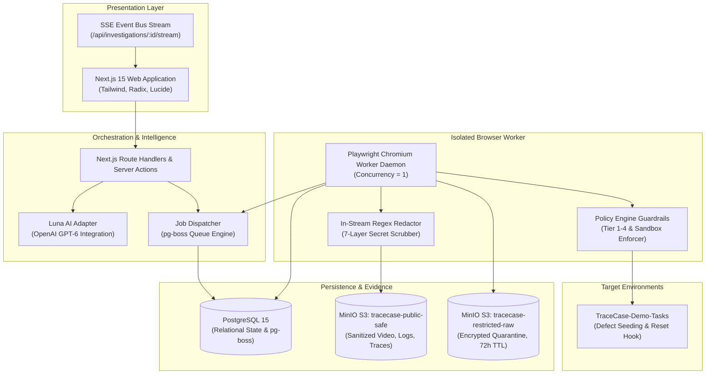

# TraceCase

> **Autonomous, Deterministic Web Application Defect Reproduction & Verifiable Evidence Pipeline**

[-blue)](#specification-register)
[](#core-invariants)
[](#system-architecture)
[](#safety--guardrails)
[](#license)

---

## Executive Summary

**TraceCase** transforms subjective, incomplete, or ambiguous bug reports into deterministic, cryptographically audited, and two-run confirmed bug reproduction packages. 

By combining **GPT-6 Luna** for natural-language intake, planning, and grounded synthesis with a **deterministic Playwright CDP execution engine**, **PostgreSQL state machine**, and **in-stream credential scrubber**, TraceCase guarantees that bugs are proven rather than guessed—delivering a synchronized **Evidence Triad** (Video `.webm`, Console `.log`, Network `.json`) without leaking production secrets or executing unsafe destructive mutations.

---

## Core System Invariants

TraceCase is governed by **14 non-negotiable architectural invariants** (`TC-INV-001` to `TC-INV-014`):

1. **`TC-INV-001` (Exclusive AI Model):** All AI operations exclusively utilize GPT-6 Luna via the OpenAI API; silent fallback to secondary models is strictly forbidden.
2. **`TC-INV-002` (Two-Run Confirmation):** `CONFIRMED_REPRODUCED` requires two independent, consecutive execution runs exhibiting the identical failure signature.
3. **`TC-INV-003` & `004` (Human Approval & Cryptographic Hash):** Tier 4 destructive actions require explicit operator authorization cryptographically bound to the SHA-256 hash of the execution plan. Any plan mutation invalidates approval.
4. **`TC-INV-005` & `006` (Baseline Restoration & Reset Hook):** Attempt 2 is strictly blocked until the target application's fixture reset hook (`POST /api/test/reset-fixture`) responds HTTP 200 and baseline restoration is verified.
5. **`TC-INV-007` (Tri-Dimensional State Decoupling):** Execution lifecycle state, reproduction verdict, and evidence readiness are strictly decoupled dimensions.
6. **`TC-INV-008` (Sandbox Protection):** Destructive actions are categorically rejected if the target application is not a verified sandbox (`is_sandbox = true`).
7. **`TC-INV-009` (In-Stream Redaction & Dual Storage):** Credentials, JWTs, and API keys are scrubbed in-stream prior to writing public exports; raw unredacted traces are quarantined in encrypted storage with a strict 72-hour TTL.
8. **`TC-INV-010` (No CAPTCHA/OTP Bypass):** Automated bot bypass is prohibited. CAPTCHAs transition the run to `PAUSED_FOR_MANUAL_AUTH` for human resolution.
9. **`TC-INV-011` (Single Concurrency Lease):** Each browser worker daemon processes exactly one reproduction investigation at a time to eliminate CPU/GPU resource contention.
10. **`TC-INV-012` (Mandatory Evidence Triad):** No completed investigation may be finalized without a valid, synchronized Evidence Triad: Video (`.webm`), Console Log (`.log`), and Network Trace (`.json`).
11. **`TC-INV-013` (Mutation Uncertainty Guard):** Any unacknowledged mutating action on network timeout is marked `MUTATION_UNCERTAIN`; automated blind retries are strictly blocked.
12. **`TC-INV-014` (Deterministic Verifier Exclusivity):** Pass/fail assertion outcomes are evaluated exclusively by programmatic code logic, never by asking LLMs to inspect screenshots.

---

## Canonical Hackathon Scenarios (TC1–TC4)

TraceCase is benchmarked against four official problem statement scenarios:

| Scenario | Objective | Ground Truth Setup | Deterministic Assertion | Final Verdict | Published Evidence State |
|---|---|---|---|---|---|
| **TC1** | Two-Run Bug Reproduction | `TraceCase-Demo-Tasks`<br/>(`FEATURE_FILTER_OFFSET_BUG=true`) | Filter Active $\rightarrow$ Click delete $\rightarrow$ Assert `task-001` deleted instead of `task-002` across two independent runs. | `CONFIRMED_REPRODUCED` | `PUBLIC_SAFE_READY`<br/>(Synced Video, Console, Network) |
| **TC2** | Non-Reproducible Defect | `TraceCase-Demo-Tasks`<br/>(`FEATURE_FILTER_OFFSET_BUG=false`) | Execute identical plan $\rightarrow$ Assert `task-002` deleted $\rightarrow$ Defect not observed across two runs; baseline preserved. | `NOT_REPRODUCED` | `PUBLIC_SAFE_READY`<br/>(Verified clean baseline) |
| **TC3** | Sandbox Guardrail Enforcement | **Variant A:** Sandbox Target<br/>**Variant B:** Production Target | **Variant A:** Tier 4 action authorized by operator $\rightarrow$ Executed.<br/>**Variant B:** Tier 4 action blocked by Policy Engine pre-execution. | **A:** Per application<br/>**B:** `INCONCLUSIVE` (Blocked) | **A:** `PUBLIC_SAFE_READY`<br/>**B:** `PENDING_GENERATION` |
| **TC4** | PII & Secret Scrubbing | `TraceCase-Demo-Tasks`<br/>(`DEBUG_AUTH_LEAK=true`) | Injected JWTs, Bearer tokens, and live API keys scrubbed in worker memory prior to writing public S3 exports. | `CONFIRMED_REPRODUCED` | `PUBLIC_SAFE_READY`<br/>(0 plaintext secrets in public bucket) |

---

## Specification Register

All 11 comprehensive specification documents are available in the [`docs/`](docs/) directory:

| Document ID | Specification Title | File Link | Focus & Coverage |
|---|---|---|---|
| **TC-PRD-001** | Product Requirements Document | [`docs/prd.md`](docs/prd.md) | Business goals, user personas, functional & non-functional requirements. |
| **TC-TRD-001** | Technical Requirements Document | [`docs/trd.md`](docs/trd.md) | Architectural stack, Playwright worker specs, budget ceilings, security. |
| **TC-RTM-001** | PS Requirements Traceability Matrix | [`docs/ps-requirements-traceability-matrix.md`](docs/ps-requirements-traceability-matrix.md) | End-to-end audit mapping problem statement requirements to verification. |
| **TC-WFM-001** | Workflow and State-Machine Specification | [`docs/workflow-and-state-machine-specification.md`](docs/workflow-and-state-machine-specification.md) | Tri-dimensional state machine, transitions, error recovery, and cancellation. |
| **TC-DBD-001** | Database Design and ERD | [`docs/database-design-and-erd.md`](docs/database-design-and-erd.md) | Relational schema, Drizzle ORM models, indexes, and storage boundaries. |
| **TC-SAD-001** | System Architecture Document | [`docs/system-architecture.md`](docs/system-architecture.md) | Component responsibilities, data flow, trust boundaries, and network topology. |
| **TC-UIX-001** | UI/UX Design & Interaction Specification | [`docs/ui-ux-specification.md`](docs/ui-ux-specification.md) | Lavender/cobalt design tokens, SSE dashboard, and Synced Triad Player. |
| **TC-AGT-001** | Agent and Tool Contracts | [`docs/agent-and-tool-contracts.md`](docs/agent-and-tool-contracts.md) | GPT-6 Luna prompt contracts, Zod schemas, 16 Playwright tool wrappers. |
| **TC-AEC-001** | API and Event Contracts | [`docs/api-and-event-contracts.md`](docs/api-and-event-contracts.md) | REST endpoints, SSE event streams, request/response Zod payloads. |
| **TC-VES-001** | Verification, Evidence, & Safety Specification | [`docs/verification-evidence-and-safety-specification.md`](docs/verification-evidence-and-safety-specification.md) | Deterministic assertions, in-stream regex redactor, and uncertainty handling. |
| **TC-TEO-001** | Test, Evaluation, Operations, & Execution Plan | [`docs/test-evaluation-operations-and-execution-plan.md`](docs/test-evaluation-operations-and-execution-plan.md) | Unified delivery plan: 11-level test architecture, runbook, 18 incident playbooks, 3-person WBS. |

---

## System Architecture



---

## Delivery Team Structure (3-Person Model)

| Role | Primary Ownership Domains | Key Deliverables |
|---|---|---|
| **Role 1: Lead / Integrator** | System architecture, PostgreSQL schema, Drizzle ORM migrations, pg-boss queue, Playwright worker daemon, Policy Engine, Docker Compose topology, release gates. | Core engine, worker isolation, deployment runbooks. |
| **Role 2: AI & Evaluation Engineer** | GPT-6 Luna client adapter, prompts (Roles 1–3), Zod schemas, AXTree DOM pruner, benchmark test harness, evaluation metrics ($P_c, FCR, R_2, ECI$), secret redactor tuning. | Structured AI pipelines, evaluation corpus, regex audit. |
| **Role 3: Product UI & Evidence Engineer** | Next.js 15 App Router frontend, visual design system (lavender surfaces, cobalt actions, navy text), SSE real-time listener, plan approval modal, Synced Evidence Triad player. | Reactive dashboard, interactive clarification cards, evidence player. |

---

## Technology Stack

- **Frontend & Web Framework:** Next.js 15 (App Router), React 19, TypeScript 5.6
- **Styling & Components:** Tailwind CSS, Radix UI Primitives, Lucide Icons
- **Database & Queue:** PostgreSQL 15, Drizzle ORM, `pg-boss`
- **Browser Automation:** Playwright Chromium 1.48+ (Headless, CDP)
- **Object Storage:** MinIO S3-compatible Object Storage (Dual-bucket architecture)
- **AI Engine:** OpenAI GPT-6 Luna API (`json_schema` Structured Outputs)
- **Containerization:** Docker Engine 24+, Docker Compose v2.20+
- **Contract Validation:** Zod 3.23+

---

## Getting Started (Local Bootstrap)

```bash
# 1. Clone repository
git clone https://github.com/sharancode3/TraceCase.git
cd TraceCase

# 2. Install dependencies
pnpm install --frozen-lockfile

# 3. Configure environment
cp .env.example .env.local
# Set OPENAI_API_KEY in .env.local

# 4. Start infrastructure containers
docker compose up -d postgres storage demo-target

# 5. Apply migrations and seed default targets
pnpm db:migrate
pnpm db:seed

# 6. Install Playwright browser dependencies
pnpm exec playwright install chromium --with-deps

# 7. Start development server and background worker
pnpm dev
```

---

## License & Governance

This project is developed under hackathon evaluation guidelines. All specifications are maintained under strict configuration control and versioning. See [`docs/test-evaluation-operations-and-execution-plan.md`](docs/test-evaluation-operations-and-execution-plan.md) for full delivery rules and acceptance gates.
