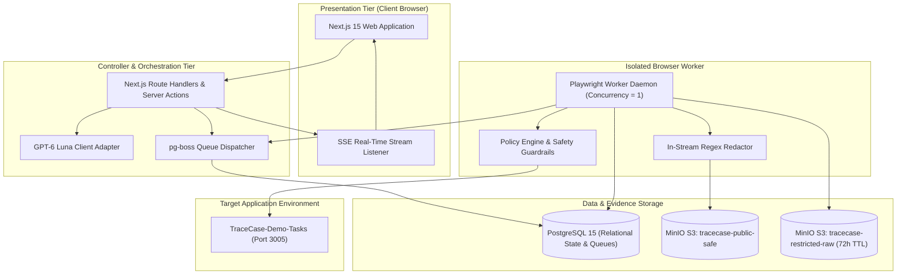
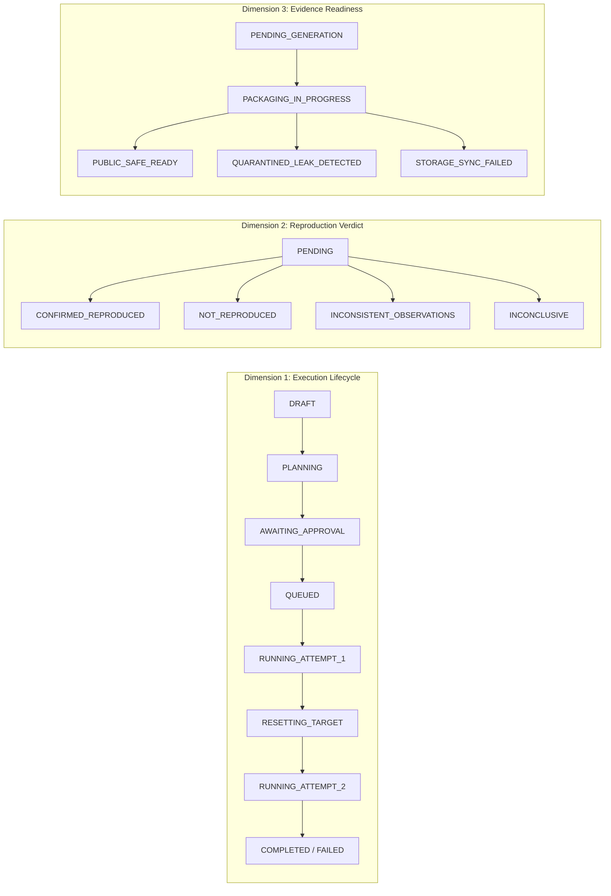
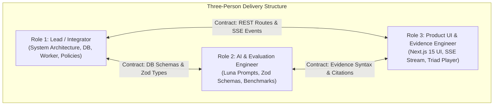

# TraceCase

**Autonomous, Deterministic Web Application Defect Reproduction and Verifiable Evidence Pipeline**

---

## Document Control and System Metadata

- **System Identifier:** TraceCase Core Engine
- **Document Version:** 1.0.0-draft
- **Specification Status:** Complete (11/11 Companion Specifications Authoritative)
- **Primary AI Model:** OpenAI GPT-6 Luna (Exclusive Structured Output Adapter)
- **Execution Engine:** Playwright Chromium Headless via Chrome DevTools Protocol (CDP)
- **Persistence Layer:** PostgreSQL 15 with Drizzle ORM and `pg-boss`
- **Object Storage:** Dual-Bucket S3 Architecture (MinIO / AWS S3)
- **Repository Path:** `https://github.com/sharancode3/TraceCase.git`
- **Governing Standard:** Hackathon Problem Statement Verification Framework

---

## Executive Overview

Software engineering teams spend thousands of hours deciphering vague, incomplete, and non-reproducible bug reports. Traditional bug tracking relies on subjective human descriptions, unverified user screenshots, and volatile application logs that frequently expose production credentials, user PII, or internal session tokens.

**TraceCase** eliminates the ambiguity of defect management by providing an autonomous, deterministic, and security-hardened bug reproduction platform. When provided with a raw, unstructured bug report, TraceCase:

1. **Normalizes and Clarifies:** Employs GPT-6 Luna (Role 1) to parse user intent, validate URL origins, and calculate an ambiguity score. If details are missing, interactive clarification requests are generated rather than guessing.
2. **Plans Deterministically:** Leverages GPT-6 Luna (Role 2) to translate reported symptoms into a multi-step browser interaction plan with strict safety tiering and deterministic DOM/Network assertions.
3. **Enforces Cryptographic Safety:** Halts before mutating or destructive operations, requiring human operator authorization bound cryptographically to the SHA-256 hash of the execution plan.
4. **Executes and Verifies Twice:** Executes the plan in a sandboxed Playwright Chromium context, triggers a verified fixture reset hook (`POST /api/test/reset-fixture`), and re-executes the plan in an isolated second run. A bug is declared `CONFIRMED_REPRODUCED` only when both runs exhibit the identical failure signature.
5. **Scrubs Secrets In-Stream:** Pipes console and network traces through a real-time regex redactor that sanitizes authorization tokens, JWTs, and API keys before public storage.
6. **Publishes the Evidence Triad:** Emits an immutable, synchronized reproduction artifact bundle comprising Video (`.webm`), Console Logs (`.log`), and Network Traces (`.json`) paired with an audited natural-language explanation (Role 3).

---

## Core System Invariants

All components, workers, data models, and agent adapters across TraceCase strictly enforce 14 architectural invariants (`TC-INV-001` through `TC-INV-014`). These rules cannot be bypassed or disabled.

| Invariant ID | Name | Architectural Rule | Operational Enforcement |
|---|---|---|---|
| **TC-INV-001** | Exclusive AI Model | All AI operations exclusively utilize GPT-6 Luna via the OpenAI API. Silent fallback to secondary or local models is strictly prohibited. | Hardcoded client adapter with API signature validation; unexpected models trigger an immediate system fault. |
| **TC-INV-002** | Two-Run Confirmation | An investigation can only transition to `CONFIRMED_REPRODUCED` if two independent, consecutive execution runs yield matching failure signatures. | Orchestrator state machine requires both Run 1 and Run 2 assertion results before calculating final verdict. |
| **TC-INV-003** | Human Approval Gate | Tier 4 (Destructive) browser interactions require explicit human authorization prior to dispatching browser commands. | Controller blocks job dispatch until an approval record exists in the database. |
| **TC-INV-004** | Cryptographic Plan Binding | Human approval is cryptographically bound to `SHA-256(plan_payload)`. Any modification to plan steps revokes prior approval. | Worker recalculates payload hash before execution; mismatch triggers `SECURITY_APPROVAL_TAMPERING_DETECTED`. |
| **TC-INV-005** | Baseline Restoration | Run 1 and Run 2 must execute against identical initial state baselines. | Target database fixture state is seeded and verified before Run 1 initiation. |
| **TC-INV-006** | Reset Hook Gate | Run 2 execution is strictly blocked until the target application's reset hook (`POST /api/test/reset-fixture`) returns HTTP 200. | Worker halts execution and emits `INCONCLUSIVE_FIXTURE_RESET_FAILED` if reset fails or times out. |
| **TC-INV-007** | Tri-Dimensional State Decoupling | The system decouples Execution Lifecycle State, Reproduction Verdict, and Evidence Readiness into independent database dimensions. | Relational schema prevents conflation (e.g., a completed run does not imply a confirmed reproduction). |
| **TC-INV-008** | Sandbox Guardrail | Destructive operations (deletion, storage purge) are categorically prohibited on targets where `is_sandbox = false`. | Policy Engine intercepts actions pre-execution; violations trigger immediate halt and security audit logging. |
| **TC-INV-009** | In-Stream Redaction & Dual Storage | Plaintext credentials, tokens, and PII must never touch public storage. Quarantined raw traces are encrypted with an automated 72-hour TTL. | Real-time memory regex stream scrubber pipes to `tracecase-public-safe`; raw streams AES-256 encrypted in `tracecase-restricted-raw`. |
| **TC-INV-010** | No CAPTCHA/OTP Bypass | Automated bypass of CAPTCHA challenges or multi-factor authentication is strictly forbidden. | Worker detects challenge iframes/prompts, transitions to `PAUSED_FOR_MANUAL_AUTH`, and awaits human operator completion. |
| **TC-INV-011** | Single Concurrency Lease | Each worker daemon processes exactly one active browser investigation at a time (`WORKER_CONCURRENCY = 1`). | Row-level target locking in PostgreSQL prevents concurrent runs from polluting target state or degrading video encoding. |
| **TC-INV-012** | Mandatory Evidence Triad | No investigation can be marked `PUBLIC_SAFE_READY` without a complete, synchronized triad: Video (`.webm`), Console (`.log`), and Network (`.json`). | Evidence Packager asserts file existence and non-zero byte count prior to publishing metadata. |
| **TC-INV-013** | Mutation Uncertainty Guard | Any unacknowledged mutating action resulting in a network timeout is marked `MUTATION_UNCERTAIN`. Automated blind retries are prohibited. | Controller halts plan execution; prompts operator for explicit recovery instruction (abort/reset or proceed). |
| **TC-INV-014** | Deterministic Verifier Exclusivity | Pass/fail assertions are evaluated exclusively by programmatic verification code, never by asking LLMs to inspect screenshots. | Deterministic verifier checks DOM locators, HTTP status codes, and JSON payloads to guarantee a 0.0% False Confirmation Rate. |

---

## Canonical Hackathon Scenarios

TraceCase provides reference implementations and automated test specifications for the four canonical problem statement scenarios:

### Scenario TC1: Deterministic Defect Confirmation
- **Identifier:** `TEP-CASE-TC1`
- **Objective:** Successfully reproduce an active defect across two consecutive runs and generate a sanitized Evidence Triad.
- **Target Application:** `TraceCase-Demo-Tasks` (`FEATURE_FILTER_OFFSET_BUG = true`).
- **Failure Description:** Filtering tasks by "Active" and deleting the first item mistakenly deletes a completed task due to array index offset binding.
- **Execution Flow:**
  1. Intake normalizes report; Planner generates 4-step plan with Step 4 flagged as Tier 4 Destructive.
  2. Operator reviews plan hash and approves execution in UI.
  3. Run 1 executes in Playwright Chromium; network trace records `DELETE /api/tasks/task-001` instead of `task-002`. Assertion passes (bug verified).
  4. Worker calls `POST /api/test/reset-fixture`; receives HTTP 200 OK.
  5. Run 2 executes in fresh browser context; identical defect signature observed.
  6. Final Verdict: `CONFIRMED_REPRODUCED`. Evidence state: `PUBLIC_SAFE_READY`.

### Scenario TC2: Non-Reproducible Defect (Clean Baseline Preservation)
- **Identifier:** `TEP-CASE-TC2`
- **Objective:** Execute full investigation against a non-buggy application, proving the defect does not manifest while preserving target baseline.
- **Target Application:** `TraceCase-Demo-Tasks` (`FEATURE_FILTER_OFFSET_BUG = false`).
- **Execution Flow:**
  1. Worker executes identical plan in Run 1; observes correct deletion of `task-002`. Assertion for bug signature fails.
  2. Worker invokes fixture reset hook; verifies 4 baseline items restored.
  3. Run 2 re-executes in fresh context; confirms clean behavior.
  4. Final Verdict: `NOT_REPRODUCED`. Evidence state: `PUBLIC_SAFE_READY` (Demonstrating clean behavior).

### Scenario TC3: Destructive Action Guardrail Enforcement
- **Identifier:** `TEP-CASE-TC3`
- **Objective:** Validate that destructive actions are permitted on sandboxes (with human approval) but unconditionally rejected on production hosts.
- **Variant TC3-A (Sandbox Target):** Target has `is_sandbox = true`. Tier 4 deletion step requires operator approval. Once approved, action executes, and fixture resets.
- **Variant TC3-B (Non-Sandbox Target):** Target has `is_sandbox = false`. Planner proposes Tier 4 action. Policy Engine intercepts action prior to browser dispatch. Action is blocked immediately with `TARGET_NOT_SANDBOX_DESTRUCTIVE_FORBIDDEN`. Investigation transitions to `INCONCLUSIVE`. Zero browser commands issued.

### Scenario TC4: In-Stream PII and Credential Scrubbing
- **Identifier:** `TEP-CASE-TC4`
- **Objective:** Prevent high-entropy secrets and authentication tokens from appearing in public evidence artifacts.
- **Target Application:** `TraceCase-Demo-Tasks` (`DEBUG_AUTH_LEAK = true`).
- **Injected Payloads:** Console errors and network headers containing live JWTs (`eyJhbGciOi...`), OpenAI API keys (`sk-live-...`), and Bearer tokens.
- **Execution Flow:**
  1. Worker captures CDP network and console streams in ephemeral memory.
  2. In-stream regex engine executes 7-layer pattern matching and substitutes tokens with `[REDACTED_JWT_TOKEN]`, `[REDACTED_API_KEY]`, and `[REDACTED_BEARER_TOKEN]`.
  3. Sanitized streams are published to `tracecase-public-safe`.
  4. Raw streams are encrypted with AES-256-GCM and stored in `tracecase-restricted-raw` with an enforced 72-hour lifecycle expiration policy.
  5. Verifier scans public files: asserts 0 plaintext matches against secret regex catalog.

---

## Specification Register

TraceCase is fully specified across 11 architectural documents stored in the [`docs/`](docs/) directory:

| Document ID | Title | File Link | Lines | Scope and Responsibilities |
|---|---|---|---|---|
| **TC-PRD-001** | Product Requirements Document | [`docs/prd.md`](docs/prd.md) | 1,104 | Market context, user personas, functional requirements, and product boundaries. |
| **TC-TRD-001** | Technical Requirements Document | [`docs/trd.md`](docs/trd.md) | 1,337 | Engineering baseline, tech stack, Playwright constraints, and financial thresholds. |
| **TC-RTM-001** | PS Requirements Traceability Matrix | [`docs/ps-requirements-traceability-matrix.md`](docs/ps-requirements-traceability-matrix.md) | 463 | Complete mapping from hackathon problem statement to code, tests, and evidence. |
| **TC-WFM-001** | Workflow & State-Machine Specification | [`docs/workflow-and-state-machine-specification.md`](docs/workflow-and-state-machine-specification.md) | 900 | Tri-dimensional state machine transitions, retry loops, timeouts, and cancellation. |
| **TC-DBD-001** | Database Design and ERD | [`docs/database-design-and-erd.md`](docs/database-design-and-erd.md) | 1,867 | PostgreSQL relational schema, Drizzle ORM models, indexes, and storage boundaries. |
| **TC-SAD-001** | System Architecture Document | [`docs/system-architecture.md`](docs/system-architecture.md) | 1,306 | Subsystem boundaries, container topology, data flow, and trust zones. |
| **TC-UIX-001** | UI/UX Design & Interaction Specification | [`docs/ui-ux-specification.md`](docs/ui-ux-specification.md) | 1,373 | Design system tokens, SSE dashboard, Clarification Cards, and Triad Player. |
| **TC-AGT-001** | Agent and Tool Contracts | [`docs/agent-and-tool-contracts.md`](docs/agent-and-tool-contracts.md) | 1,645 | GPT-6 Luna prompt contracts, Zod schemas, and 16 Playwright tool wrappers. |
| **TC-AEC-001** | API and Event Contracts | [`docs/api-and-event-contracts.md`](docs/api-and-event-contracts.md) | 1,284 | REST API endpoints, SSE event streams, request/response validation schemas. |
| **TC-VES-001** | Verification, Evidence, & Safety Specification | [`docs/verification-evidence-and-safety-specification.md`](docs/verification-evidence-and-safety-specification.md) | 1,000 | Deterministic assertions, in-stream regex redactor, and uncertainty recovery. |
| **TC-TEO-001** | Test, Evaluation, Operations, & Execution Plan | [`docs/test-evaluation-operations-and-execution-plan.md`](docs/test-evaluation-operations-and-execution-plan.md) | 2,145 | 11-level test hierarchy, operations runbook, 18 incident playbooks, 3-person WBS. |

---

## System Architecture

The following diagram illustrates the deployment topology, network segregation, and data pipeline of TraceCase:



---

## Tri-Dimensional State Model

TraceCase models the lifecycle of every bug investigation across three orthogonal dimensions, preventing invalid state assumptions:



---

## Security, Privacy, and Secret Quarantine

TraceCase implements defense-in-depth security to protect client environments and operational data:

### 1. In-Stream Regex Redactor
All CDP network payloads, headers, and console events are scrubbed in ephemeral memory before being written to disk or transmitted over SSE. The redactor applies pattern matching across:
- **JSON Web Tokens (JWT):** `eyJ[A-Za-z0-9-_=]+\.[A-Za-z0-9-_=]+\.?[A-Za-z0-9-_.+/=]*`
- **OpenAI & Cloud API Keys:** `sk-[A-Za-z0-9]{20,}`, `AKIA[0-9A-Z]{16}`
- **Bearer Tokens:** `Bearer\s+[A-Za-z0-9-_.~+/=]{16,}`
- **Generic Key-Value Secrets:** `(?i)(password|secret|apikey|token)[=:]\s*["']?([^"'\s]{4,})["']?`
- **Private Key PEM Blocks:** `-----BEGIN [A-Z ]*PRIVATE KEY-----[\s\S]*?-----END [A-Z ]*PRIVATE KEY-----`

### 2. Dual-Bucket Storage Segregation
- **`tracecase-public-safe`:** Contains verified, sanitized video files, console logs, and HAR files accessible to standard operators.
- **`tracecase-restricted-raw`:** Contains unredacted raw memory snapshots and full-fidelity network packets. Encrypted with AES-256-GCM. Bound to a strict S3 lifecycle policy that permanently purges objects after 72 hours.

### 3. Policy Engine & Tier Boundaries
Every planned interaction is categorized into one of four safety tiers:
- **Tier 1 (Read-Only):** Navigation, DOM inspection, screenshot capture. Permitted automatically within authorized target origins.
- **Tier 2 (Safe Interaction):** Scrolling, element hovering, focus. Permitted on active pages.
- **Tier 3 (Mutating Interaction):** Form inputs, option selects, non-destructive clicks. Enforces domain whitelisting.
- **Tier 4 (Destructive Interaction):** Deletions, data purges, storage clearance. **Requires `is_sandbox = true` AND explicit operator authorization with plan hash validation.**

---

## Delivery Team Organization & Work Breakdown

TraceCase assigns system responsibilities across a three-person specialized delivery model:



### RACI Matrix Across Work Packages

| Work Package ID | Work Package Title | Lead / Integrator | AI Engineer | UI Engineer |
|---|---|---|---|---|
| **EOP-WP-01** | Core Infrastructure & Persistence (DB, Docker, S3) | **Accountable / Responsible** | Consulted | Informed |
| **EOP-WP-02** | Security, Policy Engine & In-Stream Redaction | **Accountable / Responsible** | Consulted | Informed |
| **EOP-WP-03** | Browser Worker & Execution Harness (Playwright) | **Accountable / Responsible** | Consulted | Informed |
| **EOP-WP-04** | AI Adapter & Prompt Pipelines (Luna Roles 1–3) | Consulted | **Accountable / Responsible** | Informed |
| **EOP-WP-05** | State Machine & Orchestrator Controller | **Accountable / Responsible** | Consulted | Informed |
| **EOP-WP-06** | Evaluation Harness & Benchmark Suite (TC1–TC4) | Consulted | **Accountable / Responsible** | Informed |
| **EOP-WP-07** | Product UI, SSE Dashboard & Evidence Player | Consulted | Informed | **Accountable / Responsible** |
| **EOP-WP-08** | Production Deployment & Final Demonstration | **Accountable** | Responsible | Responsible |

---

## Operational Acceptance Gates

Advancement through delivery milestones requires verified sign-off across eight sequential quality gates:

| Gate ID | Milestone Name | Mandatory Verification Criteria | Owner |
|---|---|---|---|
| **TEP-GATE-0** | Architecture Sign-off | All 11 specifications merged; 14 invariants approved; zero blocking issues. | Technical Delivery Lead |
| **TEP-GATE-1** | Contract & Unit Integrity | 100% strict TypeScript compilation (`tsc --noEmit`); all Zod schemas validated. | Lead / Integrator |
| **TEP-GATE-2** | Policy & Sandbox Isolation | 100% of non-sandbox destructive actions blocked; unapproved Tier 4 actions halted. | Lead / Integrator |
| **TEP-GATE-3** | Worker & Reset Verification | Playwright worker executes runs cleanly; `POST /api/test/reset-fixture` restores baseline. | Lead / Integrator |
| **TEP-GATE-4** | AI Schema Compliance | Luna Roles 1, 2, and 3 achieve 100% schema compliance across benchmark corpus. | AI Engineer |
| **TEP-GATE-5** | Official Benchmark Pass | Official scenarios TC1, TC2, TC3, and TC4 pass with correct verdicts and Evidence Triads. | Delivery Team Triad |
| **TEP-GATE-6** | Security & Scrubbing Audit | 100% secret redaction recall; zero raw tokens in public storage; raw bucket encrypted. | AI Engineer & Lead |
| **TEP-GATE-7** | Operational Demonstration | UI streams execution end-to-end; demo spins up via `docker compose up`. | Product UI & Lead |

---

## Quantitative Evaluation Metrics

System quality is measured using seven formal evaluation metrics defined in [`docs/test-evaluation-operations-and-execution-plan.md`](docs/test-evaluation-operations-and-execution-plan.md):

1. **Reproduction Accuracy (`TEP-MET-01`):** $P_c = \frac{\text{Correct Confirmations}}{\text{Total Seeded Defects}} \ge 90\%$
2. **False Confirmation Rate (`TEP-MET-02`):** $FCR = \frac{\text{False Confirmations}}{\text{Total Fixed Runs}} = 0.0\%$ (Strict zero-tolerance)
3. **Two-Run Consistency (`TEP-MET-03`):** $R_2 = \frac{\text{Runs with Matching Signatures}}{\text{Total Completed Investigations}} \ge 85\%$
4. **Evidence Completeness (`TEP-MET-04`):** $ECI = \frac{1}{N}\sum (0.4V + 0.3C + 0.3N) = 1.00$ (100% complete triads)
5. **Redaction Recall (`TEP-MET-05`):** $R_{red} = \frac{\text{Redacted Sensitive Tokens}}{\text{Total Transmitted Sensitive Tokens}} = 100.0\%$
6. **Average Investigation Cost (`TEP-MET-06`):** $C_{inv} \le \$1.50$ per completed reproduction
7. **Mean Time to Reproduction (`TEP-MET-07`):** $MTTR_{inv} \le 180\text{ seconds}$ wall-clock duration

---

## Technology Stack & Environment Baseline

| Layer | Component | Version / Specification | Rationale |
|---|---|---|---|
| **Web Application** | Next.js | 15.0+ (App Router) | High-performance React 19 server components, unified API route handlers, and streaming. |
| **Language** | TypeScript | 5.6+ (Strict Mode) | End-to-end type safety across backend controllers, worker processes, and frontend components. |
| **Database** | PostgreSQL | 15-alpine | Relational consistency, row-level locking, and underlying engine for `pg-boss` queues. |
| **ORM** | Drizzle ORM | 0.35+ | Type-safe SQL dialect, lightweight overhead, and robust migration tracking. |
| **Queue Dispatcher** | pg-boss | 9.0+ | Reliable job queue leveraging PostgreSQL transactions without requiring Redis infrastructure. |
| **Browser Worker** | Playwright Chromium | 1.48+ | Robust headless automation, low-level CDP session attachments, and native video recording. |
| **Object Storage** | MinIO / AWS S3 | S3-Compatible API | Secure multi-bucket object persistence with programmatic lifecycle management. |
| **AI Intelligence** | OpenAI GPT-6 Luna | `gpt-6-luna` | Advanced reasoning, instruction following, and native structured JSON schema enforcement. |
| **Styling & Icons** | Tailwind CSS / Radix | 3.4+ / Radix Primitives | Accessible UI primitives styled with lavender and cobalt design tokens. |
| **Validation** | Zod | 3.23+ | Strict runtime input/output boundary parsing for API requests and LLM completions. |

---

## Local Development & Bootstrap Runbook

Execute the following commands to initialize the local development environment:

```bash
# 1. Clone repository
git clone https://github.com/sharancode3/TraceCase.git
cd TraceCase

# 2. Verify runtime prerequisites
node -v   # Requires >= v20.10.0 LTS
pnpm -v   # Requires >= 9.0.0
docker -v # Requires >= 24.0.0

# 3. Install dependencies
pnpm install --frozen-lockfile

# 4. Initialize local environment variables
cp .env.example .env.local
# Open .env.local and configure OPENAI_API_KEY and TARGET_RESET_SECRET

# 5. Launch background infrastructure containers
docker compose up -d postgres storage demo-target

# 6. Verify database connectivity
docker compose exec postgres pg_isready -U tc_user -d tracecase

# 7. Apply Drizzle database migrations and seed target catalog
pnpm db:migrate
pnpm db:seed

# 8. Install Playwright browser binaries
pnpm exec playwright install chromium --with-deps

# 9. Launch Next.js web application and background worker daemon
pnpm dev
```

### Bootstrap Verification Endpoints
- Web Application Console: `http://localhost:3000`
- Worker Health Probe: `http://localhost:3001/health`
- Storage Management Console: `http://localhost:9001`
- Reference Target Application: `http://localhost:3005`
- Target Reset Hook Test: `curl -X POST http://localhost:3005/api/test/reset-fixture -H "X-TraceCase-Reset-Auth: tc-fixture-secret-2026"`

---

## Operational Incident Response

TraceCase defines 18 formal operational playbooks (`OPS-INC-001` through `OPS-INC-018`) in [`docs/test-evaluation-operations-and-execution-plan.md`](docs/test-evaluation-operations-and-execution-plan.md) covering critical system events:

- **`OPS-INC-001`:** Worker Deadlock & Heartbeat Expiration
- **`OPS-INC-002`:** Target Application Unreachable (ECONNREFUSED / 502)
- **`OPS-INC-003`:** Target Reset Fixture Failure (HTTP 500 / Timeout)
- **`OPS-INC-004`:** OpenAI API Outage & Rate Limit Storms (HTTP 429)
- **`OPS-INC-005`:** In-Stream Redaction Failure / Potential Secret Leak
- **`OPS-INC-006`:** S3 / MinIO Storage Exhaustion or Network Failure
- **`OPS-INC-007`:** Chromium Zombie Process Leakage & OOM Kills
- **`OPS-INC-008`:** Plan Approval Hash Tampering Detected
- **`OPS-INC-009`:** Mutation Uncertainty on Mutating Action (Timeout)
- **`OPS-INC-010`:** Execution Loop & Circuit Breaker Trip
- **`OPS-INC-011`:** Bot Detection / CAPTCHA / 2FA Gate Detected
- **`OPS-INC-012`:** Target Sandbox Flag Misconfiguration
- **`OPS-INC-013`:** Video Transcoding or Stream Corruption Failure
- **`OPS-INC-014`:** Server-Sent Events (SSE) Stream Disconnection
- **`OPS-INC-015`:** PostgreSQL Connection Pool Starvation
- **`OPS-INC-016`:** Financial Budget Hard Stop Ceiling (\$20.00 Reached)
- **`OPS-INC-017`:** Malformed Luna Response (Exceeded Max Retries)
- **`OPS-INC-018`:** Concurrent Worker Target Lock Collision

---

## Governance and Sign-Off Status

This repository contains the complete specification and operational architecture for TraceCase. All documents are maintained under strict version control.

- **Current Repository Phase:** Stage 0 (Specification Freeze & Environment Readiness)
- **Document Status:** Draft for Review (Pending delivery team unanimous approval)
- **Next Milestone:** Stage 1 (Core Infrastructure & Persistence Implementation)

For detailed delivery timelines, work packages, and sign-off forms, consult the [Test, Evaluation, Operations, and Execution Plan](docs/test-evaluation-operations-and-execution-plan.md).
