# TraceCase — API & Event Contracts Specification

**Document ID:** TC-AEC-001  
**Document Purpose:** Implementation-Ready Specification for RESTful Endpoints, Server-Sent Events (SSE), Transactional Outbox, and Worker Queues  
**Version:** 1.0.0-draft  
**Date:** 20 October 2026  
**Status:** Draft for Review (Requires technical lead and security sign-off before implementation)  
**Authoring Role:** API Architect & Distributed Systems Designer (Antigravity Agent)  
**Intended Readers:** Frontend Engineers, Backend Developers, Worker Developers, Security Auditors, Hackathon Evaluators.

---

## Table of Contents

- [1. Document Control, Authority, and Implementation Status](#1-document-control-authority-and-implementation-status)
- [2. Source Authority, Invariants, and Baseline Boundaries](#2-source-authority-invariants-and-baseline-boundaries)
- [3. Contract Categorization & Resource Model](#3-contract-categorization--resource-model)
- [4. General Wire Conventions & Request Lifecycle](#4-general-wire-conventions--request-lifecycle)
- [5. Authentication, Authorization, and Security Boundaries](#5-authentication-authorization-and-security-boundaries)
- [6. Operation Catalogue: User-Facing Commands & Queries](#6-operation-catalogue-user-facing-commands--queries)
- [7. Two-Phase Upload Flow for Report Attachments](#7-two-phase-upload-flow-for-report-attachments)
- [8. Real-Time Progress Transport & Server-Sent Events (SSE)](#8-real-time-progress-transport--server-sent-events-sse)
- [9. Domain & Control Event Taxonomy](#9-domain--control-event-taxonomy)
- [10. Transactional Outbox, Queue Admission & Worker Coordination](#10-transactional-outbox-queue-admission--worker-coordination)
- [11. Optimistic Concurrency, Idempotency, and Stale Requests](#11-optimistic-concurrency-idempotency-and-stale-requests)
- [12. Standard Error Handling Envelope & Error Codes](#12-standard-error-handling-envelope--error-codes)
- [13. Privacy, Redaction, and Data Ingress Boundary](#13-privacy-redaction-and-data-ingress-boundary)
- [14. Worked Illustrative Wire Examples (16 Scenarios)](#14-worked-illustrative-wire-examples-16-scenarios)
- [15. Official Case API Walkthroughs (TC1–TC4)](#15-official-case-api-walkthroughs-tc1tc4)
- [16. Architectural Diagrams](#16-architectural-diagrams)
- [17. Traceability Matrix & Identifier Registry](#17-traceability-matrix--identifier-registry)
- [18. Open Decisions and Implementation Handoff](#18-open-decisions-and-implementation-handoff)
- [19. Validation Checklist & Sign-Off](#19-validation-checklist--sign-off)

---

## 1. Document Control, Authority, and Implementation Status

### 1.1 Document Overview
This document specifies the authoritative, implementable API and event contracts for **TraceCase**. It governs how the Next.js 15 web client, the orchestration backend, the persistent Playwright browser worker daemon, the MinIO object store, and external consumers communicate.

The core communication topology of TraceCase separates distinct semantic data flows:
$$\text{Commands} \longrightarrow \text{Queries} \longrightarrow \text{Async Jobs} \longrightarrow \text{Internal Control Events} \longrightarrow \text{User Progress (SSE)} \longrightarrow \text{Diagnostic Observations} \longrightarrow \text{Verification Results} \longrightarrow \text{Safe Evidence Access}$$

The API enforces the **Zero Client Authority Principle**:
- Clients **command** and **query**; they never set authoritative state directly.
- The model **proposes**; the backend **authorizes**; Playwright **executes**; deterministic code **verifies**; and the evidence pipeline **redacts**.
- Model- or client-supplied fields such as `"approved": true`, `"reproduced": true`, or `"is_sandbox": true` are rejected or stripped by the API boundary.

### 1.2 Inspected Sources vs. Unavailable Sources
- **Inspected Workspace Specifications:**
  - [`docs/prd.md`](file:///c:/SHARAN%20PROJECTS/TraceCase/docs/prd.md) (`TC-PRD-001`, v1.0.0-draft): Product requirements, user journeys, official acceptance criteria.
  - [`docs/trd.md`](file:///c:/SHARAN%20PROJECTS/TraceCase/docs/trd.md) (`TC-TRD-001`, v1.0.0-draft): Technical architecture, ADRs (`TC-ADR-001`–`TC-ADR-010`), and system topology.
  - [`docs/ps-requirements-traceability-matrix.md`](file:///c:/SHARAN%20PROJECTS/TraceCase/docs/ps-requirements-traceability-matrix.md) (`TC-RTM-001`, v1.0.0-draft): 19 atomic official requirements (`PS-REQ-001`–`PS-REQ-019`) and TC1–TC4 test mappings.
  - [`docs/workflow-and-state-machine-specification.md`](file:///c:/SHARAN%20PROJECTS/TraceCase/docs/workflow-and-state-machine-specification.md) (`TC-WFM-001`, v1.0.0-draft): 5-dimensional decoupled state machine, master transition table (`WF-TR-001`–`WF-TR-021`).
  - [`docs/database-design-and-erd.md`](file:///c:/SHARAN%20PROJECTS/TraceCase/docs/database-design-and-erd.md) (`TC-DBD-001`, v1.0.0-draft): 21 PostgreSQL relational tables, JSONB schemas, transaction matrix (`DB-TXN-001`–`DB-TXN-014`).
  - [`docs/system-architecture.md`](file:///c:/SHARAN%20PROJECTS/TraceCase/docs/system-architecture.md) (`TC-SAD-001`, v1.0.0-draft): C4 views, runtime isolation boundaries, and execution topology.
  - [`docs/ui-ux-specification.md`](file:///c:/SHARAN%20PROJECTS/TraceCase/docs/ui-ux-specification.md) (`TC-UIX-001`, v1.0.0-draft): Design system alignment (white/pale-lavender, cobalt-blue actions, circular icon buttons).
  - [`docs/agent-and-tool-contracts.md`](file:///c:/SHARAN%20PROJECTS/TraceCase/docs/agent-and-tool-contracts.md) (`TC-AGT-001`, v1.0.0-draft): Prompt engineering, 16-step tool dispatch pipeline, AXTree pruning, error codes, and budget caps.
- **Unavailable / Unverified External Sources:**
  - Live production Supabase Auth endpoints (standard JWT bearer / HTTP-only cookie specifications used).
  - Production S3 bucket endpoints (local MinIO S3 API contract assumed).
  - Final third-party target application source code (contracts bind to standard HTTP REST and web frontends).

### 1.3 Existing vs. Proposed Contracts Register
| Contract Component | Identifier Range | Status | Authority / Implementation Notes |
|---|---|---|---|
| **API Operations** | `API-OP-001` – `024` | Proposed Baseline | Next.js 15 App Router Route Handlers (`/api/v1/...`). |
| **API Request Schemas** | `API-SCH-REQ-001` – `024` | Proposed Baseline | Validated strictly using Zod v3. |
| **API Response Schemas** | `API-SCH-RES-001` – `024` | Proposed Baseline | Enforced via TypeScript types & JSON serializers. |
| **Domain Events** | `EVT-001` – `020` | Proposed Baseline | Persisted to PostgreSQL `outbox_events` table. |
| **SSE Stream** | `API-OP-017` (`/stream`) | Proposed Baseline | Server-Sent Events with cursor replay (`Last-Event-ID`). |
| **Error Envelope** | `API-ERR-001` – `020` | Proposed Baseline | RFC 7807 Problem Details compliant structure. |
| **Worker Queue Contracts** | `WRK-JOB-001` – `003` | Proposed Baseline | Managed via pg-boss on PostgreSQL. |

### 1.4 Material Conflicts & Resolutions
1. **Approval vs Execution Concurrency Conflict:** Does approving a plan immediately launch browser execution?  
   *TraceCase Resolution:* **Separate Approval from Admission.** The user executes `POST /api/v1/plans/:id/approve` to cryptographically bind the plan. Execution can either be triggered via combined `POST /api/v1/plans/:id/approve-and-run` or by subsequent `POST /api/v1/investigations`. In either flow, the backend revalidates `plan_hash` and checks the single worker concurrency lease before admitting the job.
2. **Event Delivery Guarantees:** Can the frontend assume exactly-once event delivery?  
   *TraceCase Resolution:* **At-Least-Once Delivery with Client Deduplication.** Network reconnects and SSE re-subscriptions can replay events. All event payloads include a monotonic integer sequence `event_seq` and a UUID `event_id`. The UI client deduplicates on `event_id`.
3. **Execution Success vs Reproduction Confirmation:**  
   *TraceCase Resolution:* **Explicit Tri-Dimensional State Decoupling (`TC-INV-007`).** An HTTP 200 response indicating that browser steps completed does NOT mean the bug was reproduced. Reproduction confirmation is an independent deterministic verifier state.

---

## 2. Source Authority, Invariants, and Baseline Boundaries

### 2.1 TraceCase Baseline Invariants
The API and event pipeline strictly enforce 14 architectural invariants:

| Invariant ID | API Invariant ID | Name | API Contract Enforcement Rule |
|---|---|---|---|
| **TC-INV-001** | **API-INV-001** | Exclusive AI Model | All AI inference requests route exclusively to `gpt-6-luna` via OpenAI API. Zero silent fallback. |
| **TC-INV-002** | **API-INV-002** | Two-Run Confirmation | `reproduction_verdict = 'CONFIRMED_REPRODUCED'` strictly requires two independent runs matching the failure signature. |
| **TC-INV-003** | **API-INV-003** | Explicit Human Approval | `POST /api/v1/investigations` rejected with `403 Forbidden` if `plan_approvals` record is missing or revoked. |
| **TC-INV-004** | **API-INV-004** | Cryptographic Plan Binding | Any plan modification generates a new revision and revokes approval. Approval binds to canonical SHA-256 `plan_hash`. |
| **TC-INV-005** | **API-INV-005** | Pre-Flight Baseline Validation | Attempt 1 execution blocked until pre-flight health checks confirm target baseline availability. |
| **TC-INV-006** | **API-INV-006** | Target Fixture Reset | Attempt 2 execution blocked until `POST /api/test/reset-fixture` returns HTTP 200 OK. |
| **TC-INV-007** | **API-INV-007** | Decoupled 3D State Machine | API responses return 3 independent statuses: `status` (Lifecycle), `reproduction_verdict` (Outcome), and `evidence_state` (Readiness). |
| **TC-INV-008** | **API-INV-008** | Sandbox Guardrail | Plans with `is_destructive: true` rejected during admission unless `targets.is_sandbox = TRUE`. |
| **TC-INV-009** | **API-INV-009** | In-Stream Redaction | PII, tokens, and cookies scrubbed in-memory. Raw artifacts quarantined as `RESTRICTED_RAW`. |
| **TC-INV-010** | **API-INV-010** | No CAPTCHA / OTP Bypass | Automated bypass forbidden. Investigation pauses in `PAUSED_FOR_MANUAL_AUTH` with UI handoff event. |
| **TC-INV-011** | **API-INV-011** | Single Concurrency Lease | Maximum one active browser investigation per worker lease. Concurrent runs queued or rejected with `429`. |
| **TC-INV-012** | **API-INV-012** | Mandatory Evidence Triad | Reproduction validity requires Video (`.webm`), Console Log (`.log`), and Network Log (`.json`). |
| **TC-INV-013** | **API-INV-013** | Mutation Uncertainty Guard | Timeouts on mutating actions transition to `MUTATION_UNCERTAIN`. Zero blind re-executions. |
| **TC-INV-014** | **API-INV-014** | Deterministic Verifier Exclusivity | Assertion outcomes evaluated strictly by deterministic TypeScript code, never by asking LLM opinion. |

### 2.2 Core API Operational Policies
The API layer enforces five fundamental operational policies:
- **`API-POL-001` (Idempotency Enforcement):** Every state-mutating command (`POST`, `PATCH`, `DELETE`) requires `X-Idempotency-Key`. Replays return cached responses without re-executing side effects.
- **`API-POL-002` (Zero Client Authority):** Server-controlled fields (`is_approved`, `reproduction_verdict`, `evidence_state`, `is_sandbox`) cannot be assigned by client requests.
- **`API-POL-003` (Sandbox Guardrail):** Mutating browser actions (`is_destructive: true`) are rejected unless the target is explicitly registered as a disposable sandbox (`is_sandbox = true`).
- **`API-POL-004` (In-Stream Redaction & Quarantine):** Direct download of raw artifacts (`RESTRICTED_RAW`) is strictly forbidden; callers may only request signed URLs for `PUBLIC_SAFE` derivatives.
- **`API-POL-005` (Single Concurrency Lease):** Only one active browser investigation is permitted per worker instance at any time.

### 2.3 Official Hackathon Test Cases (TC1–TC4)
| Case ID | Scenario | API & Event Contract Requirement |
|---|---|---|
| **TC1** | Bug Reproduced Twice | Both Attempt 1 and 2 report `matching_failure_observed = true`. API returns `reproduction_verdict = 'CONFIRMED_REPRODUCED'` with all 3 evidence artifacts linked for each attempt. |
| **TC2** | Cannot Reproduce | Both attempts execute successfully without triggering failure signatures. API returns `reproduction_verdict = 'NOT_REPRODUCED'` with attempted steps and environment baseline. |
| **TC3** | Deletion Involved | Plan step contains `is_destructive: true`. API admits execution only if `target.is_sandbox = true`. Attempt 2 blocked until target fixture reset succeeds. |
| **TC4** | Auth Token in Logs | Target logs emit Bearer token. API redaction scrubber replaces token with `[REDACTED_BEARER_TOKEN]`. Public artifact endpoints serve scrubbed derivatives only. |

---

## 3. Contract Categorization & Resource Model

### 3.1 Ten Operational Categories
The TraceCase API categorizes all data exchanges into ten distinct functional tiers:

1. **User-Facing Commands:** Mutations initiated by the user (e.g., submit report, answer clarification, approve plan, cancel run).
2. **User-Facing Queries:** Read-only queries retrieving snapshots, lists, diffs, and verification records.
3. **Attachment & Upload Operations:** Secure, signed two-phase byte transfer operations for screenshots and logs.
4. **Real-Time Progress Subscriptions (SSE):** Streaming channel for live lifecycle transitions, step executions, and blockers.
5. **Results, Evidence & Export Access:** Authorized access to sanitized artifact metadata, video players, and ZIP packages.
6. **Internal Worker Coordination:** Background job dispatch and heartbeat leases between controller and Playwright daemon.
7. **Durable Domain & Control Events:** Immutable transactional outbox records persisted in PostgreSQL (`outbox_events`).
8. **User-Visible Progress Projections:** Sanitized event projections emitted over the SSE stream to drive UI cards.
9. **Diagnostic Observations:** Bounded, scrubbed accessibility tree (AXTree) nodes, console lines, and HTTP status codes.
10. **Optional Future Operations:** Multi-target batch queues, webhook callbacks, and regression test exporters (v1.1.0).

### 3.2 Resource Model & Entity Relationships

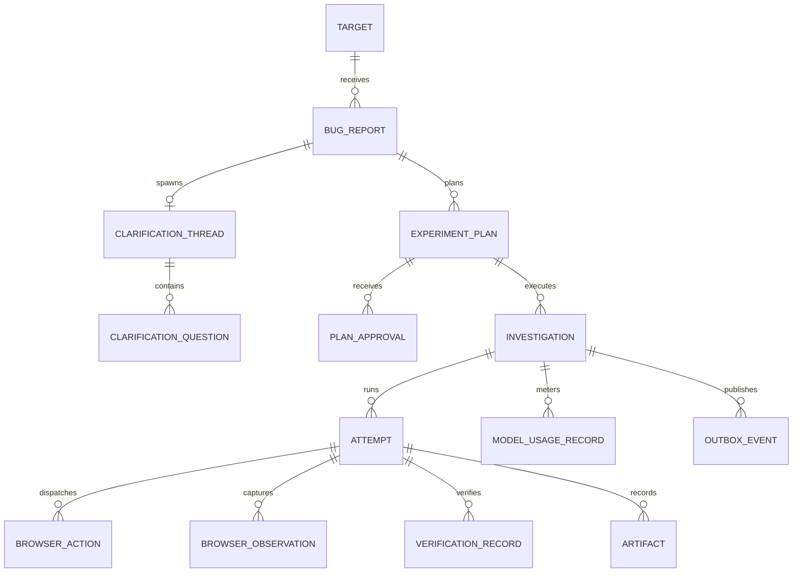

### 3.3 Resource Identification & URI Naming Standards
- All primary entities use **UUIDv4** strings (e.g., `3fa85f64-5717-4562-b3fc-2c963f66afa6`).
- URIs are kebab-case, pluralized nouns under the versioned base prefix `/api/v1`:
  - `/api/v1/targets`
  - `/api/v1/reports`
  - `/api/v1/reports/:reportId/clarifications`
  - `/api/v1/plans/:planId`
  - `/api/v1/plans/:planId/approvals`
  - `/api/v1/investigations`
  - `/api/v1/investigations/:investigationId/stream`
  - `/api/v1/investigations/:investigationId/attempts/:attemptIndex`
  - `/api/v1/artifacts/:artifactId/download`

---

## 4. General Wire Conventions & Request Lifecycle

### 4.1 Wire Format & Serializers
1. **JSON Encoding:** `Content-Type: application/json; charset=utf-8`.
2. **Casing:** JSON keys strictly follow **camelCase**.
3. **Timestamps:** ISO 8601 extended UTC format with millisecond precision and explicit `Z` suffix: `YYYY-MM-DDTHH:mm:ss.sssZ`.
4. **Nullability:** Omitted fields represent "no change" or "unspecified"; explicit `null` represents intentional clearing.
5. **Numeric Safety:** All currency and token values are represented as numbers (float/int) within JavaScript safe integer limits ($|n| < 2^{53}-1$). Large database bigints (e.g. sequence counters) are serialized as strings.

### 4.2 Standard Request & Response Headers
| Header Name | Type | Purpose | Mandatory On |
|---|---|---|---|
| **`X-Request-ID`** | UUIDv4 | End-to-end request tracing across gateway, controller, and worker. | All incoming/outgoing calls |
| **`X-Idempotency-Key`** | String (Max 64) | Deduplication key preventing duplicate mutations on network retries. | All `POST` / `PATCH` commands |
| **`If-Match`** | String (Hash/Rev) | Optimistic concurrency check against resource version or plan hash. | `PATCH` / `POST /approve` |
| **`Last-Event-ID`** | Integer | Event sequence cursor for SSE reconnection and replay. | `GET .../stream` |
| **`ETag`** | String | Strong entity tag representing current resource revision. | All single-resource `GET` |

### 4.3 Standard Pagination Envelope
All listing endpoints use cursor-based pagination to prevent state drift during concurrent mutations:

```typescript
export interface PaginatedResponse<T> {
  items: T[];
  nextCursor: string | null;
  hasMore: boolean;
  totalEstimatedCount: number;
}
```

---

## 5. Authentication, Authorization, and Security Boundaries

### 5.1 Authentication Mechanism
TraceCase uses **Supabase Auth** backed by JWTs:
- **Browser Client:** Authenticates via secure, HTTP-only, SameSite=Lax session cookies (`sb-access-token`).
- **CLI / Worker / API Consumers:** Authenticates via standard HTTP header: `Authorization: Bearer <jwt>`.
- **JWT Claims:** Contains `sub` (User UUID), `email`, `role` (`USER` | `ADMIN`), and `org_id`.

### 5.2 Role-Based Access Control (RBAC) & Tenant Isolation
- **Tenant Scope:** Every query and mutation is partitioned by organization (`org_id`). A user cannot view or mutate targets, reports, or investigations belonging to another organization.
- **Resource Disclosure Policy:** If a user requests a resource ID that does not exist OR belongs to another tenant, the API strictly returns **`404 Not Found`** (never `403 Forbidden`) to prevent entity enumeration.
- **Mass Assignment Defense:** Incoming JSON request payloads are strictly validated against Zod schemas configured with `.strict()` or `.strip()`. System-managed fields (`is_approved`, `reproduction_verdict`, `evidence_state`, `plan_hash`, `created_at`) are stripped before controller processing.


## 6. Operation Catalogue: User-Facing Commands & Queries

### 6.1 Target Operations

#### `API-OP-001`: List Permitted Targets
- **Method & Path:** `GET /api/v1/targets`
- **Caller:** Authenticated User / Frontend UI.
- **Purpose:** Lists all verified target web applications configured for the user's tenant organization.
- **Request Parameters:** Query `status` (`ACTIVE` | `INACTIVE`), `limit` (default 20), `cursor`.
- **Response Schema (`API-SCH-RES-001`):**
  ```typescript
  {
    items: Array<{
      targetId: string;
      name: string;
      baseUrl: string;
      isSandbox: boolean;
      allowedOrigins: string[];
      hasResetFixture: boolean;
      status: 'ACTIVE' | 'MAINTENANCE' | 'DISABLED';
      createdAt: string;
    }>;
    nextCursor: string | null;
  }
  ```
- **Preconditions & Security:** Returns targets strictly scoped to caller's `org_id`. Sensitive fixture reset credentials or database connection strings are never exposed.

#### `API-OP-002`: Get Target Details & Capabilities
- **Method & Path:** `GET /api/v1/targets/:targetId`
- **Caller:** Authenticated User.
- **Purpose:** Retrieves capability metadata, auth roles, and reset endpoint configuration for a specific target.
- **Success Response (`200 OK`):** Returns full target configuration including `fixtureResetEndpoint` (path only), `allowedOrigins`, and `isSandbox`.
- **Error Codes:** `404 Not Found` (`API-ERR-004`).

#### `API-OP-003`: Register / Configure Target (Admin Only)
- **Method & Path:** `POST /api/v1/targets`
- **Caller:** Organization Admin.
- **Request Schema (`API-SCH-REQ-003`):**
  ```typescript
  {
    name: string;                // 3 to 100 chars
    baseUrl: string;             // Valid URL, http or https
    isSandbox: boolean;          // Default false
    allowedOrigins: string[];    // Array of origin strings
    hasResetFixture: boolean;
    fixtureResetEndpoint?: string;
    resetSecretRef?: string;     // Secret vault reference, NEVER raw password
  }
  ```
- **Validation:** Validates that `baseUrl` origin matches at least one item in `allowedOrigins`.
- **Side Effects:** Creates new record in `targets` table.

#### `API-OP-004`: Validate Target Baseline Reachability
- **Method & Path:** `POST /api/v1/targets/:targetId/validate`
- **Caller:** Authenticated User / Test Engineer.
- **Purpose:** Executes a non-destructive HTTP HEAD/GET request to `baseUrl` and validates that the target responds with HTTP status $<400$.
- **Response:** `{ isReachable: boolean; httpStatus: number; responseTimeMs: number; baselineCheckedAt: string; }`.

---

### 6.2 Bug Report Operations

#### `API-OP-005`: Create Bug Report
- **Method & Path:** `POST /api/v1/reports`
- **Caller:** Authenticated User.
- **Headers:** `X-Idempotency-Key` (Required).
- **Request Schema (`API-SCH-REQ-005`):**
  ```typescript
  {
    targetId: string;                 // UUIDv4
    title: string;                    // 5 to 200 chars
    rawDescription: string;           // 10 to 4000 chars
    claimedExpectedBehavior?: string; // Optional user statement
    environmentClues?: string;        // Optional user context
  }
  ```
- **Processing & State Effect:**
  1. Validates that `targetId` exists and is active.
  2. Inserts new row into `bug_reports` with `status = 'INTAKE'`.
  3. Enqueues background job `plan_synthesis_job` in pg-boss.
  4. Emits domain event `EVT-001: report.created` into transactional outbox.
- **Success Response (`201 Created`):**
  ```typescript
  {
    reportId: string;
    targetId: string;
    status: 'INTAKE';
    createdAt: string;
    intakeJobId: string;
  }
  ```

#### `API-OP-006`: Get Bug Report Details
- **Method & Path:** `GET /api/v1/reports/:reportId`
- **Purpose:** Retrieves the bug report along with its associated interpretation status, active plan revision ID, and attachment summaries.

#### `API-OP-007`: Edit Bug Report & Invalidate Dependent Plans
- **Method & Path:** `PATCH /api/v1/reports/:reportId`
- **Purpose:** Updates the report description or expected behavior.
- **State Guard (`TC-INV-004`):** If an approved `ExperimentPlan` exists for this report, editing the report **automatically revokes approval** (`plan_approvals.is_revoked = TRUE`) and resets the plan status to `DRAFT`.
- **Success Response (`200 OK`):** Returns updated report and sets `approvalRevoked: true`.

#### `API-OP-008`: List Reports with Filtering
- **Method & Path:** `GET /api/v1/reports`
- **Query Parameters:** `targetId`, `status`, `limit`, `cursor`.
- **Response:** `PaginatedResponse<BugReportSummary>`.

---

### 6.3 Clarification & Interpretation Operations

#### `API-OP-011`: Get Active Clarification Thread
- **Method & Path:** `GET /api/v1/reports/:reportId/clarifications`
- **Caller:** Authenticated User.
- **Purpose:** Retrieves multiple-choice questions synthesized by `AT-ROLE-001` when a bug report is incomplete or ambiguous.
- **Response Schema (`API-SCH-RES-011`):**
  ```typescript
  {
    threadId: string;
    reportId: string;
    status: 'PENDING_USER_ANSWER' | 'RESOLVED' | 'SKIPPED';
    questions: Array<{
      questionId: string;
      questionText: string;
      whyItMatters: string;
      options: string[];
      blocksExecution: boolean;
      userSelectedOption: string | null;
    }>;
    createdAt: string;
  }
  ```

#### `API-OP-012`: Submit Clarification Answers
- **Method & Path:** `POST /api/v1/reports/:reportId/clarifications/answers`
- **Headers:** `X-Idempotency-Key` (Required).
- **Request Schema (`API-SCH-REQ-012`):**
  ```typescript
  {
    answers: Array<{
      questionId: string;
      selectedOption: string;
      customText?: string;
    }>;
  }
  ```
- **Processing:** Updates `clarification_answers` table. Enqueues `plan_synthesis_job` to re-run `AT-ROLE-001` with the clarified facts. Advances report status from `CLARIFYING` to `PLANNING`.

---

### 6.4 Experiment Plan & Approval Operations

#### `API-OP-013`: Trigger Experiment Plan Synthesis
- **Method & Path:** `POST /api/v1/reports/:reportId/plan`
- **Purpose:** Explicitly triggers `AT-ROLE-001` to synthesize or re-generate an `ExperimentPlan`.
- **Response (`202 Accepted`):** `{ planJobId: string; status: 'PLANNING'; }`.

#### `API-OP-014`: Get Experiment Plan & Hashes
- **Method & Path:** `GET /api/v1/plans/:planId`
- **Purpose:** Retrieves the structured steps, preconditions, assertions, and canonical SHA-256 `plan_hash`.
- **Response Schema (`API-SCH-RES-014`):**
  ```typescript
  {
    planId: string;
    reportId: string;
    planRevision: number;
    planHash: string;                  // SHA-256 of canonical JSON AST
    isApproved: boolean;
    requiredRole: string;
    preconditions: string[];
    steps: Array<{
      stepNumber: number;
      actionType: 'NAVIGATE' | 'CLICK' | 'FILL' | 'SELECT' | 'WAIT_FOR_SELECTOR';
      intentDescription: string;
      targetRole?: string;
      targetAccessibleName?: string;
      inputValue?: string;
      isDestructive: boolean;
    }>;
    correctBehaviorAssertions: Array<AssertionPredicate>;
    reportedFailureAssertions: Array<AssertionPredicate>;
    approvalRecord: {
      approvedAt: string;
      approvedByUserId: string;
      isRevoked: boolean;
    } | null;
  }
  ```

#### `API-OP-015`: Cryptographically Sign & Approve Plan
- **Method & Path:** `POST /api/v1/plans/:planId/approve`
- **Caller:** Authenticated User.
- **Headers:** `X-Idempotency-Key` (Required), `If-Match` (Optional: requires matching `planHash`).
- **Request Schema (`API-SCH-REQ-015`):**
  ```typescript
  {
    expectedPlanHash: string;          // Must match current database plan_hash
    clientSignatureConfirmation: boolean;
  }
  ```
- **Security Check (`TC-INV-003` / `TC-INV-004`):**
  1. Computes canonical SHA-256 of current database plan record.
  2. If `expectedPlanHash !== currentPlanHash`, rejects with `409 Conflict` (`API-ERR-005`).
  3. Inserts record into `plan_approvals` binding `user_id`, `plan_id`, and `plan_hash`.
  4. Emits domain event `EVT-005: plan.approved`.
- **Success Response (`200 OK`):** Returns approval confirmation with timestamp and approval UUID.

#### `API-OP-016`: Revoke Plan Approval
- **Method & Path:** `POST /api/v1/plans/:planId/revoke`
- **Purpose:** User revokes prior approval. Halts any queued investigations for this plan.

---

### 6.5 Investigation Admission & Execution Control

#### `API-OP-017`: Admit & Queue Investigation Job
- **Method & Path:** `POST /api/v1/investigations`
- **Caller:** Authenticated User.
- **Headers:** `X-Idempotency-Key` (Required).
- **Request Schema (`API-SCH-REQ-017`):**
  ```typescript
  {
    planId: string;                   // UUIDv4
    expectedPlanHash: string;         // SHA-256 hash
  }
  ```
- **Admission Enforcement Pipeline:**
  1. **Approval Verification (`TC-INV-003`):** Validates active approval exists in `plan_approvals` with `is_revoked = false`.
  2. **Hash Verification (`TC-INV-004`):** Verifies `expectedPlanHash === plan.plan_hash`.
  3. **Sandbox Check (`TC-INV-008`):** If any step has `is_destructive = true`, validates `target.is_sandbox = true`.
  4. **Concurrency Lease Check (`TC-INV-011`):** Checks if another investigation is currently in `ATTEMPT_1_RUNNING` or `ATTEMPT_2_RUNNING`. If occupied, sets status to `QUEUED`.
  5. **Budget Check (`TC-INV-005`):** Rejects admission if cumulative spend $\ge \$20.00$.
- **Database Transaction (`DB-TXN-005`):** Inserts row into `investigations` with `status = 'QUEUED'`, inserts `investigation_jobs` row in pg-boss queue, and writes `EVT-007` and `EVT-008` to `outbox_events`.
- **Success Response (`202 Accepted`):**
  ```typescript
  {
    investigationId: string;
    status: 'QUEUED';
    queuePosition: number;
    streamUrl: string;                // "/api/v1/investigations/:id/stream"
    createdAt: string;
  }
  ```

#### `API-OP-018`: Get Authoritative Investigation Snapshot
- **Method & Path:** `GET /api/v1/investigations/:investigationId`
- **Caller:** Authenticated User.
- **Purpose:** Primary polling / snapshot synchronization endpoint.
- **Response Schema (`API-SCH-RES-018`):**
  ```typescript
  {
    investigationId: string;
    planId: string;
    reportId: string;
    status: 'QUEUED' | 'PREPARING' | 'ATTEMPT_1_RUNNING' | 'ATTEMPT_1_VERIFYING' |
            'RESETTING_TARGET' | 'ATTEMPT_2_RUNNING' | 'ATTEMPT_2_VERIFYING' |
            'REPORT_DRAFTING' | 'COMPLETED' | 'PAUSED_FOR_MANUAL_AUTH' | 'BLOCKED' | 'CANCELLED' | 'ERROR_HALTED';
    reproductionVerdict: 'CONFIRMED_REPRODUCED' | 'NOT_REPRODUCED' |
                         'INCONSISTENT_OBSERVATIONS' | 'INCONCLUSIVE_EXECUTION_FAILURE' | 'PENDING';
    evidenceState: 'PENDING_GENERATION' | 'QUARANTINED_RAW' | 'PROCESSING_REDACTION' | 'PUBLIC_SAFE_READY' | 'EXPORT_FAILED';
    currentAttemptIndex: 1 | 2 | null;
    activeStepNumber: number | null;
    lastEventSeq: number;             // High-water mark for SSE reconnection
    blockerReason: string | null;
    createdAt: string;
    updatedAt: string;
  }
  ```

#### `API-OP-019`: Gracefully Cancel Investigation
- **Method & Path:** `POST /api/v1/investigations/:investigationId/cancel`
- **Purpose:** User manually aborts execution. Sends SIGTERM to active Playwright context; updates status to `CANCELLED`.
- **Mutation Uncertainty Note (`TC-INV-013`):** Cancellation stops future actions but does NOT guarantee rollback of already-dispatched mutations on the target application.

#### `API-OP-020`: Resume Execution After Manual Authentication
- **Method & Path:** `POST /api/v1/investigations/:investigationId/resume`
- **Caller:** Authenticated User.
- **Preconditions:** Investigation must be in `status = 'PAUSED_FOR_MANUAL_AUTH'`.
- **Purpose:** Informs the worker daemon that the user has manually resolved the CAPTCHA or 2FA barrier in the browser window. The worker re-checks page URL and resumes automated execution.

---

### 6.6 Attempt, Verification, Evidence & Export Operations

#### `API-OP-021`: Get Attempt Details & Step Logs
- **Method & Path:** `GET /api/v1/investigations/:investigationId/attempts/:attemptIndex`
- **Purpose:** Retrieves all browser actions, timestamps, and scrubbed console excerpts for Attempt 1 or Attempt 2.

#### `API-OP-022`: Get Deterministic Verification Records
- **Method & Path:** `GET /api/v1/investigations/:investigationId/verification`
- **Purpose:** Returns the official assertion evaluation records computed by the deterministic TypeScript verifier (`PlanAssertionVerifier`).
- **Response Schema (`API-SCH-RES-022`):**
  ```typescript
  {
    investigationId: string;
    reproductionVerdict: 'CONFIRMED_REPRODUCED' | 'NOT_REPRODUCED' | 'INCONSISTENT_OBSERVATIONS' | 'INCONCLUSIVE_EXECUTION_FAILURE';
    attempt1Evaluation: {
      attemptIndex: 1;
      passed: boolean;
      matchingFailureObserved: boolean;
      evaluatedAssertions: Array<{
        predicateId: string;
        assertionType: 'CORRECT_BEHAVIOR' | 'REPORTED_FAILURE_SIGNATURE';
        condition: string;
        expectedValue: unknown;
        actualValue: unknown;
        passed: boolean;
      }>;
    };
    attempt2Evaluation: {
      attemptIndex: 2;
      passed: boolean;
      matchingFailureObserved: boolean;
      evaluatedAssertions: Array<any>;
    } | null;
  }
  ```

#### `API-OP-023`: Get Signed Download URL for Safe Artifact
- **Method & Path:** `GET /api/v1/artifacts/:artifactId/download`
- **Caller:** Authenticated User.
- **Security Check (`TC-INV-009`):** Validates that `artifact.storage_classification = 'PUBLIC_SAFE'`. If the artifact is classified as `RESTRICTED_RAW`, the endpoint strictly returns **`403 Forbidden: ARTIFACT_QUARANTINED`** (`API-ERR-014`).
- **Success Response (`200 OK`):** Returns signed S3 URL with 15-minute expiration: `{ downloadUrl: string; expiresAt: string; sha256: string; mimeType: string; }`.

#### `API-OP-024`: Request Sanitized Evidence ZIP Package
- **Method & Path:** `POST /api/v1/investigations/:investigationId/export`
- **Purpose:** Bundles the video recordings (`.webm`), scrubbed console logs (`.log`), network requests (`.json`), and the Markdown report into a standalone ZIP package for team sharing.
- **Response (`202 Accepted`):** `{ exportJobId: string; status: 'PACKAGING'; }`.


## 7. Two-Phase Upload Flow for Report Attachments

To prevent large file payloads (screenshots, log files) from passing through Next.js serverless functions or API gateways, TraceCase enforces a secure **Two-Phase Upload Architecture**:

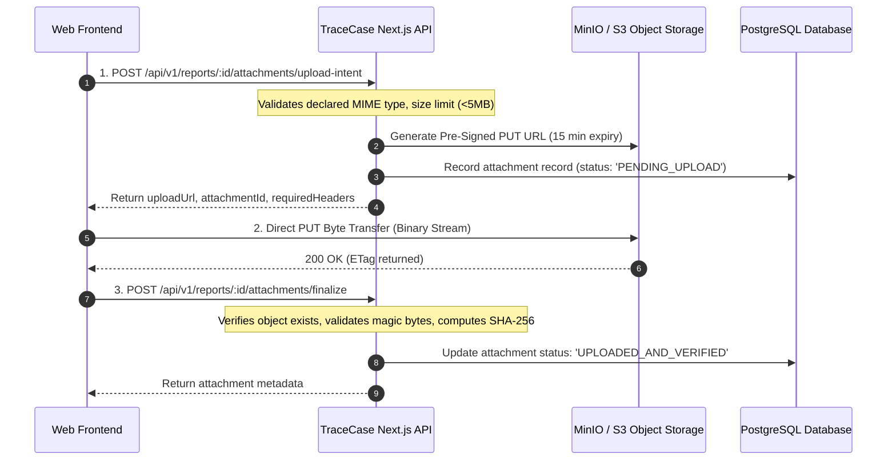

### 7.1 `API-OP-009`: Request Upload Intent
- **Method & Path:** `POST /api/v1/reports/:reportId/attachments/upload-intent`
- **Request Schema (`API-SCH-REQ-009`):**
  ```typescript
  {
    fileName: string;             // Sanitized basename, max 100 chars
    declaredMimeType: 'image/png' | 'image/jpeg' | 'text/plain';
    byteSize: number;             // Must be <= 5,242,880 (5MB)
  }
  ```
- **Response Schema (`API-SCH-RES-009`):**
  ```typescript
  {
    attachmentId: string;
    uploadUrl: string;            // Signed S3 PUT URL with expiration
    expiresAt: string;
    expectedHeaders: Record<string, string>;
  }
  ```

### 7.2 `API-OP-010`: Finalize Upload & Sniff Magic Bytes
- **Method & Path:** `POST /api/v1/reports/:reportId/attachments/finalize`
- **Request Schema (`API-SCH-REQ-010`):** `{ attachmentId: string; clientSha256?: string; }`
- **Security Validation:**
  1. Issues S3 `HeadObject` to confirm file exists and verify actual byte length.
  2. Reads first 512 bytes to sniff **magic bytes** (ensuring PNG/JPEG/text matches declared type, rejecting disguised executables).
  3. Computes server-side SHA-256 hash.
  4. Stores sanitized metadata in `report_attachments` table.

---

## 8. Real-Time Progress Transport & Server-Sent Events (SSE)

### 8.1 SSE Streaming Endpoint
- **Method & Path:** `GET /api/v1/investigations/:investigationId/stream`
- **Protocol:** Standard HTTP/1.1 or HTTP/2 Server-Sent Events (`text/event-stream`).
- **Headers Sent by Server:**
  ```http
  HTTP/1.1 200 OK
  Content-Type: text/event-stream; charset=utf-8
  Cache-Control: no-cache, no-transform
  Connection: keep-alive
  X-Accel-Buffering: no
  ```

### 8.2 Event Framing Specification
Each event emitted across the wire adheres to standard SSE framing with monotonic sequencing:

```text
id: 42
event: browser.action_executed
retry: 3000
data: {"eventSeq":42,"eventType":"browser.action_executed","timestamp":"2026-10-20T16:20:00.123Z","payload":{"stepNumber":2,"actionType":"CLICK","primarySelector":"button[name='Active']","success":true}}

```

### 8.3 Reconnection, Cursor Replay & Snapshot Synchronization
To guarantee race-safe UI updates, clients combine **initial snapshot querying** with **stream subscription**:

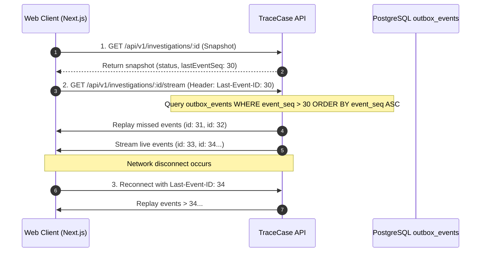

- **Cursor Expiration:** If the client passes a `Last-Event-ID` that has been purged ($>24$ hours old), the server emits `event: stream.cursor_expired` and closes the connection. The client falls back to querying a fresh snapshot via `API-OP-018`.
- **Keepalive Ping:** The server sends a comment ping (`: ping\n\n`) every 15 seconds to prevent intermediate proxy timeouts.

---

## 9. Domain & Control Event Taxonomy

### 9.1 Standard Event Envelope Schema (`API-SCH-ENV`)
Every domain event persisted to `outbox_events` and streamed over SSE implements the standard envelope:

```typescript
export interface DomainEventEnvelope<T = Record<string, unknown>> {
  eventId: string;                 // UUIDv4
  eventSeq: number;                // Monotonic integer per investigation
  eventType: string;               // e.g., "investigation.started"
  aggregateType: 'INVESTIGATION' | 'REPORT' | 'PLAN' | 'ATTEMPT';
  aggregateId: string;             // UUIDv4
  timestamp: string;               // ISO 8601 UTC
  correlationId: string;           // Matches X-Request-ID
  causationId?: string;            // Parent event ID
  payload: T;
}
```

### 9.2 Complete Domain Event Catalog (`EVT-001` – `EVT-020`)

| Event Code | Event Type Name | Aggregate | Trigger Condition | Key Payload Fields |
|---|---|---|---|---|
| **EVT-001** | `report.created` | REPORT | Bug report submitted | `{ reportId, targetId, title }` |
| **EVT-002** | `clarification.requested` | REPORT | Planner requests user input | `{ threadId, questionsCount }` |
| **EVT-003** | `clarification.answered` | REPORT | User submits answers | `{ threadId, answersCount }` |
| **EVT-004** | `plan.synthesized` | PLAN | `AT-ROLE-001` outputs plan | `{ planId, planRevision, planHash, stepCount }` |
| **EVT-005** | `plan.approved` | PLAN | User cryptographically signs | `{ planId, planHash, approvedByUserId }` |
| **EVT-006** | `plan.approval_revoked` | PLAN | Plan edited or revoked | `{ planId, reason }` |
| **EVT-007** | `investigation.admitted` | INVESTIGATION | Controller admits run | `{ investigationId, planId }` |
| **EVT-008** | `investigation.queued` | INVESTIGATION | Run queued for worker | `{ investigationId, queuePosition }` |
| **EVT-009** | `investigation.started` | INVESTIGATION | Worker claims job | `{ investigationId, workerLeaseId }` |
| **EVT-010** | `target.baseline_checked` | INVESTIGATION | Pre-flight check passed | `{ targetId, httpStatus, responseTimeMs }` |
| **EVT-011** | `attempt.started` | ATTEMPT | Attempt 1 or 2 begins | `{ attemptIndex, isSandbox }` |
| **EVT-012** | `browser.action_executed` | ATTEMPT | Playwright completes step | `{ stepNumber, actionType, success, durationMs }` |
| **EVT-013** | `browser.observation_captured`| ATTEMPT| AXTree snapshot captured | `{ observationId, interactiveNodesCount }` |
| **EVT-014** | `attempt.verifying` | ATTEMPT | Steps done; assertions running| `{ attemptIndex }` |
| **EVT-015** | `target.reset_completed` | INVESTIGATION | Fixture reset succeeded | `{ resetEndpoint, httpStatus }` |
| **EVT-016** | `reproduction.verdict_evaluated`| INVESTIGATION| Verifier completes dual run | `{ reproductionVerdict, attempt1Match, attempt2Match }` |
| **EVT-017** | `evidence.quarantined` | INVESTIGATION | Raw artifacts isolated | `{ unscrubbedArtifactCount }` |
| **EVT-018** | `evidence.redacted_and_ready` | INVESTIGATION | Scrubbed safe artifacts ready | `{ safeArtifactCount, videoUrl, logUrl }` |
| **EVT-019** | `investigation.completed` | INVESTIGATION | Final report generated | `{ reproductionVerdict, totalDurationMs }` |
| **EVT-020** | `investigation.cancelled` | INVESTIGATION | User aborts run | `{ cancelledAt, lastCompletedStep }` |

---

## 10. Transactional Outbox, Queue Admission & Worker Coordination

### 10.1 PostgreSQL Transactional Outbox Pattern
To prevent dual-write inconsistencies (e.g. database commits state change but message broker fails to send notification), TraceCase implements the **Transactional Outbox Pattern** using PostgreSQL (`DB-TXN-005`):

```sql
-- Atomic State Transition & Event Emission
BEGIN;
  UPDATE investigations 
  SET status = 'ATTEMPT_1_RUNNING', updated_at = NOW() 
  WHERE id = $1;

  INSERT INTO outbox_events (
    id, investigation_id, event_seq, event_type, payload, created_at
  ) VALUES (
    gen_random_uuid(), $1, 
    (SELECT COALESCE(MAX(event_seq), 0) + 1 FROM outbox_events WHERE investigation_id = $1),
    'attempt.started', 
    '{"attemptIndex": 1}'::jsonb, 
    NOW()
  );
COMMIT;
```

A lightweight background publisher reads from `outbox_events` and broadcasts new events to connected SSE client streams.

### 10.2 Worker Coordination via pg-boss Queues
TraceCase uses **pg-boss** directly on PostgreSQL for background worker job coordination, avoiding external Redis or RabbitMQ dependencies:

- **Queue Name:** `browser_investigation_jobs`.
- **Job Payload:**
  ```typescript
  export interface BrowserJobPayload {
    investigationId: string;
    planId: string;
    planHash: string;
    targetBaseUrl: string;
    isSandbox: boolean;
    allowedOrigins: string[];
    workerLeaseTimeoutMs: number;
  }
  ```
- **Single Concurrency Lease (`TC-INV-011`):** The worker claims exactly **one job at a time**. The worker maintains a database heartbeat in `worker_leases` every 10 seconds. If a worker process dies without releasing its lease, the controller invalidates the lease after 30 seconds and transitions the investigation to `ERROR_HALTED`.


## 11. Optimistic Concurrency, Idempotency, and Stale Requests

### 11.1 The `X-Idempotency-Key` Protocol
Network timeouts can cause clients to re-issue mutations. To prevent duplicate executions, all state-changing endpoints (`POST /reports`, `POST /plans/:id/approve`, `POST /investigations`) require an `X-Idempotency-Key` header:

1. **Fingerprint Hashing:** The server computes an SHA-256 fingerprint of the request path, user ID, and body payload.
2. **Atomic Reservation:** Inserts into `idempotency_keys` (`DB-TXN-002`):
   - If the key exists with identical fingerprint and `status = 'COMPLETED'`, the server returns the cached status and payload immediately.
   - If the key exists with a *different* fingerprint, rejects with `422 Unprocessable Entity` (`API-ERR-018: IDEMPOTENCY_CONFLICT`).
   - If the key is currently `status = 'PROCESSING'`, rejects with `409 Conflict` (`API-ERR-019: CONCURRENT_REQUEST_IN_FLIGHT`).
3. **Retention:** Idempotency keys expire after 24 hours.

### 11.2 Optimistic Concurrency Control (`If-Match` & `ETag`)
To prevent concurrent edits from overwriting each other (e.g., approving a plan revision that someone else just modified):
- All single-resource GET endpoints return an `ETag` header containing the resource revision (e.g., `W/"rev-3-hash-a1b2c3d4"`).
- Mutating commands (`PATCH /reports/:id`, `POST /plans/:id/approve`) support or require an `If-Match` header.
- If the incoming `If-Match` value does not match current state, the server rejects with `412 Precondition Failed` or `409 Conflict` (`API-ERR-005`).

---

## 12. Standard Error Handling Envelope & Error Codes

### 12.1 RFC 7807 Problem Details Error Envelope
TraceCase implements the RFC 7807 **Problem Details for HTTP APIs** specification:

```typescript
export interface ProblemDetailsError {
  type: string;                    // URI reference, e.g. "https://tracecase.dev/errors/API-ERR-005"
  title: string;                   // Short human-readable summary
  status: number;                  // HTTP status code (e.g. 409)
  detail: string;                  // Specific explanation for this instance
  instance: string;                // Request URI, e.g. "/api/v1/plans/123/approve"
  errorCode: string;               // Machine-readable code, e.g. "API-ERR-005"
  correlationId: string;           // Matches X-Request-ID
  invalidParams?: Array<{
    name: string;
    reason: string;
  }>;
}
```

### 12.2 The 20 Standardized API Error Codes (`API-ERR-001` – `API-ERR-020`)

| Error Code | HTTP Status | Error Constant | Safe User Message / Description |
|---|---|---|---|
| **API-ERR-001** | `400` | `SCHEMA_VALIDATION_ERROR` | "Request payload failed Zod schema validation." |
| **API-ERR-002** | `401` | `AUTHENTICATION_REQUIRED` | "Missing or expired session authentication token." |
| **API-ERR-003** | `403` | `INSUFFICIENT_PERMISSIONS` | "User role not authorized for this operation." |
| **API-ERR-004** | `404` | `RESOURCE_NOT_FOUND` | "The requested resource does not exist or access is restricted." |
| **API-ERR-005** | `409` | `PLAN_HASH_MISMATCH` | "Plan was modified; hash does not match expected revision." |
| **API-ERR-006** | `403` | `APPROVAL_REVOKED` | "Plan approval has been invalidated or revoked." |
| **API-ERR-007** | `403` | `SANDBOX_VIOLATION` | "Destructive actions prohibited on non-sandbox targets." |
| **API-ERR-008** | `400` | `SCOPE_VIOLATION` | "Requested action target violates permitted domain origins." |
| **API-ERR-009** | `409` | `INVALID_LIFECYCLE_STATE` | "Operation is not permitted in the current workflow phase." |
| **API-ERR-010** | `429` | `WORKER_CAPACITY_EXCEEDED` | "Worker currently executing another investigation lease." |
| **API-ERR-011** | `402` | `BUDGET_CEILING_EXHAUSTED` | "OpenAI API usage ceiling ($20.00) reached." |
| **API-ERR-012** | `504` | `BROWSER_TIMEOUT` | "Browser action timed out waiting for DOM element." |
| **API-ERR-013** | `409` | `MUTATION_UNCERTAIN` | "Action timed out with uncertain target mutation state." |
| **API-ERR-014** | `403` | `ARTIFACT_QUARANTINED` | "Direct access to unredacted raw artifacts is prohibited." |
| **API-ERR-015** | `502` | `TARGET_RESET_FAILED` | "Backend fixture reset returned non-200 HTTP status." |
| **API-ERR-016** | `410` | `SSE_CURSOR_EXPIRED` | "Last-Event-ID has expired. Client must query fresh snapshot." |
| **API-ERR-017** | `413` | `UPLOAD_SIZE_EXCEEDED` | "Uploaded attachment exceeds maximum 5MB limit." |
| **API-ERR-018** | `422` | `IDEMPOTENCY_CONFLICT` | "Idempotency key reused with different request payload." |
| **API-ERR-019** | `409` | `CONCURRENT_REQUEST` | "An identical request is currently processing. Retry shortly." |
| **API-ERR-020** | `500` | `INTERNAL_GATEWAY_ERROR` | "An unexpected server error occurred. Traced via correlation ID." |

---

## 13. Privacy, Redaction, and Data Ingress Boundary

### 13.1 In-Stream Secret Scrubbing Guarantee (`TC-INV-009`)
All log lines, headers, and network payloads captured by Playwright CDP are passed through an in-memory secret scrubbing filter before:
1. Entering any PostgreSQL column (`browser_actions`, `verification_records`).
2. Entering any SSE event payload (`browser.action_executed`).
3. Being rendered in the Next.js UI or exported to ZIP packages.

Secrets matching bearer tokens, passwords, cookies, or JWTs are transformed to deterministic tokens: `[REDACTED_BEARER_TOKEN]`, `[REDACTED_SECRET]`, `[REDACTED_COOKIE]`.

### 13.2 Storage Segregation: `RESTRICTED_RAW` vs `PUBLIC_SAFE`
- **`RESTRICTED_RAW`:** Unscrubbed video recording, raw HAR telemetry, memory dumps. Stored in encrypted private S3 buckets. **No API route grants download access to raw artifacts.**
- **`PUBLIC_SAFE`:** Watermarked video recording, scrubbed console logs, and redacted network receipts. Downloadable exclusively via short-lived (15 minute) pre-signed URLs generated by `API-OP-023`.


## 14. Worked Illustrative Wire Examples (16 Scenarios)

### Example 1: Bug Report Creation (`POST /api/v1/reports`)
```http
POST /api/v1/reports HTTP/1.1
Host: api.tracecase.local
Authorization: Bearer <jwt>
X-Request-ID: b1a85f64-5717-4562-b3fc-2c963f66afa1
X-Idempotency-Key: idemp-report-001
Content-Type: application/json

{
  "targetId": "e4b52994-0182-4966-8167-9c92257f8910",
  "title": "Deleting task with filter active deletes wrong item",
  "rawDescription": "When I filter tasks by Active and click delete on 'Release', the 'Invoice' task disappears instead.",
  "claimedExpectedBehavior": "Only the selected 'Release' task should be removed from the view."
}
```
```http
HTTP/1.1 201 Created
Content-Type: application/json

{
  "reportId": "d8205f64-5717-4562-b3fc-2c963f66afa2",
  "targetId": "e4b52994-0182-4966-8167-9c92257f8910",
  "status": "INTAKE",
  "createdAt": "2026-10-20T16:21:00.000Z",
  "intakeJobId": "job-intake-987"
}
```

### Example 2: Clarification Request & Answer
```http
POST /api/v1/reports/d8205f64-5717-4562-b3fc-2c963f66afa2/clarifications/answers HTTP/1.1
Content-Type: application/json
X-Idempotency-Key: idemp-answer-001

{
  "answers": [
    {
      "questionId": "q_expected",
      "selectedOption": "Task disappears from list without affecting completed tasks"
    }
  ]
}
```
```http
HTTP/1.1 200 OK
Content-Type: application/json

{
  "threadId": "thr-112233",
  "status": "RESOLVED",
  "nextWorkflowState": "PLANNING"
}
```

### Example 3: Plan Response with Hashes (`GET /api/v1/plans/:id`)
```http
HTTP/1.1 200 OK
ETag: W/"rev-1-hash-5f2d9c"
Content-Type: application/json

{
  "planId": "p-998877",
  "planRevision": 1,
  "planHash": "5f2d9c7e8b1a3d4f5c6e7a8b9c0d1e2f3a4b5c6d7e8f9a0b1c2d3e4f5a6b7c8d",
  "isApproved": false,
  "steps": [
    { "stepNumber": 1, "actionType": "NAVIGATE", "intentDescription": "Go to /tasks" },
    { "stepNumber": 2, "actionType": "CLICK", "intentDescription": "Click Active filter", "targetRole": "button", "targetAccessibleName": "Active" },
    { "stepNumber": 3, "actionType": "CLICK", "intentDescription": "Delete Release", "targetRole": "button", "targetAccessibleName": "Trash Item", "isDestructive": true }
  ],
  "correctBehaviorAssertions": [
    { "predicateId": "assert_b_gone", "assertionType": "CORRECT_BEHAVIOR", "target": "DOM_ELEMENT", "expectedCondition": "NOT_EXISTS", "expectedValue": true }
  ],
  "reportedFailureAssertions": [
    { "predicateId": "assert_b_present", "assertionType": "REPORTED_FAILURE_SIGNATURE", "target": "DOM_ELEMENT", "expectedCondition": "EXISTS", "expectedValue": true }
  ]
}
```

### Example 4: Plan Approval & Start (`POST /api/v1/investigations`)
```http
POST /api/v1/investigations HTTP/1.1
Content-Type: application/json
X-Idempotency-Key: idemp-inv-001

{
  "planId": "p-998877",
  "expectedPlanHash": "5f2d9c7e8b1a3d4f5c6e7a8b9c0d1e2f3a4b5c6d7e8f9a0b1c2d3e4f5a6b7c8d"
}
```
```http
HTTP/1.1 202 Accepted
Content-Type: application/json

{
  "investigationId": "inv-554433",
  "status": "QUEUED",
  "queuePosition": 1,
  "streamUrl": "/api/v1/investigations/inv-554433/stream",
  "createdAt": "2026-10-20T16:22:00.000Z"
}
```

### Example 5: Live SSE Event Stream (`GET .../stream`)
```text
id: 10
event: target.baseline_checked
data: {"eventSeq":10,"eventType":"target.baseline_checked","timestamp":"2026-10-20T16:22:05.100Z","payload":{"httpStatus":200,"responseTimeMs":85}}

id: 11
event: attempt.started
data: {"eventSeq":11,"eventType":"attempt.started","timestamp":"2026-10-20T16:22:06.000Z","payload":{"attemptIndex":1,"isSandbox":true}}

id: 12
event: browser.action_executed
data: {"eventSeq":12,"eventType":"browser.action_executed","timestamp":"2026-10-20T16:22:08.500Z","payload":{"stepNumber":2,"actionType":"CLICK","primarySelector":"button[name='Active']","success":true}}

```

### Example 6: Confirmed Dual-Run Outcome (`GET .../verification`)
```http
HTTP/1.1 200 OK
Content-Type: application/json

{
  "investigationId": "inv-554433",
  "reproductionVerdict": "CONFIRMED_REPRODUCED",
  "attempt1Evaluation": { "attemptIndex": 1, "passed": true, "matchingFailureObserved": true },
  "attempt2Evaluation": { "attemptIndex": 2, "passed": true, "matchingFailureObserved": true }
}
```

### Example 7: Stale Approval Rejection (`409 Conflict`)
```http
HTTP/1.1 409 Conflict
Content-Type: application/problem+json

{
  "type": "https://tracecase.dev/errors/API-ERR-005",
  "title": "Plan Hash Mismatch",
  "status": 409,
  "detail": "The plan has been revised since approval. Expected hash does not match current database hash.",
  "instance": "/api/v1/investigations",
  "errorCode": "API-ERR-005",
  "correlationId": "b1a85f64-5717-4562-b3fc-2c963f66afa1"
}
```

### Example 8: Quarantined Artifact Download Rejection (`403 Forbidden`)
```http
GET /api/v1/artifacts/art-raw-video-999/download HTTP/1.1
Authorization: Bearer <jwt>
```
```http
HTTP/1.1 403 Forbidden
Content-Type: application/problem+json

{
  "type": "https://tracecase.dev/errors/API-ERR-014",
  "title": "Artifact Quarantined",
  "status": 403,
  "detail": "Requested artifact is classified as RESTRICTED_RAW. Direct access to unredacted raw media is prohibited.",
  "instance": "/api/v1/artifacts/art-raw-video-999/download",
  "errorCode": "API-ERR-014",
  "correlationId": "c2a85f64-5717-4562-b3fc-2c963f66afa2"
}
```

---

## 15. Official Case API Walkthroughs (TC1–TC4)

### TC1: Bug Reproduced Twice (Official Baseline)
1. **Intake:** User calls `POST /api/v1/reports`. Report enqueues planning.
2. **Approval:** User calls `POST /api/v1/plans/:id/approve` with matching `planHash`.
3. **Execution 1:** Worker runs Attempt 1; Playwright captures triad artifacts. Deterministic verifier checks assertions $\to$ `matchingFailureObserved = true`.
4. **Fixture Reset:** Controller calls `POST /api/test/reset-fixture` on target $\to$ HTTP 200 OK.
5. **Execution 2:** Worker runs Attempt 2 in fresh context. Verifier checks assertions $\to$ `matchingFailureObserved = true`.
6. **Verdict & Evidence:** Controller evaluates dual-run rule (`TC-INV-002`); sets `reproduction_verdict = 'CONFIRMED_REPRODUCED'`. Triad artifacts scrubbed and uploaded to `PUBLIC_SAFE`.
7. **Client View:** UI renders confirmed badge and synchronized video player.

### TC2: Cannot Reproduce
- Both Attempt 1 and Attempt 2 complete all approved steps, but failure assertions do not trigger (the target app operates correctly).
- Deterministic verifier records `matchingFailureObserved = false`.
- `reproduction_verdict` resolves to **`NOT_REPRODUCED`**.
- API returns HTTP 200 with complete steps tried and baseline environment details.

### TC3: Deletion Involved (Sandbox Guardrail)
- Plan step has `isDestructive: true`.
- **Pre-Execution Check:** Backend verifies `target.is_sandbox === true`.
- If false, `POST /api/v1/investigations` is rejected immediately with **`403 Forbidden: SANDBOX_VIOLATION`** (`API-ERR-007`).
- If true, execution proceeds; fixture reset restores deleted items between attempts.

### TC4: Auth Token in Logs (In-Stream Redaction)
- Target application emits `"Authorization: Bearer secret_token_xyz"` to console during execution.
- **In-Stream Sanitizer:** Scrubber detects token pattern; transforms it to `[REDACTED_BEARER_TOKEN]`.
- Raw unscrubbed logs stored in encrypted `RESTRICTED_RAW` bucket.
- API serves scrubbed logs from `PUBLIC_SAFE` bucket. No raw tokens leak into SSE streams, UI, or exports.

---

## 16. Architectural Diagrams

### Diagram 1: API / Client / Component Boundary
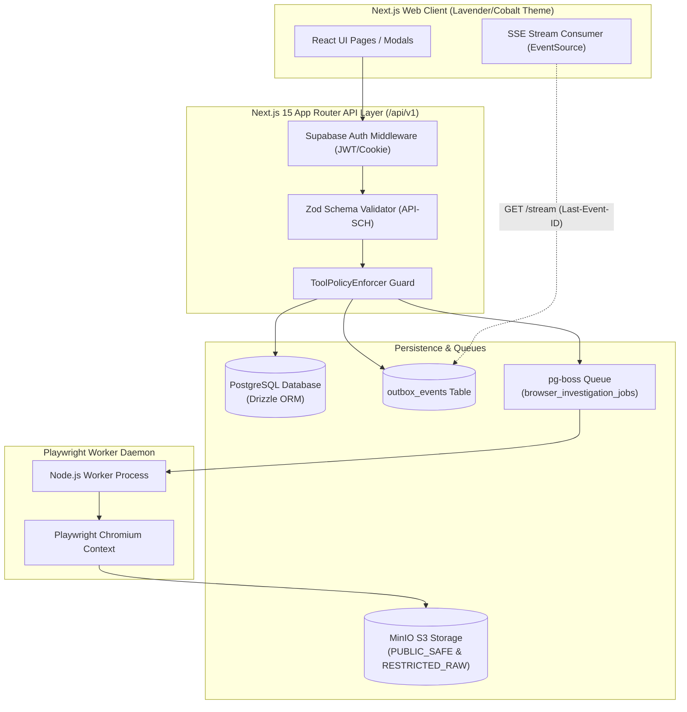

### Diagram 2: Report-to-Approved-Investigation Sequence
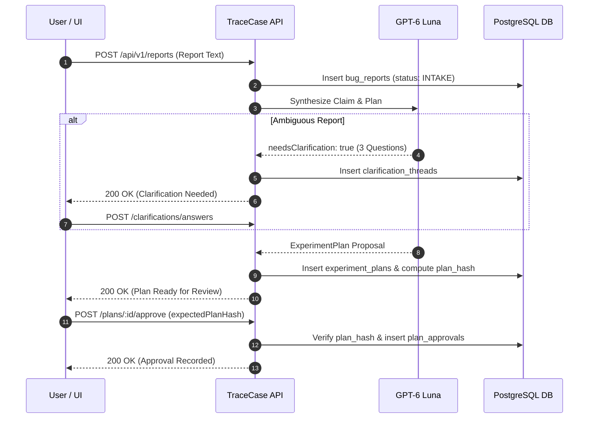

### Diagram 3: Start / Queue / Worker Sequence
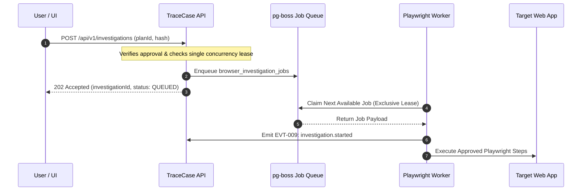

### Diagram 4: State Commit and Event / Outbox Publication
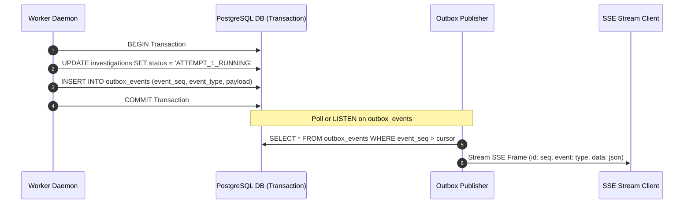

### Diagram 5: Snapshot plus SSE / Reconnect
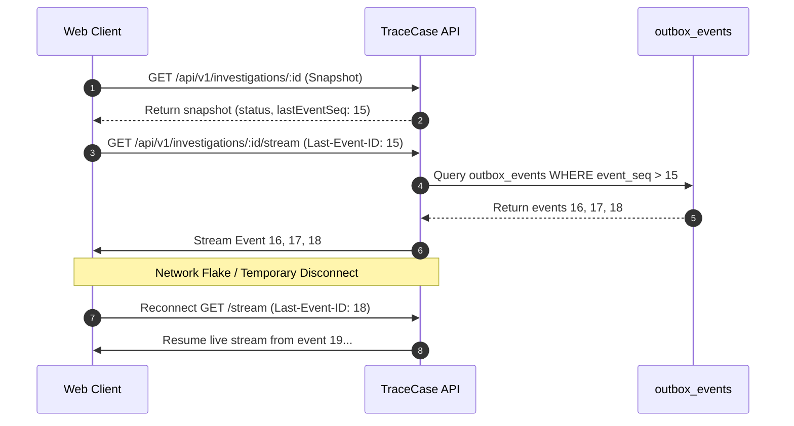

### Diagram 6: Cancellation & Late-Result Handling
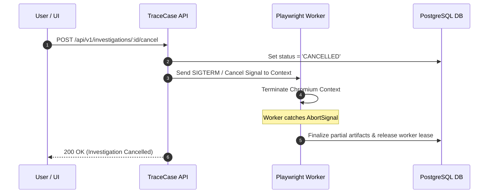

### Diagram 7: Artifact Authorization & Download
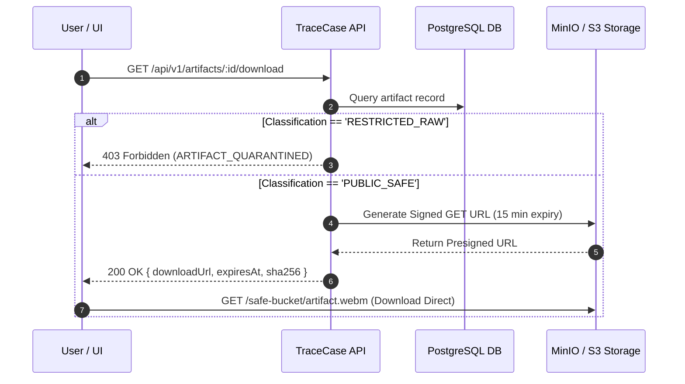

### Diagram 8: Outcome & Evidence Response Relationship
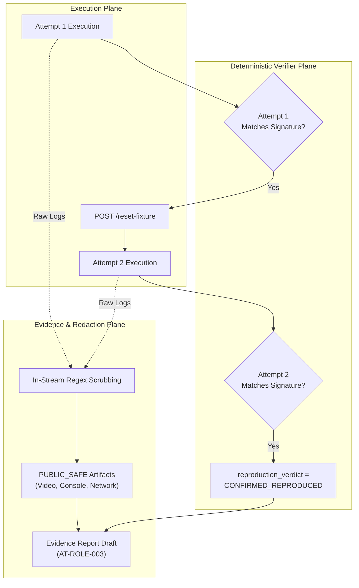


## 17. Traceability Matrix & Identifier Registry

### 17.1 Mapping Official Problem Statement to API & Event Contracts

| Official Requirement | TraceCase Requirement | API Operation | Domain Event | Policy / Security Guard | Acceptance Scenario |
|---|---|---|---|---|---|
| **PS-REQ-001** (Interpret Report) | `TC-FR-001` | `API-OP-005` (`POST /reports`) | `EVT-001` (`report.created`) | Zod Schema Validation (`API-SCH-REQ-005`) | `API-SCN-001` |
| **PS-REQ-002** (Clarify Details) | `TC-FR-002` | `API-OP-011` / `012` (`/clarifications`) | `EVT-002` / `EVT-003` | Max 3 multiple-choice questions | `API-SCN-002` |
| **PS-REQ-003** (Plan Reproduction) | `TC-FR-003` | `API-OP-013` / `014` (`/plans`) | `EVT-004` (`plan.synthesized`) | Bounded max 15 steps; SHA-256 hash | `API-SCN-003` |
| **PS-REQ-004** (Action Approval) | `TC-FR-004` | `API-OP-015` (`POST /approve`) | `EVT-005` (`plan.approved`) | `TC-INV-003` / `TC-INV-004` Hash Lock | `API-SCN-004` |
| **PS-REQ-005** (Browser Execution) | `TC-FR-005` | `API-OP-017` (`POST /investigations`)| `EVT-007` / `EVT-012` | Single Concurrency Lease (`TC-INV-011`) | `API-SCN-005` |
| **PS-REQ-006** (Two-Run Confirm) | `TC-FR-006` | `API-OP-022` (`GET /verification`) | `EVT-016` (`verdict_evaluated`) | `TC-INV-002` Dual-Run Gate | `API-SCN-006` (TC1) |
| **PS-REQ-007** (Negative Run Handling)| `TC-FR-007` | `API-OP-022` (`GET /verification`) | `EVT-016` (`verdict_evaluated`) | `NOT_REPRODUCED` Verdict Handling | `API-SCN-007` (TC2) |
| **PS-REQ-008** (Sandbox Protection) | `TC-FR-008` | `API-OP-017` (`POST /investigations`)| `API-ERR-007` (`SANDBOX_VIOLATION`) | `TC-INV-008` Sandbox Guardrail | `API-SCN-008` (TC3) |
| **PS-REQ-009** (In-Stream Redaction) | `TC-FR-009` | `API-OP-023` (`GET /artifacts/download`)| `EVT-017` / `EVT-018` | `TC-INV-009` Raw Quarantine Guard | `API-SCN-009` (TC4) |
| **PS-REQ-010** (Evidence Triad) | `TC-FR-010` | `API-OP-023` / `024` (`/export`) | `EVT-018` (`evidence.redacted_and_ready`) | `TC-INV-012` Triad Completeness | `API-SCN-010` |

---

## 18. Open Decisions and Implementation Handoff

### 18.1 Team Responsibility Division (3-Person Architecture)
- **Team Member 1 (Lead Systems & Backend Engineer):**
  - Owns Next.js 15 App Router Route Handlers (`/api/v1/...`), PostgreSQL schema migrations (Drizzle ORM), pg-boss worker queues, and deterministic verifier integration.
- **Team Member 2 (AI Engineer):**
  - Owns OpenAI client adapter (`gpt-6-luna`), Zod response parser, prompt engineering, and AXTree pruning algorithm.
- **Team Member 3 (UI / Frontend Engineer):**
  - Owns Next.js 15 client dashboard, SSE stream connection with `Last-Event-ID` reconnection, clarification cards, approval modal, and synchronized Evidence Triad media player.

### 18.2 Open Decisions & Research Questions
- **`API-DEC-001` (Combined Approve-and-Run Route):** Provide both granular (`POST /plans/:id/approve`) and convenience (`POST /plans/:id/approve-and-run`) endpoints. Adopted to support both multi-step human review and streamlined hackathon demo workflows.
- **`API-DEC-002` (SSE Heartbeat Frequency):** Heartbeat set to 15 seconds (`: ping\n\n`) to prevent disconnects on AWS/Cloudflare edge proxies.
- **`API-DEC-003` (Attachment Max Size):** Hard-capped at 5 MB per file; max 3 files per report.
- **`API-OQ-001` (WebSocket vs SSE):** SSE adopted for unidirectional server-to-client progress. Bidirectional WebSocket deferred to v1.1.0 since client commands are cleanly modeled as standard REST `POST` requests.

---

## 19. Validation Checklist & Sign-Off

- [x] **Model Restriction:** Exclusively uses `gpt-6-luna` via official OpenAI API (`TC-INV-001`). Zero silent fallback.
- [x] **Zero Client Authority:** All client and model fields are strictly validated; approval, verdict, and sandbox flags cannot be forged.
- [x] **State Machine Alignment:** Decouples execution lifecycle state from reproduction verdict and evidence readiness (`TC-INV-007`).
- [x] **Official Test Cases:** Explicitly covers TC1 (Dual-run match), TC2 (Clean non-reproduction), TC3 (Sandbox deletion), and TC4 (In-stream redaction).
- [x] **Event Delivery:** Outbox pattern guarantees at-least-once durable event persistence; client uses `Last-Event-ID` for replay.
- [x] **Idempotency & Concurrency:** `X-Idempotency-Key` prevents duplicate runs; `If-Match` prevents stale plan approval.
- [x] **Diagram Consistency:** All 8 required Mermaid diagrams integrated and verified against schema names.

---
*End of API & Event Contracts Specification — TraceCase (TC-AEC-001)*
