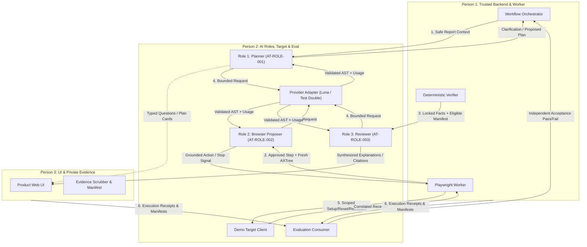

# TraceCase — H-01 AI Contracts & Shared Architecture Specification

**Document ID:** `H-01-PROPOSAL-V2`  
**Author:** Person 2 (AI, Controlled Target, and Evaluation Lead)  
**Recipients / Coordinators:** Person 1 (Lead Backend Architect) & Person 3 (Product & Evidence Lead)  
**Date:** 20 October 2026  
**Implementation Source:** [`src/server/ai/contracts.ts`](file:///c:/Users/gjaya/OneDrive/Desktop/PROJECTS/TraceCase/src/server/ai/contracts.ts), [`src/server/ai/compatibility-adapter.ts`](file:///c:/Users/gjaya/OneDrive/Desktop/PROJECTS/TraceCase/src/server/ai/compatibility-adapter.ts), [`demo-target/client.ts`](file:///c:/Users/gjaya/OneDrive/Desktop/PROJECTS/TraceCase/demo-target/client.ts), [`evaluation/case-schema.ts`](file:///c:/Users/gjaya/OneDrive/Desktop/PROJECTS/TraceCase/evaluation/case-schema.ts)  
**Test Suite:** [`tests/ai-compatibility-handoff.test.ts`](file:///c:/Users/gjaya/OneDrive/Desktop/PROJECTS/TraceCase/tests/ai-compatibility-handoff.test.ts) (17/17 passed), [`tests/ai-contracts.test.ts`](file:///c:/Users/gjaya/OneDrive/Desktop/PROJECTS/TraceCase/tests/ai-contracts.test.ts) (8/8 passed)  
**Status:** IMPLEMENTED AND NON-BROWSER VERIFIED (Deterministic Role, Target, Adapter, and Evaluation Tests Passing; Live Browser Execution & Deployed Acceptance DEFERRED BY USER)

---

## 1. Executive Summary & Purpose

In accordance with **Person 2 P2-01**, **P2-03**, **P2-04**, **P2-05**, **P2-06**, **P2-07**, and the foundation handoff milestones (**H-01, H-02, H-04, H-06, H-10, H-11**), this specification provides the complete contract map and compatibility handoff boundary for all Person 2 subsystems.

### Core Architectural Principles:
1. **Advisory Non-Authority (`TC-INV-001`, `TC-INV-004`):** AI roles propose structured experiments, locator groundings, and explanations. They cannot generate server IDs, mutate `isApproved`, assign `planHash`, alter `workerLeaseId`, or declare reproduction verdicts.
2. **Stable Identity vs. Transient Access:** Artifacts, actions, and assertions possess stable canonical identifiers (`videoId`, `predicateId`, `nodeId`). Temporary URLs (`/api/v1/artifacts/...`) are access mechanisms, not identity.
3. **Structured UI Projection (Zero Prose Parsing):** Person 3 UI components consume typed view projections (`UiClarificationView`, `UiReviewerView`) directly from adapter functions without regex or narrative Markdown parsing.
4. **Secret & Ground Truth Isolation:** Reset credentials (`X-TraceCase-Reset-Auth`), synthetic diagnostic tokens, and evaluator ground truth labels (`actualBugPresent`) are strictly quarantined from role inputs.
5. **Decoupled State (`TC-INV-007`):** Lifecycle status (`COMPLETED`/`FAILED`), reproduction verdict (`CONFIRMED_REPRODUCED`/`NOT_REPRODUCED`), and evidence readiness (`PUBLIC_SAFE_READY`/`QUARANTINED_LEAK_DETECTED`) remain three orthogonal dimensions.

---

## 2. Comprehensive Six-Interface Contract Map



---

### Interface 1: Planner (`AT-ROLE-001`)

- **Actual Exported Types & Schemas:**
  - Input Schema: `ReportAgentInputSchema` ([`src/server/ai/contracts.ts`](file:///c:/Users/gjaya/OneDrive/Desktop/PROJECTS/TraceCase/src/server/ai/contracts.ts#L114))
  - Output Schema: `ReportAgentOutputSchema` (discriminated on `variant`: `NEEDS_CLARIFICATION`, `PLAN_PROPOSED`, `UNSUPPORTED_CLAIM`, `SCOPE_CONFLICT`, `UNABLE_TO_INTERPRET`)
  - Entrypoint: `ReportExperimentAgent.evaluateReport(input, options)` ([`src/server/ai/planner.ts`](file:///c:/Users/gjaya/OneDrive/Desktop/PROJECTS/TraceCase/src/server/ai/planner.ts#L42))
  - Compatibility Adapter: `createPlannerCompatibilityAdapter(provider)` ([`src/server/ai/compatibility-adapter.ts`](file:///c:/Users/gjaya/OneDrive/Desktop/PROJECTS/TraceCase/src/server/ai/compatibility-adapter.ts#L173))
- **Owner & Consumers:**
  - Owner: Person 2
  - Consumers: Person 1 (Orchestrator intake route `/api/v1/investigations`), Person 3 (UI Clarification Card via `projectClarificationForUi`)
- **Required/Optional Fields & Bounds:**
  - `investigationId`: UUID (required, server correlation)
  - `rawReport`: `title` (3–200 chars), `description` (5–4,000 chars), `environmentClues` (max 500 chars, optional), `claimedExpectedBehavior` (max 1,000 chars, optional)
  - `targetProfile`: `name`, `baseUrl`, `isSandbox`, `allowedOrigins` (strictly sanitized; zero auth secrets)
  - `clarificationHistory`: Array of `{ questionId, questionText, selectedOption, customText }` (max 10)
- **Provenance & Authority:**
  - Report facts originate from untrusted user submission.
  - Target facts originate from server target registry.
  - Model proposals contain **zero authority**: cannot set `isApproved: true`, cannot generate `planHash`, cannot assign execution IDs.
- **Errors & Cancellation Behavior:**
  - Respects `options.abortSignal`.
  - Schema validation failure triggers bounded retry (max 2) before surfacing `SemanticValidationError`.
- **Versioning & Compatibility:**
  - Contract version: `'1.0.0'`
  - Unagreed Decision: Upgrades opaque `verificationCriteria: string[]` to typed `PlanAssertion[]` (`DEC-001`).
- **Safe Example Payload (`PLAN_PROPOSED`):**
  ```json
  {
    "variant": "PLAN_PROPOSED",
    "extractedClaim": {
      "summary": "Deleting active task deletes completed task instead",
      "reportedProblem": "Task A deleted instead of Task B",
      "claimedExpectedBehavior": "Task B is deleted and Task A is kept",
      "affectedEntities": ["Task A", "Task B"]
    },
    "experimentPlan": {
      "planRevision": 1,
      "preconditions": ["Baseline restored via POST /api/test/reset-fixture"],
      "requiredRole": "test_user",
      "steps": [
        {
          "stepNumber": 1,
          "actionType": "NAVIGATE",
          "intentDescription": "Open demo tasks app",
          "isDestructive": false
        },
        {
          "stepNumber": 2,
          "actionType": "CLICK",
          "intentDescription": "Click Active filter",
          "targetRole": "button",
          "targetAccessibleName": "Active",
          "isDestructive": false
        },
        {
          "stepNumber": 3,
          "actionType": "CLICK",
          "intentDescription": "Delete Task B",
          "targetRole": "button",
          "targetAccessibleName": "Delete Task B",
          "isDestructive": true,
          "affectedDataScope": "task-b"
        }
      ],
      "correctBehaviorAssertions": [
        {
          "predicateId": "assert_task_b_deleted",
          "assertionType": "CORRECT_BEHAVIOR",
          "target": "DOM_ELEMENT",
          "selector": "[data-task-id=\"task-b\"]",
          "expectedCondition": "NOT_EXISTS",
          "expectedValue": true
        }
      ],
      "reportedFailureAssertions": [
        {
          "predicateId": "assert_task_a_wrongly_deleted",
          "assertionType": "REPORTED_FAILURE_SIGNATURE",
          "target": "DOM_ELEMENT",
          "selector": "[data-task-id=\"task-a\"]",
          "expectedCondition": "NOT_EXISTS",
          "expectedValue": true
        }
      ]
    }
  }
  ```
- **Unavailable Dependency Behavior:**
  - If provider model is unavailable or rate-limited, returns `UNABLE_TO_INTERPRET` with structured explanation without crashing or falling back silently to another model.

---

### Interface 2: Browser Proposer (`AT-ROLE-002`)

- **Actual Exported Types & Schemas:**
  - Input Schema: `BrowserAgentInputSchema` ([`src/server/ai/contracts.ts`](file:///c:/Users/gjaya/OneDrive/Desktop/PROJECTS/TraceCase/src/server/ai/contracts.ts#L216))
  - Output Schema: `BrowserDecisionOutputSchema` (discriminated on `variant`: `PROPOSE_ACTION`, `REQUEST_OBSERVATION`, `WAIT_FOR_STATE`, `REQUEST_HUMAN_HELP`, `PROCEDURE_READY_FOR_VERIFICATION`, `STOP_BLOCKED`)
  - Entrypoint: `BrowserInteractionAgent.proposeNextAction(input, options)` ([`src/server/ai/browser-actor.ts`](file:///c:/Users/gjaya/OneDrive/Desktop/PROJECTS/TraceCase/src/server/ai/browser-actor.ts#L44))
  - Compatibility Adapter: `createBrowserProposerCompatibilityAdapter(provider)` ([`src/server/ai/compatibility-adapter.ts`](file:///c:/Users/gjaya/OneDrive/Desktop/PROJECTS/TraceCase/src/server/ai/compatibility-adapter.ts#L254))
- **Owner & Consumers:**
  - Owner: Person 2
  - Consumer: Person 1 (Playwright browser worker step execution loop)
- **Required/Optional Fields & Bounds:**
  - `investigationId`: UUID
  - `attemptIndex`: `1 | 2`
  - `approvedPlanHash`: 64-char hex SHA-256 (strictly enforced)
  - `currentStep`: `stepNumber`, `actionType`, `intentDescription`, `targetDescription`, `isDestructive`, optional `affectedDataScope`
  - `observation`: `observationId` (UUID), `pageUrl` (URL), `pageTitle`, `axTree` (pruned to $\le 150$ interactive nodes / $<1,500$ tokens)
  - `priorActionHistory`: Array of executed actions and outcomes (max 15)
  - `allowedOrigins`: Array of approved origins (enforced; navigation outside allowed origins emits `STOP_BLOCKED: DISALLOWED_ORIGIN`)
- **Provenance & Authority:**
  - Input observation is captured live by Playwright and pruned by `observation-pruner.ts`.
  - Step intent is locked by human approval.
  - Model proposal is **non-executable**: produces a proposal AST containing `targetNodeId`, `primarySelector`, `cssFallback`. Playwright worker verifies canonical mapping before resolving to a live locator.
- **Errors & Cancellation Behavior:**
  - `isRevokedOrCancelled: true` immediately returns `STOP_BLOCKED: EXECUTION_CANCELLED_OR_REVOKED`.
  - `lastActionMutationUncertain: true` returns `STOP_BLOCKED: MUTATION_UNCERTAIN_TIMEOUT` (prevents blind replay).
  - 3 identical failed steps trigger `STOP_BLOCKED: NO_PROGRESS_LOOP`.
  - CAPTCHA/OTP triggers `REQUEST_HUMAN_HELP`.
  - Positional selectors (`:last-child`, `:nth-child`, `:nth-of-type`) or arbitrary class selectors (`.delete-btn`) are rejected with `STOP_BLOCKED: SELECTOR_ENTITY_MISMATCH`.
  - Unmapped node IDs trigger `REQUEST_OBSERVATION`.
- **Safe Example Payload (`PROPOSE_ACTION`):**
  ```json
  {
    "variant": "PROPOSE_ACTION",
    "echoedStepNumber": 2,
    "echoedObservationId": "22222222-3333-4444-5555-666666666666",
    "action": {
      "actionType": "CLICK",
      "targetNodeId": "node_1",
      "primarySelector": "button:has-text(\"Active\")",
      "cssFallback": "button[data-filter=\"active\"]"
    },
    "expectedPostcondition": "Active filter applied and only active tasks displayed",
    "rationale": "Grounded in observed node_1 matching approved step intent"
  }
  ```

---

### Interface 3: Reviewer (`AT-ROLE-003`)

- **Actual Exported Types & Schemas:**
  - Input Schema: `EvidenceReviewAgentInputSchema` ([`src/server/ai/contracts.ts`](file:///c:/Users/gjaya/OneDrive/Desktop/PROJECTS/TraceCase/src/server/ai/contracts.ts#L327))
  - Output Schema: `EvidenceReviewOutputSchema` (discriminated on `variant`: `REPORT_SYNTHESIZED`, `EVIDENCE_GAP_DETECTED`, `INCONSISTENT_EVIDENCE_DETECTED`, `REVIEW_UNABLE_TO_COMPLETE`, `EXPLANATION_UNAVAILABLE_FALLBACK`)
  - Entrypoint: `EvidenceReviewAgent.reviewEvidence(input, options)` ([`src/server/ai/reviewer.ts`](file:///c:/Users/gjaya/OneDrive/Desktop/PROJECTS/TraceCase/src/server/ai/reviewer.ts#L41))
  - Compatibility Adapter: `createReviewerCompatibilityAdapter(provider)` ([`src/server/ai/compatibility-adapter.ts`](file:///c:/Users/gjaya/OneDrive/Desktop/PROJECTS/TraceCase/src/server/ai/compatibility-adapter.ts#L311))
- **Owner & Consumers:**
  - Owner: Person 2
  - Consumers: Person 1 (Verification synthesis coordinator), Person 3 (UI Evidence Summary & Citation Timeline via `projectReviewForUi`)
- **Required/Optional Fields & Bounds:**
  - `investigationId`: UUID
  - `reproductionVerdict`: Locked enum (`CONFIRMED_REPRODUCED`, `NOT_REPRODUCED`, `INCONSISTENT_OBSERVATIONS`, `INCONCLUSIVE_EXECUTION_FAILURE`)
  - `attempt1`: `status`, `failureSignatureMatched`, `executionDurationMs`, `assertionsEvaluated`, `safeArtifacts` (`videoId`, `videoUrl`, `consoleLogId`, `consoleLogUrl`, `networkLogId`, `networkLogUrl`), `sanitizedConsoleExcerpts`
  - `attempt2`: Nullable (for single attempt cases)
  - `resetStatus`: `{ executed: boolean, success: boolean, details?: string }`
  - `knownGaps`: Array of missing or restricted artifacts
- **Provenance & Authority:**
  - `reproductionVerdict` is **deterministically enforced by trusted verifier code**. Reviewer CANNOT alter or upgrade the verdict.
  - Citations must match verified safe URLs filtered by `getEligibleArtifacts()`. Foreign or unverified URLs are deterministically stripped.
  - Diagnostic hypotheses must strictly have `isVerifiedFact: false`.
- **Errors & Cancellation Behavior:**
  - If model inference times out, budget is exhausted, or provider errors out, automatically returns `EXPLANATION_UNAVAILABLE_FALLBACK` with 100% deterministic facts.
- **Safe Example Payload (`REPORT_SYNTHESIZED`):**
  ```json
  {
    "variant": "REPORT_SYNTHESIZED",
    "executiveSummary": "Defect confirmed reproduced across two runs. Active filter causes Task A to be removed when Task B is deleted.",
    "observedReproductionVerdict": "CONFIRMED_REPRODUCED",
    "attempt1Comparison": {
      "summary": "Task A removed instead of Task B",
      "failedAssertions": ["assert_task_b_deleted"],
      "matchingFailureObserved": true
    },
    "attempt2Comparison": {
      "summary": "Task A removed instead of Task B following verified reset",
      "failedAssertions": ["assert_task_b_deleted"],
      "matchingFailureObserved": true
    },
    "evidenceCitations": [
      {
        "artifactId": "art-video-001",
        "artifactType": "VIDEO",
        "safeUrl": "http://localhost:3000/api/v1/artifacts/vid-001/public",
        "timestampOffsetMs": 1500,
        "relevanceExplanation": "Shows completed task disappearing after clicking delete on active task"
      }
    ],
    "manualReproductionSteps": [
      "Navigate to tasks application",
      "Click Active filter button",
      "Click Delete on Task B"
    ],
    "diagnosticHypothesis": {
      "isVerifiedFact": false,
      "hypothesisText": "Row deletion handler references filtered array index rather than persistent task UUID.",
      "supportingEvidenceTokens": ["array-offset", "filter"],
      "suggestedInvestigationDirection": "Inspect task row delete click handler and filter slice indexing."
    },
    "limitationsAndCaveats": [
      "Verified on controlled staging sandbox build v1.0.0-buggy only."
    ]
  }
  ```

---

### Interface 4: Provider Adapter (`ModelProviderPort`)

- **Actual Exported Types & Schemas:**
  - Interface: `ModelProviderPort` ([`src/server/ai/provider.ts`](file:///c:/Users/gjaya/OneDrive/Desktop/PROJECTS/TraceCase/src/server/ai/provider.ts#L61))
  - Request Type: `ModelCompletionRequest` (promptVersion, schemaVersion, systemPrompt, userPrompt, temperature, maxTokens, abortSignal)
  - Response Type: `ModelCompletionResponse<T>` (`data: T`, `rawText`, `parsedJson`, `usage: AiUsageReport`)
  - Usage Type: `AiUsageReport` (promptTokens, completionTokens, totalTokens, tokenCostUsd: `'0.0000'`, durationMs, retriesAttempted, isLocalInference)
  - Error Classes: `ModelProviderError`, `ModelTimeoutError`, `ModelConnectionError`, `ModelSchemaValidationError`, `ModelRefusalError`, `ModelTruncationError`
  - Implementations: `MockTestDoubleModelProvider`, `OllamaLocalModelProvider`, `OpenAiLunaProvider`
- **Owner & Consumers:**
  - Owner: Person 2
  - Consumers: All 3 AI roles (`ReportExperimentAgent`, `BrowserInteractionAgent`, `EvidenceReviewAgent`)
- **Required/Optional Fields & Bounds:**
  - Correlation ID: bound to `investigationId`
  - Temperature: strictly bounded ($0.0$ for actor/reviewer, $0.1$ for planner)
  - Max tokens: bounded (512 for actor, 1,024 for reviewer, 2,048 for planner)
- **Zero-Paid-Cost Local Guarantee:**
  - In local development mode, all inference routes through local Ollama (`phi4-mini:latest` or `qwen2.5-coder:3b`) or `MockTestDoubleModelProvider`.
  - `tokenCostUsd` is strictly `'0.0000'`. Zero OpenAI API expenditure is incurred during local testing.

---

### Interface 5: Target Adapter (`DemoTargetClient`)

- **Actual Exported Types & Schemas:**
  - Client Class: `DemoTargetClient` ([`demo-target/client.ts`](file:///c:/Users/gjaya/OneDrive/Desktop/PROJECTS/TraceCase/demo-target/client.ts#L66))
  - Types: `SupportedFixtureScope`, `TargetBuildInfo`, `FixtureResetReceipt`, `FixtureReadbackResult` ([`demo-target/types.ts`](file:///c:/Users/gjaya/OneDrive/Desktop/PROJECTS/TraceCase/demo-target/types.ts))
  - Error Classes: `TargetClientError`, `TargetUnauthorizedError`, `TargetScopeError`, `TargetTimeoutError`, `TargetConnectionError`
- **Owner & Consumers:**
  - Owner: Person 2
  - Consumers: Person 1 (Execution worker pre-flight baseline check, reset hook trigger, post-flight readback)
- **Operations & Bounds:**
  - `getBuildInfo(): Promise<TargetBuildInfo>`: Queries `GET /api/info`
  - `resetFixture(scope, faultInjection?): Promise<FixtureResetReceipt>`: Privileged reset via `POST /api/test/reset-fixture`
  - `readbackFixture(scope): Promise<FixtureReadbackResult>`: Independent store verification via `GET /api/test/readback`
  - `cleanupFixture(scope): Promise<{ success: boolean; message: string }>`: Teardown via `POST /api/test/cleanup-fixture`
- **Authentication & Security:**
  - Privileged test operations require `X-TraceCase-Reset-Auth: <secret>` header.
  - Secret is server-only; never exposed to browser context or model prompts.
  - Rejects arbitrary SQL, table names, or unapproved fixture scopes with `TargetScopeError`.
- **Safe Example Receipts:**
  ```json
  // FixtureResetReceipt:
  {
    "success": true,
    "receiptId": "rst-001",
    "timestamp": "2026-10-20T18:00:04.000Z",
    "fixtureScope": "two_tasks_one_completed",
    "itemsRestored": 2,
    "buildVersion": "v1.0.0-buggy"
  }

  // FixtureReadbackResult:
  {
    "fixtureScope": "two_tasks_one_completed",
    "buildVersion": "v1.0.0-buggy",
    "itemCount": 2,
    "items": [
      { "id": "task-a", "title": "Task A (Completed)", "completed": true, "createdAt": "..." },
      { "id": "task-b", "title": "Task B (Active)", "completed": false, "createdAt": "..." }
    ],
    "verifiedAt": "2026-10-20T18:00:04.500Z"
  }
  ```

---

### Interface 6: Evaluation Consumer (`EvaluationHarness`)

- **Actual Exported Types & Schemas:**
  - Class: `EvaluationHarness` ([`evaluation/harness.ts`](file:///c:/Users/gjaya/OneDrive/Desktop/PROJECTS/TraceCase/evaluation/harness.ts#L100))
  - Schemas: `ExecutionReceiptSchema`, `AttemptReceiptSchema`, `ResetReceiptSchema`, `EvaluationCaseSchema` ([`evaluation/case-schema.ts`](file:///c:/Users/gjaya/OneDrive/Desktop/PROJECTS/TraceCase/evaluation/case-schema.ts))
  - Entrypoint: `harness.evaluateCase(evaluationCase, { mode: 'INTEGRATED_DEPLOYED', receipts })`
  - Runner Entrypoint: `npx tsx evaluation/run-eval.ts [--mock | --ollama | --deployed]`
- **Owner & Consumers:**
  - Owner: Person 2
  - Consumers: Person 1 (Release gate validator, campaign summary CLI, CI acceptance pipeline)
- **Receipt Validation Gates Enforced:**
  - **Distinct Attempts:** `att1.attemptId !== att2.attemptId` (no duplicate attempt identities).
  - **Correct Indices:** `att1.attemptIndex === 1`, `att2.attemptIndex === 2`.
  - **ISO-8601 UTC Timestamps & Chronological Ordering:**
    $$\text{att1.start} \le \text{att1.comp} \le \text{reset.timestamp} \le \text{att2.start} \le \text{att2.comp}$$
  - **Approved Plan Reference:** `receipt.approvedPlanId` must be non-empty and `receipt.planHash` must match `evaluationCase.expectedPlanHash`.
  - **Reset Correlation:** `resetReceipt.attemptPair` must equal `[att1.attemptId, att2.attemptId]` and `resetReceipt.fixtureScope` must equal `receipt.fixtureScope`.
  - **Correlated Failure Predicates:** Attempt 1 and Attempt 2 must share at least one failed assertion that correlates with `evaluationCase.groundTruth.deterministicPredicates`.
  - **Evidence Completeness Gate:** If required evidence is missing or quarantined (`QUARANTINED_LEAK_DETECTED`), official acceptance is blocked (`FAIL` on leak; `BLOCKED` on missing scans).

---

## 3. Product UI Structured View Models (Person 3 Integration)

To eliminate fragile narrative parsing, Person 2 provides typed UI projection functions in [`src/server/ai/compatibility-adapter.ts`](file:///c:/Users/gjaya/OneDrive/Desktop/PROJECTS/TraceCase/src/server/ai/compatibility-adapter.ts):

### Clarification & Planning UI (`projectClarificationForUi`)

```typescript
export interface UiClarificationView {
  state: 'NEEDS_CLARIFICATION' | 'PLAN_PROPOSED' | 'UNSUPPORTED' | 'UNABLE_TO_INTERPRET';
  summary: string;
  questions: Array<{
    id: string;
    text: string;
    whyItMatters: string;
    options: string[];
    blocksExecution: boolean;
  }>;
  proposedSteps?: Array<{
    stepNumber: number;
    actionType: string;
    intent: string;
    isDestructive: boolean;
  }>;
  correctAssertions?: PlanAssertion[];
  reportedFailureAssertions?: PlanAssertion[];
  unsupportedReason?: string;
}
```

### Reviewer & Evidence UI (`projectReviewForUi`)

```typescript
export interface UiReviewerView {
  state: 'REPORT_SYNTHESIZED' | 'EVIDENCE_GAP' | 'INCONSISTENT' | 'FALLBACK';
  verdict: string;
  executiveSummary: string;
  attempt1Comparison?: { summary: string; failedAssertions: string[]; matched: boolean };
  attempt2Comparison?: { summary: string; failedAssertions: string[]; matched: boolean } | null;
  citations: Array<{
    artifactId?: string;
    artifactType: 'VIDEO' | 'CONSOLE_LOG' | 'NETWORK_LOG';
    safeUrl: string;
    explanation: string;
    offsetMs?: number;
  }>;
  hypothesis: {
    text: string;
    isVerifiedFact: false; // Guaranteed false by schema
    tokens: string[];
    direction: string;
  } | null;
  caveats: string[];
  manualSteps: string[];
  deterministicFacts?: Record<string, unknown>;
}
```

---

## 4. Unagreed Shared Contract Decisions Register

In accordance with team governance rules, Person 2 has explicitly documented all proposed changes to shared interfaces where team alignment is pending. **No agreement is claimed as established.**

| Decision ID | Subsystem | Proposed By | Counterpart | Description | Person 2 Proposed Solution | Status | Agreement Claimed |
|---|---|---|---|---|---|---|---|
| **`DEC-001`** | `src/contracts/planning.ts` | Person 2 | Person 1 | Upgrade opaque string assertions to typed predicates | `PlanAssertionSchema` (`target`, `condition`, `expectedValue`) | `PROPOSED_PENDING_AGREEMENT` | **`false`** |
| **`DEC-002`** | `src/server/services/ports.ts` | Person 2 | Person 1 | Decompose monolithic `AiPlannerPort` into three role ports | `ReportExperimentAgentPort`, `BrowserActorPort`, `EvidenceReviewAgentPort` | `PROPOSED_PENDING_AGREEMENT` | **`false`** |
| **`DEC-003`** | `src/contracts/targets.ts` | Person 2 | Person 1 | Purge reset auth secret from client `TargetProfileSchema` | Server-only credential reference injected by trusted backend | `PROPOSED_PENDING_AGREEMENT` | **`false`** |
| **`DEC-004`** | `src/contracts/evidence.ts` | Person 2 | Person 3 | Separate immutable artifact ID from ephemeral access URLs | `EvidenceArtifactMetadata.id` as stable key; signed URLs as transient access | `PROPOSED_PENDING_AGREEMENT` | **`false`** |
| **`DEC-005`** | `evaluation/case-schema.ts` | Person 2 | Person 1 | Standardize `ExecutionReceiptSchema` with strict ISO UTC timestamps & correlation | Deterministic and relational binding to `approvedPlanId`, `attemptPair`, and failure predicates | `PROPOSED_PENDING_AGREEMENT` | **`false`** |

Exported in code as `UNAGREED_SHARED_CONTRACT_DECISIONS` in [`src/server/ai/compatibility-adapter.ts`](file:///c:/Users/gjaya/OneDrive/Desktop/PROJECTS/TraceCase/src/server/ai/compatibility-adapter.ts#L69).

---

## 5. End-to-End Representative Integration Flow

Below is the verified end-to-end integration sequence demonstrating how Person 1, Person 2, and Person 3 interact without authority bypass or ungrounded execution:

```typescript
// ----------------------------------------------------------------------------
// STEP 1: Person 1 receives user report and invokes Person 2 Planner Adapter
// ----------------------------------------------------------------------------
import { createPlannerCompatibilityAdapter, projectClarificationForUi } from '@/server/ai/compatibility-adapter';
import { OllamaLocalModelProvider } from '@/server/ai/provider';

const provider = new OllamaLocalModelProvider({ modelIdentifier: 'phi4-mini:latest' });
const planner = createPlannerCompatibilityAdapter(provider);

const planResult = await planner.evaluateReport({
  investigationId: '11111111-2222-3333-4444-555555555555',
  rawReport: {
    title: 'Deleting active task deletes completed task instead',
    description: 'When Active filter is applied, clicking delete on Task B removes Task A.',
    claimedExpectedBehavior: 'Task B should be removed, Task A preserved.',
  },
  targetProfile: {
    name: 'Demo App',
    baseUrl: 'http://localhost:3005',
    isSandbox: true,
    allowedOrigins: ['http://localhost:3005'],
    hasResetFixture: true,
  },
});

// Person 3 renders clarification / proposal directly:
const uiPlanView = projectClarificationForUi(planResult.output);

// ----------------------------------------------------------------------------
// STEP 2: Human approves plan -> Person 1 locks hash and begins execution
// ----------------------------------------------------------------------------
const approvedPlanId = 'approved-plan-uuid-001';
const approvedPlanHash = 'e3b0c44298fc1c149afbf4c8996fb92427ae41e4649b934ca495991b7852b855';

// ----------------------------------------------------------------------------
// STEP 3: Person 1 executes Attempt 1 with Person 2 Browser Proposer
// ----------------------------------------------------------------------------
import { createBrowserProposerCompatibilityAdapter } from '@/server/ai/compatibility-adapter';

const proposer = createBrowserProposerCompatibilityAdapter(provider);
const actionResult = await proposer.proposeNextAction({
  investigationId: '11111111-2222-3333-4444-555555555555',
  attemptIndex: 1,
  approvedPlanHash,
  currentStep: {
    stepNumber: 2,
    actionType: 'CLICK',
    intentDescription: 'Click Active filter',
    targetDescription: 'Active filter',
    isDestructive: false,
  },
  observation: {
    observationId: '22222222-3333-4444-5555-666666666666',
    pageUrl: 'http://localhost:3005/',
    pageTitle: 'TraceCase Tasks Demo',
    axTree: [
      { nodeId: 'node_1', role: 'button', name: 'Active', description: 'Active filter', disabled: false },
    ],
  },
});

// Playwright verifies canonical mapping and dispatches action...

// ----------------------------------------------------------------------------
// STEP 4: Person 1 resets target using DemoTargetClient before Attempt 2
// ----------------------------------------------------------------------------
import { DemoTargetClient } from '../../demo-target/client';

const targetClient = new DemoTargetClient({
  baseUrl: 'http://localhost:3005',
  resetSecret: process.env.TARGET_RESET_SECRET || 'tc-fixture-secret-2026',
});

const resetReceipt = await targetClient.resetFixture('two_tasks_one_completed');
const readback = await targetClient.readbackFixture('two_tasks_one_completed');
// Independent check: readback.itemCount === 2

// ----------------------------------------------------------------------------
// STEP 5: Person 1 locks verdict and invokes Person 2 Reviewer Adapter
// ----------------------------------------------------------------------------
import { createReviewerCompatibilityAdapter, projectReviewForUi } from '@/server/ai/compatibility-adapter';

const reviewer = createReviewerCompatibilityAdapter(provider);
const reviewResult = await reviewer.reviewEvidence({
  investigationId: '11111111-2222-3333-4444-555555555555',
  reproductionVerdict: 'CONFIRMED_REPRODUCED',
  attempt1: attempt1Data,
  attempt2: attempt2Data,
});

// Person 3 renders synthesized report with unverified hypotheses flagged:
const uiReviewView = projectReviewForUi(reviewResult.output);

// ----------------------------------------------------------------------------
// STEP 6: Independent Evaluation Consumer assesses campaign receipts
// ----------------------------------------------------------------------------
import { EvaluationHarness } from '../../evaluation/harness';
import { TC1_ARRAY_OFFSET_CASE } from '../../evaluation/cases';

const harness = new EvaluationHarness();
const evaluationRecord = await harness.evaluateCase(TC1_ARRAY_OFFSET_CASE, {
  mode: 'INTEGRATED_DEPLOYED',
  receipts: executionReceipt,
});
// evaluationRecord.evaluationStatus === 'PASS'
```

---

## 6. Verification & Test Summary

All Person 2 contracts and handoff boundaries are verified through automated test suites:

- **TypeScript Compilation:** `tsc --noEmit` exited **0** with **0 errors**.
- **Unit & Boundary Tests:** **177 passed**, **0 failed**, **5 opt-in skipped** across 12 test files.
- **Handoff Compatibility Tests:** [`tests/ai-compatibility-handoff.test.ts`](file:///c:/Users/gjaya/OneDrive/Desktop/PROJECTS/TraceCase/tests/ai-compatibility-handoff.test.ts) passed **17/17 tests** covering:
  - P1 role invocation & typed consumption for all 3 roles
  - P3 structured UI projection without prose parsing
  - Strict exclusion of secrets and evaluation-only ground truth
  - Rejection and stripping of forbidden authority fields
  - Reference grounding and rejection of unanchored/positional selectors
  - Target adapter scoped operations & correlated receipts
  - Independent evaluation receipt validation & acceptance gates
- **Evaluation Campaign:** `npx tsx evaluation/run-eval.ts --mock` executed cleanly with **8 passed**, **0 failed**, **1 blocked** (TC4 secret coverage honestly marked `BLOCKED`, 0 release blockers, $0.0000 API cost).
