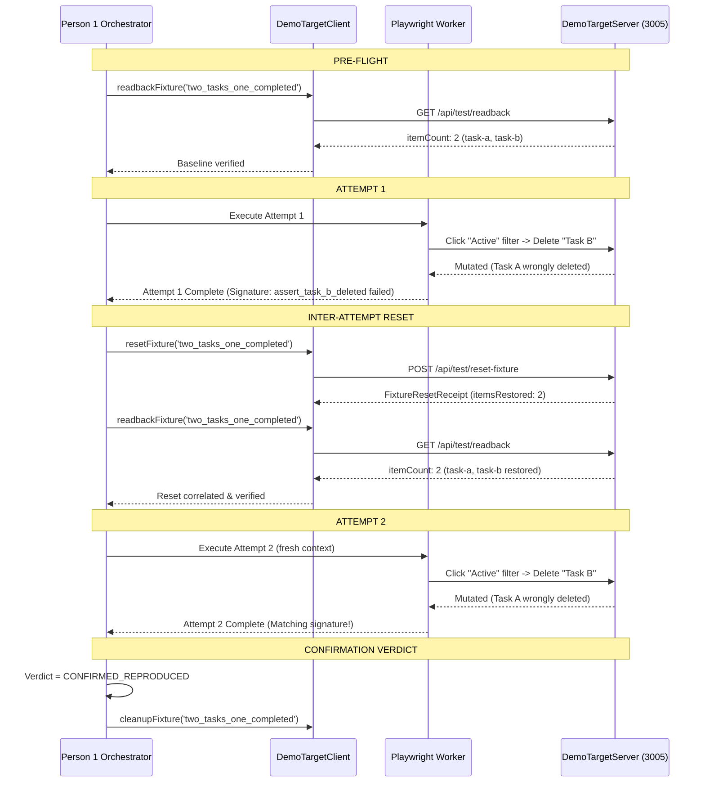

# TraceCase — H-02 Target, Fixtures, and Reset/Readback Handoff Specification

**Document ID:** `H-02-HANDOFF`  
**Author:** Person 2 (AI, Controlled Target, and Evaluation Lead)  
**Recipient / Coordinator:** Person 1 (Lead Backend Architect & Playwright Worker Integrator)  
**Date:** 20 October 2026  
**Implementation Source:** [`demo-target/`](file:///c:/Users/gjaya/OneDrive/Desktop/PROJECTS/TraceCase/demo-target), [`demo-target/client.ts`](file:///c:/Users/gjaya/OneDrive/Desktop/PROJECTS/TraceCase/demo-target/client.ts)  
**Test Suite:** [`tests/demo-target.test.ts`](file:///c:/Users/gjaya/OneDrive/Desktop/PROJECTS/TraceCase/tests/demo-target.test.ts) (26/26 passed)  
**Status:** IMPLEMENTED AND NON-BROWSER VERIFIED (Deterministic Target & Store Tests Passing; Gate G3 Contract Ready; Live Browser Execution & Deployed Acceptance DEFERRED BY USER)  

---

## 1. Executive Summary & Purpose

In accordance with **Person 2 P2-02** and integration stage **Phase 3**, Person 2 has delivered the standalone, controlled staging demo target: **`TraceCase-Demo-Tasks`**, along with its typed client adapter [`DemoTargetClient`](file:///c:/Users/gjaya/OneDrive/Desktop/PROJECTS/TraceCase/demo-target/client.ts).

This specification provides Person 1 with:
1. **Reproducible Target Instances:** Two independent, non-conflicting configurations running on ports `3005` (buggy build `v1.0.0-buggy`) and `3006` (fixed build `v1.0.1-fixed`).
2. **Deterministic Seeded Defect (TC1 vs TC2):** Filtering on `Active` and deleting Task B erroneously deletes Task A under buggy mode due to index-offset desynchronization, while correctly deleting Task B under fixed mode.
3. **Privileged, Authenticated Reset & Readback Webhooks:** `POST /api/test/reset-fixture` and `GET /api/test/readback` protected by `X-TraceCase-Reset-Auth` header.
4. **Disposable Fixture Scopes:** Whitelisted fixture configurations (`two_tasks_one_completed`, `three_tasks_multi_status`, `auth_test_user`, `default`) ensuring cross-fixture isolation.
5. **Fail-Closed Safety & Validation:** Strict prototype-property rejection (`__proto__`, `constructor`), body validation, and fail-closed auth handling.
6. **TC4 Synthetic Secret Surface:** Documented diagnostic scenario emitting synthetic tokens for Person 1 capture and Person 3 redaction.

---

## 2. Seeded Defect Mechanics & Ground Truth

### 2.1 Backing Data Model
Within the default scope (`two_tasks_one_completed`):
- `task-a`: Title `"Task A (Completed)"`, `completed: true`, initial array index 0.
- `task-b`: Title `"Task B (Active)"`, `completed: false`, initial array index 1.

### 2.2 Buggy Deletion (`v1.0.0-buggy` — TC1)
When the user switches the filter to `Active`:
1. The visible list contains only `task-b` at displayed index 0.
2. Clicking "Delete" on `task-b` sends `DELETE /api/tasks/task-b?filter=active&scope=two_tasks_one_completed`.
3. In `demo-target/store.ts`:
   ```typescript
   // BUGGY BEHAVIOR: Slices backing array using visible index
   const visibleTasks = this.getTasks(scope, currentFilter);
   const filteredIndex = visibleTasks.findIndex((t) => t.id === targetId); // returns 0
   const [wronglyRemoved] = tasks.splice(filteredIndex, 1); // removes index 0 (Task A)!
   ```
4. **Outcome:** Task A is deleted; Task B remains present and active.

### 2.3 Fixed Deletion (`v1.0.1-fixed` — TC2)
Under the fixed build configuration:
1. Deletion ignores the displayed index and deletes strictly by immutable record ID (`t.id !== targetId`).
2. **Outcome:** Task B is deleted; Task A is preserved.

### 2.4 Supported Disposable Fixture Scopes (`SupportedFixtureScope`)
The store explicitly whitelists exactly four disposable fixture scopes (`SupportedFixtureScope`), each seeded with an isolated baseline:

| Fixture Scope Name | Initial Count | Seeded Items | Purpose |
|---|---|---|---|
| `two_tasks_one_completed` | 2 | `task-a` (completed), `task-b` (active) | Primary evaluation benchmark for TC1 & TC2 filtered deletion reproduction. |
| `three_tasks_multi_status` | 3 | `task-a` (completed), `task-b` (active), `task-c` (active) | Multi-item status filtering and cross-fixture isolation verification. |
| `auth_test_user` | 1 | `task-auth-1` (active) | Dedicated user workspace for TC4 diagnostic token and secret redaction surface. |
| `default` | 2 | `task-a` (completed), `task-b` (active) | Canonical fallback alias guaranteeing backward compatibility with base runners. |

Any request specifying a scope outside this whitelist is rejected immediately with HTTP 400 `UNKNOWN_FIXTURE_SCOPE`.

---

## 3. Supported Startup Configurations

The target application is started via CLI using environment variables. Command-line flags are not supported.

### Windows PowerShell
```powershell
# 1. Buggy Target (Port 3005)
$env:DEMO_TARGET_PORT="3005"; $env:DEMO_TARGET_BUG_MODE="true"; $env:DEMO_TARGET_BUILD_VERSION="v1.0.0-buggy"; $env:TARGET_RESET_SECRET="tc-disposable-secret-2026"; npx tsx demo-target/server.ts

# 2. Fixed Target (Port 3006)
$env:DEMO_TARGET_PORT="3006"; $env:DEMO_TARGET_BUG_MODE="false"; $env:DEMO_TARGET_BUILD_VERSION="v1.0.1-fixed"; $env:TARGET_RESET_SECRET="tc-disposable-secret-2026"; npx tsx demo-target/server.ts
```

### Windows Command Prompt (CMD)
```cmd
rem Buggy Target (Port 3005)
cmd /c "set DEMO_TARGET_PORT=3005&& set DEMO_TARGET_BUG_MODE=true&& set DEMO_TARGET_BUILD_VERSION=v1.0.0-buggy&& set TARGET_RESET_SECRET=tc-disposable-secret-2026&& npx tsx demo-target/server.ts"

rem Fixed Target (Port 3006)
cmd /c "set DEMO_TARGET_PORT=3006&& set DEMO_TARGET_BUG_MODE=false&& set DEMO_TARGET_BUILD_VERSION=v1.0.1-fixed&& set TARGET_RESET_SECRET=tc-disposable-secret-2026&& npx tsx demo-target/server.ts"
```

### Linux / macOS / Bash
```bash
# Buggy Target (Port 3005)
DEMO_TARGET_PORT=3005 DEMO_TARGET_BUG_MODE=true DEMO_TARGET_BUILD_VERSION=v1.0.0-buggy TARGET_RESET_SECRET=tc-disposable-secret-2026 npx tsx demo-target/server.ts

# Fixed Target (Port 3006)
DEMO_TARGET_PORT=3006 DEMO_TARGET_BUG_MODE=false DEMO_TARGET_BUILD_VERSION=v1.0.1-fixed TARGET_RESET_SECRET=tc-disposable-secret-2026 npx tsx demo-target/server.ts
```

---

## 4. Webhook & Endpoint Contracts

### 4.1 Authentication & Fail-Closed Policy (`TC-INV-006`)
All privileged endpoints (`/api/test/*`) require the `X-TraceCase-Reset-Auth` header (or `Authorization: Bearer <secret>`).
- If `TARGET_RESET_SECRET` is unset, empty, or whitespace, `verifyResetAuth()` **fails closed**, returning HTTP 401 on every reset/readback/cleanup call.
- The reset secret is strictly server-configured; it is never sent to browser clients or included in AI agent prompts.

### 4.2 Reset Fixture: `POST /api/test/reset-fixture`

**Request Headers & Body:**
```http
POST /api/test/reset-fixture HTTP/1.1
Host: localhost:3005
Content-Type: application/json
X-TraceCase-Reset-Auth: tc-fixture-secret-2026

{
  "fixtureScope": "two_tasks_one_completed",
  "faultInjection": "NONE"
}
```

**Receipt Response (HTTP 200 OK):**
```json
{
  "success": true,
  "receiptId": "7c9e6679-7425-40de-944b-e07fc1f90ae7",
  "timestamp": "2026-10-20T18:00:04.000Z",
  "fixtureScope": "two_tasks_one_completed",
  "itemsRestored": 2,
  "buildVersion": "v1.0.0-buggy"
}
```

**Validation & Error Responses:**
- Missing/invalid auth: `HTTP 401 UNAUTHORIZED_RESET`
- Invalid JSON body or array payload: `HTTP 400 INVALID_REQUEST_BODY`
- Unrecognized or prototype scope (`__proto__`, `constructor`): `HTTP 400 UNKNOWN_FIXTURE_SCOPE`
- Unsupported fault injection string: `HTTP 400 UNSUPPORTED_FAULT_INJECTION`
- Fault injection disabled in target environment: `HTTP 400 FAULT_INJECTION_DISABLED`

### 4.3 Independent Readback: `GET /api/test/readback`

HTTP 200 on reset does not prove that actual records were restored (`TC-INV-005`, `TC-INV-006`). Person 1's verifier must independently query the readback webhook:

**Request:**
```http
GET /api/test/readback?scope=two_tasks_one_completed HTTP/1.1
Host: localhost:3005
X-TraceCase-Reset-Auth: tc-fixture-secret-2026
```

**Response (HTTP 200 OK):**
```json
{
  "fixtureScope": "two_tasks_one_completed",
  "buildVersion": "v1.0.0-buggy",
  "itemCount": 2,
  "items": [
    {
      "id": "task-a",
      "title": "Task A (Completed)",
      "completed": true,
      "createdAt": "2026-10-20T10:00:00.000Z"
    },
    {
      "id": "task-b",
      "title": "Task B (Active)",
      "completed": false,
      "createdAt": "2026-10-20T10:01:00.000Z"
    }
  ],
  "verifiedAt": "2026-10-20T18:00:04.500Z"
}
```

### 4.4 Fixture Cleanup: `POST /api/test/cleanup-fixture`

**Request:**
```http
POST /api/test/cleanup-fixture HTTP/1.1
Host: localhost:3005
Content-Type: application/json
X-TraceCase-Reset-Auth: tc-fixture-secret-2026

{
  "fixtureScope": "two_tasks_one_completed"
}
```

**Response (HTTP 200 OK):**
```json
{
  "success": true,
  "message": "Fixture scope 'two_tasks_one_completed' cleaned up."
}
```

### 4.5 Safe Application Info: `GET /api/build-info` or `GET /api/info`

Returns public application metadata. Defect flags (`bugModeActive`) are **strictly omitted** to prevent oracle cheating by model actors.

```json
{
  "applicationName": "TraceCase-Demo-Tasks",
  "buildVersion": "v1.0.0-buggy",
  "environment": "sandbox",
  "serverTimestamp": "2026-10-20T18:00:00.000Z"
}
```

---

## 5. Two-Run Confirmation Sequence for Person 1

Below is the verified integration protocol for Person 1's orchestrator and Playwright worker to execute verified two-run confirmation:



---

## 6. TC4: Synthetic Secret Diagnostic Scenario

### 6.1 Purpose & Boundary
TC4 evaluates that in-stream credentials emitted during web interaction are scrubbed from public artifacts before evidence finalization.
- **Strict Constraint:** Real credentials, production keys, or AWS/OAuth tokens must **never** be used.
- **Synthetic Token:** The demo target emits the fixed synthetic test token:
  ```text
  Bearer synthetic-jwt-token-xyz-9876
  ```

### 6.2 Emission Surfaces
1. **HTML Web UI:** When accessed with `?scope=auth_test_user`, the target logs to the browser console:
   ```javascript
   console.log('[DEBUG_AUTH] Active session token: Bearer synthetic-jwt-token-xyz-9876');
   ```
2. **Diagnostic Login API:** Invoking `POST /api/auth/login`:
   - Logs `[DEBUG_AUTH] User '<user>' session initialized with Bearer synthetic-jwt-token-xyz-9876` to Node console.
   - Emits response header `X-Diagnostic-Token: Bearer synthetic-jwt-token-xyz-9876`.

### 6.3 Separation of Responsibilities
- **Person 1 (Capture):** Captures raw browser console messages and raw CDP network exchange into private workspace artifacts (`console.raw.log`, `network.raw.json`).
- **Person 3 (Sanitization):** Runs the evidence scrubbing pipeline to mask `Bearer synthetic-...` into `[REDACTED]` prior to creating public-safe evidence manifests.
- **Person 2 (Target & Harness):** Provides the controlled synthetic target emission and validates that the Evaluation Harness honestly blocks release when leak detection is active.
- **Verification Note:** Live browser emission and Playwright CDP network capture remain unverified in local non-browser test runs.

---

## 7. In-Memory Lifecycle & Limitations

1. **Storage:** All fixtures are held in Node process memory per instance.
2. **Zero Database Coupling:** The demo target does not connect to TraceCase's PostgreSQL database.
3. **Volatile State:** Restarting the process resets all fixtures back to their initial seed state.
4. **Cross-Fixture Isolation:** Mutations in `two_tasks_one_completed` do not leak into `three_tasks_multi_status` or `auth_test_user`.

---

## 8. Automated Test Evidence

All target behavior, HTTP endpoints, security constraints, and client adapter operations are verified in [`tests/demo-target.test.ts`](file:///c:/Users/gjaya/OneDrive/Desktop/PROJECTS/TraceCase/tests/demo-target.test.ts):

- **Store Defect Logic:** Buggy deletion outcome (TC1) and fixed deletion outcome (TC2) verified by stable task ID.
- **Repeated Reset Cycles:** Verified that 2+ reset and readback cycles return identical records.
- **Cross-Fixture Isolation:** Verified that mutating scope A leaves scope B intact.
- **Fault Injection:** Verified that `PARTIAL_RESET` restores 1 item and is detectable via readback.
- **Prototype Property Rejection:** Verified that `__proto__`, `constructor`, `prototype`, `toString` are rejected with HTTP 400.
- **Fail-Closed Auth:** Verified that empty `TARGET_RESET_SECRET` rejects all privileged requests with HTTP 401.
- **Invalid Payloads & Filters:** Verified that invalid bodies and filters return HTTP 400.
- **Client Adapter (`DemoTargetClient`):** Verified `getBuildInfo`, `resetFixture`, `readbackFixture`, and `cleanupFixture` against live server instances.
- **TC4 Synthetic Emission:** Verified diagnostic login endpoint emits synthetic token.
