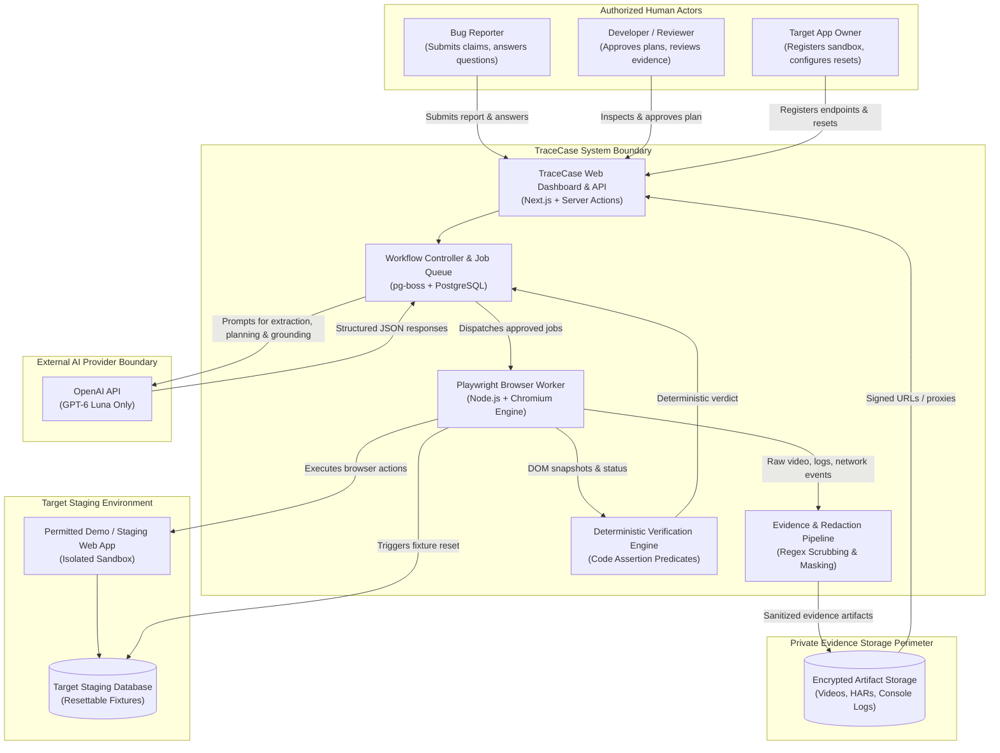
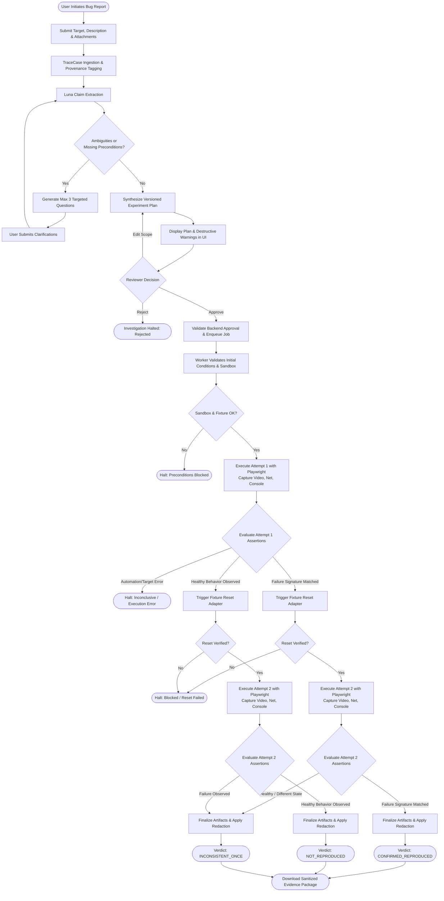
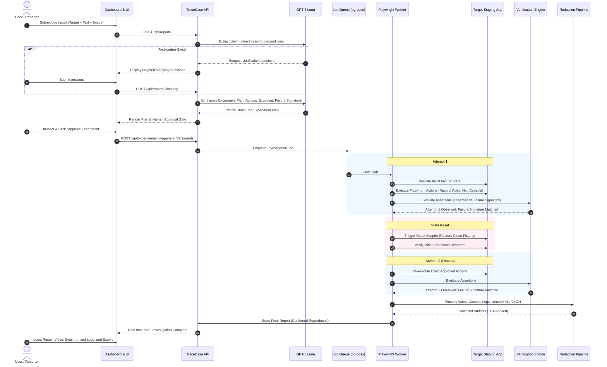
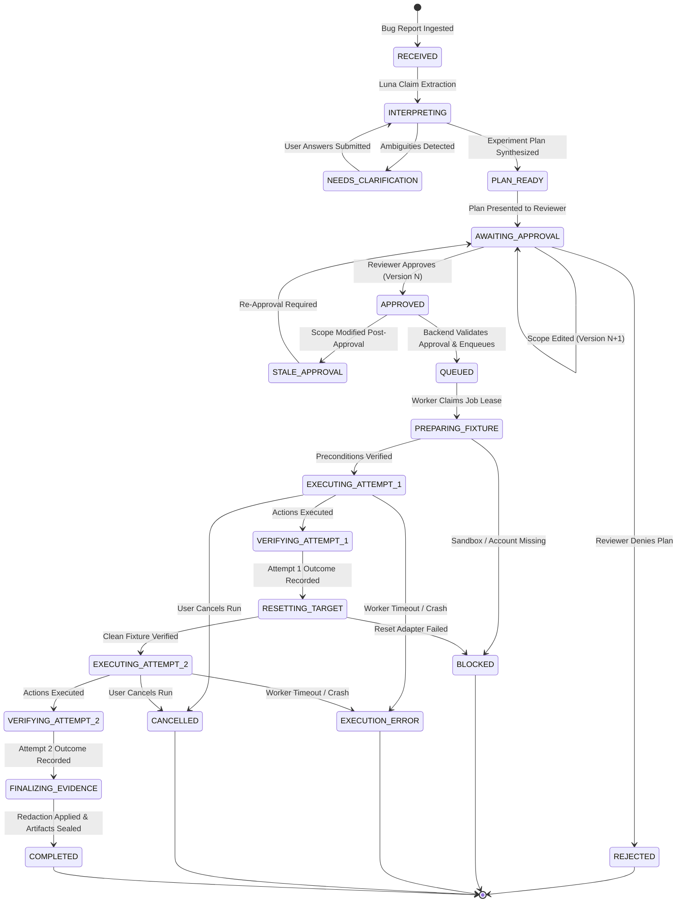
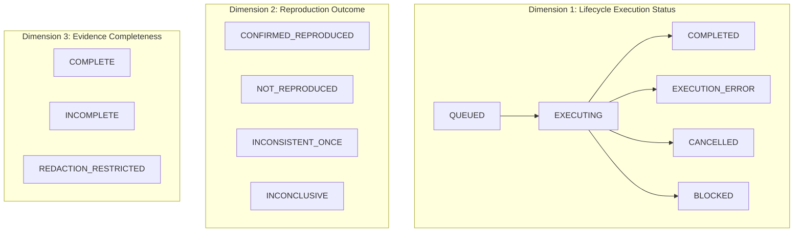
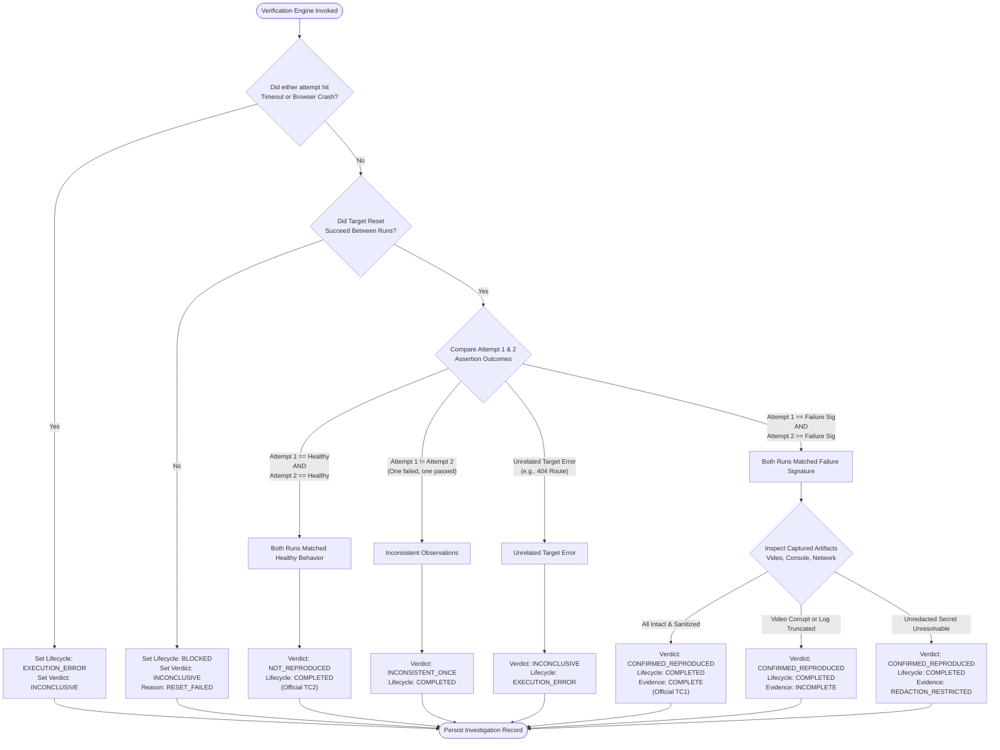
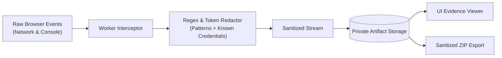
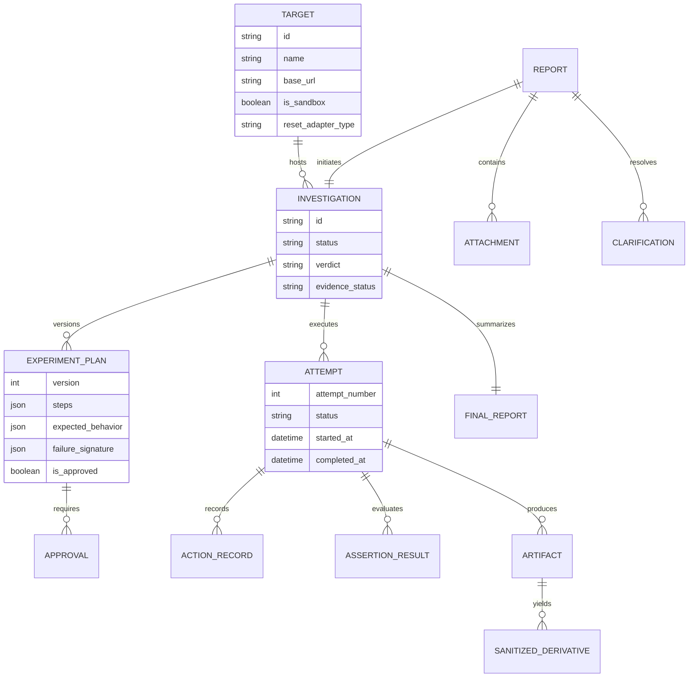

# TraceCase — Product Requirements Document (PRD)

**Document ID:** TC-PRD-001  
**Document Purpose:** Baseline Product Requirements Document for TraceCase (Bug Reproduction Agent)  
**Version:** 1.0.0-draft  
**Date:** 20 October 2026  
**Status:** Draft for Review  
**Authoring Role:** Product Requirements Author (Antigravity AI Agent)  
**Intended Readers:** Technical Lead, AI/Agent Engineers, Frontend/Fullstack Engineers, Hackathon Evaluators, and subsequent Implementation Agents.

---

## Table of Contents

- [A. Document Control and Source Register](#a-document-control-and-source-register)
- [B. Executive Product Definition](#b-executive-product-definition)
- [C. Problem, Users, and Jobs to Be Done](#c-problem-users-and-jobs-to-be-done)
- [D. Goals, Non-Goals, and Scope Tiers](#d-goals-non-goals-and-scope-tiers)
- [E. Product Principles and Invariants](#e-product-principles-and-invariants)
- [F. Initial Operating Envelope](#f-initial-operating-envelope)
- [G. Input Requirements and Provenance](#g-input-requirements-and-provenance)
- [H. End-to-End User Journeys](#h-end-to-end-user-journeys)
- [I. Functional Requirements](#i-functional-requirements)
- [J. Experiment Approval and Autonomy Boundaries](#j-experiment-approval-and-autonomy-boundaries)
- [K. Agent Behavior and Product Boundaries](#k-agent-behavior-and-product-boundaries)
- [L. Verification and Outcome Semantics](#l-verification-and-outcome-semantics)
- [M. Attempts, Resets, Retries, and Recovery](#m-attempts-resets-retries-and-recovery)
- [N. Evidence and Privacy Requirements](#n-evidence-and-privacy-requirements)
- [O. Result and Developer Handoff](#o-result-and-developer-handoff)
- [P. UI/UX Requirements](#p-ui-ux-requirements)
- [Q. Conceptual Information Model](#q-conceptual-information-model)
- [R. Product-Facing Nonfunctional Requirements](#r-product-facing-nonfunctional-requirements)
- [S. Official-Case Acceptance Matrix](#s-official-case-acceptance-matrix)
- [T. Evaluation and Success Metrics](#t-evaluation-and-success-metrics)
- [U. Prioritized Innovations](#u-prioritized-innovations)
- [V. Dependencies, Assumptions, Risks, and Open Decisions](#v-dependencies-assumptions-risks-and-open-decisions)
- [W. Release Gates, Ownership, and Documentation Handoff](#w-release-gates-ownership-and-documentation-handoff)
- [X. Requirements Traceability Matrix](#x-requirements-traceability-matrix)

---

## A. Document Control and Source Register

### A.1 Document Control Information
- **Title:** Product Requirements Document (PRD) for TraceCase
- **Document Version:** 1.0.0-draft
- **Creation Date:** 20 October 2026
- **Status:** Draft for Review (Requires explicit human review before transition to Approved baseline)
- **Authoring Role:** Product Requirements Author
- **Intended Audience:** Engineering team, AI prompt engineers, QA reviewers, hackathon judges.

### A.2 Sources Inspected
1. **`TraceCase-Agent-Project-Context.md` (Context revision 1.0, dated 20 October 2026):** Consolidated project context handoff establishing user decisions, architectural baseline, official brief mapping, and scope discipline.
2. **Workspace Inspection:** Local repository at `c:\SHARAN PROJECTS\TraceCase` inspected on 20 October 2026; confirmed currently clean/empty (no pre-existing code, schemas, or markdown specifications).
3. **Official Hackathon Assignment Source Data:** Problem statement extracted from Ziro.Digital Agentic AI Hackathon 2026 brief for "Bug Reproduction Agent" under Developer & Enterprise AI track.

### A.3 Sources Unavailable / Unverified
1. **Live Hackathon Submission Portal:** Submission opening was confirmed for 20 October 2026, 11:00 AM IST via brief screenshot, but final submission deadline and specific multi-field submission forms were not directly inspected.
2. **OpenAI Account Balance:** User reports approximately US$20 in OpenAI credits; actual live account balance, rate limits, and quota status were not independently inspected.
3. **Specific Demo Application Codebase:** The concrete open-source demo repository, license, and deployment endpoint for the target test application are not yet committed to this repository.

### A.4 Relationship to Context & Precedence Rules
This PRD derives directly from the planning consensus recorded in `TraceCase-Agent-Project-Context.md`. In case of ambiguity:
1. Explicit user instructions take precedence over earlier assistant proposals.
2. Official hackathon requirements take precedence over optional innovations.
3. Observed repository implementation (currently empty) establishes existing code, not future approved scope.
4. Earlier assistant recommendations for alternative models (Claude, GPT-6.1 Sol) or broader scopes (automatic patching, production scraping) are explicitly superseded.

---

## B. Executive Product Definition

**TraceCase** is an intelligent web application that transforms incomplete, vague web bug reports into controlled, human-approved reproduction experiments, executes them against a permitted staging/demo web application, and returns a verified, traceable outcome accompanied by undeniable evidence.

### B.1 The Central Product Question
> **"Can the reported failure be reproduced under recorded conditions, and what observations support that conclusion?"**

### B.2 Core Value Proposition
- **For Developers & QA Engineers:** Eliminates hours spent manually deciphering vague bug reports, guessing preconditions, and struggling to reproduce intermittent defects.
- **For Product Organizations:** Bridges the communication gap between non-technical bug reporters and engineering teams by providing immutable proof (screen recording, synchronized console logs, filtered network requests, and precise environment metadata).

### B.3 The Scope Boundary: Reproduction vs. Discovery, Diagnosis, and Repair
TraceCase is explicitly centered on **Reproduction**:
- **Bug Discovery (Out of Scope):** Unconstrained web crawling to find unknown bugs across an entire website is out of scope.
- **Reproduction (In Scope):** Grounding a specific reported claim into executable browser actions and validating whether the reported anomaly manifests.
- **Diagnostic Hypotheses (Secondary / Prioritized Addition):** Generating evidence-supported hypotheses regarding why the defect occurred is an optional post-reproduction value-add.
- **Automatic Repair / Patching (Explicitly Out of Scope):** Automatically modifying source code, generating pull requests, or deploying hotfixes is excluded from the initial operating envelope.

### B.4 High-Level Product Context

#### Diagram 1: Product Context Diagram (Conceptual Baseline)
*The following diagram illustrates the high-level boundary of TraceCase, depicting human actors, the core application, the exclusive model provider, the isolated target under test, and the protected evidence perimeter.*



---

## C. Problem, Users, and Jobs to Be Done

### C.1 Evidence-Grounded Problems
1. **Incomplete & Vague Bug Claims:** Reports frequently omit crucial prerequisites, URL routes, starting data fixtures, or browser details.
2. **Ambiguous Expected Behavior:** Users describe what went wrong without stating what *should* have happened, making programmatic verification impossible.
3. **Non-Deterministic "Works on My Machine" Friction:** Developers fail to recreate the exact initial conditions, leading to prematurely closed "Cannot Reproduce" tickets.
4. **Dangerous Data Mutation:** Automated tools testing destructive bugs (e.g., deletions, account resets) risk mutating production or dirtying shared staging data without guardrails.
5. **Secret Leakage in Logs:** Network headers, session cookies, and authentication tokens frequently leak into unredacted reproduction logs and screenshots.
6. **Automation Failures Masquerading as Bugs:** Brittle locators, network timeouts, or script crashes are often misdiagnosed as target application defects.

### C.2 User Personas and Roles
*Note: In the hackathon context, a single user or judge may fulfill all three roles sequentially.*

#### 1. Target Application Owner / Developer
- **Role:** Configures the permitted target application, staging URLs, restricted test credentials, and database/fixture reset endpoints.
- **Primary Goal:** Ensure TraceCase tests the application safely within an isolated sandbox without corrupting shared environments.
- **Key Permissions:** Manage target application settings, configure reset endpoints, store test credentials.

#### 2. Bug Reporter (QA Engineer, Support Agent, or User)
- **Role:** Submits raw, freeform bug descriptions and optional attachments; responds to clarification queries.
- **Primary Goal:** Clearly communicate an observed problem without having to manually write an automated script.
- **Key Permissions:** Submit reports, answer clarifying questions, view investigation status.

#### 3. Reviewer / Lead Developer
- **Role:** Reviews the proposed reproduction plan, inspects destructive action warnings, grants/denies execution approval, and consumes the final evidence package.
- **Primary Goal:** Verify whether the bug is real, inspect network/console logs, and export reproducible findings.
- **Key Permissions:** Approve/edit/reject experiments, view unredacted or sanitized artifacts according to role, download evidence bundles.

### C.3 Jobs to Be Done (JTBD)
- **JTBD 1:** When I receive a vague bug report, I want to convert it into a structured, step-by-step reproduction experiment so that I don't waste time guessing what the user did.
- **JTBD 2:** When a reproduction experiment involves data mutation, I want explicit human approval and sandbox isolation so that critical data is never destroyed by mistake.
- **JTBD 3:** When a bug is claimed to be reproduced, I want to see two independent, consecutive matching runs with synchronized screen recording, console logs, and network requests so that I have absolute confidence in the defect.
- **JTBD 4:** When an investigation completes, I want all sensitive auth tokens and passwords automatically redacted from shared logs so that security standards are strictly maintained.

---

## D. Goals, Non-Goals, and Scope Tiers

### D.1 Scope Tiering

| Tier | Classification | Description |
|---|---|---|
| **Tier 1: Core MVP (Mandatory)** | Required for initial release & official brief satisfaction | Target setup, report intake, interactive clarification, structured experiment proposal, human approval gate, real Playwright execution, independent deterministic verification, target fixture reset, repeat execution (2-run rule), artifact capture (video, console, network), secret redaction (TC4), sandbox protection (TC3), honest outcome reporting (TC1, TC2), history log. |
| **Tier 2: Prioritized Additions** | Planned enhancements (Post-Core) | Validated regression-test code export (`.spec.ts`), buggy-versus-fixed build comparison, synchronized multi-artifact timeline navigation, evidence-backed diagnostic hypotheses. |
| **Tier 3: Deferred / Out of Scope** | Explicitly deferred | Large-scale parallel browser execution, uploaded-video interpretation, autonomous website-wide exploration, reproduction step-reduction algorithms. |
| **Tier 4: Excluded Initially** | Explicitly out of scope | Production data mutation, native mobile app testing, hijacking existing local browser tabs, automatic code patching / PR generation, foundational model training or fine-tuning, complex enterprise multi-tenant billing. |

### D.2 Product Goals
- **G-1:** Transform ambiguous natural language bug reports into executable, validated Playwright reproduction experiments.
- **G-2:** Enforce a strict backend-level human approval gate prior to executing browser actions.
- **G-3:** Require two consecutive valid executions matching the identical reported failure signature before declaring a bug confirmed.
- **G-4:** Provide an unassailable evidence package consisting of video recording, console logs, network requests, and assertion outcomes for every attempt.
- **G-5:** Guarantee 100% of tested synthetic authentication tokens and passwords are redacted from shared logs and exports (TC4).
- **G-6:** Successfully demonstrate the four official hackathon test cases (TC1, TC2, TC3, TC4).

### D.3 Non-Goals
- **NG-1:** TraceCase will not autonomously fix source code or submit pull requests.
- **NG-2:** TraceCase will not test arbitrary production websites without pre-registered authorization.
- **NG-3:** TraceCase will not bypass CAPTCHA, Cloudflare challenges, or two-factor authentication (OTP) without mock endpoints or explicit manual handoffs.
- **NG-4:** TraceCase will not claim 100% bug reproduction certainty based on a single successful execution.

---

## E. Product Principles and Invariants

The following invariants are locked decisions and must be preserved across all specifications and implementations:

1. **Product Name:** Must remain **TraceCase**.
2. **AI Model Exclusivity:** All AI agent roles must use **GPT-6 Luna through the OpenAI API**. No fallback or alternative model (Claude, GPT-6.1 Sol, etc.) may be introduced without an explicit user decision.
3. **Model Proposes, Code Enforces:** GPT-6 Luna proposes interpretations, plans, and grounded locators. Deterministic code enforces schemas, budgets, navigation boundaries, human approvals, and verification predicates.
4. **Two-Run Confirmation Rule:** A bug is confirmed if and only if the exact same normalized failure signature manifests across **two separate, valid attempts** with restored starting conditions between attempts.
5. **Tri-Dimensional State Separation:** Lifecycle execution status, reproduction verdict, and evidence completeness are tracked as three distinct, independent axes.
6. **Backend-Enforced Approval Gate:** Human approval is validated by the server and workflow controller prior to issuing browser execution jobs. UI approval badges alone are insufficient.
7. **Sandbox-Only Destructive Execution:** Any action tagged as mutating or deleting data must only execute against verified, resettable sandbox targets with disposable fixtures.
8. **Sanitization Before Sharing:** Secret redaction operates during ingestion and prior to storage/sharing. Raw secrets must never enter public dashboard views or LLM contexts.
9. **Backend Reset $\neq$ Browser Isolation:** Clearing browser cookies or cache does not reset server database state. Target data fixtures must be reset via explicit reset adapters.
10. **Honest Reporting of Uncertainty:** An automation failure or missing prerequisite must be reported as `Execution Error` or `Blocked`, never as `Not Reproduced`.

---

## F. Initial Operating Envelope

- **Target Applications:** Exactly one well-configured, permitted open-source demo/staging web application with a documented REST API and resettable database (e.g., a modern Task/Kanban CRUD application).
- **Browser Runtime:** Server-side Node.js worker executing headless Chromium via Playwright. (Visible headful mode supported locally during development).
- **Concurrency:** Exactly **one (1) active browser investigation** running at a time to prevent resource exhaustion, port collisions, and database race conditions.
- **Input Modalities:** Text descriptions, user-supplied screenshots (PNG/JPEG/WebP), and bounded input fixture files (JSON/CSV $\le 1\text{ MB}$). Video upload analysis is deferred.
- **Budgetary Boundaries:** Total OpenAI API consumption constrained to the user's reported $\approx\text{US}\$20$ credit envelope. Token usage per investigation must be bounded by compact DOM representations and pre-filtered logs.
- **Network Boundaries:** Browser worker restricted to registered staging domains and authorized mock endpoints. External web crawling is blocked.

---

## G. Input Requirements and Provenance

Every fact ingested by TraceCase must have an immutable provenance record: `USER_SUPPLIED`, `TARGET_CONFIG`, `BROWSER_OBSERVED`, `ATTACHMENT_DERIVED`, or `INFERRED_ASSUMPTION`.

| Input Field | Required When | Supplied By | Purpose | Missing / Invalid Handling | Provenance Category |
|---|---|---|---|---|---|
| **Target Application** | At submission | Reporter / Config | Identifies the registered staging URL, auth credentials, and reset endpoint. | Submission blocked; must select a registered target. | `TARGET_CONFIG` |
| **Bug Description** | At submission | Reporter | Freeform natural language claim of the observed failure. | Submission blocked if empty ($< 10$ chars). | `USER_SUPPLIED` |
| **Expected Behavior** | Before plan approval | Reporter / Clarification | Programmatic baseline for what a healthy application should do. | System prompts clarification; plan cannot be approved without it. | `USER_SUPPLIED` or `INFERRED_ASSUMPTION` (must be confirmed) |
| **Suspected Steps** | Optional at submission | Reporter | Ordered user actions leading to the bug. | Luna infers plausible action path from DOM and description. | `USER_SUPPLIED` |
| **Reported Environment** | Optional at submission | Reporter | Reporter's OS, browser, screen resolution, app version. | Recorded as reported metadata; does not override tested worker environment. | `USER_SUPPLIED` |
| **Screenshots** | Optional at submission | Reporter | Visual evidence of the error or page state. | Ingested by Luna for text/error extraction; does not substitute for Playwright evidence. | `ATTACHMENT_DERIVED` |
| **Sample Files** | Optional at submission | Reporter | Test data files triggering the bug (e.g., malformed CSV). | Sanitized, validated for size ($\le 1\text{ MB}$), staged in worker container. | `USER_SUPPLIED` |
| **Diagnostic Logs** | Optional at submission | Reporter | Client-side console dumps or server error traces. | Ingested for keyword extraction; kept distinct from worker-captured logs. | `USER_SUPPLIED` |

---

## H. End-to-End User Journeys

#### Diagram 2: End-to-End User Journey Flowchart (Proposed Operational Flow)
*This flowchart depicts the end-to-end user and system journey, including positive branches, clarification cycles, human approval rejection, and execution failure handling.*



#### Diagram 4: Happy-Path Interaction Sequence Diagram (Conceptual Implementation)
*This sequence diagram shows the chronological lifecycle of a successful two-attempt reproduction (TC1), detailing component interactions, approval gating, and state resets.*



### H.1 Primary Happy Path (TC1: Confirmed Reproduction)
1. **Target Setup:** Application Owner registers `http://staging.target.local`, configures disposable account `test_qa@target.local`, and provides reset webhook.
2. **Submit:** Reporter submits: *"In the Tasks view, after filtering to 'Active', clicking delete on task 'Release' deletes 'Invoice' instead. Release stays on screen."*
3. **Understand & Clarify:** Luna parses the report, verifies that expected behavior is known (Release should be deleted, Invoice must remain), and generates a structured plan.
4. **Plan & Approve:** UI displays the step plan: Navigate $\to$ Filter 'Active' $\to$ Click delete on 'Release' $\to$ Inspect list. The plan identifies a destructive action (data deletion). Reviewer inspects and approves Plan v1.
5. **Prepare & Attempt 1:** Worker confirms fixture tasks exist (Task A: Invoice [completed], Task B: Release [active]). Worker launches Playwright, starts screen recording, logs network requests and console events, and executes the clicks.
6. **Verify Attempt 1:** Verifier checks DOM and API readbacks. Task A is missing; Task B remains. This matches the **Reported Failure Signature**.
7. **Reset:** Worker executes the reset adapter. Task A and Task B are cleanly restored.
8. **Attempt 2:** Worker repeats the exact procedure under fresh browser context. Same observation: Task A deleted, Task B remains.
9. **Finalize & Redact:** Artifacts are scanned for sensitive tokens. Video is encoded.
10. **Result:** Investigation marked **Confirmed Reproduced**. Reviewer watches side-by-side video, inspects the network delete call, and exports the findings.

### H.2 Alternative Journey 1 (TC2: Valid Non-Reproduction)
- **Scenario:** Bug report states: *"Clicking 'Export CSV' causes a 500 error."*
- **Execution:** Worker runs Attempt 1. 'Export CSV' is clicked. Server responds with `200 OK` and a valid CSV blob downloads. Verifier evaluates the assertion: expected healthy behavior observed.
- **Repeat:** Fixture reset, Attempt 2 executed. Exactly identical healthy behavior observed.
- **Verdict:** Marked **Not Reproduced Under Tested Conditions**. The final report includes full steps tried, target build version, console logs, and network logs proving the healthy `200 OK` responses.

### H.3 Alternative Journey 2 (TC3: Destructive Action in Unverified Environment)
- **Scenario:** Bug report requires dropping a table or purging all tasks.
- **Safety Enforcement:** TraceCase backend inspects target metadata. If target is flagged as `PRODUCTION` or lacks a confirmed `is_sandbox: true` flag, the experiment generator halts.
- **Approval Flow:** The approval UI flags the action with a severe warning: `Destructive Mutation: Permitted only because target is verified sandbox`. If the user rejects the plan, execution is permanently prevented.

### H.4 Alternative Journey 3 (TC4: Authentication Token Redaction)
- **Scenario:** Bug report involves user profile update. The web application logs the JWT `Bearer eyJhbGciOi...` or API key to the browser console and query string.
- **Sanitization:** Prior to saving network requests or console entries to disk/database, the Redaction Pipeline matches the token against known session secrets and regex patterns, replacing it with `[REDACTED_AUTH_TOKEN]`. The exported log contains zero raw credential bytes.

### H.5 Alternative Journey 4: Execution Failure & Infrastructure Error
- **Scenario:** Staging server drops connection (502 Bad Gateway) or Playwright locator times out due to target freeze.
- **System Handling:** System halts, marks Attempt 1 as `Execution Error`, preserves captured partial logs, and flags the run as **Inconclusive / Infrastructure Error**. It explicitly **does not** mark the bug as "Not Reproduced."

---

## I. Functional Requirements

### I.1 Target Configuration and Access
- **TC-FR-001 (Target Registration):**
  - **Behavior:** The system must allow Application Owners to register authorized staging/demo targets with base URL, authentication mode, allowed navigation patterns, and environment type (`sandbox` vs `production_blocked`).
  - **Actor:** Application Owner
  - **Source:** Core Requirement / Safety Policy
  - **Priority:** Core (Tier 1)
  - **Acceptance Criteria:**
    - *Given* an owner enters a target URL with `is_sandbox: false`,
    *When* a reproduction plan containing destructive mutations is submitted,
    *Then* the system must reject execution with a validation error.
  - **Failure Behavior:** Target marked inactive; cannot be selected for new reports.
  - **Dependencies:** None.

- **TC-FR-002 (Target Reset Adapter Registration):**
  - **Behavior:** The system must store and validate an automated reset mechanism (REST webhook, DB seed command, or disposable fixture script) for each registered target.
  - **Actor:** Application Owner
  - **Source:** Context Invariant / Two-Attempt Rule
  - **Priority:** Core (Tier 1)
  - **Acceptance Criteria:**
    - *Given* a registered target,
    *When* the worker invokes the reset adapter,
    *Then* it must return HTTP `200 OK` and verify baseline preconditions before Attempt 2 commences.

### I.2 Report Intake & Provenance
- **TC-FR-003 (Report Ingestion):**
  - **Behavior:** The system must ingest raw bug reports containing text description, target reference, optional suspected steps, optional expected behavior, and file attachments ($\le 1\text{ MB}$ each, images or text data).
  - **Actor:** Reporter
  - **Source:** Official Brief
  - **Priority:** Core (Tier 1)
  - **Acceptance Criteria:**
    - *Given* a reporter submits a description and selects a target,
    *When* the submission payload is received,
    *Then* the system creates an immutable `BugReport` record with `USER_SUPPLIED` provenance tags on all inputs.

- **TC-FR-004 (Artifact Provenance Tracking):**
  - **Behavior:** The system must tag every fact, observation, and artifact with its exact origin (`USER_SUPPLIED`, `TARGET_CONFIG`, `BROWSER_OBSERVED`, `ATTACHMENT_DERIVED`, or `INFERRED_ASSUMPTION`).
  - **Actor:** System
  - **Source:** Context Section 7
  - **Priority:** Core (Tier 1)

### I.3 Claim Understanding & Clarification
- **TC-FR-005 (Intelligent Extraction via GPT-6 Luna):**
  - **Behavior:** The system must prompt GPT-6 Luna to extract an initial semantic claim, distinguish observed facts from missing prerequisites, and identify whether expected behavior is specified.
  - **Actor:** Report & Experiment Agent (Luna)
  - **Source:** Core Agentic Behavior
  - **Priority:** Core (Tier 1)
  - **Acceptance Criteria:**
    - *Given* an incomplete report missing the user's intended outcome,
    *When* Luna extracts the claim,
    *Then* the system transitions the investigation to `NEEDS_CLARIFICATION` and generates max 3 concise, multiple-choice questions.

- **TC-FR-006 (Interactive Clarification Loop):**
  - **Behavior:** The system must allow the reporter to answer clarifying questions. Answers must be appended to the investigation record without overwriting original inputs.
  - **Actor:** Reporter
  - **Source:** Core UX / Brief
  - **Priority:** Core (Tier 1)

### I.4 Experiment Creation & Human Approval Gate
- **TC-FR-007 (Versioned Experiment Plan Generation):**
  - **Behavior:** The system must synthesize a formal, versioned `ExperimentPlan` defining preconditions, exact semantic steps, intended healthy behavior, and the reported failure signature.
  - **Actor:** Report & Experiment Agent (Luna)
  - **Source:** Core Requirement
  - **Priority:** Core (Tier 1)

- **TC-FR-008 (Backend-Enforced Human Approval):**
  - **Behavior:** The backend must prohibit queueing or executing any browser actions until a human reviewer explicitly approves the current plan version (`is_approved: true`, `approved_plan_version: N`).
  - **Actor:** Reviewer / Backend Controller
  - **Source:** Official Brief / Safety Directive
  - **Priority:** Core (Tier 1)
  - **Acceptance Criteria:**
    - *Given* an experiment plan in `AWAITING_APPROVAL` status,
    *When* a direct execution API request is made without a valid approval token,
    *Then* the server must respond with HTTP `403 Forbidden` and refuse to enqueue the job.

- **TC-FR-009 (Approval Invalidation on Scope Edit):**
  - **Behavior:** If any step, target, assertion, or fixture parameter in an experiment plan is edited, the system must immediately revoke existing approval and reset status to `AWAITING_APPROVAL`.
  - **Actor:** Workflow Controller
  - **Source:** Context Section 13
  - **Priority:** Core (Tier 1)

### I.5 Browser Execution & Grounding
- **TC-FR-010 (Grounded Playwright Execution):**
  - **Behavior:** The Playwright worker must execute the approved actions sequentially, using semantic locators (role, accessible name, text) grounded in live DOM accessibility trees.
  - **Actor:** Browser Investigation Agent / Playwright Worker
  - **Source:** Context Section 11 & 13
  - **Priority:** Core (Tier 1)
  - **Acceptance Criteria:**
    - *Given* an approved step *"Click 'Delete'"*,
    *When* the page loads,
    *Then* the worker grounds the element via accessible role `button[name='Delete']` and executes the click within the approved target domain only.

- **TC-FR-011 (Bounded Adaptation / Self-Healing Locators):**
  - **Behavior:** If a locator fails due to minor DOM drift, the worker may query Luna to select an equivalent locator matching the identical semantic intent. The worker must **never** alter the semantic action, destination URL, or assertion logic.
  - **Actor:** Browser Investigation Agent
  - **Source:** Context Section 13
  - **Priority:** Core (Tier 1)

### I.6 Evidence Capture, Sanitization & Verification
- **TC-FR-012 (Comprehensive Evidence Capture):**
  - **Behavior:** During each attempt, the worker must capture: full screen video recording (`.webm`), timestamped console logs (stdout, stderr, uncaught exceptions), and timestamped network logs (URL, method, status, request/response headers, timing).
  - **Actor:** Playwright Worker
  - **Source:** Official Brief (TC1)
  - **Priority:** Core (Tier 1)

- **TC-FR-013 (Deterministic Verification Engine):**
  - **Behavior:** After completing the action sequence, code assertions must evaluate whether the observed state matches the **Reported Failure Signature** or the **Intended Correct Behavior**.
  - **Actor:** Verification Engine (Code)
  - **Source:** Invariant / Anti-Hallucination
  - **Priority:** Core (Tier 1)
  - **Acceptance Criteria:**
    - *Given* an assertion expecting element `#task-release` to be visible and `#task-invoice` to be absent,
    *When* DOM inspection confirms `#task-release` is present and `#task-invoice` is absent,
    *Then* the Verifier outputs `ATTEMPT_FAILURE_SIGNATURE_MATCHED = true`.

- **TC-FR-014 (Two-Attempt Confirmation Engine):**
  - **Behavior:** The system must execute Attempt 1 $\to$ invoke target reset adapter $\to$ verify clean preconditions $\to$ execute Attempt 2. Only if both attempts match the failure signature may the status become `CONFIRMED_REPRODUCED`.
  - **Actor:** Workflow Controller
  - **Source:** Official Brief (TC1) / Context Section 14
  - **Priority:** Core (Tier 1)

- **TC-FR-015 (Secret & Auth Token Redaction):**
  - **Behavior:** The system must sanitize all captured console logs, network headers, query strings, and exported files against regex patterns and known test credentials, replacing matches with `[REDACTED_AUTH_TOKEN]`.
  - **Actor:** Redaction Pipeline
  - **Source:** Official Brief (TC4)
  - **Priority:** Core (Tier 1)
  - **Acceptance Criteria:**
    - *Given* a test execution where the app logs an authentication token `eyJhbGciOi...` to console and network headers,
    *When* the artifacts are processed for storage and display,
    *Then* zero raw token bytes appear in shared UI views, JSON logs, or exports.

### I.7 Results, History & Export
- **TC-FR-016 (Investigation Dashboard & Evidence Player):**
  - **Behavior:** The UI must display the verdict, tested build metadata, step-by-step audit log, synchronized video player, console drawer, and network inspector.
  - **Actor:** Reviewer
  - **Source:** Official Brief / UX Baseline
  - **Priority:** Core (Tier 1)

- **TC-FR-017 (Deterministic Markdown & Bundle Export):**
  - **Behavior:** The system must generate a downloadable reproduction bundle containing: `summary.md` (reproduction steps, environment, verdict), `network.json` (sanitized), `console.log` (sanitized), and `video_attempt1.webm` / `video_attempt2.webm`.
  - **Actor:** Reviewer
  - **Source:** Context Section 22
  - **Priority:** Core (Tier 1)

- **TC-FR-018 (Investigation History):**
  - **Behavior:** The system must persist all past investigations, allowing users to reopen, filter, and review historical evidence packages.
  - **Actor:** Reporter / Reviewer
  - **Source:** Core Requirement
  - **Priority:** Core (Tier 1)

---

## J. Experiment Approval and Autonomy Boundaries

#### Diagram 3: Product Lifecycle State Diagram (Conceptual State Machine)
*This state diagram illustrates the durable state machine governing an investigation, capturing stage transitions, approval gates, dual execution loops, and interruption branches.*



### J.1 What the Human Approves
When a reviewer clicks **Approve**, they explicitly bind authorization to:
1. **The Target URL & Environment:** Exact destination host and port.
2. **The Session Account:** Specific test user credentials.
3. **The Exact Semantic Steps:** The approved sequence of interactions (navigations, inputs, clicks).
4. **The Affected Data Scope:** The disposable fixture IDs authorized for deletion or modification.
5. **The Assertion Oracles:** The frozen definitions of healthy behavior vs. failure signature.
6. **The Reset Adapter Call:** The webhook or command used to clean up between runs.

### J.2 Autonomy Boundaries: What the Agent May and May Not Do
- **Permitted Agent Autonomy:**
  - Selecting alternative robust DOM locators (e.g., CSS selector drift fallback) to execute the *exact same* approved semantic step.
  - Adjusting wait times (within configured timeout budgets) for asynchronous DOM updates.
  - Formulating clarifying questions when input text is ambiguous.
- **Prohibited Agent Autonomy (Requires Plan Invalidation & Re-Approval):**
  - Navigating to any external domain not included in the approved target scope.
  - Mutating or deleting data records outside the approved fixture boundary.
  - Changing the definition of a passing or failing assertion.
  - Bypassing the reset procedure between Attempt 1 and Attempt 2.
  - Executing custom, arbitrary JavaScript injected by the model into the browser context.

---

## K. Agent Behavior and Product Boundaries

TraceCase utilizes three specialized agent roles powered exclusively by **GPT-6 Luna**:

| Agent Role | Model | Input Context | Output Artifact | Boundaries & Constraints |
|---|---|---|---|---|
| **1. Report & Experiment Agent** | GPT-6 Luna | Bug report, user attachments, target schema, DOM snapshot of target entry page. | Structured Claim, Clarification Questions, Versioned `ExperimentPlan`. | Cannot execute browser actions; cannot invent unstated facts; cannot approve its own plan. |
| **2. Browser Investigation Agent** | GPT-6 Luna | Current page accessibility tree, screenshot (when useful), current approved step, action history. | Grounded Playwright Action Tool Call (e.g., `click(selector)`, `fill(selector, text)`). | Bound strictly to approved step list; cannot change target URL; cannot alter assertions; cannot execute shell commands. |
| **3. Evidence Review Agent** | GPT-6 Luna | Sanitized console logs, network response codes, assertion results, attempt diffs. | Natural language diagnostic summary, failure narrative, limitation disclaimers. | Read-only; cannot override deterministic verification verdicts; cannot invent file names or line numbers without source code access. |

### K.1 Enforced Architectural Boundary
```
[ GPT-6 Luna Modules ] ──(Proposals Only via Structured JSON)──► [ Workflow Controller ]
                                                                       │
                                                       (Validation & Policy Check)
                                                                       ▼
                                                       [ Deterministic Playwright Engine ]
```

---

## L. Verification and Outcome Semantics

TraceCase strictly separates status into **three independent, orthogonal dimensions**:



### L.1 Result Decision Architecture

#### Diagram 5: Result Decision Flowchart (Canonical Evaluation Logic)
*This flowchart illustrates the deterministic decision tree evaluated by the Verification Engine to determine the final tri-dimensional outcome (Execution Status, Reproduction Verdict, and Evidence Completeness).*



### L.2 Canonical Reproduction Decision Table

| Attempt 1 Observation | Reset Status | Attempt 2 Observation | Artifact Integrity | Final Reproduction Verdict | Lifecycle Status | Evidence Status | Explanation / Note |
|---|---|---|---|---|---|---|---|
| Failure Signature Matched | Restored OK | Failure Signature Matched | All Video/Logs Intact | **CONFIRMED_REPRODUCED** | `COMPLETED` | `COMPLETE` | **Official TC1:** Bug reproduced twice consecutively under identical conditions. |
| Healthy Behavior Observed | Restored OK | Healthy Behavior Observed | All Video/Logs Intact | **NOT_REPRODUCED** | `COMPLETED` | `COMPLETE` | **Official TC2:** System behaved as intended; honest negative result under tested conditions. |
| Failure Signature Matched | Restored OK | Healthy Behavior Observed | All Video/Logs Intact | **INCONSISTENT_ONCE** | `COMPLETED` | `COMPLETE` | Manifested once; failed on repeat. Not confirmed. |
| Healthy Behavior Observed | Restored OK | Failure Signature Matched | All Video/Logs Intact | **INCONSISTENT_ONCE** | `COMPLETED` | `COMPLETE` | Flaky / intermittent manifestation. Not confirmed. |
| Failure Signature Matched | Restored OK | Failure Signature Matched | Video corrupt or log missing | **CONFIRMED_REPRODUCED** | `COMPLETED` | `INCOMPLETE` | Bug verified by assertions, but evidence package has missing components. |
| Failure Signature Matched | Restored OK | Failure Signature Matched | Secret leak unresolvable | **CONFIRMED_REPRODUCED** | `COMPLETED` | `REDACTION_RESTRICTED` | Verified, but artifact quarantined to protect sensitive credentials. |
| Locator Timeout / 502 Bad Gateway | N/A | Not Executed | Partial Logs Only | **INCONCLUSIVE** | `EXECUTION_ERROR` | `INCOMPLETE` | Automation or target crash. Not evidence of non-reproduction. |
| Missing Account / Missing Prerequisite | N/A | Not Executed | None | **INCONCLUSIVE** | `BLOCKED` | `INCOMPLETE` | Prerequisites absent; execution halted safely. |
| Unrelated Crash (e.g. 404 on login) | N/A | Not Executed | Logs Intact | **INCONCLUSIVE** | `EXECUTION_ERROR` | `COMPLETE` | Different error than reported claim; reported bug not confirmed. |

---

## M. Attempts, Resets, Retries, and Recovery

### M.1 Separate Attempt Identities
- Each attempt possesses an immutable ID (`attempt_1`, `attempt_2`).
- Evidence files are partitioned: `/artifacts/{investigation_id}/attempt_1/` and `/artifacts/{investigation_id}/attempt_2/`.
- Attempts must never share video streams or log buffers.

### M.2 Backend Reset vs. Browser Isolation
- Creating a fresh `BrowserContext` clears cookies, localStorage, and sessionStorage.
- **This does NOT reset backend database records.**
- Prior to Attempt 2, the worker executes the registered `ResetAdapter` (e.g., calling `POST /api/test/reset-fixture` or re-running a seed script).
- The worker executes a pre-flight probe to confirm that initial fixture records exist before triggering Attempt 2.
- If the reset fails, the investigation transitions immediately to `BLOCKED: RESET_FAILED`. Attempt 2 is **never** executed against a dirty environment.

### M.3 Failure Recovery & Idempotency
- **Worker Crash:** If the worker process disconnects mid-investigation, `pg-boss` job heartbeat expiration reclaims the lease. The investigation marks the attempt as `EXECUTION_ERROR` and halts. It does not blindly retry destructive mutations.
- **Duplicate Submissions:** Submitting a plan or clicking "Approve" multiple times is deduplicated via unique client request tokens (`idempotency_key`).
- **User Cancellation:** If a user clicks "Cancel" during Attempt 1, the worker issues an orderly browser close, saves partial logs captured up to that timestamp, and transitions status to `CANCELLED`.

---

## N. Evidence and Privacy Requirements

### N.1 User-Visible Evidence Inventory
For every investigation, TraceCase must produce and preserve:
1. **Target Build Stamp:** Target URL, commit hash (if available), tested browser engine (Chromium), viewport dimensions.
2. **Step-by-Step Action Trace:** Timestamped list of grounded actions (`navigate`, `click`, `fill`) and DOM outcomes.
3. **Screen Recordings:** Standalone `.webm` video recording for Attempt 1 and Attempt 2.
4. **Console Logs:** Complete console output categorized by log level (`info`, `warn`, `error`, `unhandledrejection`).
5. **Network Logs:** Sanitized HTTP request and response entries, including method, URL, status code, response time, and selected headers.
6. **Assertion Records:** Exact evaluation receipts comparing actual DOM/API values against expected and failure signatures.

### N.2 Multi-Stage Redaction Architecture (TC4)


- **Stage 1 (Ingestion Scrubbing):** Sensitive headers (`Authorization`, `Cookie`, `Set-Cookie`, `X-Api-Key`) are stripped or masked at the Playwright network event listener before writing to the in-memory buffer.
- **Stage 2 (Pattern-Based Scrubbing):** Console messages and URL query parameters are scanned against standard token patterns (JWT `eyJ...`, UUIDs, Bearer strings) and replaced with `[REDACTED_AUTH_TOKEN]`.
- **Stage 3 (Visual Privacy / Pixel Masking):** Password input fields (`<input type="password">`) are obscured by default during video recording via CSS masking injection.
- **Stage 4 (Quarantine Fallback):** If an unresolvable secret is identified in a captured screenshot or video that cannot be programmatically redacted, the artifact is marked `QUARANTINED` and hidden from export.

---

## O. Result and Developer Handoff

### O.2 Detailed Illustrative Reference Scenario (Hypothetical Fixture)
*The following reference scenario is an illustrative example designed to demonstrate system mechanics, state separation, and verification logic. It is not an observed bug in a real public system.*

- **Scenario Title:** List Index Mismatch on Filtered Deletion
- **Initial Disposable Fixture:**
  - `Task A`: Title: "Invoice", Status: "Completed", ID: `task-uuid-001`
  - `Task B`: Title: "Release", Status: "Active", ID: `task-uuid-002`
- **Initial Verified State:** Both records confirmed present in staging database via pre-flight check.
- **Approved Semantic Procedure:**
  1. Navigate to `/tasks`.
  2. Select filter dropdown: set to "Active" (Task B is visible; Task A is hidden by filter).
  3. Locate Task B row; click its "Delete" button.
  4. Clear filter (set to "All").
  5. Inspect visible task list and evaluate database state.
- **Expected Correct Behavior:**
  - Task B (`task-uuid-002`) is deleted and absent from UI/database.
  - Task A (`task-uuid-001`) remains intact and visible in the unfiltered list.
- **Reported Failure Signature:**
  - Task A (`task-uuid-001`) is deleted and absent.
  - Task B (`task-uuid-002`) remains present in the list and database.
- **Two-Attempt Execution Cycle:**
  - **Attempt 1:** Executed in fresh browser context. Assertion evaluates: Task A absent, Task B present. *Outcome:* Matches failure signature. Video, console, and network logs captured.
  - **Reset Adapter:** Worker issues `POST /api/test/reset-fixture`. Target DB restores Task A and Task B. Pre-flight check passes.
  - **Attempt 2:** Executed in separate browser context. Exact procedure repeated. Assertion evaluates: Task A absent, Task B present. *Outcome:* Matches failure signature. Video, console, and network logs captured.
- **Diagnostic Hypothesis (Unverified):**
  - Luna hypothesizes: *"Possible off-by-one array index in the client-side list component where the filtered array index was passed to the delete handler instead of the stable task UUID."* This is strictly categorized as `UNVERIFIED_HYPOTHESIS`.

### O.3 Sample Reproduction Report Structure (Illustrative Mockup)

```markdown
# [HYPOTHETICAL REPORT] TraceCase Reproduction Report: TC-INV-2026-0042

- **Investigation ID:** `inv-hypothetical-0042`
- **Reported Claim:** "Filtering Active, deleting Release task deletes Invoice task instead."
- **Target URL:** `http://staging.target.local:3000` (Tested Build: commit `c89f02a`)
- **Final Reproduction Verdict:** **CONFIRMED_REPRODUCED**
- **Lifecycle Execution Status:** `COMPLETED`
- **Evidence Completeness:** `COMPLETE`

---

## 1. Verified Outcome Comparison
| Assertion Target | Intended Healthy Behavior | Observed Attempt 1 | Observed Attempt 2 | Result |
|---|---|---|---|---|
| Task B ("Release") | Absent (Deleted) | Present (Retained) | Present (Retained) | Bug Manifested |
| Task A ("Invoice") | Present (Retained) | Absent (Deleted) | Absent (Deleted) | Bug Manifested |

## 2. Decisive Evidence Artifacts
- **Attempt 1:**
  - Screen Recording: `artifacts/inv-0042/attempt_1/video.webm` [Attached]
  - Network Log: `DELETE /api/tasks/task-uuid-001` (Status: 200 OK) [Attached]
  - Console Log: `0 uncaught exceptions, 1 warning` [Attached]
- **Attempt 2 (Post-Reset):**
  - Reset Receipt: `POST /api/test/reset-fixture` (Status: 200 OK, Fixture Restored)
  - Screen Recording: `artifacts/inv-0042/attempt_2/video.webm` [Attached]
  - Network Log: `DELETE /api/tasks/task-uuid-001` (Status: 200 OK) [Attached]

## 3. Reproduction Procedure for Developers
1. Ensure both Task A ("Invoice", Completed) and Task B ("Release", Active) exist.
2. In the UI, set the status filter to "Active".
3. Click "Delete" on Task B.
4. Switch the filter back to "All". Notice Task A has disappeared while Task B remains.

## 4. Root-Cause Diagnostic Guidance (UNVERIFIED HYPOTHESIS)
- *Note:* The following is an AI-generated hypothesis and not an inspected code finding.
- Observation: The network request targeted `task-uuid-001` (Task A) even though the user clicked the delete button on Task B. This suggests the deletion action dispatched using the filtered list index rather than the item's immutable ID.
```

---

## P. UI/UX Requirements

The TraceCase frontend consists of six primary functional workspaces (implemented in Next.js + Tailwind CSS + shadcn/ui):

### P.1 Functional Screen Areas
1. **Target Application Manager (`/targets`):** Manage authorized staging endpoints, test credentials, and reset adapters.
2. **Report Intake & Clarification (`/reports/new`, `/reports/:id`):** Fast report submission form with drag-and-drop file attachment; interactive clarification question widget.
3. **Experiment Review & Approval Gate (`/investigations/:id/plan`):** Visual plan inspector displaying the proposed action list, destructive mutation warning banners, affected data previews, and the prominent **Approve Experiment** button.
4. **Live Investigation Progress (`/investigations/:id/live`):** Real-time status tracker powered by Server-Sent Events (SSE), showing current phase: *Preparing Fixture $\to$ Attempt 1 Running $\to$ Resetting $\to$ Attempt 2 Running $\to$ Redacting*.
5. **Evidence & Verdict Center (`/investigations/:id/result`):** Dual-run comparison, synchronized video playback, log drawers, and export triggers.
6. **Investigation History (`/history`):** Searchable, filterable table of past investigations with status chips and target filters.

### P.2 UX States and Accessibility Guidelines
- **Empty States:** Clear onboarding guidance on `/targets` when no target is configured, and on `/history` when no reports have been submitted.
- **Loading & Progress States:** Deterministic progress indicators showing current attempt without animated spinner ambiguity.
- **Error & Disruption States:** Explicit callouts when worker disconnected, reset adapter timed out, or plan was rejected.
- **Accessibility Baseline:** All core actions accessible via keyboard navigation; high-contrast status chips; screen-reader accessible form labels; zero reliance on color alone for communicating verdicts.

---

## Q. Conceptual Information Model



### Q.1 Key Entities and Persistence Rules
- **BugReport:** Original immutable text, attachments, and timestamps.
- **ExperimentPlan:** Versioned specification of actions and checks. Once approved, a plan version is frozen.
- **Approval:** Record of human authorization linked to `(user_id, plan_id, plan_version, approved_at)`.
- **Attempt:** Tracks individual execution attempts (Attempt 1, Attempt 2) with discrete execution metrics.
- **Artifact:** Raw and sanitized files stored in private object storage, linked via UUIDs.
- **FinalReport:** Immutable summary record containing final verdict, comparison matrix, and export manifest.

---

## R. Product-Facing Nonfunctional Requirements

- **TC-NFR-001 (Durable State Persistence):**
  All stage transitions, plan versions, approval decisions, and attempt logs must be durably stored in PostgreSQL. A browser reload or client network drop must never cause loss of progress or restart an active investigation.
- **TC-NFR-002 (Single-Worker Isolation):**
  The browser worker must execute exactly one active investigation at a time to prevent CPU, memory, and network contention from polluting timing-sensitive reproduction steps.
- **TC-NFR-003 (Strict Timeouts & Resource Caps):**
  - Maximum total investigation runtime capped at **10 minutes**.
  - Maximum per-step Playwright action timeout capped at **15 seconds**.
  - Target reset webhook timeout capped at **30 seconds**.
- **TC-NFR-004 (API Budget & Token Efficiency):**
  DOM inputs sent to GPT-6 Luna must be pre-processed and pruned into compact accessibility trees. Investigations must not exceed an average budget of $\approx 25,000$ prompt tokens per full two-run cycle, safeguarding the $\approx\text{US}\$20$ credit ceiling.
- **TC-NFR-005 (Private Artifact Access):**
  Raw screen recordings and log files must be stored in private storage (e.g., private Supabase bucket) accessible only via short-lived signed URLs or authenticated proxy endpoints.
- **TC-NFR-006 (Zero Raw Secret Leakage):**
  Redaction filters must run deterministically on all text before persistence. Sanitized derivatives must be verified to contain zero matching tokens from the active session credential set.

---

## S. Official-Case Acceptance Matrix

| Case ID | Official Scenario Requirement | Target Setup & Inputs | Human Approval Gate | Expected Execution & Verdict | Required Captured Evidence | Negative / Safety Check | Definition of Pass | Status |
|---|---|---|---|---|---|---|---|---|
| **TC1** | Bug reproduced twice | Registered demo app (Tasks CRUD). Report: *"Filtering Active, deleting Release task deletes Invoice task instead."* | Reviewer inspects steps; clicks **Approve**. | Attempt 1 observes bug; reset restores tasks; Attempt 2 observes bug. Verdict: `CONFIRMED_REPRODUCED`. | Separate videos for Attempt 1 & 2; full console logs; network logs with delete request; assertion receipts. | Must NOT reuse single run twice; must execute actual reset between attempts. | Both runs independently confirm failure signature; all 3 evidence types attached. | **Planned** (Not executed) |
| **TC2** | Cannot reproduce | Registered demo app. Report: *"Clicking 'Export CSV' causes 500 server error."* | Reviewer inspects steps; clicks **Approve**. | Attempt 1 clicks export $\to$ receives `200 OK`; Attempt 2 repeats $\to$ receives `200 OK`. Verdict: `NOT_REPRODUCED`. | Complete step execution trace; console logs; network log showing `200 OK`; target environment stamp. | Must NOT claim execution error as non-reproduction; must complete both runs cleanly. | Correct intended behavior observed twice; steps tried and environment listed. | **Planned** (Not executed) |
| **TC3** | Bug involves deleting data | Target flagged as verified sandbox. Report: *"Purging completed tasks deletes all active projects."* | Approval modal displays high-severity `Destructive Action` warning; lists affected records. Reviewer approves. | Worker executes delete in isolated sandbox; reset adapter cleans fixture. Verdict: `CONFIRMED_REPRODUCED`. | Screen recording showing deletion; network delete requests; pre/post database assertion records. | System must block execution if target URL is marked `is_sandbox: false` or if user rejects plan. | Destructive execution allowed ONLY after explicit approval in verified sandbox. | **Planned** (Not executed) |
| **TC4** | Auth token appears in logs | Registered demo app with test auth. Report: *"Login redirect leaks bearer token in console."* | Reviewer inspects login steps; clicks **Approve**. | Worker logs in; token printed to console/query. Redaction pipeline scrubs token before saving. | Sanitized console logs; sanitized network HAR; test report confirming redaction scan. | Zero raw bytes of test JWT token `eyJhbGciOi...` appear in shared logs or exports. | Token successfully redacted; replaced with `[REDACTED_AUTH_TOKEN]`; evidence shared safely. | **Planned** (Not executed) |

---

## T. Evaluation and Success Metrics

TraceCase evaluation will be measured using strict mathematical formulations:

### T.1 Evaluation Formulas

1. **Two-Run Confirmation Precision:**
   $$\text{Confirmation Precision} = \frac{\text{True Positives Confirmed Twice}}{\text{Total Investigations Outputting 'CONFIRMED\_REPRODUCED'}}$$
   *Target Proposal: $100\%$ (Zero false confirmations accepted).*

2. **Non-Reproduction Distinction Rate:**
   $$\text{Non-Reproduction Accuracy} = \frac{\text{True Negatives Correctly Marked 'NOT\_REPRODUCED'}}{\text{Total Non-Reproducible Scenarios Evaluated}}$$
   *Constraint: Infrastructure crashes and blocked prerequisites must have denominator count $= 0$ in this metric and be counted under Execution Error Rate.*

3. **Evidence Completeness Ratio:**
   $$\text{Evidence Completeness} = \frac{\text{Completed Runs with (Video} \land \text{Console} \land \text{Network Intact)}}{\text{Total Completed Investigations}}$$
   *Target Proposal: $100\%$ on completed investigations.*

4. **Synthetic Secret Leakage Rate (TC4):**
   $$\text{Leakage Rate} = \frac{\text{Occurrences of Unredacted Test Secrets in Shared Logs}}{\text{Total Known Secret Injections}}$$
   *Mandatory Target: Exactly $0.00\%$ ($100\%$ redaction).*

5. **Investigation Cost Efficiency:**
   $$\text{Cost Per Investigation} = \sum_{\text{calls}} (\text{Tokens}_{\text{in}} \times \text{Price}_{\text{in}} + \text{Tokens}_{\text{out}} \times \text{Price}_{\text{out}})$$
   *Target: Average $\le \text{US}\$0.25$ per complete two-run investigation, ensuring 50+ investigations fit within the $\approx\text{US}\$20$ credit budget.*

---

## U. Prioritized Innovations

The following capabilities are prioritized additions that build on top of the Core MVP:

### U.1 Validated Regression Test Export (`.spec.ts`)
- **User Value:** Translates a confirmed bug investigation into an automated, permanent Playwright regression test for the developer's CI/CD pipeline.
- **Critical Distinction:** The exported test asserts the **intended correct behavior** (e.g., verifying Task B is deleted and Task A remains), not the buggy behavior.
- **Validation Requirement:** A generated test is marked `UNVALIDATED` until executed in the sandbox. A valid regression test must fail on the buggy build and pass on the fixed build.

### U.2 Buggy-versus-Fixed Build Comparison
- **User Value:** Confirms that a proposed code patch actually resolves the bug without regressions.
- **Workflow:** Runs the identical approved experiment plan against Staging Build A (buggy) $\to$ confirms failure; runs against Staging Build B (patched) $\to$ confirms correct behavior.

### U.3 Synchronized Multi-Artifact Evidence Player
- **User Value:** Clicking a red console error or failed network request in the timeline jumps the video recording directly to the exact millisecond the event occurred in the browser.

### U.4 Evidence-Grounded Diagnostic Hypotheses
- **User Value:** Luna analyzes sanitized stack traces, network payloads, and DOM diffs to suggest plausible root causes (e.g., *"Possible off-by-one array index in task deletion handler"*), strictly tagged as `UNCONFIRMED_HYPOTHESIS`.

---

## V. Dependencies, Assumptions, Risks, and Open Decisions

### V.1 Decisions Register (`TC-DEC-###`)
- **TC-DEC-001 (Product Identity):** Product name is locked as **TraceCase**.
- **TC-DEC-002 (Model Selection):** **GPT-6 Luna via OpenAI API** is the exclusive model for all AI roles. No model fallback is permitted.
- **TC-DEC-003 (Browser Execution Engine):** Playwright on headless Chromium is the agreed runtime.
- **TC-DEC-004 (Approval Enforcement):** Human approval is enforced at the backend API layer before execution.
- **TC-DEC-005 (Confirmation Threshold):** Exactly two consecutive matching runs are required for confirmation.

### V.2 Assumptions Register (`TC-ASM-###`)
- **TC-ASM-001 (Credit Budget):** Assumes the user possesses $\approx\text{US}\$20$ in usable OpenAI API credits.
- **TC-ASM-002 (Demo Target Resettability):** Assumes the selected target demo web application provides a reliable mechanism to restore baseline database fixtures.
- **TC-ASM-003 (Team Composition):** Assumes a 3-person team split (Lead/Worker, AI/Luna, Frontend/UX) for delivery planning.

### V.3 Risks & Mitigations (`TC-RISK-###`)
- **TC-RISK-001 (Token Budget Depletion):**
  - *Risk:* Raw DOM snapshots consume excessive context tokens, exhausting the US$20 credit budget.
  - *Mitigation:* Prune DOM to interactive accessibility subtrees before passing to Luna.
- **TC-RISK-002 (Flaky Reproductions):**
  - *Risk:* Dynamic CSS animations or network latency cause false-negative non-reproductions.
  - *Mitigation:* Implement Playwright auto-waiting and assertion retries before evaluating failure signatures.
- **TC-RISK-003 (Dirty State Across Runs):**
  - *Risk:* Attempt 1 leaves residual database rows, corrupting Attempt 2.
  - *Mitigation:* Mandatory automated verification of initial preconditions before Attempt 2 starts.

### V.4 Open Decisions Register (`TC-OQ-###`)

| ID | Open Decision | Impact | Proposed Owner | Resolution Action | Blocking Stage |
|---|---|---|---|---|---|
| **TC-OQ-001** | Selection of exact open-source demo app repository | Dictates target fixture scripts and test cases TC1-TC4. | Technical Lead | Select lightweight, modern TypeScript/Next.js/Node task app with SQLite/Postgres. | Phase 3 (Fixtures) |
| **TC-OQ-002** | Final hackathon submission form & hard deadline | Influences presentation format and delivery timing. | User / Team | Inspect live hackathon portal dashboard upon submission link opening. | Phase 10 (Submission) |
| **TC-OQ-003** | Worker hosting platform | Affects Playwright Chromium container provisioning. | Technical Lead | Decide between local Docker host vs. cloud VM (e.g. Render/Fly.io/DigitalOcean). | Phase 2 (Foundation) |
| **TC-OQ-004** | Concrete assertion vocabulary specification | Defines the JSON schema for verifier predicates. | AI Engineer | Draft formal schema in Agent/API Contract specification. | Phase 1 (Contracts) |

---

## W. Release Gates, Ownership, and Documentation Handoff

### W.1 Dependency-Based Release Gates
```
Gate 1: Core Contracts & Schemas Frozen
   │
   ▼
Gate 2: Foundation (PostgreSQL + Drizzle + pg-boss + Next.js Shell)
   │
   ▼
Gate 3: Target Sandbox & Reset Adapter Operational
   │
   ▼
Gate 4: Playwright Worker & Evidence Capture Functional
   │
   ▼
Gate 5: End-to-End Vertical Slice (Report ──► Approval ──► Run 1 ──► Reset ──► Run 2 ──► Verdict)
   │
   ▼
Gate 6: Official Test Cases Validated (TC1, TC2, TC3, TC4)
   │
   ▼
Gate 7: UI Polish, Sanitized Bundles & Final Demo Video Packaging
```

### W.2 Planning Team Ownership
- **User / Technical Lead:** Architecture, workflow controller, Playwright worker container, reset integration, verification engine, deployment.
- **Teammate 2 (AI Engineer):** GPT-6 Luna prompts, structured JSON schemas, claim extraction, grounded action generation, regression test synthesis.
- **Teammate 3 (Frontend / UX Engineer):** Next.js dashboard, human approval modal, live SSE investigation progress, dual-run evidence viewer, history.

### W.3 Next Documentation Handoff
This PRD serves as the authoritative product baseline. The next scheduled technical documents are:
1. **System Architecture Document (SAD):** Container topologies, trust boundaries, network isolation, and storage architectures.
2. **Workflow & State Machine Specification:** Detailed database enum transitions, lease recovery, and error graphs.
3. **Agent & Tool Contract Specification:** Complete JSON schemas for Luna tool calls and Zod validation schemas.
4. **Database ERD & Storage Schema:** Complete Drizzle ORM table models, relational constraints, and migration strategies.

---

## X. Requirements Traceability Matrix

| Source / User Decision | PRD Requirement ID | Feature Name | Primary Journey / Screen | Acceptance Check | Official Case | Required Evidence |
|---|---|---|---|---|---|---|
| User Decision | TC-DEC-001 | Product Identity: TraceCase | All Screens | Header & metadata show TraceCase | N/A | Application Manifest |
| User Decision | TC-DEC-002 | Exclusive GPT-6 Luna Model | Extraction & Planning | Model requests use `gpt-6-luna` | N/A | API Dispatch Logs |
| Official Brief | TC-FR-003 | Vague Report Intake | `/reports/new` | Ingests text + image attachments | TC1, TC2 | `BugReport` DB Record |
| Official Brief | TC-FR-005 | Claim Extraction & Clarification | `/reports/:id` | Generates max 3 clarifying questions | TC1, TC2 | `Clarification` DB Record |
| Official Brief | TC-FR-008 | Human Approval Gate | `/investigations/:id/plan` | Execution blocked without approval | TC1, TC2, TC3, TC4 | Signed `Approval` Record |
| Official Brief | TC-FR-010 | Grounded Playwright Execution | `/investigations/:id/live` | Executes clicks via accessible DOM | TC1, TC2, TC3, TC4 | Action Step Log |
| Official Brief (TC1) | TC-FR-012 | Evidence Capture Pipeline | `/investigations/:id/result` | Video, console, network recorded | TC1 | `.webm`, `.log`, `.har` files |
| Context Baseline | TC-FR-013 | Deterministic Verification Engine | `/investigations/:id/result` | Assertions evaluate code predicates | TC1, TC2 | Verification Receipts |
| Official Brief (TC1) | TC-FR-014 | Two-Attempt Confirmation Rule | `/investigations/:id/result` | Two matching runs required | TC1 | Dual Attempt Verification Rows |
| Official Brief (TC2) | TC-FR-014 | Honest Non-Reproduction | `/investigations/:id/result` | Steps tried & env listed for negative | TC2 | Clean logs + healthy verdict |
| Official Brief (TC3) | TC-FR-001 | Sandbox-Only Destructive Mutation | `/investigations/:id/plan` | Blocked if target is not sandbox | TC3 | Security Audit Event |
| Official Brief (TC4) | TC-FR-015 | Secret & Auth Token Redaction | `/investigations/:id/result` | Tokens replaced with `[REDACTED]` | TC4 | Sanitized Logs & Export Zip |
| User Decision | TC-FR-017 | Deterministic Bundle Export | `/investigations/:id/result` | Downloadable `.zip` with evidence | TC1, TC4 | Validated ZIP Bundle |

---

*End of Product Requirements Document — TraceCase (TC-PRD-001)*
