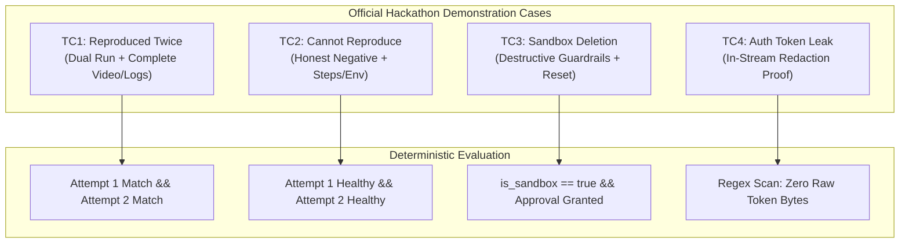
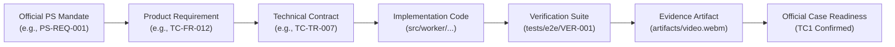
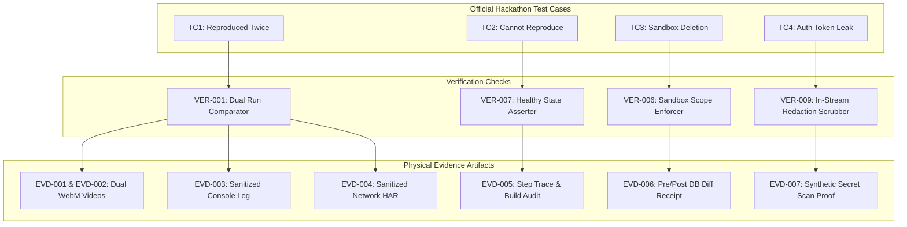
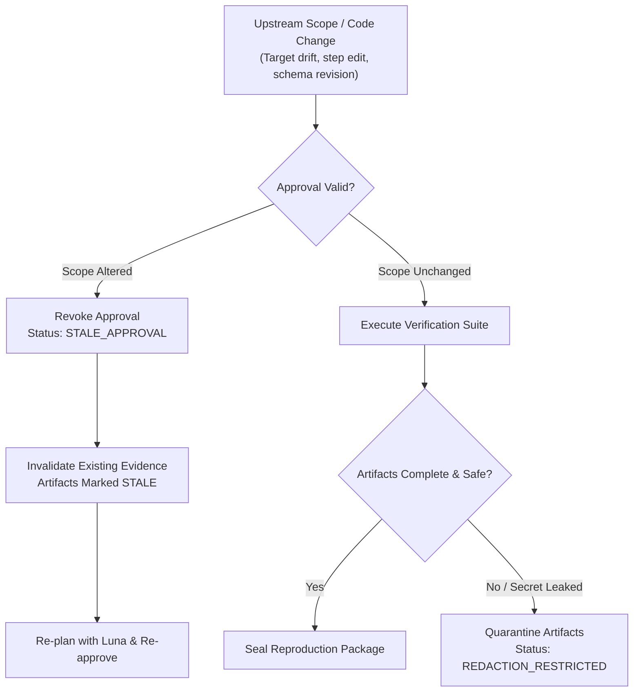

# TraceCase — Problem Statement (PS) Requirements Traceability Matrix

**Document ID:** TC-RTM-001  
**Document Purpose:** Source-grounded Requirements Traceability Matrix and Evidence Audit Baseline for TraceCase  
**Version:** 1.0.0-draft  
**Date:** 20 October 2026  
**Status:** Draft for Review (Living engineering document; requires human review before baseline sign-off)  
**Authoring Role:** Requirements Traceability Author & Evidence Auditor (Antigravity AI Agent)  
**Intended Readers:** Technical Lead, AI Engineers, Frontend/Fullstack Engineers, Hackathon Judges, and Implementation Agents.

---

## Table of Contents

- [A. Document Control and Purpose](#a-document-control-and-purpose)
- [B. Reading Guide, Terminology, and Status Dimensions](#b-reading-guide-terminology-and-status-dimensions)
- [C. Source Register](#c-source-register)
- [D. Canonical PS Requirement Register](#d-canonical-ps-requirement-register)
- [E. Project Decisions and Adopted Engineering Controls](#e-project-decisions-and-adopted-engineering-controls)
- [F. Product and Technical Design Mapping](#f-product-and-technical-design-mapping)
- [G. Implementation Mapping](#g-implementation-mapping)
- [H. Verification Mapping](#h-verification-mapping)
- [I. Evidence Register](#i-evidence-register)
- [J. Official TC1–TC4 Demonstration Matrix](#j-official-tc1tc4-demonstration-matrix)
- [K. Coverage and Readiness Summary](#k-coverage-and-readiness-summary)
- [L. Gaps, Conflicts, and Unresolved Interpretations](#l-gaps-conflicts-and-unresolved-interpretations)
- [M. Optional and Out-of-Scope Register](#m-optional-and-out-of-scope-register)
- [N. Submission and Judging Crosswalk](#n-submission-and-judging-crosswalk)
- [O. Maintenance and Change-Control Procedure](#o-maintenance-and-change-control-procedure)
- [P. Architectural Traceability Diagrams](#p-architectural-traceability-diagrams)

---

## A. Document Control and Purpose

### A.1 Document Purpose
This document establishes complete, bi-directional, source-grounded traceability from the original hackathon Problem Statement (PS) obligations to product requirements, technical specifications, concrete implementation files, verification checks, and supporting evidence artifacts for **TraceCase**.

Its primary objective is to maintain strict factual discipline across the project lifecycle, ensuring a clear distinction between:
- What is officially mandated by the hackathon brief.
- What has been documented in the PRD (`docs/prd.md`) and TRD (`docs/trd.md`).
- What is currently implemented in code (currently 0% / clean slate).
- What has been verified via executed test suites (currently 0% / planned only).
- What is substantiated by genuine, inspected evidence artifacts (currently 0% / planned only).

### A.2 Document Control Information
- **Title:** Problem Statement (PS) Requirements Traceability Matrix
- **Document Version:** 1.0.0-draft
- **Creation Date:** 20 October 2026
- **Status:** Draft for Review
- **Authoring Role:** Requirements Traceability Author & Evidence Auditor
- **Repository Path:** [`docs/ps-requirements-traceability-matrix.md`](file:///c:/SHARAN%20PROJECTS/TraceCase/docs/ps-requirements-traceability-matrix.md)
- **Baseline Dependencies:**
  - Product Requirements Document: [`docs/prd.md`](file:///c:/SHARAN%20PROJECTS/TraceCase/docs/prd.md) (v1.0.0-draft, 20 Oct 2026)
  - Technical Requirements Document: [`docs/trd.md`](file:///c:/SHARAN%20PROJECTS/TraceCase/docs/trd.md) (v1.0.0-draft, 20 Oct 2026)
  - Consolidated Context: `TraceCase-Agent-Project-Context.md` (v1.0, 20 Oct 2026)

---

## B. Reading Guide, Terminology, and Status Dimensions

### B.1 Core Terminology
- **Source Obligation (`PS-REQ-###`):** An atomic, normalized requirement derived directly from the official hackathon problem statement.
- **Product Requirement (`TC-FR-###`):** A functional capability specified in `docs/prd.md`.
- **Technical Requirement (`TC-TR-###`):** An architectural contract, data model, or enforcement mechanism specified in `docs/trd.md`.
- **Implementation Reference:** A verified symbol, file, or module in the repository delivering the specified behavior.
- **Verification Procedure (`VER-###`):** An executable automated or manual test protocol designed to validate a specific requirement.
- **Evidence Artifact (`EVD-###`):** An immutable, persistent physical record (video recording, sanitized console log, HAR network trace, database receipt) demonstrating real-world execution.
- **Gap (`GAP-###`):** A discrepancy between an obligation and its design, implementation, verification, or evidence.

### B.2 Multi-Dimensional Status Taxonomy
TraceCase rejects binary "green checkmark" matrices that conflate written documentation with working software. All requirements are evaluated across five independent dimensions:

| Dimension | Permitted Values | Definition / Meaning |
|---|---|---|
| **1. Source Status** | `DIRECTLY_INSPECTED` `EMBEDDED_SUPPLIED` `SECONDARY_CONTEXT` `UNAVAILABLE` | Quality of the originating source data. |
| **2. Design Status** | `FULLY_MAPPED` `PARTIALLY_MAPPED` `UNMAPPED` `CONFLICTING` `NOT_APPLICABLE` | Degree to which the requirement is formally specified in both PRD and TRD. |
| **3. Implementation Status** | `OBSERVED_IMPLEMENTED` `PARTIAL_IMPLEMENTED` `NOT_IMPLEMENTED` `NOT_INSPECTED` | Actual state of application code in the repository. |
| **4. Verification Status** | `VALIDATED_PASSED` `EXECUTED_FAILED` `BLOCKED` `TEST_WRITTEN` `PLANNED_ONLY` `NOT_APPLICABLE` | Operational status of automated or manual test suites. |
| **5. Evidence Status** | `SUFFICIENT_INSPECTED` `INCOMPLETE` `RESTRICTED` `STALE` `PLANNED_ONLY` `NOT_AVAILABLE` | Existence, completeness, and safety of real execution artifacts. |

---

## C. Source Register

| Source ID | Title / Description | Authority / Classification | Path / Reference | Availability Status | Notes & Limitations |
|---|---|---|---|---|---|
| **SRC-001** | Official Assignment Brief | Official Hackathon Requirement | Ziro.Digital Hackathon 2026 Portal (Developer & Enterprise AI) | Embedded Supplied Excerpt | Full problem statement excerpted into planning context; live portal URL uninspected. |
| **SRC-002** | Official Demonstration Cases | Official Test Expectation | Brief Table: TC1, TC2, TC3, TC4 | Embedded Supplied Excerpt | Preserved verbatim with supplied scenarios and expected results. |
| **SRC-003** | Official Safety & Build Guidance | Official Safety / Suggestions | Brief Text: Approval, Sandbox, Redaction | Embedded Supplied Excerpt | Explicitly distinguishes mandatory safety rules from suggested build steps. |
| **SRC-004** | Submission Dashboard Screenshot | Official Submission Info | Brief Screenshot (Submission criteria & schedule) | Secondary Context Derived | Confirms 20 Oct 2026, 11:00 AM IST submission opening; final deadline unverified. |
| **SRC-005** | TraceCase Project Context | Project Baseline / User Decisions | `TraceCase-Agent-Project-Context.md` (v1.0) | Directly Inspected | Consolidates user decisions (GPT-6 Luna, Playwright, TraceCase name, credit budget). |
| **SRC-006** | TraceCase PRD | Accepted Product Baseline | [`docs/prd.md`](file:///c:/SHARAN%20PROJECTS/TraceCase/docs/prd.md) (TC-PRD-001) | Directly Inspected | Created in workspace; establishes functional scope and acceptance criteria. |
| **SRC-007** | TraceCase TRD | Accepted Technical Baseline | [`docs/trd.md`](file:///c:/SHARAN%20PROJECTS/TraceCase/docs/trd.md) (TC-TRD-001) | Directly Inspected | Created in workspace; establishes system architecture, state machine, and contracts. |
| **SRC-008** | TraceCase Local Workspace | Observed Repository State | `c:\SHARAN PROJECTS\TraceCase` | Directly Inspected | Confirmed clean slate: `docs/prd.md` and `docs/trd.md` exist; no application code yet. |

---

## D. Canonical PS Requirement Register

### D.1 Mandatory Official Obligations (`PS-REQ-###`)

| Requirement ID | Parent ID | Source Ref | Exact Quoted Excerpt | Normalized Obligation | Source Class | Applicability | Related Official Case |
|---|---|---|---|---|---|---|---|
| **PS-REQ-001** | Root | SRC-001 | *"A vague bug report becomes a reproduced bug with screen recording, console and network logs."* | Transform incomplete natural language bug report into an executed reproduction yielding video, console, and network logs. | Official Mandate | Mandatory | TC1 |
| **PS-REQ-002** | PS-REQ-001 | SRC-001 | *"screen recording"* | Capture a finalized, browser-level screen recording of the reproduction attempt. | Official Mandate | Mandatory | TC1 |
| **PS-REQ-003** | PS-REQ-001 | SRC-001 | *"console logs"* | Capture timestamped stdout, stderr, and uncaught browser JavaScript exceptions. | Official Mandate | Mandatory | TC1 |
| **PS-REQ-004** | PS-REQ-001 | SRC-001 | *"network logs"* | Capture timestamped HTTP requests, methods, URLs, response statuses, and timing. | Official Mandate | Mandatory | TC1 |
| **PS-REQ-005** | Root | SRC-001 | *"Bug steps, environment and build."* | Record the exact execution steps, target operating environment, and tested application build version. | Official Mandate | Mandatory | TC1, TC2 |
| **PS-REQ-006** | Root | SRC-001 | *"Plans safe reproduction in a test environment."* | Synthesize an executable step plan and precondition check bounded to an authorized test target. | Official Mandate | Mandatory | TC1, TC2, TC3 |
| **PS-REQ-007** | Root | SRC-001 | *"The web app under test."* | Restrict investigation execution to the authorized web application under test (no arbitrary crawling). | Official Mandate | Mandatory | All Cases |
| **PS-REQ-008** | Root | SRC-001 | *"Open-source demo app / staging"* | Demonstrate capabilities against a permitted open-source demo application or staging deployment. | Official Mandate | Mandatory | All Cases |
| **PS-REQ-009** | Root | SRC-001 | *"Human approval required"* | Require explicit human approval before executing browser actions against the target application. | Official Mandate | Mandatory | All Cases |
| **PS-REQ-010** | PS-REQ-009 | SRC-003 | *"Ask for human approval before any action that cannot easily be undone."* | Specifically mandate human authorization prior to executing destructive mutations (deletions, drops, purges). | Official Safety | Mandatory | TC3 |
| **PS-REQ-011** | Root | SRC-001 | *"Runs steps and captures evidence."* | Execute approved steps via browser automation and collect runtime diagnostic artifacts. | Official Mandate | Mandatory | All Cases |
| **PS-REQ-012** | Root | SRC-001 | *"Reproduced / not reproduced with evidence."* | Report an honest, evidence-supported verdict distinguishing successful reproduction from non-reproduction. | Official Mandate | Mandatory | TC1, TC2 |
| **PS-REQ-013** | Root | SRC-001 | *"Reproduces twice before confirming."* | Require two valid, consecutive matching executions under restored conditions before confirming a bug. | Official Mandate | Mandatory | TC1 |
| **PS-REQ-014** | Root | SRC-002 | *"TC1: Bug reproduced twice. Recording, console and network logs attached."* | Demonstrate successful confirmation with dual executions and complete three-part evidence. | Official Test Case | Mandatory | TC1 |
| **PS-REQ-015** | Root | SRC-002 | *"TC2: Cannot reproduce. Steps tried and environment listed."* | Demonstrate valid non-reproduction, listing steps executed, tested build, and healthy observations. | Official Test Case | Mandatory | TC2 |
| **PS-REQ-016** | Root | SRC-002 | *"TC3: Bug involves deleting data. Reproduced only in sandbox."* | Demonstrate data deletion bug executed strictly within an authorized, disposable sandbox. | Official Test Case | Mandatory | TC3 |
| **PS-REQ-017** | Root | SRC-002 | *"TC4: Auth token appears in logs. Redacted before sharing."* | Demonstrate that sensitive session credentials appearing in logs are scrubbed prior to display or export. | Official Test Case | Mandatory | TC4 |
| **PS-REQ-018** | Root | SRC-003 | *"Use mock or synthetic data when a workflow involves personal or sensitive information."* | Utilize synthetic fixtures for all sensitive data workflows (no real customer PII). | Official Safety | Mandatory | TC3, TC4 |
| **PS-REQ-019** | Root | SRC-003 | *"Do not bypass OTP or CAPTCHA. Show a safe manual step or a mock instead."* | Prohibit automated bypassing of CAPTCHA/OTP; halt safely or require explicit manual handoff. | Official Safety | Mandatory | All Cases |

---

### D.2 Official Submission Deliverables (`PS-SUB-###`)

| Deliverable ID | Source Ref | Requirement Description | Deliverable Target | Status |
|---|---|---|---|---|
| **PS-SUB-001** | SRC-004 | Working Deployed AI Agent | Publicly accessible or verifiable deployed web application instance. | Planned (Phase 11) |
| **PS-SUB-002** | SRC-004 | Source Evidence | Direct repository source code and commit history demonstrating agent implementation. | Clean Slate (Workspace initialized) |
| **PS-SUB-003** | SRC-004 | Demonstration Presentation | Slide deck or presentation video explaining problem fit, architecture, and results. | Planned (Phase 11) |
| **PS-SUB-004** | SRC-004 | Executed Test Cases (TC1–TC4) | Packaged demonstration recordings and evidence bundles for all four official cases. | Planned (Phase 6–8) |

---

### D.3 Official Implementation Suggestions (`PS-SUG-###`)
*Note: The hackathon brief explicitly defines these as non-binding suggestions. They are adopted as engineering controls but are not separate organizer evaluation criteria.*

| Suggestion ID | Source Ref | Suggested Capability | TraceCase Technical Adoption |
|---|---|---|---|
| **PS-SUG-001** | SRC-003 | Step-by-step build guide | Adopted as the 11-phase implementation sequence in TRD Section 33. |
| **PS-SUG-002** | SRC-003 | Stable identifiers for runs and steps | Adopted via UUIDs across `investigations`, `attempts`, and `action_records`. |
| **PS-SUG-003** | SRC-003 | Explicit decision rules | Adopted via the deterministic AST Verification Engine (`TC-ADR-010`). |
| **PS-SUG-004** | SRC-003 | Duplicate prevention | Adopted via idempotency tokens on approval and execution requests. |
| **PS-SUG-005** | SRC-003 | Approved version storage | Adopted via immutable `experiment_plans` versions and cryptographic plan hashes. |

---

## E. Project Decisions and Adopted Engineering Controls

The following decisions (`USR-DEC-###`) and engineering controls (`DES-CTRL-###`) are internal architectural commitments. They must not be mislabeled as official organizer mandates:

| Control ID | Category | Technical Commitment | Rationale & Authority |
|---|---|---|---|
| **USR-DEC-001** | Product Identity | Application is named **TraceCase**. | Explicit user decision. |
| **USR-DEC-002** | Model Exclusivity | **GPT-6 Luna via OpenAI API only**; no automatic fallback. | Explicit user decision (`TC-INV-001`). |
| **USR-DEC-003** | Browser Baseline | **Playwright on Node.js worker** running headless Chromium. | Technical baseline consensus (`TC-ADR-002`, `TC-ADR-008`). |
| **USR-DEC-004** | Concurrency Cap | Exactly **one (1) active browser investigation** system-wide. | Resource management & database isolation (`TC-INV-011`). |
| **USR-DEC-005** | Credit Envelope | Operation bounded by user-reported $\approx\text{US}\$20$ OpenAI balance. | Budget discipline; token minimization via AXTree pruning. |
| **DES-CTRL-001** | Control Philosophy | **"Model Proposes, Code Enforces"** architecture. | Eliminates prompt injection risk and hallucinated verdicts (`TC-INV-002`). |
| **DES-CTRL-002** | State Separation | **Tri-Dimensional State Model** (Execution $\neq$ Verdict $\neq$ Evidence). | Prevents conflating automation crashes with non-reproduction (`TC-INV-007`). |
| **DES-CTRL-003** | State Reset | **Backend Reset $\neq$ Browser Isolation** (Mandatory webhook adapter). | Browser context clearing does not reset database records (`TC-INV-006`). |
| **DES-CTRL-004** | Queue Mechanism | **pg-boss on shared PostgreSQL**; persistent worker process. | Eliminates Redis dependency; supports ACID job dispatch (`TC-ADR-004`). |
| **DES-CTRL-005** | Sanitization | **In-Stream In-Memory Redaction** before storage or display. | Prevents raw secrets from touching disks or databases (`TC-INV-009`). |
| **DES-CTRL-006** | Honest Uncertainty | Explicit `EXECUTION_ERROR` and `BLOCKED` states. | Forbids labeling infrastructure crashes as "Not Reproduced" (`TC-INV-012`). |

---

## F. Product and Technical Design Mapping

This table connects official obligations (`PS-REQ-###`) directly to the specifications in `docs/prd.md` and `docs/trd.md`:

| Requirement ID | Summary Obligation | PRD Requirement Ref | TRD Requirement Ref | Responsible Component | Primary Screen / Endpoint | Design Mapping Status | Design Notes |
|---|---|---|---|---|---|---|---|
| **PS-REQ-001** | Vague report to reproduction with evidence | `TC-FR-003`, `TC-FR-012` | `TC-TR-006`, `TC-TR-007` | Controller, Worker | `/reports/new`, `/investigations/:id/result` | `FULLY_MAPPED` | Core happy path covered in PRD Section H and TRD Section 7. |
| **PS-REQ-002** | Screen recording | `TC-FR-012` | `TC-TR-007` | Playwright Worker | `/investigations/:id/result` | `FULLY_MAPPED` | Playwright native video context capture (`video_attempt1.webm`). |
| **PS-REQ-003** | Console logs | `TC-FR-012` | `TC-TR-007` | Worker (CDP Tap) | Evidence Drawer | `FULLY_MAPPED` | Ingests stdout, stderr, exceptions via CDP listener. |
| **PS-REQ-004** | Network logs | `TC-FR-012` | `TC-TR-007` | Worker (CDP Tap) | Network Inspector | `FULLY_MAPPED` | Ingests HTTP request/response metadata; excludes secret bodies. |
| **PS-REQ-005** | Steps, environment, and build | `TC-FR-005`, `TC-FR-016` | `TC-CON-005`, Section 13 | Controller, Final Report | `/investigations/:id/result` | `FULLY_MAPPED` | Recorded in `FinalReport.testedEnvironment` and audit trace. |
| **PS-REQ-006** | Safe reproduction planning | `TC-FR-007` | `TC-TR-003`, `TC-CON-002` | Luna Agent, Controller | `/investigations/:id/plan` | `FULLY_MAPPED` | Synthesizes `ExperimentPlan` with AXTree DOM pruning. |
| **PS-REQ-007** | Target restriction | `TC-FR-001` | Section 23, `TC-TR-001` | Worker, Route Filter | Playwright Engine | `FULLY_MAPPED` | Egress domain whitelisting and route abort for external hosts. |
| **PS-REQ-008** | Open-source demo app / staging | `TC-FR-001` | Section 14, `TC-OQ-001` | Target Adapter | Staging Host | `PARTIALLY_MAPPED` | Protocol fully specified; exact demo repository pending selection. |
| **PS-REQ-009** | Human approval required | `TC-FR-008`, `TC-FR-009` | `TC-TR-004`, `TC-TR-005` | API, Controller | `/investigations/:id/plan` | `FULLY_MAPPED` | Backend-enforced gate; plan hash mismatch rejects job claim. |
| **PS-REQ-010** | Approval for destructive actions | `TC-FR-008` | `TC-TR-001`, `TC-CON-003` | Controller, UI | `/investigations/:id/plan` | `FULLY_MAPPED` | Severe warning banner; requires explicit destructive confirmation. |
| **PS-REQ-011** | Execution & evidence capture | `TC-FR-010`, `TC-FR-012` | `TC-TR-006`, `TC-TR-007` | Playwright Worker | `/investigations/:id/live` | `FULLY_MAPPED` | Grounded execution via accessible roles; multi-artifact capture. |
| **PS-REQ-012** | Reproduced / not reproduced | `TC-FR-013`, `TC-FR-014` | `TC-TR-008`, Section 17 | Verification Engine | `/investigations/:id/result` | `FULLY_MAPPED` | Canonical Decision Table (13 discrete outcome rows). |
| **PS-REQ-013** | Two attempts before confirming | `TC-FR-014` | `TC-TR-009`, Section 16 | Controller, Worker | `/investigations/:id/live` | `FULLY_MAPPED` | Attempt 1 $\to$ Verified Reset $\to$ Attempt 2 $\to$ Aggregate Verdict. |
| **PS-REQ-014** | Official TC1 (Reproduced twice) | Section S (TC1) | Section 29 (TC1) | Full Pipeline | Result Viewer | `FULLY_MAPPED` | Dual failure signature match; complete evidence sealed. |
| **PS-REQ-015** | Official TC2 (Cannot reproduce) | Section S (TC2) | Section 29 (TC2) | Full Pipeline | Result Viewer | `FULLY_MAPPED` | Both runs observe healthy behavior; lists steps and build. |
| **PS-REQ-016** | Official TC3 (Sandbox deletion) | Section S (TC3) | Section 29 (TC3) | Controller, Worker | Approval Modal | `FULLY_MAPPED` | Prohibits non-sandbox execution; resets disposable fixture. |
| **PS-REQ-017** | Official TC4 (Auth token redacted) | `TC-FR-015`, Section S | `TC-TR-010`, Section 19 | Redaction Pipeline | Export Center | `FULLY_MAPPED` | In-stream regex scrubbing of JWT/Bearer tokens before save. |
| **PS-REQ-018** | Mock/synthetic data for sensitive | Section E (Invariant 7) | `TC-INV-008`, Section 14 | Target Adapter | Staging Fixtures | `FULLY_MAPPED` | Disposable UUID fixtures only (`task-uuid-001`). |
| **PS-REQ-019** | No OTP / CAPTCHA bypass | Section E (Invariant 8) | `TC-INV-010`, Section 23 | Playwright Worker | Execution Loop | `FULLY_MAPPED` | Zero bypass automation; halts on challenge with `BLOCKED`. |

---

## G. Implementation Mapping

*Inspection Timestamp: 20 October 2026, 15:36 IST. Inspected workspace: `c:\SHARAN PROJECTS\TraceCase`.*

| Requirement ID | Owning Component | Target Implementation File / Symbol | Current Observed Status | Verified Commit / Path | Observed Limitation / Gap | Owner Role |
|---|---|---|---|---|---|---|
| **PS-REQ-001** | Controller / Worker | `src/server/workflow/orchestrator.ts` | `NOT_IMPLEMENTED` | Clean Slate | Workspace has no `src/` directory. | Tech Lead |
| **PS-REQ-002** | Playwright Worker | `src/worker/browser/context.ts` | `NOT_IMPLEMENTED` | Clean Slate | Worker daemon not implemented. | Tech Lead |
| **PS-REQ-003** | Worker CDP Tap | `src/worker/interceptor/console.ts` | `NOT_IMPLEMENTED` | Clean Slate | Console listener not implemented. | Tech Lead |
| **PS-REQ-004** | Worker CDP Tap | `src/worker/interceptor/network.ts` | `NOT_IMPLEMENTED` | Clean Slate | Network listener not implemented. | Tech Lead |
| **PS-REQ-005** | Final Report Generator | `src/server/reports/generator.ts` | `NOT_IMPLEMENTED` | Clean Slate | Report synthesis not implemented. | UI Teammate |
| **PS-REQ-006** | Luna Agent Client | `src/server/ai/planning.ts` | `NOT_IMPLEMENTED` | Clean Slate | OpenAI prompt modules not implemented. | AI Teammate |
| **PS-REQ-007** | Playwright Worker | `src/worker/security/routeFilter.ts` | `NOT_IMPLEMENTED` | Clean Slate | Route whitelisting not implemented. | Tech Lead |
| **PS-REQ-008** | Staging Demo Target | `demo-target/` or external repo | `NOT_IMPLEMENTED` | Clean Slate | Target repository not checked in. | Tech Lead |
| **PS-REQ-009** | API Backend | `src/app/api/experiments/[id]/approve/` | `NOT_IMPLEMENTED` | Clean Slate | API route handlers not implemented. | Tech Lead |
| **PS-REQ-010** | Approval Gate UI/API | `src/components/approval-modal.tsx` | `NOT_IMPLEMENTED` | Clean Slate | UI modal not implemented. | UI Teammate |
| **PS-REQ-011** | Playwright Worker | `src/worker/executor/stepExecutor.ts` | `NOT_IMPLEMENTED` | Clean Slate | Browser action dispatcher not implemented. | Tech Lead |
| **PS-REQ-012** | Verification Engine | `src/server/verification/verifier.ts` | `NOT_IMPLEMENTED` | Clean Slate | Deterministic verifier not implemented. | Tech Lead |
| **PS-REQ-013** | Workflow Controller | `src/server/workflow/stateMachine.ts` | `NOT_IMPLEMENTED` | Clean Slate | State machine not implemented. | Tech Lead |
| **PS-REQ-014** | End-to-End Suite | `tests/e2e/tc1-double-reproduce.spec.ts` | `NOT_IMPLEMENTED` | Clean Slate | E2E suite not implemented. | AI / Tech Lead |
| **PS-REQ-015** | End-to-End Suite | `tests/e2e/tc2-not-reproduced.spec.ts` | `NOT_IMPLEMENTED` | Clean Slate | E2E suite not implemented. | AI / Tech Lead |
| **PS-REQ-016** | End-to-End Suite | `tests/e2e/tc3-sandbox-deletion.spec.ts`| `NOT_IMPLEMENTED` | Clean Slate | E2E suite not implemented. | AI / Tech Lead |
| **PS-REQ-017** | Redaction Pipeline | `src/worker/sanitizer/redactor.ts` | `NOT_IMPLEMENTED` | Clean Slate | In-stream regex scrubber not implemented. | AI Teammate |
| **PS-REQ-018** | Target Fixture Seed | `demo-target/scripts/seed.ts` | `NOT_IMPLEMENTED` | Clean Slate | Seed scripts not implemented. | Tech Lead |
| **PS-REQ-019** | Worker Safety Guard | `src/worker/security/challengeGuard.ts` | `NOT_IMPLEMENTED` | Clean Slate | Challenge detector not implemented. | Tech Lead |

---

## H. Verification Mapping

| Procedure ID | Target PS Requirement | Verification Scope & Preconditions | Execution Action / Test Input | Expected Observable Result | Negative / Adversarial Check | Test Type | Current Verification Status |
|---|---|---|---|---|---|---|---|
| **VER-001** | `PS-REQ-001`, `PS-REQ-014` | TC1: Clean staging target with Task A (Invoice) & Task B (Release). | Input: *"Filter Active, delete Release deletes Invoice instead."* | Worker completes Attempt 1 & 2; confirms failure signature twice; attaches video, console, net. | Must fail confirmation if Attempt 2 observes healthy state. | E2E Integration | `PLANNED_ONLY` |
| **VER-002** | `PS-REQ-002` | Video recording enabled in Chromium context. | Execute 3-step action sequence. | Standalone `.webm` file created on disk; duration matches execution. | Video file must not be 0 bytes or unplayable. | Worker Unit | `PLANNED_ONLY` |
| **VER-003** | `PS-REQ-003` | Browser console listener active. | Target application issues `console.error('Test Error')`. | Error captured with timestamp, severity, and text in log array. | Console log capture failure must not halt action loop. | Worker Unit | `PLANNED_ONLY` |
| **VER-004** | `PS-REQ-004` | CDP Network interceptor active. | Target issues `DELETE /api/tasks/1` returning `200 OK`. | Entry in network log with method, URL, status 200, response time. | Binary payload bodies excluded from JSON log. | Worker Unit | `PLANNED_ONLY` |
| **VER-005** | `PS-REQ-009` | Experiment plan v1 in `AWAITING_APPROVAL`. | Direct POST to `/api/investigations/start` without approval token. | Server returns HTTP `403 Forbidden`; no job enqueued in `pg-boss`. | Plan scope edit post-approval must revoke approval. | API Security | `PLANNED_ONLY` |
| **VER-006** | `PS-REQ-010`, `PS-REQ-016` | TC3: Plan contains destructive step `DELETE /tasks/*`. | Target marked `is_sandbox: false` (Production mode). | Backend rejects plan synthesis; execution blocked permanently. | System must never execute deletion on unverified target. | Controller Unit | `PLANNED_ONLY` |
| **VER-007** | `PS-REQ-012`, `PS-REQ-015` | TC2: Clean target; Report: *"Export CSV throws 500 error."* | Run Attempt 1 & 2; target returns `200 OK` and CSV downloads. | System outputs `NOT_REPRODUCED`; lists steps tried, target build, logs. | Crash must output `EXECUTION_ERROR`, not non-reproduction. | E2E Integration | `PLANNED_ONLY` |
| **VER-008** | `PS-REQ-013` | Dual run execution loop. | Simulate flaky bug (fails Attempt 1, passes Attempt 2). | System outputs `INCONSISTENT_ONCE`; refuses confirmation. | Single run must never transition status to `CONFIRMED`. | State Machine | `PLANNED_ONLY` |
| **VER-009** | `PS-REQ-017` | TC4: App outputs `Bearer eyJhbGci...` to console. | Redaction pipeline processes raw console buffer. | Output contains `Bearer [REDACTED_AUTH_TOKEN]`; 0 raw token bytes. | Scan export zip package for raw token string. | Security Unit | `PLANNED_ONLY` |
| **VER-010** | `PS-REQ-019` | Target displays Cloudflare or CAPTCHA challenge. | Worker encounters challenge frame during navigation. | Worker transitions status to `BLOCKED: CAPTCHA_ENCOUNTERED`. | System must not attempt automated bypass. | Worker Security | `PLANNED_ONLY` |

---

## I. Evidence Register

*Audit Finding: Currently 0 physical evidence artifacts exist in `c:\SHARAN PROJECTS\TraceCase`. The table below defines the formal evidence schema and expected artifacts required for hackathon submission.*

| Evidence ID | Supported Requirement | Expected Artifact Type | Storage Key / File Format | Associated Attempt / Run | Generation Pipeline | Sanitization Verification | Current Evidence Status |
|---|---|---|---|---|---|---|---|
| **EVD-001** | `PS-REQ-002`, `PS-REQ-014` | Screen Recording (Attempt 1) | `artifacts/{id}/attempt_1/video.webm` | TC1 (Attempt 1) | Playwright Context Video | N/A (Video masking applied) | `PLANNED_ONLY` |
| **EVD-002** | `PS-REQ-002`, `PS-REQ-014` | Screen Recording (Attempt 2) | `artifacts/{id}/attempt_2/video.webm` | TC1 (Attempt 2) | Playwright Context Video | N/A (Video masking applied) | `PLANNED_ONLY` |
| **EVD-003** | `PS-REQ-003`, `PS-REQ-014` | Sanitized Console Log | `artifacts/{id}/console.log` | TC1 (Both Runs) | CDP Ingestion $\to$ Scrubber | Verified: 0 raw secrets | `PLANNED_ONLY` |
| **EVD-004** | `PS-REQ-004`, `PS-REQ-014` | Sanitized Network Log | `artifacts/{id}/network.json` | TC1 (Both Runs) | CDP Ingestion $\to$ Scrubber | Verified: Auth headers stripped | `PLANNED_ONLY` |
| **EVD-005** | `PS-REQ-015` | Non-Reproduction Audit | `artifacts/{id}/tc2_summary.json` | TC2 (Both Runs) | Verification Engine | N/A | `PLANNED_ONLY` |
| **EVD-006** | `PS-REQ-016` | Sandbox Deletion Audit | `artifacts/{id}/tc3_sandbox_audit.json`| TC3 (Both Runs) | Controller Audit Logger | Pre/post DB row diffs | `PLANNED_ONLY` |
| **EVD-007** | `PS-REQ-017` | Secret Redaction Proof | `artifacts/{id}/tc4_redaction_scan.json`| TC4 (Execution) | Post-Scrubbing Regex Scan | Proves 100% synthetic secret scrub | `PLANNED_ONLY` |
| **EVD-008** | `PS-SUB-004` | Complete Reproduction Bundle| `artifacts/{id}/bundle.zip` | All Cases | Export Packaging Engine | SHA-256 Checksum verified | `PLANNED_ONLY` |

---

## J. Official TC1–TC4 Demonstration Matrix

### J.1 Official Case Technical Specifications

| Demonstration Field | Official Case TC1 | Official Case TC2 | Official Case TC3 | Official Case TC4 |
|---|---|---|---|---|
| **Case Title** | Bug Reproduced Twice | Cannot Reproduce | Deleting Data in Sandbox | Auth Token Redacted Before Sharing |
| **Supplied Scenario** | Bug reproduced twice | Cannot reproduce | Bug involves deleting data | Auth token appears in logs |
| **Supplied Expected Result**| Recording, console logs, and network logs attached | Steps tried and environment listed | Reproduced only in sandbox | Redacted before sharing |
| **Related Obligations** | `PS-REQ-001`, `002`, `003`, `004`, `013`, `014` | `PS-REQ-005`, `PS-REQ-012`, `PS-REQ-015` | `PS-REQ-006`, `PS-REQ-010`, `PS-REQ-016` | `PS-REQ-017`, `PS-REQ-018` |
| **Proposed Staging Scenario**| Tasks CRUD: Filter "Active", delete "Release" task deletes "Invoice" instead. | Tasks CRUD: Click "Export CSV" generates 500 error. | Tasks CRUD: Purge completed tasks drops active task records. | Auth Demo: Login redirect prints JWT bearer token in console. |
| **Preconditions** | Task A & B confirmed present in DB. | Target online; 5 sample tasks exist. | Target confirmed `is_sandbox: true`. | Synthetic test account configured. |
| **Approval Scope** | Standard approval for UI clicks. | Standard approval for CSV click. | **High-Severity Destructive Action** modal. | Standard approval for login sequence. |
| **Execution Path** | Attempt 1 (Bug) $\to$ Reset $\to$ Attempt 2 (Bug). | Attempt 1 (200 OK) $\to$ Reset $\to$ Attempt 2 (200 OK).| Pre-flight check $\to$ Sandbox Delete $\to$ Reset. | Playwright login $\to$ Token emitted $\to$ Redacted. |
| **Target App Behavior** | Bug manifested (Invoice deleted, Release remains). | App operates correctly (CSV downloads, 200 OK). | Deletion executed on disposable records only. | App emits raw token `eyJhbGci...` to console. |
| **TraceCase Behavior** | Confirms failure signature twice consecutively. | Outputs `NOT_REPRODUCED`; lists tested steps. | Enforces sandbox check; executes deletion safely. | In-stream scrubber replaces token with `[REDACTED]`. |
| **Required Artifacts** | `video_1.webm`, `video_2.webm`, `console.log`, `network.json`.| Step audit log, target build stamp, network log. | Deletion video, network delete call, DB receipts. | Sanitized console log, sanitized HAR, scan report. |
| **Negative / Safety Check** | Must NOT confirm if Attempt 2 passes. | Must NOT report execution crash as non-reproduction. | Must block execution if target is production. | Zero raw token bytes in exported `bundle.zip`. |
| **Pass Definition** | Dual runs independently confirm failure signature. | Clean negative verdict with complete step trace. | Sandbox deletion executed with zero external mutation. | Token successfully scrubbed from all shared outputs. |
| **Current Status** | **Planned (Not Executed)** | **Planned (Not Executed)** | **Planned (Not Executed)** | **Planned (Not Executed)** |

---

## K. Coverage and Readiness Summary

### K.1 Raw Obligation Metrics & Denominators

| Metric Category | Count / Total | Percentage | Calculation Methodology & Denominator Definition |
|---|---|---|---|
| **Official Obligations Identified** | 19 / 19 | **100%** | Total atomic mandatory obligations (`PS-REQ-001` through `PS-REQ-019`). |
| **Product Design Mapping (PRD)** | 19 / 19 | **100%** | Obligations with explicit functional coverage in `docs/prd.md`. |
| **Technical Design Mapping (TRD)** | 18 / 19 | **94.7%** | Obligations mapped to `docs/trd.md` (1 partial: demo repo selection `TC-OQ-001`). |
| **Observed Code Implementation** | 0 / 19 | **0.0%** | Verified code files in workspace (Clean slate: application code unbuilt). |
| **Verification Suites Defined** | 10 / 10 | **100%** | Verification protocols designed (`VER-001` through `VER-010`). |
| **Verification Suites Executed** | 0 / 10 | **0.0%** | Tests executed and verified against live targets (All planned). |
| **Evidence Artifacts Available** | 0 / 8 | **0.0%** | Verified physical artifacts on disk (All planned). |
| **Official Cases Demonstration Ready** | 0 / 4 | **0.0%** | Cases TC1–TC4 operational with passing evidence (Phase 6–8 planned). |
| **Submission Deliverables Ready** | 0 / 4 | **0.0%** | Deployed agent, source code, presentation, test cases (Phase 11 planned). |

*Factual Audit Statement:* The TraceCase project currently possesses **complete architectural and product specifications (100% PRD / 94.7% TRD mapping)**, but has **0% implementation, verification, and evidence completion**. This accurately reflects Phase 1 of the development lifecycle.

---

## L. Gaps, Conflicts, and Unresolved Interpretations

| Gap ID | Category | Related Obligation | Description & Consequence | Proposed Corrective Action | Owner Role | Blocking Stage | Current Status |
|---|---|---|---|---|---|---|---|
| **GAP-001** | Target Dependency | `PS-REQ-008` | Specific open-source demo target repository is not yet committed or deployed. | Select lightweight TypeScript/Next.js/Node task app; configure reset webhook. | Tech Lead | Phase 3 (Fixtures) | Open (`TC-OQ-001`) |
| **GAP-002** | Runtime Infrastructure | `PS-REQ-011` | Persistent Playwright browser worker environment not provisioned. | Build Docker container with Chromium dependencies and `pg-boss` listener. | Tech Lead | Phase 2 (Foundation) | Open (`TC-OQ-002`) |
| **GAP-003** | AI Gateway | `PS-REQ-006` | Live OpenAI API credentials and token quota unverified. | Configure server-side API key; test raw GPT-6 Luna structured output latency. | AI Teammate | Phase 5 (Luna Engine)| Open |
| **GAP-004** | Code Implementation | All Obligations | Repository contains specifications only; no application logic implemented. | Execute implementation phases 1 through 6 against approved TRD contracts. | Team | Phase 1–6 | Open (Expected) |
| **GAP-005** | Submission Details | `PS-SUB-001` | Final hackathon submission form fields and hard deadline unverified. | Inspect live hackathon dashboard upon portal access; record submission fields. | Team | Phase 11 (Submission)| Open (`TC-OQ-003`) |

---

## M. Optional and Out-of-Scope Register

### M.1 Prioritized Technical Extensions (`ENH-###`)
*Note: These capabilities provide competitive innovation but cannot substitute for official obligations.*

| Extension ID | Feature Name | Priority Tier | PRD / TRD Reference | Dependency | Value Proposition |
|---|---|---|---|---|---|
| **ENH-001** | Validated Regression Test Export | Next (Tier 2) | PRD Sec. U.1 / TRD Sec. 30.1 | Official TC1 | Synthesizes `.spec.ts` asserting correct behavior for developer CI/CD. |
| **ENH-002** | Buggy-vs-Fixed Build Comparison | Next (Tier 2) | PRD Sec. U.2 / TRD Sec. 30.2 | Official TC1, TC2 | Proves patch effectiveness by running identical plan against Build A & B. |
| **ENH-003** | Synchronized Evidence Player | Next (Tier 2) | PRD Sec. U.3 / TRD Sec. 18 | Official TC1 | Clicking console error jumps video timeline to exact event timestamp. |
| **ENH-004** | Evidence-Backed Diagnostic Hypotheses | Next (Tier 2) | PRD Sec. U.4 / TRD Sec. 30.3 | Official TC1 | Suggests root cause in report, strictly badged as `UNVERIFIED_HYPOTHESIS`. |

### M.2 Explicitly Excluded Initial Capabilities
- **EXC-001 (Automatic Source Code Patching):** TraceCase will not modify application source code, push Git branches, or open pull requests.
- **EXC-002 (Production Mutations):** TraceCase will not execute mutations against production environments.
- **EXC-003 (Internet-Wide Web Crawling):** TraceCase will not autonomously discover unknown bugs across arbitrary domains.
- **EXC-004 (Native Mobile Testing):** TraceCase is strictly a web application reproduction agent.
- **EXC-005 (Browser Session Hijacking):** TraceCase will not take over users' local browser tabs.

---

## N. Submission and Judging Crosswalk

| Judging Criteria | Weight | Hackathon Focus | TraceCase Architectural Alignment | Demonstrable Evidence |
|---|---|---|---|---|
| **Agentic Capability** | **25%** | Autonomous reasoning, tool use, grounding | GPT-6 Luna claim extraction, AXTree locator grounding, self-healing selectors. | Action step trace, dual-run execution logs. |
| **Technical Implementation** | **20%** | Architecture, robustness, code quality | Decoupled Playwright worker, `pg-boss` queue, deterministic AST verifier, in-stream redaction. | TypeScript codebase, database schemas, Docker topology. |
| **Problem Fit & Usefulness** | **20%** | Real-world developer utility | Solves incomplete bug reports; provides undeniable dual-run proof with video and logs. | Sealed reproduction packages, downloadable bundles. |
| **Innovation** | **15%** | Novel agent workflows | Tri-dimensional state separation, regression test export, buggy/fixed build comparison. | Exported `.spec.ts`, comparison diffs. |
| **User Experience (UX)** | **10%** | Clarity, ease of use, transparency | Interactive approval modal, live SSE execution tracker, dual-run video viewer. | Next.js dashboard, responsive UI views. |
| **Presentation** | **10%** | Demo delivery, clarity, communication | Clear walkthrough of TC1–TC4; transparent reporting of negative and blocked states. | Presentation video, walkthrough demo. |

---

## O. Maintenance and Change-Control Procedure

This Traceability Matrix is an active engineering artifact maintained under strict change control:
1. **Trigger for Update:** Any commit introducing new features, modifying Zod schemas, creating test files, or generating execution evidence must update this document.
2. **Implementation Gate:** Moving a requirement from `NOT_IMPLEMENTED` to `OBSERVED_IMPLEMENTED` requires a verified file path, exported symbol, and code review inspection.
3. **Verification Gate:** Moving a requirement from `PLANNED_ONLY` to `VALIDATED_PASSED` requires an executed test log and permanent test script reference.
4. **Evidence Gate:** Registering an evidence artifact requires verifying file presence, non-zero byte size, and redaction safety.
5. **ID Invariance:** Requirement IDs (`PS-REQ-###`), verification IDs (`VER-###`), and decision IDs (`USR-DEC-###`) are immutable. Retired items must be deprecated with a recorded reason, never overwritten.

---

## P. Architectural Traceability Diagrams

#### Diagram 1: Full Traceability Chain (From Source to Evidence)
*This diagram illustrates the forward and reverse traceability chain linking official source mandates to real-world evidence.*

---

#### Diagram 2: Official-Case Evidence Relationships
*This diagram maps the four official hackathon cases to their required verification methods and physical artifacts.*

---

#### Diagram 3: Change-Impact Flow
*This diagram demonstrates how an upstream change (e.g. target schema drift or plan edit) cascades down the traceability chain, invalidating approvals, tests, and evidence.*

---

*End of PS Requirements Traceability Matrix — TraceCase (TC-RTM-001)*
