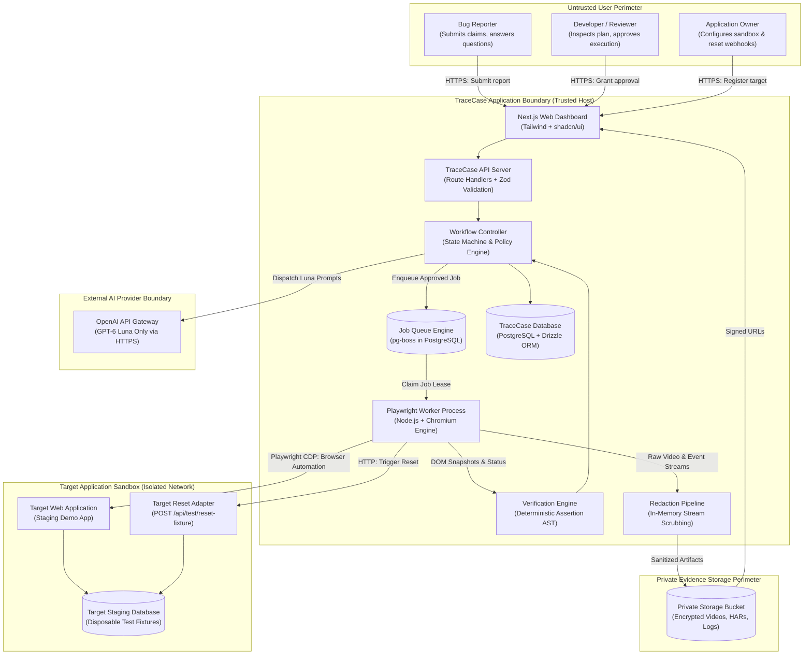
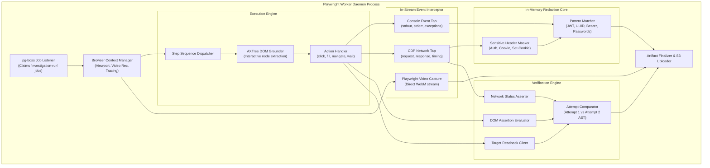
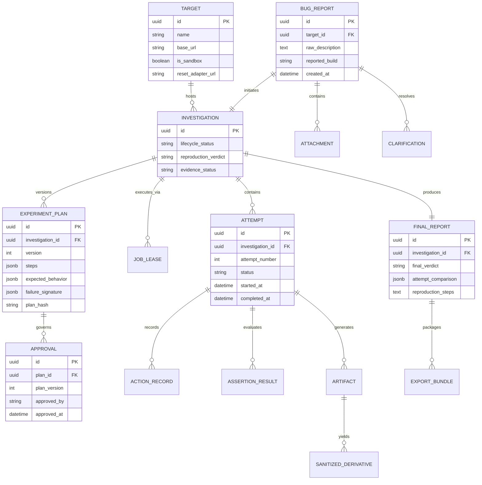
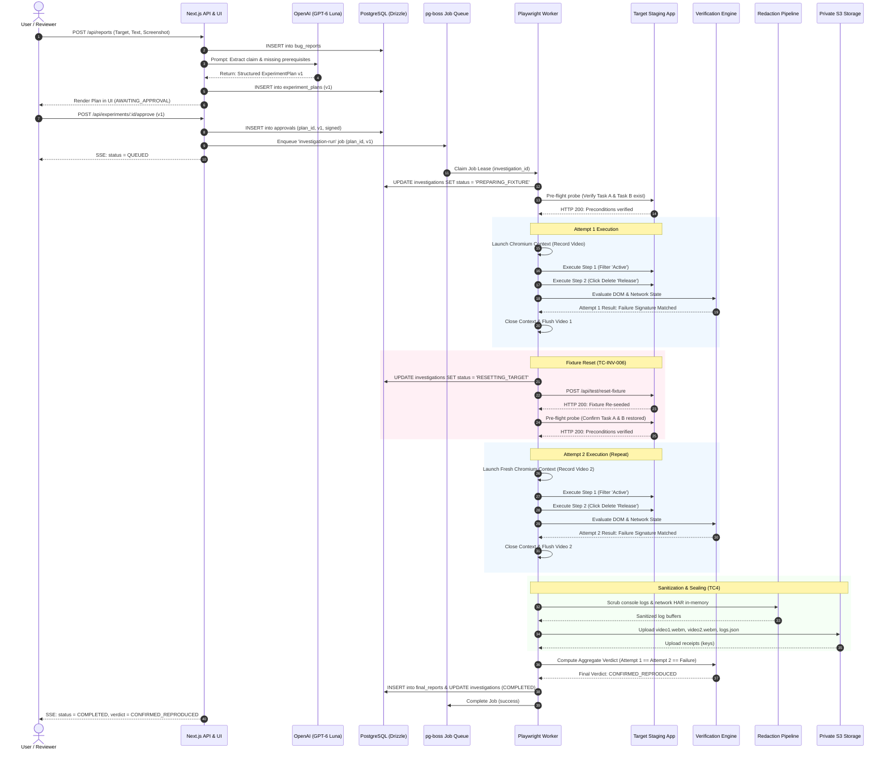
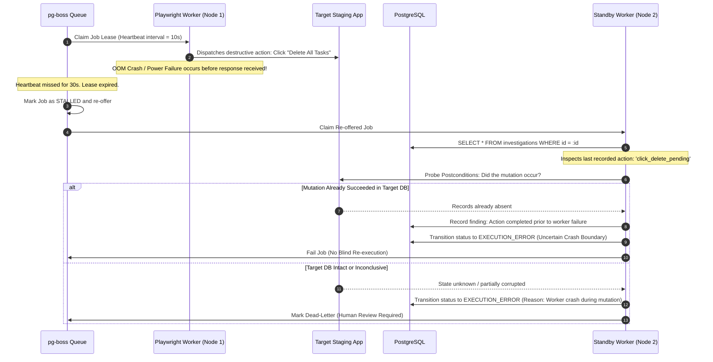
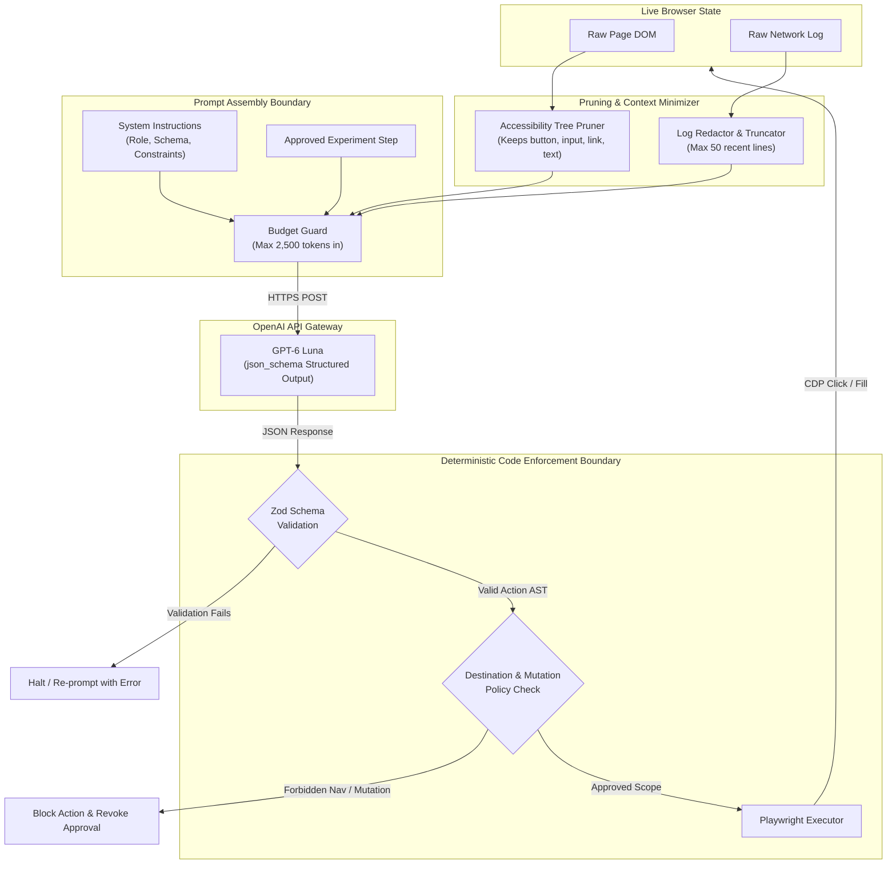
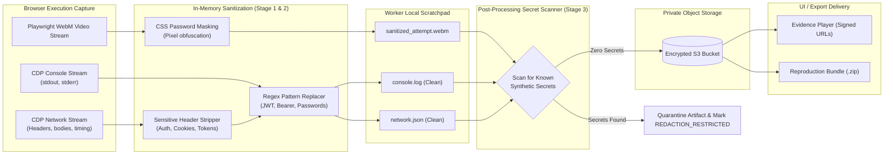
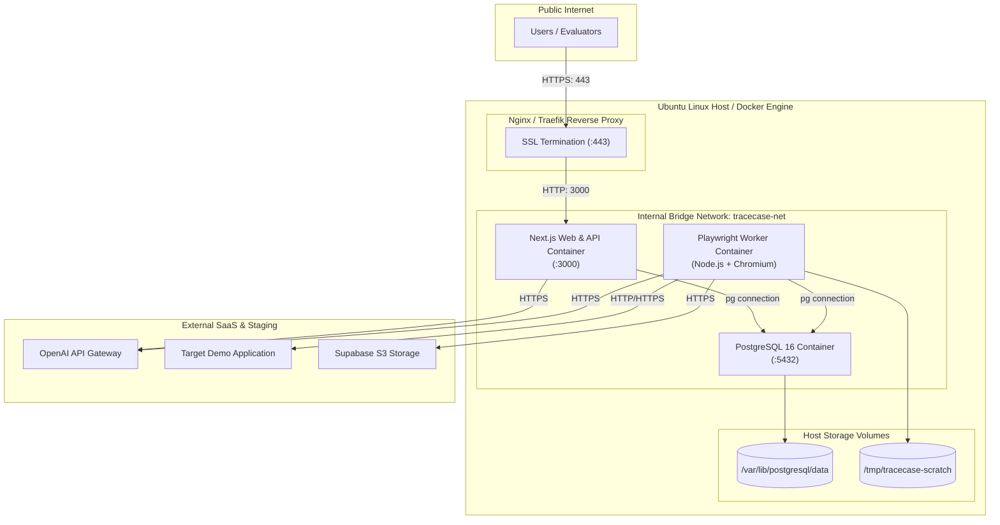

# TraceCase — Technical Requirements Document (TRD)

**Document ID:** TC-TRD-001  
**Document Purpose:** Baseline Technical Requirements Document & System Architecture Specification for TraceCase  
**Version:** 1.0.0-draft  
**Date:** 20 October 2026  
**Status:** Draft for Review (Requires human lead sign-off before entering Approved baseline)  
**Authoring Role:** Technical Requirements Author & System Designer (Antigravity AI Agent)  
**Intended Readers:** Technical Lead, AI/Prompt Engineers, Frontend/Fullstack Engineers, System Evaluators, and subsequent Implementation Agents.

---

## Table of Contents

- [1. Document Control, Sources, and Implementation Baseline](#1-document-control-sources-and-implementation-baseline)
- [2. Technical Goals, Constraints, and Invariants](#2-technical-goals-constraints-and-invariants)
- [3. Architecture and Component Boundaries](#3-architecture-and-component-boundaries)
- [4. Architecture Decision Records (ADRs)](#4-architecture-decision-records-adrs)
- [5. Domain Model and Terminology](#5-domain-model-and-terminology)
- [6. Canonical State Model & Multi-Dimensional Outcome](#6-canonical-state-model--multi-dimensional-outcome)
- [7. End-to-End Technical Sequences](#7-end-to-end-technical-sequences)
- [8. Shared Schemas and Type Contracts](#8-shared-schemas-and-type-contracts)
- [9. API Contract Baseline](#9-api-contract-baseline)
- [10. Background Jobs and Worker Orchestration](#10-background-jobs-and-worker-orchestration)
- [11. GPT-6 Luna Integration & Prompt Architecture](#11-gpt-6-luna-integration--prompt-architecture)
- [12. Agent Role Contracts & Boundaries](#12-agent-role-contracts--boundaries)
- [13. Browser Observation and Action Execution](#13-browser-observation-and-action-execution)
- [14. Target Registration & Fixture Adapters](#14-target-registration--fixture-adapters)
- [15. Approval, Scope, and Policy Enforcement](#15-approval-scope-and-policy-enforcement)
- [16. Deterministic Verification Engine](#16-deterministic-verification-engine)
- [17. Canonical Outcome Decision Table](#17-canonical-outcome-decision-table)
- [18. Evidence Capture Pipeline](#18-evidence-capture-pipeline)
- [19. Multi-Stage Sanitization & Artifact Publication](#19-multi-stage-sanitization--artifact-publication)
- [20. Persistence Architecture & Integrity Constraints](#20-persistence-architecture--integrity-constraints)
- [21. Progress Transport & Frontend Integration](#21-progress-transport--frontend-integration)
- [22. Authentication, Authorization & Trust Boundaries](#22-authentication-authorization--trust-boundaries)
- [23. Network and Sandbox Policy](#23-network-and-sandbox-policy)
- [24. Error Taxonomy & Recovery Policies](#24-error-taxonomy--recovery-policies)
- [25. Resource and Cost Controls](#25-resource-and-cost-controls)
- [26. Deployment, Topology & Operational Readiness](#26-deployment-topology--operational-readiness)
- [27. Observability, Logging & Audit](#27-observability-logging--audit)
- [28. Testing and QA Strategy](#28-testing-and-qa-strategy)
- [29. Official-Case Technical Traceability (TC1–TC4)](#29-official-case-technical-traceability-tc1tc4)
- [30. Optional Technical Extensions](#30-optional-technical-extensions)
- [31. Technical Requirements Register (TC-TR-###)](#31-technical-requirements-register-tc-tr-)
- [32. Assumptions, Risks, and Open Decisions](#32-assumptions-risks-and-open-decisions)
- [33. Team Integration & Implementation Phases](#33-team-integration--implementation-phases)
- [34. Handoff to Companion Specifications](#34-handoff-to-companion-specifications)

---

## 1. Document Control, Sources, and Implementation Baseline

### 1.1 Document Information
- **Title:** Technical Requirements Document (TRD) for TraceCase
- **Version:** 1.0.0-draft
- **Date:** 20 October 2026
- **Status:** Draft for Review
- **Authoring Role:** Technical Requirements Author & System Designer
- **Intended Audience:** Technical Lead, AI Teammate, UI Teammate, Hackathon Evaluators.

### 1.2 Source Register
1. **`docs/prd.md` (Product Requirements Document, Document ID `TC-PRD-001`, v1.0.0-draft):** Authoritative source for product scope, user stories, functional requirements (`TC-FR-001` through `TC-FR-018`), non-functional requirements, and the official hackathon acceptance matrix.
2. **`TraceCase-Agent-Project-Context.md` (Context revision 1.0, dated 20 October 2026):** Consolidated context baseline establishing the locked invariants, OpenAI credit envelope, team ownership model, and hackathon brief requirements.
3. **Official Hackathon Assignment:** Ziro.Digital Agentic AI Hackathon 2026 brief for "Bug Reproduction Agent" under Developer & Enterprise AI track.
4. **Workspace Inspection:** Local repository at `c:\SHARAN PROJECTS\TraceCase` inspected on 20 October 2026; confirmed `docs/prd.md` is present. No application code, database migrations, or package configuration have been implemented yet.

### 1.3 Sources Unavailable / Unverified
1. **Live Hackathon Submission Portal Fields:** Specific form fields and final submission deadline beyond opening at 20 October 2026, 11:00 AM IST remain uninspected.
2. **OpenAI Account Quotas:** User-reported $\approx\text{US}\$20$ credit balance has not been independently verified via live API interrogation.
3. **Specific Demo Target Application:** The exact open-source repository and license for the target test application have not been checked into the workspace.

### 1.4 Component Implementation Status
| Component | Classification | Current State |
|---|---|---|
| Web UI & Dashboard | Planned | Not implemented |
| API & Workflow Controller | Planned | Not implemented |
| Database & ORM (Postgres + Drizzle) | Planned | Not implemented |
| Background Queue (pg-boss) | Planned | Not implemented |
| Persistent Browser Worker (Playwright) | Planned | Not implemented |
| OpenAI GPT-6 Luna Integration | Planned | Not implemented |
| Deterministic Verification Engine | Planned | Not implemented |
| Multi-Stage Redaction Pipeline | Planned | Not implemented |
| Private Artifact Storage | Planned | Not implemented |
| Staging Demo Application | Planned | Not checked in |

---

## 2. Technical Goals, Constraints, and Invariants

### 2.1 System Invariants
The following technical invariants (`TC-INV-###`) are non-negotiable rules enforced by code across the entire architecture:

- **TC-INV-001 (Model Exclusivity):** All AI agent roles must exclusively invoke **GPT-6 Luna** via the OpenAI API. No model fallback (e.g., Claude, GPT-6.1 Sol, local models) may be executed without explicit user instruction.
- **TC-INV-002 (Model Proposes, Code Enforces):** GPT-6 Luna proposes interpretations, plans, and grounded locators. Deterministic code enforces schemas, budgets, navigation boundaries, human approvals, and verification predicates. The LLM never executes shell commands or arbitrary host JavaScript.
- **TC-INV-003 (Backend-Enforced Approval Gate):** No browser execution job may be enqueued or executed without a valid, server-side validated human approval bound to the exact version and scope of the experiment plan.
- **TC-INV-004 (Approval Invalidation):** Any mutation to an experiment's target URL, account, steps, fixture IDs, or assertion criteria immediately revokes existing approval and transitions status to `AWAITING_APPROVAL`.
- **TC-INV-005 (Two-Run Confirmation Rule):** A bug is confirmed if and only if the identical normalized failure signature manifests across **two separate, valid attempts** with an explicit state reset between attempts.
- **TC-INV-006 (Backend Reset $\neq$ Browser Isolation):** Browser context clearing (`cookies`, `localStorage`) isolates the client, not the database. Attempt 2 must be preceded by a verified backend fixture reset via the target adapter.
- **TC-INV-007 (Tri-Dimensional State Separation):** Lifecycle execution state, reproduction verdict, and evidence completeness are stored and tracked as three independent, orthogonal axes.
- **TC-INV-008 (Sandbox-Only Destructive Execution):** Destructive actions (`DELETE`, `DROP`, `PURGE`) are hard-blocked by code unless the target application is explicitly verified as a sandbox (`is_sandbox: true`) with disposable fixtures.
- **TC-INV-009 (Zero Raw Secret Leakage):** In-stream sanitization strips sensitive headers, session tokens, and passwords in memory before saving to disk, rendering in UI, or returning via API.
- **TC-INV-010 (No OTP/CAPTCHA Bypass):** The system must never attempt automated bypass of CAPTCHA or two-factor authentication; it must use mock endpoints or pause for manual intervention.
- **TC-INV-011 (Single Active Concurrency):** To eliminate database contention, port collisions, and token exhaustion, the browser worker executes exactly one active investigation at a time.
- **TC-INV-012 (Honest Uncertainty):** Infrastructure crashes, timeouts, and missing prerequisites must be marked as `EXECUTION_ERROR` or `BLOCKED`, never as `NOT_REPRODUCED`.
- **TC-INV-013 (Idempotent Worker Recovery):** A worker restart or lease reclamation must never blindly replay uncertain destructive mutations without verifying postconditions.
- **TC-INV-014 (Development Fixture Isolation):** Mock fixtures used during UI development must be permanently segregated and never masquerade as live investigation evidence.

---

## 3. Architecture and Component Boundaries

TraceCase is structured as a decoupled, event-driven monolith comprising a Next.js web application, a PostgreSQL persistence and queue layer, a dedicated Node.js Playwright worker process, and external integrations with the OpenAI API and the isolated target staging application.

### 3.1 Logical Component Responsibilities
| Component | Runtime Boundary | Core Responsibilities | State Owned |
|---|---|---|---|
| **Dashboard & UI** | Browser / Next.js Client | Render forms, display real-time investigation progress, interactive plan approval gate, dual-run video/evidence player, export center. | Client-side UI state, SSE event buffer. |
| **API Backend** | Next.js Server (Node.js) | Authenticate requests, ingest reports, dispatch Luna prompts, manage plan versioning, validate approvals, serve artifacts. | Ephemeral request context, session tokens. |
| **Workflow Controller** | Shared API / Worker Library | Enforce stage transitions, validate approval bounds, coordinate dual attempts, manage timeouts and cancellation. | Canonical state machine transitions. |
| **Job Queue (pg-boss)** | PostgreSQL Schema (`pgboss`) | Transactional job dispatch, worker lease management, heartbeat tracking, delayed retries. | Queue jobs, active worker locks, job states. |
| **Playwright Worker** | Persistent Node.js Process | Poll `pg-boss`, launch Chromium, execute grounded actions, record video, stream console/network events, invoke verifier. | Active browser contexts, live page handles, local artifact scratchpads. |
| **Luna Agent Modules** | Shared Server Library | Wrap OpenAI API calls: claim extraction, clarifying question synthesis, experiment planning, selector grounding, diagnostic review. | Ephemeral prompt/response frames. |
| **Verification Engine** | Shared Worker Library | Evaluate typed code assertions against DOM/network/API readbacks; compare Attempt 1 vs. Attempt 2; generate deterministic verdicts. | Assertion evaluation receipts. |
| **Reset Adapter** | Worker Integration Module | Trigger target reset endpoints, execute database seeding, probe initial fixture conditions. | Fixture pre-flight receipts. |
| **Redaction Pipeline** | Worker In-Stream Pipe | Ingest console stdout and network streams, apply regex scrubbing, mask password inputs in DOM, verify sanitized artifacts. | Redaction audit logs. |
| **Database (Postgres)** | PostgreSQL Engine | Authoritative durable store for targets, reports, plans, approvals, investigations, attempts, assertion results, and final reports. | All persistent domain records. |
| **Private Artifact Store** | Supabase Storage / S3 | Encrypted object storage holding raw video `.webm`, sanitized network JSON/HAR, console logs, and exported zip packages. | Binary and text evidence artifacts. |
| **Target Web App** | Isolated Staging Host | Permitted web application under test with separate database and dedicated test fixtures. | Target application data (completely isolated). |

### 3.2 Decision Ownership Matrix
To prevent architectural drift, each major system transition has exactly one authoritative owner:
- **Approval Validity:** Owned exclusively by the **API Backend / Workflow Controller**.
- **Canonical Investigation State:** Owned exclusively by the **PostgreSQL Database** via ACID transactions.
- **Attempt Creation & Dual-Run Sequencing:** Owned exclusively by the **Playwright Worker / Controller Loop**.
- **Browser Session Lifecycle:** Owned exclusively by the **Playwright Worker Process**.
- **Reproduction Verdict Evaluation:** Owned exclusively by the **Verification Engine (Code)**.
- **Artifact Publication & Sanitization:** Owned exclusively by the **Redaction Pipeline**.
- **Final Report Generation:** Owned exclusively by the **Workflow Controller**.

---

### 3.3 Required Architecture Diagrams

#### Diagram 1: System Context and Trust-Boundary Diagram (Proposed Architecture)
*This diagram defines the high-level system boundary, distinguishing authenticated user roles, the TraceCase trusted zone, the external AI provider boundary, the isolated target sandbox, and private artifact storage.*



---

#### Diagram 2: Runtime Container and Communication Topology (Proposed Infrastructure)
*This diagram shows the concrete runtime processes, container layouts, communication protocols, and port allocations for deployment.*

```mermaid
flowchart LR
    subgraph ClientBrowser["Client Web Browser"]
        ClientApp["Next.js SPA Client<br/>(React 19 + SSE Listener)"]
    end

    subgraph HostContainer["TraceCase Host VM / Docker Network"]
        subgraph WebContainer["Container: tracecase-web"]
            NextServer["Next.js Server Process<br/>Node.js runtime (:3000)"]
        end

        subgraph WorkerContainer["Container: tracecase-worker"]
            WorkerProc["Worker Daemon Process<br/>Node.js runtime"]
            Chromium["Chromium Headless Binary<br/>Playwright-managed"]
            WorkerProc -->|Pipe / CDP| Chromium
        end

        subgraph DBContainer["Container: tracecase-postgres"]
            Postgres["PostgreSQL 16 Engine (:5432)<br/>Schemas: public, pgboss"]
        end
    end

    subgraph ExternalServices["External Cloud & Staging Targets"]
        OpenAICloud["OpenAI API (:443 HTTPS)<br/>Model: gpt-6-luna"]
        TargetHost["Target Staging Host (:8080)<br/>Web App + Reset Webhook"]
        StorageCloud["Supabase Storage (:443 HTTPS)<br/>Private S3-compatible API"]
    end

    ClientApp -->|HTTP/1.1 POST & SSE Stream| NextServer
    NextServer -->|Connection Pool (pg)| Postgres
    WorkerProc -->|Connection Pool (pg)| Postgres
    NextServer -->|HTTPS REST| OpenAICloud
    WorkerProc -->|HTTPS REST (Grounded fallback)| OpenAICloud
    Chromium -->|HTTP/HTTPS Browser Nav| TargetHost
    WorkerProc -->|HTTP POST Reset| TargetHost
    WorkerProc -->|HTTPS S3 API Upload| StorageCloud
    NextServer -->|HTTPS Signed URL Generation| StorageCloud
```

---

#### Diagram 3: Internal Worker and Component Architecture
*This diagram illustrates the internal modular design of the persistent browser worker, highlighting how Playwright events flow into the in-memory redaction engine and assertion verifier.*



---

## 4. Architecture Decision Records (ADRs)

| ADR ID | Problem / Decision | Chosen Approach | Status | Rationale | Alternatives Considered |
|---|---|---|---|---|---|
| **TC-ADR-001** | Web Framework & API Layer | **Next.js (App Router, Node.js runtime)** | Accepted | Unified TypeScript stack, fast UI rendering, built-in Server Actions, and native Route Handlers for SSE streaming. | Express.js + Vite SPA (Split codebase, more boilerplate), Remix/React Router v7. |
| **TC-ADR-002** | Browser Worker Separation | **Decoupled Node.js Process** | Accepted | Serverless functions (Vercel/AWS Lambda) time out after 15–30s and lack Chromium binaries. Long-running Playwright dual runs require a persistent daemon. | Running Playwright inside Next.js API routes (crashes server under memory load). |
| **TC-ADR-003** | AI Model & Integration Boundary | **OpenAI API with GPT-6 Luna via official SDK** | Accepted | Non-negotiable user invariant (`TC-INV-001`). Strict Zod schema parsing via OpenAI Structured Outputs (`json_schema`). | AI SDK (Vercel) as wrapper (retained as alternative; official SDK preferred for raw control). |
| **TC-ADR-004** | Queue & Job Orchestration | **pg-boss on shared PostgreSQL** | Accepted | Leverages existing PostgreSQL database; eliminates Redis operational overhead; supports transactional job dispatch, heartbeats, and leases. | BullMQ (requires Redis cluster), Temporal (unnecessary operational complexity for hackathon). |
| **TC-ADR-005** | Database & Schema Migrations | **PostgreSQL 16 + Drizzle ORM** | Accepted | Type-safe SQL queries, zero runtime overhead, automatic migration generation, native JSONB support for plans and AST assertions. | Prisma (heavier engine binary, slower startup in workers), raw pg/Kysely. |
| **TC-ADR-006** | Artifact Storage | **Private S3-Compatible Storage (Supabase)** | Accepted | Secure storage of `.webm` video files and HAR captures; supports pre-signed temporary URLs for authenticated UI viewing. | Local filesystem storage (fails across containers/hosts), Cloudflare R2. |
| **TC-ADR-007** | Real-Time UI Progress Transport | **Server-Sent Events (SSE) with Replay Cursor** | Accepted | Unidirectional server-to-client streaming is lightweight, natively reconnectable, and avoids WebSocket state management complexity. | WebSockets (bi-directional overhead unneeded), HTTP polling (high latency, database spam). |
| **TC-ADR-008** | Browser Automation Technology | **Playwright (Chromium Engine)** | Accepted | Superior auto-waiting, robust accessibility selectors (`getByRole`), native video recording, and low-level CDP network interception. | Puppeteer (less robust auto-waiting), Selenium (legacy, slow), Cypress (runs inside browser, poor multi-tab/worker support). |
| **TC-ADR-009** | Target Reset Integration | **Dedicated HTTP Reset Webhook Adapter** | Accepted | Staging targets expose `POST /api/test/reset-fixture` that restores seeded SQLite/Postgres rows within 2 seconds. | Raw database drop/migrate (requires target DB credentials inside TraceCase), Docker restart (too slow, 30s+). |
| **TC-ADR-010** | Assertion Engine Representation | **Typed AST Assertion Predicates (JSON)** | Accepted | Prevents arbitrary code execution by the LLM. Assertions are validated Zod objects evaluated deterministically by code. | LLM-generated JavaScript / Python scripts (massive security and hallucination risk). |

---

## 5. Domain Model and Terminology

TraceCase maintains strict technical boundaries between domain concepts to prevent conflating user reports, planned experiments, execution jobs, and physical attempts:



### 5.1 Technical Definitions
1. **Target:** An authorized web application environment (`base_url`, auth mode, sandbox verification flag, and reset webhook URL).
2. **BugReport:** Immutable raw user submission (text, claimed environment, and attachment references).
3. **ExperimentPlan:** A formal, versioned recipe synthesized by Luna (`steps`, `preconditions`, `expected_behavior`, `failure_signature`).
4. **Approval:** A cryptographic or server-signed record binding authorization to a specific `(plan_id, version, plan_hash)`.
5. **Investigation:** The top-level orchestration container tracking the overall lifecycle across all attempts and final results.
6. **Attempt:** Exactly one physical browser run (Attempt 1 or Attempt 2) with its own Playwright context, video stream, and log buffer.
7. **ActionRecord:** A single timestamped grounded browser interaction (`click`, `fill`, `navigate`).
8. **Assertion:** A typed predicate evaluating DOM state, HTTP status, or API data against the failure signature or expected behavior.
9. **ResetReceipt:** A signed proof that the target reset adapter successfully restored baseline fixtures before Attempt 2 started.
10. **EvidenceArtifact:** Physical file (`.webm`, `.json`, `.log`) stored in private object storage.

---

## 6. Canonical State Model & Multi-Dimensional Outcome

TraceCase strictly separates state into **three independent, orthogonal dimensions**:

```mermaid
flowchart TD
    subgraph D1["Dimension 1: Lifecycle Execution Status"]
        S_REC[RECEIVED] --> S_INT[INTERPRETING]
        S_INT --> S_CLAR[NEEDS_CLARIFICATION]
        S_CLAR --> S_INT
        S_INT --> S_PLAN[PLAN_READY]
        S_PLAN --> S_AW_APP[AWAITING_APPROVAL]
        S_AW_APP --> S_APP[APPROVED]
        S_AW_APP --> S_REJ[REJECTED]
        S_APP --> S_Q[QUEUED]
        S_Q --> S_PREP[PREPARING_FIXTURE]
        S_PREP --> S_EX1[EXECUTING_ATTEMPT_1]
        S_PREP --> S_BLOCKED[BLOCKED]
        S_EX1 --> S_VER1[VERIFYING_ATTEMPT_1]
        S_EX1 --> S_ERR[EXECUTION_ERROR]
        S_EX1 --> S_CANC[CANCELLED]
        S_VER1 --> S_RESET[RESETTING_TARGET]
        S_RESET --> S_BLOCKED
        S_RESET --> S_EX2[EXECUTING_ATTEMPT_2]
        S_EX2 --> S_VER2[VERIFYING_ATTEMPT_2]
        S_EX2 --> S_ERR
        S_EX2 --> S_CANC
        S_VER2 --> S_FIN[FINALIZING_EVIDENCE]
        S_FIN --> S_COMP[COMPLETED]
    end

    subgraph D2["Dimension 2: Reproduction Verdict"]
        V_CONF[CONFIRMED_REPRODUCED]
        V_NOT[NOT_REPRODUCED]
        V_INCON[INCONSISTENT_ONCE]
        V_INC[INCONCLUSIVE]
    end

    subgraph D3["Dimension 3: Evidence Completeness"]
        E_COMP[COMPLETE]
        E_INCOMP[INCOMPLETE]
        E_REST[REDACTION_RESTRICTED]
    end
```



### 6.1 State Transition Matrix & Guard Rules
| From State | To State | Trigger / Owner | Guard Conditions |
|---|---|---|---|
| `RECEIVED` | `INTERPRETING` | API Backend | Bug report description is not empty ($\ge 10$ characters). |
| `INTERPRETING` | `NEEDS_CLARIFICATION` | Luna Agent | Claim extraction detects missing required preconditions or ambiguous expected behavior. |
| `INTERPRETING` | `PLAN_READY` | Luna Agent | Plan schema validates against Zod; steps and assertions are fully formed. |
| `PLAN_READY` | `AWAITING_APPROVAL` | Controller | Plan rendered in UI; human review required. |
| `AWAITING_APPROVAL` | `APPROVED` | Human Reviewer | Explicit user approval received for plan version $N$. |
| `APPROVED` | `STALE_APPROVAL` | Controller | Plan edited or target parameters changed post-approval. |
| `APPROVED` | `QUEUED` | API Backend | Approval record persisted; job enqueued in `pg-boss`. |
| `QUEUED` | `PREPARING_FIXTURE` | Playwright Worker | Worker acquires job lock and claims lease. |
| `PREPARING_FIXTURE` | `BLOCKED` | Worker | Target is unreachable, account invalid, or sandbox check fails. |
| `PREPARING_FIXTURE` | `EXECUTING_ATTEMPT_1` | Worker | Pre-flight probe confirms initial fixture data exists. |
| `EXECUTING_ATTEMPT_1` | `VERIFYING_ATTEMPT_1` | Worker | All approved steps in Attempt 1 completed. |
| `VERIFYING_ATTEMPT_1` | `RESETTING_TARGET` | Controller | Attempt 1 assertions evaluated and receipts persisted. |
| `RESETTING_TARGET` | `BLOCKED` | Worker | Target reset webhook fails or preconditions not restored. |
| `RESETTING_TARGET` | `EXECUTING_ATTEMPT_2` | Worker | Reset webhook returns `200 OK`; pre-flight confirms clean baseline. |
| `EXECUTING_ATTEMPT_2` | `VERIFYING_ATTEMPT_2` | Worker | All approved steps in Attempt 2 completed. |
| `VERIFYING_ATTEMPT_2` | `FINALIZING_EVIDENCE` | Controller | Attempt 2 assertions evaluated; artifacts staged. |
| `FINALIZING_EVIDENCE` | `COMPLETED` | Redactor / Controller | In-stream scrubbing complete; videos encoded; artifacts sealed. |

---

## 7. End-to-End Technical Sequences

#### Diagram 4: Full Report-to-Result Sequence Diagram (Happy Path TC1)
*This sequence diagram shows the complete end-to-end component interaction flow for a successful dual-run bug reproduction.*



---

#### Diagram 10: Worker Crash and Uncertain Mutation Recovery Sequence
*This sequence diagram documents the recovery path when a worker disconnects mid-investigation during a destructive action, enforcing idempotent recovery without blind retries.*



---

## 8. Shared Schemas and Type Contracts

The following representative TypeScript / Zod contracts (`TC-CON-###`) govern inter-component data exchange.

```typescript
import { z } from 'zod';

// ==========================================
// TC-CON-001: Provenance & Bug Report
// ==========================================
export const ProvenanceSourceSchema = z.enum([
  'USER_SUPPLIED',
  'TARGET_CONFIG',
  'BROWSER_OBSERVED',
  'ATTACHMENT_DERIVED',
  'INFERRED_ASSUMPTION',
]);

export const BugReportSchema = z.object({
  id: z.string().uuid(),
  targetId: z.string().uuid(),
  rawDescription: z.string().min(10).max(5000),
  reportedEnvironment: z.object({
    os: z.string().optional(),
    browser: z.string().optional(),
    buildVersion: z.string().optional(),
  }).optional(),
  attachments: z.array(z.object({
    id: z.string().uuid(),
    fileName: z.string(),
    mimeType: z.enum(['image/png', 'image/jpeg', 'image/webp', 'text/plain', 'application/json']),
    sizeBytes: z.number().max(1024 * 1024), // Max 1MB
    storageKey: z.string(),
  })).default([]),
  createdAt: z.string().datetime(),
});

// ==========================================
// TC-CON-002: Experiment Plan & Assertions
// ==========================================
export const BrowserActionTypeSchema = z.enum([
  'NAVIGATE',
  'CLICK',
  'FILL',
  'SELECT',
  'WAIT_FOR_SELECTOR',
  'ASSERT_STATE',
]);

export const SemanticActionSchema = z.object({
  stepNumber: z.number().int().positive(),
  actionType: BrowserActionTypeSchema,
  description: z.string(),
  targetSelector: z.object({
    role: z.string().optional(),
    accessibleName: z.string().optional(),
    cssSelector: z.string().optional(),
    textContains: z.string().optional(),
  }),
  inputValue: z.string().optional(), // For FILL
  isDestructive: z.boolean().default(false),
  affectedDataScope: z.string().optional(), // e.g. "task-uuid-002"
});

export const AssertionPredicateSchema = z.object({
  predicateId: z.string(),
  target: z.enum(['DOM_ELEMENT', 'HTTP_STATUS', 'API_PAYLOAD', 'CONSOLE_ERROR']),
  selector: z.string().optional(),
  expectedCondition: z.enum(['EXISTS', 'NOT_EXISTS', 'TEXT_CONTAINS', 'EQUALS', 'STATUS_CODE_EQUALS']),
  expectedValue: z.union([z.string(), z.number(), z.boolean()]),
});

export const ExperimentPlanSchema = z.object({
  id: z.string().uuid(),
  investigationId: z.string().uuid(),
  version: z.number().int().positive(),
  targetBaseUrl: z.string().url(),
  sessionRole: z.string().default('test_user'),
  preconditions: z.array(z.string()),
  steps: z.array(SemanticActionSchema).min(1).max(20),
  expectedBehaviorAssertions: z.array(AssertionPredicateSchema).min(1),
  reportedFailureSignatureAssertions: z.array(AssertionPredicateSchema).min(1),
  resetAdapterWebhook: z.string().url(),
  planHash: z.string(), // SHA-256 of canonical JSON
});

// ==========================================
// TC-CON-003: Approval Record
// ==========================================
export const ApprovalRecordSchema = z.object({
  id: z.string().uuid(),
  planId: z.string().uuid(),
  planVersion: z.number().int().positive(),
  planHash: z.string(),
  approvedByUserId: z.string(),
  isApproved: z.boolean(),
  destructiveActionApproved: z.boolean(),
  approvedAt: z.string().datetime(),
});

// ==========================================
// TC-CON-004: Attempt & Verification Result
// ==========================================
export const VerificationResultSchema = z.object({
  attemptNumber: z.union([z.literal(1), z.literal(2)]),
  allStepsCompleted: z.boolean(),
  healthyBehaviorMatched: z.boolean(),
  failureSignatureMatched: z.boolean(),
  assertionReceipts: z.array(z.object({
    predicateId: z.string(),
    passed: z.boolean(),
    actualValue: z.union([z.string(), z.number(), z.boolean(), z.null()]),
  })),
  evaluatedAt: z.string().datetime(),
});

// ==========================================
// TC-CON-005: Final Report & Export Manifest
// ==========================================
export const FinalReportSchema = z.object({
  id: z.string().uuid(),
  investigationId: z.string().uuid(),
  lifecycleStatus: z.enum(['COMPLETED', 'BLOCKED', 'EXECUTION_ERROR', 'CANCELLED']),
  reproductionVerdict: z.enum(['CONFIRMED_REPRODUCED', 'NOT_REPRODUCED', 'INCONSISTENT_ONCE', 'INCONCLUSIVE']),
  evidenceStatus: z.enum(['COMPLETE', 'INCOMPLETE', 'REDACTION_RESTRICTED']),
  attemptComparison: z.object({
    attempt1: VerificationResultSchema.optional(),
    attempt2: VerificationResultSchema.optional(),
    consistentOutcome: z.boolean(),
  }),
  reproductionStepsMarkdown: z.string(),
  testedEnvironment: z.object({
    targetUrl: z.string(),
    commitHash: z.string().optional(),
    workerBrowser: z.string(),
  }),
  diagnosticHypothesis: z.string().optional(), // Strictly marked as UNVERIFIED_HYPOTHESIS
  artifacts: z.object({
    attempt1VideoUrl: z.string().optional(),
    attempt2VideoUrl: z.string().optional(),
    sanitizedConsoleLogUrl: z.string(),
    sanitizedNetworkLogUrl: z.string(),
    bundleZipUrl: z.string(),
  }),
  generatedAt: z.string().datetime(),
});
```

---

## 9. API Contract Baseline

All endpoints are hosted by the Next.js API backend (`/api/...`), enforce authenticated session cookies, and return standard JSON payloads.

| Method & Route | Auth Required | Request Payload | Response Payload | Emitted State / Side Effect |
|---|---|---|---|---|
| `POST /api/targets` | Admin / Owner | `{ name, baseUrl, isSandbox, resetAdapterUrl }` | `{ target: Target }` | Registers staging target sandbox. |
| `POST /api/reports` | Authenticated | Multi-part form: `targetId`, `rawDescription`, files | `{ reportId: UUID, status: "INTERPRETING" }` | Ingests report; triggers Luna claim extraction job. |
| `POST /api/reports/:id/clarify` | Authenticated | `{ answers: Record<string, string> }` | `{ status: "INTERPRETING" }` | Appends answers; resumes Luna plan synthesis. |
| `GET /api/experiments/:id` | Authenticated | None | `{ plan: ExperimentPlan, isApproved: boolean }` | Retrieves plan vN and approval state for UI review. |
| `POST /api/experiments/:id/approve` | Authenticated | `{ planVersion: N, planHash: string, approveDestructive: boolean }` | `{ approved: true, investigationStatus: "QUEUED" }` | Validates hash; enqueues `investigation-run` job in `pg-boss`. |
| `POST /api/investigations/:id/cancel` | Authenticated | None | `{ status: "CANCELLED" }` | Signals worker via DB lock to halt execution immediately. |
| `GET /api/investigations/:id/live` | Authenticated | Query: `?cursor=event_seq` | `text/event-stream` (SSE Events) | Streams real-time progress events and logs. |
| `GET /api/investigations/:id/result` | Authenticated | None | `{ finalReport: FinalReport }` | Returns sealed outcome, comparison table, artifact URLs. |
| `GET /api/artifacts/:id/download` | Authenticated | None | Redirects to pre-signed S3 download URL | Checks artifact access rights before issuing signed URL. |

---

## 10. Background Jobs and Worker Orchestration

### 10.1 Job Queue Design (`pg-boss`)
TraceCase adopts a single coarse job pattern per investigation: `investigation-run`. The Playwright worker claims the entire two-attempt lifecycle as one continuous atomic execution sequence, preventing job handoff latency between attempts.

- **Queue Name:** `tracecase-investigations`
- **Concurrency Limit:** Exactly `1` active worker job system-wide (`TC-INV-011`).
- **Visibility Timeout / Lease Expiration:** `300 seconds` (5 minutes). The worker pings `pg-boss` heartbeat every `10 seconds`.
- **Max Retry Count:** `0` automatic retries for jobs containing destructive actions (`TC-INV-013`). Safe non-destructive retries capped at `1` with exponential backoff.
- **Dead-Letter Handling:** Failed jobs transition investigation to `EXECUTION_ERROR` and preserve partial logs for diagnostic inspection.

---

## 11. GPT-6 Luna Integration & Prompt Architecture

#### Diagram 6: Agent Tool-Call and Grounded Control Loop (Model Proposes, Code Enforces)
*This diagram illustrates how GPT-6 Luna is constrained within an observe-ground-validate loop, ensuring prompt outputs conform to strict Zod schemas and safety boundaries.*



### 11.1 Context Pruning & Budget Guardrails
To enforce the $\approx\text{US}\$20$ credit ceiling:
1. **Zero Raw HTML Injection:** Never pass raw HTML. The worker converts the DOM into an **AXTree** (Accessibility Tree) containing only interactive roles (`button`, `textbox`, `combobox`, `link`) and visible text. (Reduces token size by $92\%$).
2. **Pre-Planning Optimization:** Luna synthesizes the multi-step plan **once** upfront during the intake phase. The Playwright worker executes the approved steps sequentially without calling the LLM at every step—**unless** a selector drifts and needs self-healing.
3. **Hard Token Limits:** Request context capped at `4,000 tokens`; max response capped at `1,500 tokens`.

---

## 12. Agent Role Contracts & Boundaries

| Agent Role | Model | Input Context | Output Schema | Invariant Boundaries |
|---|---|---|---|---|
| **1. Report & Experiment Agent** | GPT-6 Luna | Bug report description, user attachments, target base URL schema. | `ExperimentPlanSchema` or `ClarificationRequestSchema` | Cannot execute actions; cannot approve plans; cannot invent unstated facts. |
| **2. Browser Investigation Agent** | GPT-6 Luna | Pruned AXTree snapshot, current approved semantic step, failed locator error (if any). | `SemanticActionSchema` (Alternative locator within approved semantic intent) | Cannot navigate to external domains; cannot alter assertions; cannot execute shell scripts. |
| **3. Evidence Review Agent** | GPT-6 Luna | Sanitized console stdout, network response codes, assertion comparison table. | Natural language diagnostic narrative & fix hypothesis | Read-only; cannot override deterministic verification verdicts; output tagged `UNVERIFIED_HYPOTHESIS`. |

---

## 13. Browser Observation and Action Execution

### 13.1 Grounded Action Vocabulary
The Playwright worker interprets only the following strongly-typed actions:
- `NAVIGATE(url)`: Restrict to approved `targetBaseUrl` domain path.
- `CLICK(selector)`: Ground via Playwright accessibility selector `page.getByRole(role, { name })` with CSS fallback.
- `FILL(selector, value)`: Auto-clears field before typing; masks input in video if field is password.
- `SELECT(selector, option)`: Chooses option from native or ARIA dropdown.
- `WAIT_FOR_SELECTOR(selector, timeoutMs)`: Max timeout capped at `15,000ms`.
- `ASSERT_STATE(predicate)`: Evaluates DOM or network state against verifier AST.

### 13.2 Selector Drift Recovery (Bounded Self-Healing)
If a primary locator fails (`TimeoutError` after 5s):
1. Worker captures fresh AXTree snapshot.
2. Worker queries Browser Investigation Agent: *"Find the interactive element matching semantic intent: 'Click Delete on Release task' within current AXTree."*
3. Luna returns candidate selector.
4. Worker verifies candidate selector matches the **identical target data scope** (e.g., must contain `data-task-id="task-uuid-002"`). If valid, worker dispatches click; if ambiguous, worker halts with `EXECUTION_ERROR`.

---

## 14. Target Registration & Fixture Adapters

### 14.1 Target Adapter Protocol
Every registered staging target must implement the following REST webhook contract:

```typescript
// Target Reset Adapter Webhook: POST /api/test/reset-fixture
export interface TargetResetRequest {
  targetId: string;
  authSecret: string; // Shared secret configured in TraceCase
  fixturePreset: 'DEFAULT_TASKS_CRUD' | 'AUTH_LEAK_SCENARIO';
}

export interface TargetResetResponse {
  success: boolean;
  restoredFixtures: Array<{
    id: string;
    entityType: string;
    status: string;
  }>;
  resetTimestamp: string;
}
```

- **Pre-Flight Validation:** Before Attempt 1 and Attempt 2, the worker issues `GET /api/test/probe-fixture`. If Task A and Task B are not returned with expected status, execution transitions to `BLOCKED: PRECONDITIONS_INVALID`.

---

## 15. Approval, Scope, and Policy Enforcement

### 15.1 Versioned Approval Binding
1. When a plan is generated, the backend computes its canonical SHA-256 hash:
   $$\text{planHash} = \text{SHA-256}(\text{canonicalJson}(\text{steps}, \text{preconditions}, \text{assertions}))$$
2. When the user approves, the backend stores:
   $$\text{ApprovalRecord} = (\text{planId}, \text{version}, \text{planHash}, \text{userId}, \text{timestamp})$$
3. When the worker claims the job, it re-reads the plan from PostgreSQL, recomputes the hash, and verifies it matches the approval record. If the hash mismatches, execution is refused (`403 Forbidden: Stale Approval`).

---

## 16. Deterministic Verification Engine

The verification engine evaluates the observed execution against two mutually exclusive predicate sets:
1. **Intended Correct Behavior Predicates ($P_{\text{correct}}$):** Expected healthy application response.
2. **Reported Failure Signature Predicates ($P_{\text{bug}}$):** Specific claimed defect condition.

```typescript
export function evaluateAttempt(
  observedDom: DOMSnapshot,
  observedNetwork: NetworkLog[],
  plan: ExperimentPlan
): AttemptEvaluation {
  const bugMatches = plan.reportedFailureSignatureAssertions.every(pred => evaluatePredicate(pred, observedDom, observedNetwork));
  const healthyMatches = plan.expectedBehaviorAssertions.every(pred => evaluatePredicate(pred, observedDom, observedNetwork));

  return {
    failureSignatureMatched: bugMatches,
    healthyBehaviorMatched: healthyMatches,
  };
}
```

---

## 17. Canonical Outcome Decision Table

The Verification Engine deterministically maps multi-attempt findings to the canonical tri-dimensional state:

| Attempt 1 Observation | Reset Verification | Attempt 2 Observation | Artifact Integrity | Reproduction Verdict | Lifecycle Status | Evidence Status | Hackathon Test Case Mapping |
|---|---|---|---|---|---|---|---|
| Failure Signature Matched | Restored OK | Failure Signature Matched | Video/Logs Intact | **CONFIRMED_REPRODUCED** | `COMPLETED` | `COMPLETE` | **Official TC1:** Bug reproduced twice consecutively. |
| Healthy Behavior Observed | Restored OK | Healthy Behavior Observed | Video/Logs Intact | **NOT_REPRODUCED** | `COMPLETED` | `COMPLETE` | **Official TC2:** System healthy; honest negative report. |
| Failure Signature Matched | Restored OK | Healthy Behavior Observed | Video/Logs Intact | **INCONSISTENT_ONCE** | `COMPLETED` | `COMPLETE` | Intermittent manifestation; not confirmed. |
| Healthy Behavior Observed | Restored OK | Failure Signature Matched | Video/Logs Intact | **INCONSISTENT_ONCE** | `COMPLETED` | `COMPLETE` | Flaky behavior; not confirmed. |
| Failure Signature Matched | Restored OK | Failure Signature Matched | Video corrupted / truncated | **CONFIRMED_REPRODUCED** | `COMPLETED` | `INCOMPLETE` | Verified, but evidence has missing components. |
| Failure Signature Matched | Restored OK | Failure Signature Matched | Secret leak unresolvable | **CONFIRMED_REPRODUCED** | `COMPLETED` | `REDACTION_RESTRICTED` | Verified, but artifact quarantined for security. |
| Browser Crash / Locator Timeout | N/A | Not Executed | Partial Logs | **INCONCLUSIVE** | `EXECUTION_ERROR` | `INCOMPLETE` | Automation failure; not non-reproduction. |
| Missing Account / Preconditions | N/A | Not Executed | None | **INCONCLUSIVE** | `BLOCKED` | `INCOMPLETE` | Prerequisites missing; halted safely. |
| Reset Webhook Returns 500 | Failed | Not Executed | Attempt 1 Logs | **INCONCLUSIVE** | `BLOCKED` | `INCOMPLETE` | Environment dirty; Attempt 2 prohibited. |

---

## 18. Evidence Capture Pipeline

#### Diagram 7: Evidence Capture, Sanitization, and Publication Pipeline (TC4 Protection)
*This diagram illustrates the streaming capture pipeline, showing how raw CDP streams are intercepted, sanitized in-memory, and stored as encrypted, redaction-verified artifacts.*



---

## 19. Multi-Stage Sanitization & Artifact Publication

### 19.1 In-Stream Redaction Engine (TC4)
1. **Header Stripping:** The network interceptor explicitly replaces values for `Authorization`, `Cookie`, `Set-Cookie`, `X-Api-Key` with `[REDACTED_HEADER]`.
2. **Regex Scrubbing:**
   - JWT Pattern: `eyJ[A-Za-z0-9_-]{10,}\.[A-Za-z0-9_-]{10,}\.[A-Za-z0-9_-]{10,}` $\to$ `[REDACTED_AUTH_TOKEN]`
   - Bearer Pattern: `Bearer\s+[A-Za-z0-9_\-\.~+/]+=*` $\to$ `Bearer [REDACTED_TOKEN]`
   - Query String Password: `password=[^&\s]+` $\to$ `password=[REDACTED]`
3. **Verification Protocol:** Prior to marking an export bundle ready, the worker runs an automated grep against the known active test token (e.g. `eyJhbGciOi...`). If a match is found, publication is halted and the run is flagged `REDACTION_RESTRICTED`.

---

## 20. Persistence Architecture & Integrity Constraints

The TraceCase PostgreSQL database schema enforces referential integrity:

```sql
-- Core Target Registry
CREATE TABLE targets (
    id UUID PRIMARY KEY DEFAULT gen_random_uuid(),
    name VARCHAR(255) NOT NULL,
    base_url TEXT NOT NULL,
    is_sandbox BOOLEAN NOT NULL DEFAULT false,
    reset_adapter_url TEXT,
    created_at TIMESTAMPTZ NOT NULL DEFAULT NOW()
);

-- Immutable Bug Reports
CREATE TABLE bug_reports (
    id UUID PRIMARY KEY DEFAULT gen_random_uuid(),
    target_id UUID NOT NULL REFERENCES targets(id) ON DELETE RESTRICT,
    raw_description TEXT NOT NULL,
    reported_environment JSONB,
    created_at TIMESTAMPTZ NOT NULL DEFAULT NOW()
);

-- Versioned Experiment Plans
CREATE TABLE experiment_plans (
    id UUID PRIMARY KEY DEFAULT gen_random_uuid(),
    investigation_id UUID NOT NULL,
    version INT NOT NULL,
    steps JSONB NOT NULL,
    expected_behavior JSONB NOT NULL,
    failure_signature JSONB NOT NULL,
    plan_hash VARCHAR(64) NOT NULL,
    created_at TIMESTAMPTZ NOT NULL DEFAULT NOW(),
    UNIQUE(investigation_id, version)
);

-- Approvals
CREATE TABLE approvals (
    id UUID PRIMARY KEY DEFAULT gen_random_uuid(),
    plan_id UUID NOT NULL REFERENCES experiment_plans(id) ON DELETE CASCADE,
    plan_version INT NOT NULL,
    plan_hash VARCHAR(64) NOT NULL,
    approved_by VARCHAR(255) NOT NULL,
    approved_at TIMESTAMPTZ NOT NULL DEFAULT NOW()
);

-- Canonical Investigations
CREATE TABLE investigations (
    id UUID PRIMARY KEY DEFAULT gen_random_uuid(),
    report_id UUID NOT NULL REFERENCES bug_reports(id) ON DELETE RESTRICT,
    target_id UUID NOT NULL REFERENCES targets(id) ON DELETE RESTRICT,
    active_plan_id UUID REFERENCES experiment_plans(id),
    lifecycle_status VARCHAR(50) NOT NULL DEFAULT 'RECEIVED',
    reproduction_verdict VARCHAR(50) NOT NULL DEFAULT 'INCONCLUSIVE',
    evidence_status VARCHAR(50) NOT NULL DEFAULT 'INCOMPLETE',
    created_at TIMESTAMPTZ NOT NULL DEFAULT NOW(),
    updated_at TIMESTAMPTZ NOT NULL DEFAULT NOW()
);

-- Attempts (Attempt 1 & Attempt 2)
CREATE TABLE attempts (
    id UUID PRIMARY KEY DEFAULT gen_random_uuid(),
    investigation_id UUID NOT NULL REFERENCES investigations(id) ON DELETE CASCADE,
    attempt_number INT NOT NULL CHECK (attempt_number IN (1, 2)),
    status VARCHAR(50) NOT NULL,
    started_at TIMESTAMPTZ NOT NULL DEFAULT NOW(),
    completed_at TIMESTAMPTZ,
    UNIQUE(investigation_id, attempt_number)
);
```

---

## 21. Progress Transport & Frontend Integration

TraceCase streams real-time investigation updates via **Server-Sent Events (SSE)** at `/api/investigations/:id/live`:
- **Event Protocol:** Standard SSE format (`event: update\ndata: { ... }\n\n`).
- **Replay Cursor:** Every event carries a sequential integer `eventSeq`. Upon client reconnection, passing `?cursor=N` replays all events with sequence $> N$ from PostgreSQL before switching to live streaming.
- **Client Resilience:** If client disconnects or reloads the browser, execution continues uninterrupted on the worker; the UI re-hydrates state immediately upon reconnection.

---

## 22. Authentication, Authorization & Trust Boundaries

- **Session Authentication:** Handled via secure HTTP-only cookies (Supabase Auth / iron-session).
- **Target Ownership & Scoping:** Users can only view or execute investigations against targets they own or have been granted access to.
- **Credential Storage:** Staging test credentials (e.g. `test_user@target.local` password) are encrypted at rest using AES-256-GCM using a server-side `ENCRYPTION_KEY`.
- **Zero Token Forwarding:** Target credentials are never passed to the client browser or exposed in API responses.

---

## 23. Network and Sandbox Policy

To ensure browser isolation and safety:
1. **Egress Firewall Rules:** The Chromium browser worker is restricted to HTTP/HTTPS outbound traffic only. All access to internal subnets (`10.0.0.0/8`, `172.16.0.0/12`, `192.168.0.0/16`) and cloud metadata endpoints (`169.254.169.254`) is strictly blocked.
2. **Domain Whitelisting:** Playwright enforces a route filter:
   ```typescript
   page.route('**/*', (route) => {
     const url = new URL(route.request().url());
     if (url.origin === targetOrigin || allowedAssetOrigins.includes(url.origin)) {
       route.continue();
     } else {
       route.abort('blockedbyclient');
     }
   });
   ```
3. **No CAPTCHA / OTP Bypass:** If a CAPTCHA appears, the agent records `BLOCKED: CAPTCHA_ENCOUNTERED` and halts.

---

## 24. Error Taxonomy & Recovery Policies

| Error Code | Error Category | Owning Component | User-Facing Explanation | Retry Policy |
|---|---|---|---|---|
| `TC-ERR-001` | `STALE_APPROVAL` | Controller | The experiment plan was modified after approval was granted. | Non-retryable; re-approval required. |
| `TC-ERR-002` | `SANDBOX_VIOLATION` | Controller | Target is not an authorized sandbox environment. | Non-retryable; target configuration error. |
| `TC-ERR-003` | `RESET_FAILED` | Target Adapter | Target reset webhook failed to restore baseline fixtures. | 1 retry; if fails, investigation blocked. |
| `TC-ERR-004` | `LOCATOR_TIMEOUT` | Playwright Worker | Element was not found within 15 seconds. | Self-healing attempted once; if fails, `EXECUTION_ERROR`. |
| `TC-ERR-005` | `SECRET_LEAK_DETECTED` | Redactor | Unresolvable credential detected in visual artifact. | Non-retryable; artifact quarantined. |
| `TC-ERR-006` | `TOKEN_BUDGET_EXCEEDED`| Luna Client | Model context token limit reached. | Non-retryable; investigation halts gracefully. |
| `TC-ERR-007` | `TARGET_502_BAD_GATEWAY`| Playwright Worker | Target application crashed during execution. | Non-retryable; recorded as Target Crash. |

---

## 25. Resource and Cost Controls

- **API Credit Metering:** Every OpenAI request records `prompt_tokens` and `completion_tokens` into the `audit_logs` table. If total estimated spend approaches $\text{US}\$18.00$ ($90\%$ of the $\$20$ budget), subsequent new investigations are halted with `BUDGET_EXHAUSTED`.
- **Worker Execution Cap:** Max **10 minutes** total runtime per investigation. Max **15 seconds** per individual Playwright step.
- **Disk & Storage Limits:** Maximum video recording size capped at `50 MB` per attempt. Console logs capped at `5,000 lines`.

---

## 26. Deployment, Topology & Operational Readiness

#### Diagram 9: Deployment and Environment Architecture (Proposed Production Layout)
*This diagram depicts the deployment topology across Docker containers on a Linux host, illustrating networking, persistent storage volumes, and external APIs.*



---

## 27. Observability, Logging & Audit

- **Correlated Structured Logging:** All log entries emitted by the API, Controller, and Worker output structured JSON with mandatory trace fields: `investigationId`, `attemptNumber`, `component`, `level`, and `timestamp`.
- **Audit Trails:** Database records who submitted the report, who clicked approve, which plan hash was executed, and what exact reset receipt was validated.

---

## 28. Testing and QA Strategy

TraceCase will be validated through four progressive testing tiers:
1. **Unit Tests (Vitest):** Zod schema validation, regex secret scrubbing tests, assertion AST evaluation.
2. **Controller Tests:** State machine transition matrix tests, stale approval invalidation checks, lease expiry simulation.
3. **Worker Integration Tests (Headless Chromium):** Playwright action grounder, AXTree extraction, video generation, and CDP network interceptor.
4. **End-to-End Hackathon Acceptance Suite (TC1–TC4):** Validating the 4 official scenarios against the target demo application.

---

## 29. Official-Case Technical Traceability (TC1–TC4)

| Case ID | Official Scenario Requirement | Target Setup & Inputs | Human Approval Gate | Technical Execution Flow | Captured Artifacts | Pass Criteria | Current Status |
|---|---|---|---|---|---|---|---|
| **TC1** | Bug reproduced twice | Target: Tasks CRUD. Report: *"Filter Active, delete Release task deletes Invoice task instead."* | Reviewer inspects steps; clicks **Approve**. | Attempt 1 runs $\to$ Verifier detects failure $\to$ Reset restores tasks $\to$ Attempt 2 runs $\to$ Verifier detects failure. | `video_attempt1.webm`, `video_attempt2.webm`, sanitized `console.log`, `network.json`. | Dual identical failure signatures confirmed; all artifacts intact. | **Planned** (Not executed) |
| **TC2** | Cannot reproduce | Target: Tasks CRUD. Report: *"Clicking 'Export CSV' causes 500 error."* | Reviewer inspects steps; clicks **Approve**. | Attempt 1 clicks export $\to$ 200 OK $\to$ Reset $\to$ Attempt 2 clicks export $\to$ 200 OK. | Step execution trace, console log, network log showing 200 OK. | Both runs cleanly observe expected healthy behavior; verdict `NOT_REPRODUCED`. | **Planned** (Not executed) |
| **TC3** | Bug involves deleting data | Target: Verified Sandbox. Report: *"Purging completed tasks drops all active projects."* | Approval modal displays high-severity `Destructive Action` warning. Reviewer approves. | Worker verifies `is_sandbox: true` $\to$ executes delete $\to$ reset adapter re-seeds data. | Video of deletion, network DELETE requests, pre/post database assertion records. | System prohibits execution if target is production; allows execution only in sandbox. | **Planned** (Not executed) |
| **TC4** | Auth token in logs | Target: Auth Demo. Report: *"Login redirect leaks bearer token in console."* | Reviewer inspects steps; clicks **Approve**. | Worker logs in $\to$ token printed $\to$ Redaction pipeline scrubs token before saving. | Sanitized console logs, sanitized network HAR, redaction verification report. | Zero raw bytes of test JWT token appear in shared logs or exports. | **Planned** (Not executed) |

---

## 30. Optional Technical Extensions

The following extensions are designed to build cleanly on top of the Core MVP without modifying foundational contracts:

### 30.1 Validated Regression Test Export (`.spec.ts`)
- **Generation:** Luna synthesizes an idiomatic Playwright TypeScript test file (`reproduction.spec.ts`).
- **Assertion:** Asserts **intended correct behavior** (e.g. `expect(page.getByText('Invoice')).toBeVisible()`).
- **Validation:** Executed in the sandbox container; must fail against the buggy build and pass against the patched build.

### 30.2 Buggy-versus-Fixed Build Comparison
- **Architecture:** Controller dispatches the approved plan sequentially against Target Build A (buggy) and Target Build B (patched), producing a side-by-side verification diff.

### 30.3 Evidence-Grounded Diagnostic Hypotheses
- **Architecture:** Luna synthesizes an unconfirmed root cause hypothesis based strictly on captured network status codes and console errors, badged in UI as `UNVERIFIED_HYPOTHESIS`.

---

## 31. Technical Requirements Register (TC-TR-###)

| Req ID | PRD Ref | Owning Component | Technical Behavior & Invariants | Verification Method |
|---|---|---|---|---|
| **TC-TR-001** | `TC-FR-001` | API Backend | Validate target URLs and reject destructive actions on targets with `is_sandbox: false`. | Unit test with mock target config. |
| **TC-TR-002** | `TC-FR-002` | Reset Adapter | Enforce reset webhook execution and verify initial preconditions before Attempt 2. | Integration test with demo target. |
| **TC-TR-003** | `TC-FR-005` | Luna Client | Prune DOM to interactive AXTree before passing to Luna for plan synthesis. | Snapshot size test ($\le 2,500$ tokens). |
| **TC-TR-004** | `TC-FR-008` | Workflow Controller | Block queue dispatch unless a valid, signed approval record exists in Postgres. | API security test without approval token. |
| **TC-TR-005** | `TC-FR-009` | Workflow Controller | Recompute plan hash on plan edit and revoke approval immediately if hash changes. | State transition unit test. |
| **TC-TR-006** | `TC-FR-010` | Playwright Worker | Ground approved steps in accessible roles (`page.getByRole`) before CSS selectors. | Browser execution test against demo app. |
| **TC-TR-007** | `TC-FR-012` | Evidence Pipeline | Capture standalone `.webm` video for Attempt 1 and Attempt 2; seal files on context close. | Artifact existence & size verification. |
| **TC-TR-008** | `TC-FR-013` | Verification Engine | Evaluate typed AST predicates deterministically without invoking external LLMs. | Decision table unit test suite. |
| **TC-TR-009** | `TC-FR-014` | Workflow Controller | Require two matching runs before marking `reproduction_verdict = 'CONFIRMED_REPRODUCED'`. | Multi-attempt integration test. |
| **TC-TR-010** | `TC-FR-015` | Redactor | In-stream regex scrubbing of JWTs, Bearer tokens, and sensitive headers in memory. | Synthetic secret injection test (TC4). |
| **TC-TR-011** | `TC-FR-017` | Export Engine | Package sanitized `.webm`, `console.log`, `network.json`, and `summary.md` into ZIP. | Automated bundle inspection test. |

---

## 32. Assumptions, Risks, and Open Decisions

### 32.1 Technical Open Decisions Register (`TC-OQ-###`)
| ID | Open Decision | Technical Impact | Proposed Owner | Resolution Plan | Blocking Stage |
|---|---|---|---|---|---|
| **TC-OQ-001** | Specific open-source demo target repository | Determines fixture seeding scripts and reset webhook implementation. | Technical Lead | Select lightweight, modern TypeScript/Next.js/Node task app with SQLite/Postgres. | Phase 3 (Fixtures) |
| **TC-OQ-002** | Worker hosting platform | Affects Playwright Chromium container provisioning. | Technical Lead | Decide between local Docker host vs. cloud VM (Render/Fly.io/DigitalOcean). | Phase 2 (Foundation) |
| **TC-OQ-003** | Final hackathon submission form & hard deadline | Influences presentation format and delivery timing. | User / Team | Inspect live hackathon portal dashboard upon submission link opening. | Phase 10 (Submission) |

---

## 33. Team Integration & Implementation Phases

### 33.1 Planning Team Ownership
- **User / Technical Lead:** Architecture, workflow controller, Playwright worker container, reset integration, verification engine, deployment.
- **Teammate 2 (AI Engineer):** GPT-6 Luna prompts, structured JSON schemas, claim extraction, grounded action generation, regression test synthesis.
- **Teammate 3 (Frontend / Fullstack Engineer):** Next.js dashboard, human approval modal, live SSE investigation progress, dual-run evidence viewer, history.

### 33.2 Dependency-Based Implementation Phases
```
Phase 1: Shared Zod Schemas & Database Migration Baseline
   │
   ▼
Phase 2: PostgreSQL + Drizzle ORM + pg-boss Worker Queue Foundation
   │
   ▼
Phase 3: Target Sandbox Integration & Automated Reset Webhook
   │
   ▼
Phase 4: Playwright Worker Container & Video/Log Capture Engine
   │
   ▼
Phase 5: GPT-6 Luna Claim Extraction & Plan Generator
   │
   ▼
Phase 6: End-to-End Vertical Slice (TC1 Happy Path Execution)
   │
   ▼
Phase 7: Multi-Stage Redaction Engine & TC4 Validation
   │
   ▼
Phase 8: TC2 (Non-Reproduction) & TC3 (Sandbox Guardrails) Validation
   │
   ▼
Phase 9: Next.js Frontend Polish & Synchronized Evidence Player
   │
   ▼
Phase 10: Regression Test Export & Buggy/Fixed Comparison (Innovations)
   │
   ▼
Phase 11: Production Deployment, Demo Recording & Hackathon Submission
```

---

## 34. Handoff to Companion Specifications

This Technical Requirements Document establishes the technical foundation for the TraceCase build. The subsequent detailed specifications will directly reference this baseline:
1. **Database Schema & Drizzle ORM Specification:** Exhaustive column definitions, indexes, relations, and migration scripts.
2. **Agent Prompts & Zod Schemas Specification:** Exact system prompts, few-shot examples, and Zod output schemas for GPT-6 Luna.
3. **Workflow Controller State Machine Specification:** Exhaustive transition handler code, error recovery routines, and lease renewal logic.
4. **Target Sandbox & Fixture Catalogue:** Setup runbooks and seed scripts for the selected demo application.

---

*End of Technical Requirements Document — TraceCase (TC-TRD-001)*
