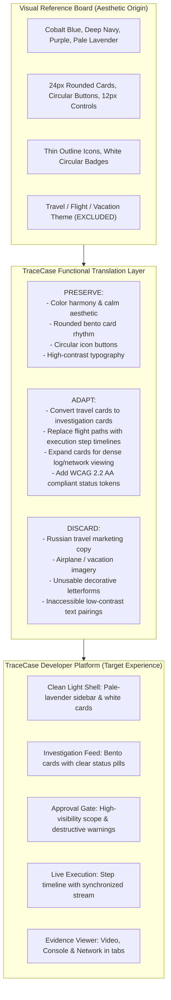
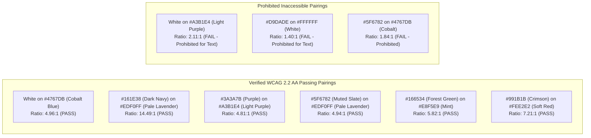
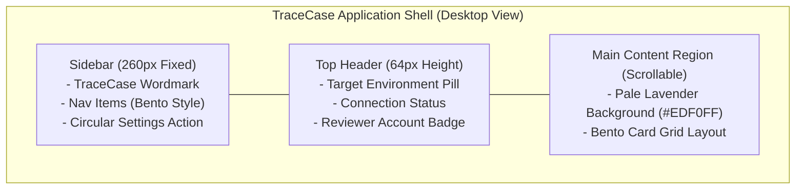
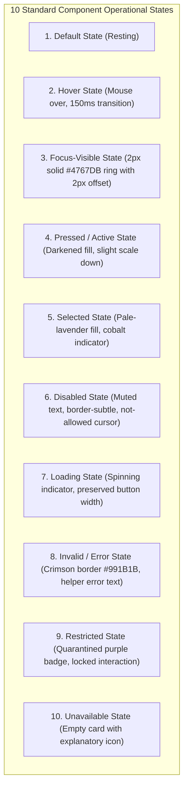
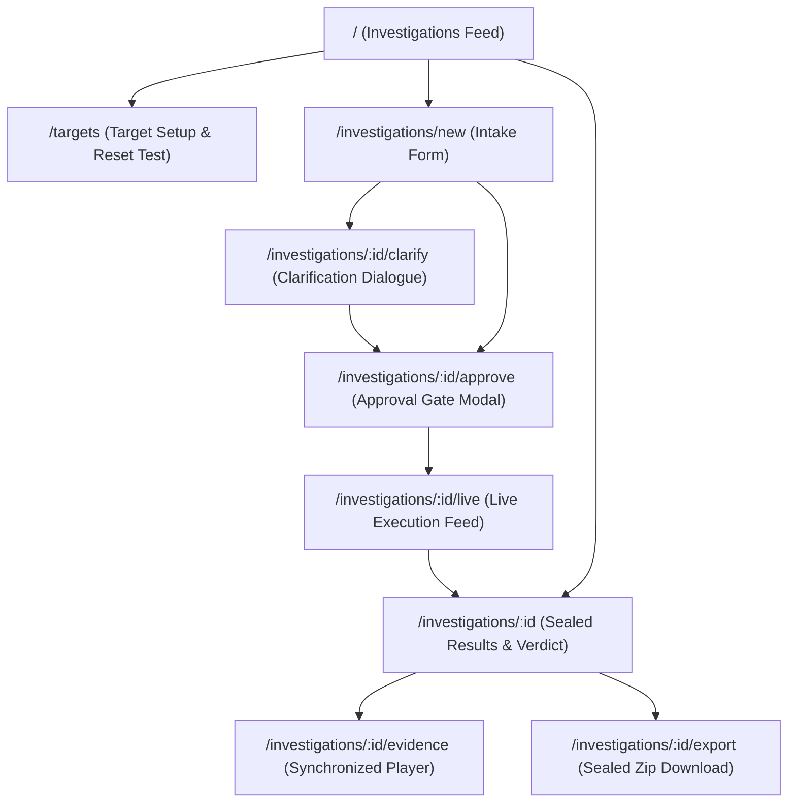
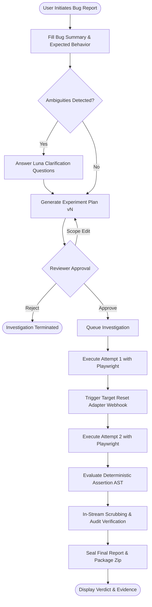
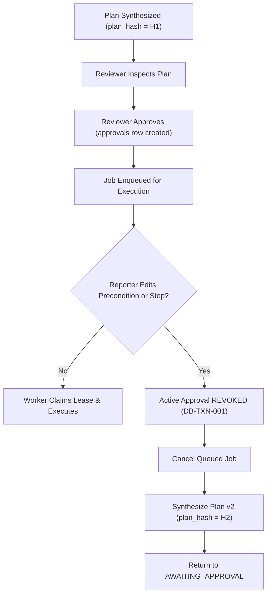
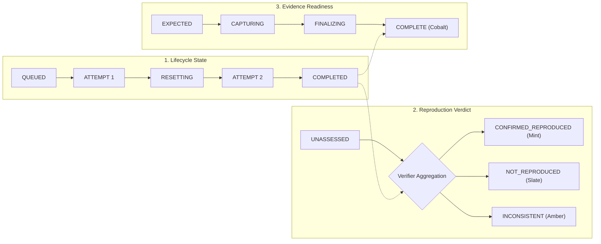
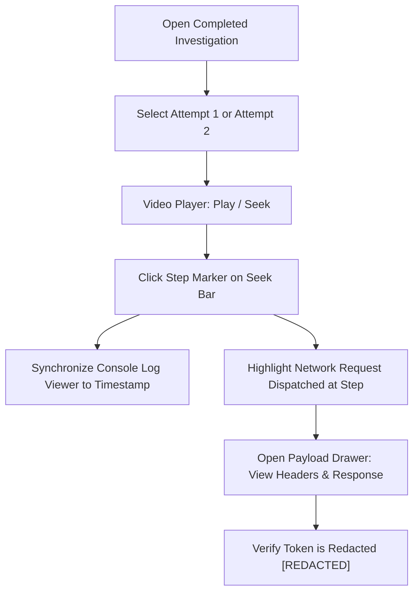
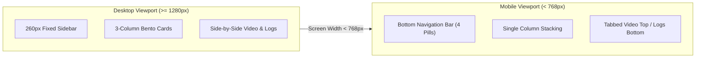

# TraceCase — UI/UX Design and Interaction Specification

**Document ID:** `TC-UIX-001`  
**Version:** `1.0.0-draft`  
**Creation Date:** 20 October 2026  
**Status:** Draft for Review (Requires User & Lead Architect Review prior to implementation)  
**Authoring Role:** Product Designer, Interaction Designer & UI/UX Specification Author  
**Repository Path:** [`docs/ui-ux-specification.md`](file:///c:/SHARAN%20PROJECTS/TraceCase/docs/ui-ux-specification.md)  
**Visual Reference Inspected:** [`TraceCase-UI-Reference.png`](file:///C:/Users/tms10/Documents/Codex/2026-10-20/ok-can-u-analyze-the-ps-6/outputs/TraceCase-UI-Reference.png)

---

## Table of Contents
1. [Document Control, Source Register, and Current State Assessment](#1-document-control-source-register-and-current-state-assessment)
2. [Source Authority, Decision Status, and Factual Discipline](#2-source-authority-decision-status-and-factual-discipline)
3. [Confirmed TraceCase Product and Technical Baseline](#3-confirmed-tracecase-product-and-technical-baseline)
4. [Official Hackathon Case Coverage (TC1–TC4)](#4-official-hackathon-case-coverage-tc1tc4)
5. [Visual Reference: Observed Direction and Direct Inspection](#5-visual-reference-observed-direction-and-direct-inspection)
6. [Reference Palette, Hex Labels, and Bitmap Measurement Provenance](#6-reference-palette-hex-labels-and-bitmap-measurement-provenance)
7. [Required Visual Translation: From Travel Board to Developer Investigation Tool](#7-required-visual-translation-from-travel-board-to-developer-investigation-tool)
8. [Design Principles](#8-design-principles)
9. [Color Token Specification](#9-color-token-specification)
10. [Contrast Requirements, W3C WCAG 2.2 AA Targets, and Known Pairings](#10-contrast-requirements-w3c-wcag-22-aa-targets-and-known-pairings)
11. [Typography Scale and System Font Stack](#11-typography-scale-and-system-font-stack)
12. [Layout, Spacing, Radius, and Elevation Scale](#12-layout-spacing-radius-and-elevation-scale)
13. [Application Shell and Global Navigation](#13-application-shell-and-global-navigation)
14. [Information Architecture and Route Structure](#14-information-architecture-and-route-structure)
15. [User Journeys: Primary Workflow and Edge Scenarios](#15-user-journeys-primary-workflow-and-edge-scenarios)
16. [Screen Specification 1: Investigation List / Dashboard](#16-screen-specification-1-investigation-list--dashboard)
17. [Screen Specification 2: Target Application Setup](#17-screen-specification-2-target-application-setup)
18. [Screen Specification 3: New Bug Report Intake](#18-screen-specification-3-new-bug-report-intake)
19. [Screen Specification 4: Attachment and Sample File Interactions](#19-screen-specification-4-attachment-and-sample-file-interactions)
20. [Screen Specification 5: Interpretation and Clarification Dialog](#20-screen-specification-5-interpretation-and-clarification-dialog)
21. [Screen Specification 6: Experiment Plan Review and Approval Gate](#21-screen-specification-6-experiment-plan-review-and-approval-gate)
22. [Screen Specification 7: Active Investigation Progress and Live Feed](#22-screen-specification-7-active-investigation-progress-and-live-feed)
23. [Screen Specification 8: Cancellation, Pause, and Recovery Controls](#23-screen-specification-8-cancellation-pause-and-recovery-controls)
24. [Screen Specification 9: Results, Verdicts, and Summary](#24-screen-specification-9-results-verdicts-and-summary)
25. [Screen Specification 10: Attempt Comparison (Run 1 vs. Run 2)](#25-screen-specification-10-attempt-comparison-run-1-vs-run-2)
26. [Screen Specification 11: Integrated Evidence Viewer (Video, Console, Network)](#26-screen-specification-11-integrated-evidence-viewer-video-console-network)
27. [Screen Specification 12: Console Log and Network HAR Presentation](#27-screen-specification-12-console-log-and-network-har-presentation)
28. [Screen Specification 13: Sensitive, Quarantined, and Redacted Artifacts](#28-screen-specification-13-sensitive-quarantined-and-redacted-artifacts)
29. [Screen Specification 14: Reproduction Procedure and Safe Export Bundle](#29-screen-specification-14-reproduction-procedure-and-safe-export-bundle)
30. [Screen Specification 15: Optional Diagnostic Guidance & Test Code](#30-screen-specification-15-optional-diagnostic-guidance--test-code)
31. [Component Catalogue](#31-component-catalogue)
32. [Comprehensive Component-State Coverage](#32-comprehensive-component-state-coverage)
33. [Responsive Layouts and Breakpoint Specifications](#33-responsive-layouts-and-breakpoint-specifications)
34. [Accessibility, Focus Navigation, and Screen-Reader Strategy](#34-accessibility-focus-navigation-and-screen-reader-strategy)
35. [Motion, Micro-Interactions, and Loading Skeletons](#35-motion-micro-interactions-and-loading-skeletons)
36. [Microcopy Specification and Standard Copy Table](#36-microcopy-specification-and-standard-copy-table)
37. [Backend-State Mapping to UI Presentation](#37-backend-state-mapping-to-ui-presentation)
38. [Privacy and Safe Client Interaction Architecture](#38-privacy-and-safe-client-interaction-architecture)
39. [Annotated Screen Wireframes (11 Core Screens)](#39-annotated-screen-wireframes-11-core-screens)
40. [Architectural UI and Interaction Diagrams](#40-architectural-ui-and-interaction-diagrams)
41. [Reference Fidelity Review Checklist](#41-reference-fidelity-review-checklist)
42. [Design Acceptance Criteria (Given/When/Then)](#42-design-acceptance-criteria-givenwhenthen)
43. [UI/UX Traceability Matrix](#43-uiux-traceability-matrix)
44. [Open Design Decisions and Implementation Handoff](#44-open-design-decisions-and-implementation-handoff)

---

## 1. Document Control, Source Register, and Current State Assessment

### 1.1 Document Information
- **Title:** TraceCase UI/UX Design and Interaction Specification
- **Version:** `1.0.0-draft`
- **Creation Date:** 20 October 2026
- **Status:** Draft for Review (Requires User & Lead Architect Review prior to implementation)
- **Document ID:** `TC-UIX-001`
- **Target Frontend Baseline:** Next.js 14 App Router, React 18+, Tailwind CSS v3.4+, shadcn/ui component primitives, Lucide React outline icons.

### 1.2 Inspected Dependencies
This specification synthesizes product requirements, system contracts, and the visual reference into an implementable user interface design:
1. **[`TraceCase-UI-Reference.png`](file:///C:/Users/tms10/Documents/Codex/2026-10-20/ok-can-u-analyze-the-ps-6/outputs/TraceCase-UI-Reference.png):** Visual reference image directly inspected via multimodal image analysis.
2. **[`docs/prd.md`](file:///c:/SHARAN%20PROJECTS/TraceCase/docs/prd.md) (`TC-PRD-001`, v1.0.0-draft):** Functional requirements (`TC-FR-001` through `TC-FR-018`) and user journey definitions.
3. **[`docs/trd.md`](file:///c:/SHARAN%20PROJECTS/TraceCase/docs/trd.md) (`TC-TRD-001`, v1.0.0-draft):** Technical architecture, Next.js frontend boundaries, and contracts (`TC-CON-001` through `TC-CON-005`).
4. **[`docs/ps-requirements-traceability-matrix.md`](file:///c:/SHARAN%20PROJECTS/TraceCase/docs/ps-requirements-traceability-matrix.md) (`TC-RTM-001`, v1.0.0-draft):** Official hackathon obligations (`PS-REQ-001` through `PS-REQ-019`) and test cases (TC1–TC4).
5. **[`docs/workflow-and-state-machine-specification.md`](file:///c:/SHARAN%20PROJECTS/TraceCase/docs/workflow-and-state-machine-specification.md) (`TC-WFM-001`, v1.0.0-draft):** 5-dimensional state machine and master transition table (`WF-TR-001` through `WF-TR-021`).
6. **[`docs/agent-and-tool-contracts.md`](file:///c:/SHARAN%20PROJECTS/TraceCase/docs/agent-and-tool-contracts.md) (`TC-AGT-001`, v1.0.0-draft):** Luna tool contracts, AXTree pruning, and token limits.
7. **[`docs/database-design-and-erd.md`](file:///c:/SHARAN%20PROJECTS/TraceCase/docs/database-design-and-erd.md) (`TC-DBD-001`, v1.0.0-draft):** 21 relational tables, transaction matrix (`DB-TXN-001` through `DB-TXN-014`), and RLS access matrix.
8. **[`docs/system-architecture.md`](file:///c:/SHARAN%20PROJECTS/TraceCase/docs/system-architecture.md) (`TC-SAD-001`, v1.0.0-draft):** System Architecture Document defining plane partitioning, container topology, and C4 views.
9. **`TraceCase-Agent-Project-Context.md` (v1.0):** Consolidated baseline invariants for TraceCase.

### 1.3 Sources Unavailable / Uninspected
- **Live User Testing / Usability Studies:** Offline engineering and documentation phase; no external user feedback has been gathered.
- **Figma Design Tokens / Variables File:** The reference was provided as a flattened PNG image. Original Figma variables, layers, and styles were not directly accessible and are derived by visual inspection and color sampling.

---

## 2. Source Authority, Decision Status, and Factual Discipline

### 2.1 Hierarchy of Authority
1. **Official Problem Statement:** Establishes non-negotiable core obligations: vague report intake $\to$ human approval gate $\to$ browser execution $\to$ reproduction twice before confirmation $\to$ 3-part evidence (video, console, network) $\to$ sandbox destruction guard $\to$ auth token redaction.
2. **Explicit User Directives:** Name locked to **TraceCase**; exclusive AI model locked to **GPT-6 Luna**; visual direction locked to the supplied design board (**white and pale-lavender surfaces, cobalt-blue actions, deep navy/purple text, rounded cards, circular icon buttons, and restrained shadows**).
3. **Approved Repository Documents:** PRD, TRD, Traceability Matrix, Workflow Specification, Database ERD, and System Architecture govern functional behavior, data types, state machine transitions, and security boundaries.
4. **Visual Reference Authority:** The image governs aesthetic styling, color relationships, radius proportions, and component visual rhythm. It does **not** govern product content (Russian travel copy, airplane motifs, and hotel booking widgets are strictly excluded).

---

## 3. Confirmed TraceCase Product and Technical Baseline

- **Product Identity:** TraceCase is a developer and QA tool designed to investigate, plan, reproduce, and verify web application bugs with cryptographic proof and media evidence.
- **Exclusive AI Intelligence:** All AI reasoning is executed strictly by **GPT-6 Luna** via the official OpenAI API (`TC-INV-001`). No silent fallback models are permitted.
- **Execution Engine:** Playwright running inside an independent, persistent server-side Node.js worker process. The tool controls a headless/virtual Chromium browser, **never** the user's personal browser tabs.
- **Target Boundary:** Staging or demo web application with explicit host whitelisting and an authenticated reset webhook (`POST /api/test/reset-fixture`).
- **Human Approval Gate:** Backend-enforced approval modal; execution is blocked until a reviewer signs off on a canonical `plan_hash` and version (`TC-INV-003`, `TC-INV-004`).
- **Confirmation Standard:** Mathematical requirement of 2 consecutive valid executions matching the failure signature under clean baselines (`TC-INV-002`).
- **Backend Reset Distinction:** Browser cache/cookie clearing does not reset server databases. Attempt 2 is strictly blocked until an HTTP 200 receipt is received from the target reset adapter (`TC-INV-006`).
- **Evidence Triad:** Verified reproduction requires three synchronized artifacts: screen recording (`.webm`), console logs (`.log`), and network logs (`.json`) (`TC-INV-012`).
- **In-Stream Redaction:** Sensitive headers, Bearer tokens, and passwords are scrubbed in-memory before writing to disk or object storage (`TC-INV-009`).

---

## 4. Official Hackathon Case Coverage (TC1–TC4)

The user interface provides dedicated, unambiguous visual treatments for the four official hackathon cases:

| Case ID | Hackathon Scenario | Backend Verdict | Primary UI Visual Treatment & Indicators |
|---|---|---|---|
| **TC1** | **Bug Reproduced Twice** | `CONFIRMED_REPRODUCED` | Cobalt-blue success badge; side-by-side Attempt 1 vs. Attempt 2 comparison; synchronized video/console/network evidence player; "Download Sealed Bundle" CTA. |
| **TC2** | **Cannot Reproduce** | `NOT_REPRODUCED` | Neutral slate badge; explicit list of reproduction steps attempted; target build SHA banner; video proof of healthy application behavior. |
| **TC3** | **Deletion / Destructive Action** | Dependent on run (`CONFIRMED_REPRODUCED` or `NOT_REPRODUCED`) | High-visibility purple/warning banner on approval card: "Destructive Mutation in Sandbox"; target sandbox verification badge (`targets.is_sandbox = TRUE`); pre-flight & post-reset receipt chips. |
| **TC4** | **Auth Token in Logs** | Dependent on run | Redaction audit badge: "1 Token Redacted"; console log pane displays `[REDACTED_AUTH_TOKEN]`; raw artifact quarantined as `RESTRICTED_RAW`; public download serves strictly `PUBLIC_SAFE` derivative. |

---

## 5. Visual Reference: Observed Direction and Direct Inspection

Direct multimodal inspection of `TraceCase-UI-Reference.png` reveals the following concrete characteristics:
1. **Canvas & Layout:** Clean `#FFFFFF` outer canvas with modular, rounded rectangular cards organized in a calm, bento-grid rhythm.
2. **Card Surfaces:** Soft, rounded rectangular panels with generous internal padding (approx. 20–24px) and subtle 1px border outlines or tone-on-tone separations.
3. **Color Balance:** Dominant interaction elements are vibrant cobalt blue (`#4767DB`). Text and structural accents leverage deep navy (`#161E38`) and rich purple (`#3A3A7B`). Background surfaces feature ultra-pale lavender (`#EDF0FF` / `#F3F2F7`).
4. **Button & Control Geometry:** Strongly rounded corners on buttons and inputs (approx. 10–12px radius). Distinctive white circular icon buttons (`border-radius: 50%`) with blue/purple stroke icons.
5. **Icon Style:** Modern, thin-line outline icons (1.5px stroke) with consistent optical weighting.
6. **Typography Styling:** The reference prominently labels **SF Pro Display** with clean proportions, generous line height, and distinct weight hierarchy (Regular, Medium, Semibold, Bold).
7. **Exclusions:** The reference features Russian travel copy, airline booking widgets, suitcases, and hearts. These domain artifacts are strictly excluded from TraceCase.

---

## 6. Reference Palette, Hex Labels, and Bitmap Measurement Provenance

The reference image contains both printed text labels and rendered pixel surfaces. To maintain absolute factual discipline, this specification distinguishes printed labels from measured pixel samples:

### 6.1 Reference Printed Labels vs. Measured Bitmap Samples

| Reference Color Name | Printed Hex in Image | Sampled Bitmap Hex | Semantic Role in TraceCase |
|---|---|---|---|
| **Light Blue** | `#4767DB` | `#4867DB` | **Primary Brand & Action Color** (Buttons, active tabs, focus rings, links). |
| **Purple** | `#3A3A7B` | `#3A3A7A` | **Secondary Brand & Structural Accent** (Section headers, badge borders, deep accents). |
| **Dark Blue** | `#161E38` | `#171E38` | **Primary Text & High-Contrast Canvas** (Headings, primary body copy, dark badges). |
| **Light Purple** | `#A3B1E4` | `#A4B1E5` | **Soft Accent & Highlight Fill** (Selected item backdrops, secondary badge fills). |
| **White (Labelled)** | `#D9DADE` | `#D9DADE` | **Subtle Neutral Border / Divider** (Card borders, dividers; NOT the page background). |
| **Pale Lavender (Card Fill)**| *Unlabelled* | `#EDF0FF` | **Tertiary Canvas & Section Fill** (Card backgrounds, sidebar fill, code block backdrops). |
| **Pure White (Canvas)** | *Unlabelled* | `#FFFFFF` | **Primary Canvas & Reading Surface** (Page background, input fills, circular button fills). |

### 6.2 The `#D9DADE` "White" Label Clarification
In the reference image, the swatch labeled "White" has the hex code `#D9DADE`. In standard color science, `#D9DADE` is a light neutral gray, whereas the actual canvas and circular buttons in the image are pure white (`#FFFFFF`). TraceCase resolves this ambiguity definitively:
- `#FFFFFF` is used as the primary background canvas and input surface.
- `#EDF0FF` is used as the pale-lavender card and section surface.
- `#D9DADE` is used strictly as a subtle border/divider stroke token (`border-subtle`). It is **never** used as full-page text or background.

---

## 7. Required Visual Translation: From Travel Board to Developer Investigation Tool



---

## 8. Design Principles

The TraceCase user interface is governed by 10 non-negotiable interaction principles:

1. **State Transparency over Guesswork:** The master state of an investigation is immediately apparent across all three orthogonal dimensions: Lifecycle, Verdict, and Evidence.
2. **Approval Means Real Action:** The approval modal communicates exact target scope, steps, and data affected. Destructive mutations in sandbox environments display unambiguous warnings.
3. **Evidence is Primary, Hypotheses are Secondary:** Deterministic facts (DOM visibility, HTTP status, console logs) are prominently separated from AI-generated diagnostic inferences.
4. **Legibility at Developer Density:** The visual softness of pale lavender and rounded cards must never sacrifice the readability of dense stack traces, HAR tables, or terminal logs.
5. **Progressive Disclosure:** High-level executive summaries are visible on initial load; deep technical traces, headers, and AST predicates expand on demand without modal clutter.
6. **Assumptions Never Masquerade as Observations:** Reporter claims and AI interpretations are explicitly tagged ("From user report", "AI inferred claim"), preventing cognitive confusion.
7. **Honest Reporting of Non-Reproduction:** A healthy application run that proves a bug did not reproduce is presented as a successful investigation, not a red failure.
8. **Visual Fidelity Without Decorative Obstruction:** Rounded cards, circular buttons, and lavender accents are applied to enhance layout hierarchy, not as arbitrary eye candy.
9. **Zero Premature Success States:** The UI never displays "Reproduced" or "Confirmed" based on a single attempt or before deterministic assertion evaluation completes.
10. **Zero Secret Leakage in Previews:** The UI enforces in-stream redaction; raw authentication tokens or cookies are never exposed in "before/after" toggles or client logs.


---

## 9. Color Token Specification

The TraceCase color system bridges the reference design language with developer-grade semantic requirements:

| Token Name | Proposed Hex | Provenance | Intended Application | Prohibited Application | WCAG 2.2 AA Contrast Ratio |
|---|---|---|---|---|---|
| `canvas-main` | `#FFFFFF` | Reference Canvas | Main application outer background, card inner fills. | Muted borders, text. | Base surface. |
| `surface-lavender` | `#EDF0FF` | Reference Bitmap | Section fills, bento card backdrops, sidebar panel. | Body text, borders. | Base surface. |
| `surface-card` | `#FFFFFF` | Reference Canvas | High-density reading surfaces, data tables, log cards. | Large outer backgrounds. | Base surface. |
| `surface-accent` | `#A3B1E4` | Reference Label | Highlighted table rows, active badge fills. | Small body text backgrounds. | 4.81:1 with `#3A3A7B`. |
| `text-primary` | `#161E38` | Reference Label | Headings, primary reading text, active icons. | Muted secondary metadata. | 14.49:1 on `#EDF0FF`. |
| `text-secondary` | `#3A3A7B` | Reference Label | Section subtitles, card headers, secondary emphasis. | Low-importance timestamps. | 8.92:1 on `#EDF0FF`. |
| `text-muted` | `#5F6782` | Derived Accessible | Timestamps, helper text, table column headers. | Primary action labels. | 4.94:1 on `#EDF0FF`. |
| `text-on-action` | `#FFFFFF` | Reference Canvas | Text and icons inside cobalt-blue action buttons. | Dark text surfaces. | 4.96:1 on `#4767DB`. |
| `action-primary` | `#4767DB` | Reference Label | Primary buttons ("Approve & Run", "Submit Report"). | Background canvas. | 4.96:1 with white. |
| `action-hover` | `#3856CA` | Derived Functional | Hover state for primary buttons. | Base button fill. | > 5:1 with white. |
| `action-pressed` | `#2D47B0` | Derived Functional | Active / pressed state for primary buttons. | Hover state. | > 6:1 with white. |
| `border-subtle` | `#D9DADE` | Reference Label | 1px card divider lines, outer card outlines. | Essential button outlines. | 1.4:1 (Non-text decorative). |
| `border-control` | `#C4C7D4` | Derived Functional | Input borders, checkbox boundaries, table dividers. | Decorative canvas lines. | 3.1:1 on white (WCAG Non-Text). |
| `focus-ring` | `#4767DB` | Reference Label | 2px solid accessible focus outline with 2px offset. | Inactive borders. | > 3:1 against white & lavender. |
| `status-confirmed-fill`| `#E8F5E9` | Derived Functional | Badge fill for `CONFIRMED_REPRODUCED`. | Error states. | Soft surface. |
| `status-confirmed-text`| `#166534` | Derived Functional | Badge text & icon for `CONFIRMED_REPRODUCED`. | Normal body copy. | 5.82:1 on `#E8F5E9`. |
| `status-notrepro-fill` | `#F1F5F9` | Derived Functional | Badge fill for `NOT_REPRODUCED`. | Failure alerts. | Soft surface. |
| `status-notrepro-text` | `#334155` | Derived Functional | Badge text & icon for `NOT_REPRODUCED`. | Primary action buttons. | 7.12:1 on `#F1F5F9`. |
| `status-error-fill` | `#FEE2E2` | Derived Functional | Banner fill for `EXECUTION_ERROR` and destructive warnings. | Success cards. | Soft surface. |
| `status-error-text` | `#991B1B` | Derived Functional | Banner text for errors and destructive warnings. | Routine metadata. | 7.21:1 on `#FEE2E2`. |
| `status-blocked-fill` | `#FEF3C7` | Derived Functional | Badge fill for `BLOCKED` (CAPTCHA, reset failure). | Normal notifications. | Soft surface. |
| `status-blocked-text` | `#92400E` | Derived Functional | Badge text for `BLOCKED`. | Dark canvas text. | 6.14:1 on `#FEF3C7`. |
| `status-restricted-fill`|`#F3E8FF` | Derived Functional | Badge fill for `RESTRICTED_RAW` (Secret quarantined). | Public artifact tags. | Soft surface. |
| `status-restricted-text`|`#6B21A8` | Derived Functional | Badge text for `RESTRICTED_RAW`. | Primary brand copy. | 6.84:1 on `#F3E8FF`. |

---

## 10. Contrast Requirements, W3C WCAG 2.2 AA Targets, and Known Pairings

TraceCase strictly enforces W3C WCAG 2.2 Level AA accessibility compliance:
- **Normal Text (<18pt / <24px):** Minimum contrast ratio of **4.5:1** against adjacent surfaces.
- **Large Text ($\ge$18pt or bold $\ge$14pt):** Minimum contrast ratio of **3.0:1**.
- **Interactive Controls & Non-Text UI:** Minimum contrast ratio of **3.0:1** against adjacent backgrounds.

### 10.1 Mathematical Verification of Reference Pairings



### 10.2 Architectural Rules Governing Color Pairings
1. **The Light Purple Rule:** Text placed inside `#A3B1E4` (Light Purple) container cards or badges **must** use `#3A3A7B` (Deep Purple) or `#161E38` (Navy). White text on Light Purple is strictly prohibited by linting rules.
2. **The Divider Rule:** `#D9DADE` is restricted exclusively to decorative structural card borders and dividers. It is never used for text, icons, or active input borders.
3. **The Interactive Boundary Rule:** All form inputs, comboboxes, and checkboxes utilize `border-control` (`#C4C7D4`), guaranteeing a 3.1:1 contrast ratio against the white background.

---

## 11. Typography Scale and System Font Stack

### 11.1 Font Stack Selection
- **Primary Display & Interface Font:** `SF Pro Display`, `-apple-system, BlinkMacSystemFont, "Segoe UI", Roboto, "Helvetica Neue", Arial, sans-serif`.
  - *Rationale:* The reference explicitly designates SF Pro Display. Using system-sans as the production fallback ensures zero layout shifts, zero font-loading delays, and native desktop rendering without bundling proprietary Apple font binaries.
- **Monospace Code & Log Font:** `ui-monospace, "SF Mono", Menlo, Consolas, "Liberation Mono", monospace`.
  - *Rationale:* Essential for readable, un-wrapped terminal console logs, network request URLs, and JSON AST failure signatures.

### 11.2 Type Hierarchy Scale

| Typography Level | Font Size | Line Height | Font Weight | Letter Spacing | Target Usage |
|---|---|---|---|---|---|
| **Page Title** | `32px` (2.0rem) | `40px` (1.25) | Bold (700) | `-0.02em` | Main dashboard & investigation headers. |
| **Section Title** | `24px` (1.5rem) | `32px` (1.33) | Semibold (600) | `-0.01em` | Major bento card section titles. |
| **Card Header** | `18px` (1.125rem)| `26px` (1.44) | Semibold (600) | `0.00em` | Sub-panel titles, modal headers. |
| **Body Primary** | `16px` (1.0rem) | `24px` (1.50) | Regular (400) | `0.00em` | General report narrative, explanations. |
| **Form & Table** | `14px` (0.875rem)| `20px` (1.43) | Medium (500) | `0.00em` | Form labels, input text, table cell values. |
| **Helper & Muted** | `12px` (0.75rem) | `16px` (1.33) | Regular (400) | `+0.01em` | Timestamps, file size metadata, sub-labels. |
| **Monospace Code** | `13px` (0.8125rem)| `18px` (1.38)| Regular (400) | `0.00em` | Console logs, HAR payloads, selector strings. |

---

## 12. Layout, Spacing, Radius, and Elevation Scale

### 12.1 Spacing Scale (8-Point Grid)
TraceCase utilizes an 8-point harmonic spacing grid for layout rhythm:
- `space-1` (4px): Micro-spacing between icon and button label.
- `space-2` (8px): Compact element padding, tag gaps.
- `space-3` (12px): Standard control internal padding (inputs, buttons).
- `space-4` (16px): Internal card spacing, grid gaps.
- `space-6` (24px): Major card internal padding, layout column gaps.
- `space-8` (32px): Bento section separation, modal header margin.
- `space-12` (48px): Page-level top/bottom breathing room.

### 12.2 Corner Radii Specification
Reflecting the visual softness of the design board:
- **Major Cards (`radius-card`):** `24px` (1.5rem). Applied to bento cards, modals, and evidence containers.
- **Controls & Buttons (`radius-control`):** `12px` (0.75rem). Applied to primary buttons, text inputs, and dropdowns.
- **Circular Icon Buttons (`radius-circle`):** `50%` (9999px). Applied to all standalone action buttons, icon chips, and navigation triggers.
- **Badges & Pills (`radius-pill`):** `9999px`. Applied to status badges, attempt indicators, and tag chips.

### 12.3 Elevation and Restrained Shadows
The reference relies on crisp flat fills and tone-on-tone separations rather than heavy blur shadows:
- `shadow-none`: `none`. Used for flat secondary cards.
- `shadow-card`: `0px 2px 8px rgba(22, 30, 56, 0.04), 0px 1px 2px rgba(22, 30, 56, 0.02)`. Barely perceptible ambient shadow giving cards subtle physical separation from the pale-lavender canvas.
- `shadow-modal`: `0px 12px 32px rgba(22, 30, 56, 0.08), 0px 4px 12px rgba(22, 30, 56, 0.04)`. Focused shadow for approval dialogs and drawer panels.

---

## 13. Application Shell and Global Navigation

### 13.1 Shell Architecture
The desktop-first application shell features a persistent collapsible sidebar navigation (260px wide) paired with a responsive top header and a flexible main workspace:



### 13.2 Navigation Elements
1. **TraceCase Wordmark:** Stylized bold typography (`#161E38`) with a vibrant cobalt dot (`#4767DB`). No travel icons or airplanes.
2. **Navigation Menu Items:**
   - **Investigations (Home):** Circular white icon badge + "Investigations" label.
   - **Target Applications:** Circular white icon badge + "Connected Targets" label.
   - **System Audit Log:** Circular white icon badge + "Audit History" label.
3. **Primary Action Header Button:** High-prominence cobalt pill button: `+ New Investigation`.

---

## 14. Information Architecture and Route Structure

The Next.js App Router exposes 10 distinct, functional route surfaces:

| Route Path | Screen Name | Primary User Task | Key Data Components |
|---|---|---|---|
| `/` | **Investigation Feed** | Review recent investigations and initiate new runs. | Bento summary cards, active status filters, search bar. |
| `/targets` | **Target Management** | Register targets, inspect sandbox flags, test reset adapters. | Target card grid, reset test button, webhook URL. |
| `/investigations/new`| **New Report Intake** | Submit raw bug claim, expected behavior, attachments. | Intake form, drop zone, environment selector. |
| `/investigations/[id]/clarify`| **Clarification Q&A** | Answer Luna's structured questions to resolve ambiguity. | Q&A dialogue thread, assumption chips, submit answers. |
| `/investigations/[id]/approve`| **Approval Gate** | Inspect plan, verify steps, approve/reject execution. | Approval modal, step preview, destructive sandbox warning. |
| `/investigations/[id]/live` | **Live Execution** | Monitor real-time browser steps and target state. | Step timeline, live screenshot, SSE reconnect banner. |
| `/investigations/[id]` | **Results & Evidence** | Inspect final verdict, attempt comparison, sealed media. | Verdict banner, Run 1 vs Run 2 tabs, evidence player. |
| `/investigations/[id]/export` | **Export Center** | Download sanitized zip bundle, reproduction script. | Checksum viewer, presigned download CTA. |

---

## 15. User Journeys: Primary Workflow and Edge Scenarios

### 15.1 Primary Happy-Path User Journey

```mermaid
sequenceDiagram
    autonumber
    actor User as User (Reporter / Reviewer)
    participant UI as TraceCase UI
    participant Backend as Next.js API & Worker

    User->>UI: 1. Click "+ New Investigation"
    UI->>User: 2. Render Intake Form
    User->>UI: 3. Fill Claim & Expected Behavior; Submit
    UI->>Backend: 4. POST /api/reports (Report Ingested)
    Backend-->>UI: 5. Plan Synthesized (plan_hash = H1)
    UI->>User: 6. Display Approval Gate Modal
    User->>UI: 7. Review Steps & Click "Approve & Run"
    UI->>Backend: 8. POST /api/approvals (Investigation Queued)
    Backend-->>UI: 9. SSE Stream: Executing Attempt 1
    UI->>User: 10. Live Timeline Updates (Step 1..N)
    Backend-->>UI: 11. SSE Stream: Target Reset Executing
    UI->>User: 12. Display "Resetting Target Fixture..." Badge
    Backend-->>UI: 13. SSE Stream: Executing Attempt 2
    UI->>User: 14. Live Timeline Updates (Step 1..N)
    Backend-->>UI: 15. SSE Stream: Verdict = CONFIRMED_REPRODUCED
    UI->>User: 16. Display Sealed Results, Videos & Download CTA
```

### 15.2 Comprehensive Alternate & Edge Journeys
1. **Edge Journey A (Scope Edit Post-Approval):** Reviewer approves Plan v1 $\to$ Reporter edits Step 2 in UI $\to$ Approval immediately transitions to `REVOKED` $\to$ System cancels queued job $\to$ Modal displays: "Plan modified; new approval required."
2. **Edge Journey B (Ambiguous Report Clarification):** Reporter enters vague single-line issue $\to$ Luna generates 2 clarification questions $\to$ UI routes to `/clarify` $\to$ User submits answers $\to$ Luna re-synthesizes plan v2.
3. **Edge Journey C (Target Reset Failure):** Attempt 1 reproduces bug $\to$ Target reset webhook returns HTTP 500 $\to$ Attempt 2 is blocked $\to$ UI displays: `BLOCKED: Target reset failed. Attempt 2 cancelled to protect state.` Verdict set to `OBSERVED_ONCE`.
4. **Edge Journey D (Uncertain Mutation Halt):** Playwright encounters network drop during task deletion $\to$ Action marked `MUTATION_UNCERTAIN` $\to$ UI halts with explicit warning: "Network timeout mid-action. Paused to prevent blind double-deletion."
5. **Edge Journey E (Auth Token Redacted in View):** Target prints Bearer token $\to$ Scrubber scrubs in-memory $\to$ Console pane displays `[REDACTED_AUTH_TOKEN]` with purple badge $\to$ Download bundle includes only sanitized derivative.
6. **Edge Journey F (Single Match / Inconsistent Run):** Attempt 1 observes bug $\to$ Reset restores state $\to$ Attempt 2 target behaves correctly $\to$ UI displays `INCONSISTENT_OBSERVATIONS` badge with detailed side-by-side diff.
7. **Edge Journey G (Budget Exhaustion Circuit Breaker):** Cumulative OpenAI spend hits $20.00 $\to$ UI banner alerts: "Credit budget cap reached ($20.00). Investigation paused. All completed evidence preserved."
8. **Edge Journey H (Browser Disconnect Replay):** User refreshes page mid-run $\to$ UI reconnects via SSE passing `Last-Event-ID` $\to$ Replays missing timeline steps without restarting browser.

---

## 16. Screen Specification 1: Investigation List / Dashboard

- **Route:** `/`
- **Primary Goal:** Provide an immediate, scannable overview of recent bug investigations, their reproduction verdicts, and evidentiary readiness.

### 16.1 Layout & Bento Card Hierarchy
- **Header Bar:**
  - Page title: "Investigations" (`text-primary`, 32px Bold).
  - Target application switcher pill: `Dropdown: [ Acme Staging v2.4 ]`.
  - Primary CTA: `+ New Investigation` (Cobalt blue button, 12px radius).
- **Metric Cards (Top Bento Row):**
  - Card 1: **Active Queue** (White card, lavender icon chip): Displays active/running investigations count (e.g. `1 Active Worker`).
  - Card 2: **Confirmed Reproductions** (White card, mint icon chip): Displays count of `CONFIRMED_REPRODUCED` cases.
  - Card 3: **Non-Reproductions** (White card, slate icon chip): Displays count of `NOT_REPRODUCED` cases.
- **Investigation Table / Bento Feed (Main Area):**
  - Each investigation card features:
    - Target Name & Build SHA chip (`git-commit: 8f9b1c`).
    - Bug Title & ID (`#INV-104: CSV export drops decimal precision`).
    - Tri-Dimensional Status Badges:
      1. Lifecycle Badge: `Completed` (Slate pill).
      2. Verdict Badge: `Confirmed Twice` (Mint pill, checkmark icon).
      3. Evidence Badge: `Triad Ready` (Cobalt pill, video icon).
    - Relative Timestamp: `14 minutes ago`.
    - Action Trigger: Circular white button with cobalt arrow `→`.


---

## 17. Screen Specification 2: Target Application Setup

- **Route:** `/targets`
- **Primary Goal:** Enable engineers to register staging environments, configure allowed host whitelists, verify sandbox permissions, and test the backend reset webhook adapter.

### 17.1 UI Elements & Controls
1. **Target Registration Card (White Bento Panel, 24px radius):**
   - **Target Name Input:** `text` (e.g. `Acme E-Commerce Staging`).
   - **Base URL Input:** `url` with validation (`https://staging.acme.internal`).
   - **Sandbox Classification Toggle:** `is_sandbox: boolean`. Accompanying helper text: *"Enables safe execution of destructive plans (e.g., account deletion, task purging). Must be enabled for TC3."*
   - **Reset Adapter Webhook URL Input:** `url` (`https://staging.acme.internal/api/test/reset-fixture`).
   - **Reset Adapter Secret Key Ref:** `text` (`TARGET_RESET_SECRET_V1`). Opaque reference string mapping to server runtime vault.
   - **Allowed Hostnames Tag Input:** Array chip selector (`acme.internal`, `auth.acme.internal`).
2. **Connectivity & Reset Test Widget:**
   - Button: `Test Webhook Reset` (Cobalt outline pill).
   - Test Feedback Chip: Emits real-time HTTP ping; displays `HTTP 200 OK — Restored: ['tasks', 'users']` on success, or `HTTP 500 Connection Refused` on failure.

---

## 18. Screen Specification 3: New Bug Report Intake

- **Route:** `/investigations/new`
- **Primary Goal:** Low-friction intake form capturing the user's raw bug claim, expected behavior, and optional attachments without demanding complex technical parameters.

### 18.1 Form Layout and Field Architecture
- **Step Header:** "Submit Bug Report" (`text-primary`, 24px Semibold).
- **Target App Selector:** Combobox selecting from registered targets. Displays a prominent green or purple sandbox indicator pill (`Sandbox Active`).
- **Issue Summary Input:** High-prominence single-line text input: *"What broke? (e.g. Deleting last task causes infinite spinner)"*.
- **Reported Actual Behavior (Required Textarea):** Detailed description of the observed bug.
- **Expected Correct Behavior (Required Textarea):** Explicit description of what the user expected to happen. Helper copy: *"Crucial for generating deterministic verification checks."*
- **Suspected Steps to Reproduce (Dynamic Tag / Ordered List):** Flexible bullet input where reporters can add discrete steps (e.g., `1. Navigate to /tasks`, `2. Click delete icon on item #3`).
- **Form Actions:**
  - Primary Button: `Synthesize Investigation Plan` (Cobalt blue button with sparkle icon).
  - Secondary Link: `Cancel` (returns to dashboard).

---

## 19. Screen Specification 4: Attachment and Sample File Interactions

- **Component:** Integrated inside `/investigations/new`.
- **Primary Goal:** Allow drag-and-drop upload of user screenshots, sample CSV/JSON payloads, and error logs while ensuring clear visual separation from agent-captured evidence.

### 19.1 Drag-and-Drop Zone Anatomy
- **Dashed Enclosure:** 2px dashed border in `border-control` (`#C4C7D4`) over a soft `surface-lavender` (`#EDF0FF`) background. 16px corner radius.
- **Visual Motif:** Centered circular white icon badge with an upload arrow.
- **Instructional Microcopy:** *"Drop screenshots, network HARs, or sample input files here, or browse files"*.
- **Allowed Formats & Limits:** `PNG, JPG, JSON, CSV, LOG up to 10 MB`.
- **Uploaded File Chips:**
  - Displays file icon, truncated file name (`broken_export.csv`), exact byte size (`142 KB`), and an immutable provenance tag: `Reporter Upload`.
  - Delete Action: Circular white button with trash icon (`#991B1B`).

---

## 20. Screen Specification 5: Interpretation and Clarification Dialog

- **Route:** `/investigations/[id]/clarify`
- **Primary Goal:** Engage the reporter in a focused, structured Q&A dialogue when GPT-6 Luna detects ambiguities in the submitted claim (Maximum 3 rounds).

### 20.1 Dialogue Cards & Structure
- **Understood Claim Card (White Card, 20px radius):** Displays Luna's structured interpretation of the bug report with clear provenance labels:
  - *From your report:* "Delete task operation stalls."
  - *Identified Ambiguity:* "Does the spinner occur when deleting a single task or during bulk delete?"
- **Clarification Form:**
  - Interactive radio group or focused text input addressing Luna's specific question.
  - Button: `Submit Answer & Re-Plan` (Cobalt blue pill).
  - Round Indicator Pill: `Clarification Round 1 of 3`.

---

## 21. Screen Specification 6: Experiment Plan Review and Approval Gate

- **Route:** `/investigations/[id]/approve` (or Modal Overlay)
- **Primary Goal:** High-importance human-in-the-loop governance gate. Displays the synthesized execution plan, affected data, and deterministic assertions, requiring cryptographic sign-off before browser launch (`TC-INV-003`).

### 21.1 Plan Review Anatomy & Bento Cards
1. **Target & Scope Banner:**
   - Displays Target URL, tested build Git SHA, and browser viewport (`Chromium 1280x800`).
2. **Destructive Mutation Warning Card (Mandatory for TC3):**
   - Rendered when `plan.is_destructive = TRUE`.
   - Visual Treatment: Soft red fill (`#FEE2E2`), crimson border (`#991B1B`), alert triangle icon.
   - Text: `WARNING: DESTRUCTIVE MUTATION IN SANDBOX`
   - Copy: *"This plan contains destructive operations (DELETE /api/tasks). Verified target is an isolated sandbox. Disposable fixtures will be restored via reset adapter."*
3. **Semantic Steps Timeline Card (White Card, 24px radius):**
   - Numbered step list showing grounded browser actions (`GOTO`, `CLICK`, `FILL`).
   - Interactive parameters displayed in monospace pills (e.g. `Click button[name="Delete Task"]`).
4. **Deterministic Assertions Card:**
   - **Correct Behavior Predicate:** Monospace card displaying intended baseline assertion (e.g., `Assert DOM: "Task deleted successfully" is visible`).
   - **Failure Signature Predicate:** Monospace card displaying bug assertion (e.g., `Assert DOM: "Internal Server Error 500" is visible`).
5. **Approval Controls (Footer Bar):**
   - **Approve Button:** `Approve & Launch Two Runs` (Cobalt blue button, 12px radius, checkmark icon).
   - **Edit Plan Button:** `Modify Plan` (Pale-lavender outline button; revokes active hash on edit).
   - **Reject Button:** `Reject Plan` (Destructive text button, `#991B1B`).

---

## 22. Screen Specification 7: Active Investigation Progress and Live Feed

- **Route:** `/investigations/[id]/live`
- **Primary Goal:** Deliver real-time, transparent operational progress as Playwright executes Attempt 1, triggers the backend reset adapter, and executes Attempt 2.

### 22.1 Real-Time Execution Layout
- **Top Progress Bar:**
  - Dynamic Attempt Indicator Pill: `Attempt 1 of 2 in Progress` (Cobalt pill with pulsing dot).
  - Wall-Clock Timer: Counts up from `00:00` toward 300s limit.
- **Active Step Timeline (Left Column, 60% Width):**
  - Displays completed steps with green checkmarks, currently executing step with a spinning lavender badge, and queued steps in muted gray.
  - Step details show grounded action, target selector, and execution duration (e.g., `Step 3: Click button[name="Export CSV"] (142ms)`).
- **Target Reset Transition Card (Renders between Attempt 1 and Attempt 2):**
  - High-visibility purple notification card:
  - Text: `Restoring Target Baseline State...`
  - Subtext: `Invoking POST /api/test/reset-fixture to ensure Attempt 2 runs under identical conditions.`
- **Live Screencast / Screenshot Viewer (Right Column, 40% Width):**
  - Live CDP viewport rendering showing the browser's current visual state.
  - Watermark: `Playwright Worker (Sandbox Isolated)`.
- **Reconnect Banner (Conditional):**
  - If network drops and re-establishes: `Reconnected to live stream. Replaying missed events from cursor #14.`

---

## 23. Screen Specification 8: Cancellation, Pause, and Recovery Controls

- **Component:** Accessible from `/investigations/[id]/live` header.
- **Primary Goal:** Allow reviewers to immediately abort an execution while maintaining honest data integrity and preventing phantom browser runs.

### 23.1 Cancellation Interaction Modal
- **Trigger:** Circular icon button with stop icon (`Cancel Run`).
- **Confirmation Modal:**
  - Header: `Stop Investigation?`
  - Explicit Clarification Copy:
    - *"The browser worker will halt immediately at the current step."*
    - *"All captured video, console logs, and network traces up to this step will be preserved."*
    - *"Notice: Dispatched backend requests cannot be un-done. If a delete was submitted, manual target reset may be required."*
  - Action Buttons: `Halt Execution` (Crimson button) and `Keep Running` (Neutral outline).

---

## 24. Screen Specification 9: Results, Verdicts, and Summary

- **Route:** `/investigations/[id]`
- **Primary Goal:** Authoritative sealed results screen presenting the scientific reproduction verdict, attempt comparison, and download links.

### 24.1 Master Verdict Banners (Mutually Exclusive)
1. **`CONFIRMED_REPRODUCED` Banner (TC1):**
   - Background: Soft mint (`#E8F5E9`), border: `#166534`.
   - Title: `Bug Confirmed: Successfully Reproduced Twice` (Forest Green, 24px Bold).
   - Subtext: *"Both execution attempts observed the identical failure signature under validated clean baseline conditions."*
2. **`NOT_REPRODUCED` Banner (TC2):**
   - Background: Soft slate (`#F1F5F9`), border: `#334155`.
   - Title: `Target Healthy: Bug Could Not Be Reproduced` (Slate, 24px Bold).
   - Subtext: *"Both execution attempts completed without encountering the reported failure. The application functioned as specified."*
3. **`INCONSISTENT_OBSERVATIONS` Banner:**
   - Background: Soft amber (`#FEF3C7`), border: `#92400E`.
   - Title: `Inconsistent Observations: Bug Observed Once Only` (Amber, 24px Bold).
   - Subtext: *"Attempt 1 observed the failure signature, but Attempt 2 did not match under identical clean baselines. Confirmation denied."*
4. **`EXECUTION_ERROR` Banner:**
   - Background: Soft crimson (`#FEE2E2`), border: `#991B1B`.
   - Title: `Investigation Interrupted: Execution Error` (Crimson, 24px Bold).
   - Subtext: *"Worker crash, timeout, or uncertain mutation encountered. No blind retry performed."*

---

## 25. Screen Specification 10: Attempt Comparison (Run 1 vs. Run 2)

- **Component:** Embedded within `/investigations/[id]`.
- **Primary Goal:** Deliver side-by-side scientific comparison of Attempt 1 and Attempt 2, proving that both runs executed under identical baselines (`TC-INV-002`, `TC-INV-005`, `TC-INV-006`).

### 25.1 Comparison Grid Matrix

| Comparison Dimension | Attempt 1 (Initial Execution) | Target Reset Webhook | Attempt 2 (Verification Run) |
|---|---|---|---|
| **Pre-Flight Baseline** | Clean Seed Verified (`fixture_instances`) | HTTP 200 OK (`reset_receipts`) | Clean Seed Verified (`fixture_instances`) |
| **Target Build SHA** | `git-commit: 8f9b1c` | N/A | `git-commit: 8f9b1c` (Identical) |
| **Steps Completed** | 8 of 8 Actions Executed | Database Tables Restored | 8 of 8 Actions Executed (Identical) |
| **Duration** | 4.2 seconds | 312 milliseconds | 4.1 seconds |
| **Failure Predicate** | **MATCHED (HTTP 500)** | N/A | **MATCHED (HTTP 500)** |
| **Artifacts Recorded** | Video, Console, Network | Webhook Payload Log | Video, Console, Network |

---

## 26. Screen Specification 11: Integrated Evidence Viewer (Video, Console, Network)

- **Route:** Integrated tabbed viewer inside `/investigations/[id]`.
- **Primary Goal:** Synchronized multi-modal evidence inspection allowing developers to play videos, inspect console error logs, and analyze network request traces side-by-side (`TC-INV-012`).

### 26.1 Multi-Modal Evidence Layout
- **Attempt Selector Switcher:** Pill tabs toggle between `Attempt 1 Evidence` and `Attempt 2 Evidence`.
- **Video Player Panel (Left Column, 50% Width):**
  - Native HTML5 video element streaming `.webm` via 15-minute presigned GET URL.
  - Custom rounded media controls: Play/Pause, Seek Bar, Timestamp (`00:03.2 / 00:04.2`), Fullscreen.
  - Step Sync Markers: Interactive tick marks along video seek bar corresponding to step click events.
- **Diagnostic Inspection Tabs (Right Column, 50% Width):**
  - **Tab 1: Console Logs:** Terminal-style monospace viewer displaying stdout, stderr, and uncaught page exceptions.
  - **Tab 2: Network HAR:** Searchable request table with HTTP Method, URL, Status Code, Latency, and Payload inspector.
  - **Tab 3: Verification AST:** Visual breakdown of evaluated predicate expressions and pass/fail receipts.


---

## 27. Screen Specification 12: Console Log and Network HAR Presentation

### 27.1 Console Log Viewer Anatomy
- **Background Surface:** `surface-card` (`#FFFFFF`) with a subtle `border-subtle` (`#D9DADE`) outline.
- **Log Line Formatting:** Monospace 13px (`ui-monospace`), line height 18px.
- **Log Level Badges:**
  - `ERROR`: Crimson pill (`#FEE2E2` fill, `#991B1B` text).
  - `WARN`: Amber pill (`#FEF3C7` fill, `#92400E` text).
  - `INFO`: Slate pill (`#F1F5F9` fill, `#334155` text).
- **Search & Filter Bar:** Instant regex/keyword search input with level toggles (`Errors Only`, `All Logs`).
- **Copy Action:** Circular white icon button with clipboard icon (`Copy Sanitized Logs`).

### 27.2 Network Request Table Anatomy
- **Table Columns:** `Status`, `Method`, `Path / Domain`, `Type`, `Size`, `Time`.
- **Status Code Badges:**
  - `500 Internal Server Error`: Red pill (`#FEE2E2` fill, `#991B1B` text).
  - `404 Not Found`: Amber pill (`#FEF3C7` fill, `#92400E` text).
  - `200 OK`: Mint pill (`#E8F5E9` fill, `#166534` text).
- **Expandable Payload Drawer:** Clicking a row opens a bottom sheet showing Headers, Query Parameters, and Response Body. Sensitive headers (`Authorization`, `Cookie`) display in-stream scrubbed tokens.

---

## 28. Screen Specification 13: Sensitive, Quarantined, and Redacted Artifacts

### 28.1 Redaction Badge and Token Visual Treatment (Mandatory for TC4)
When in-stream redaction scrubs authentication credentials:
- **In Console Logs:** Raw JWT or Bearer strings are replaced with a high-contrast purple chip:
  ```text
  [REDACTED_AUTH_TOKEN]
  ```
  *Style:* Purple pill (`#F3E8FF` background, `#6B21A8` bold text, lock icon).
- **In Network Headers:**
  ```http
  Authorization: Bearer [REDACTED_BEARER_TOKEN]
  Cookie: session_id=[REDACTED_COOKIE]
  ```

### 28.2 Quarantined Raw Media Card (`RESTRICTED_RAW`)
If an un-sanitized raw recording or log file is flagged as quarantined:
- The download button is **permanently disabled**.
- Card Displays: Soft purple fill (`#F3E8FF`), shield-alert icon.
- Copy: *"Original raw trace quarantined to prevent credential exposure. Downloadable export contains strictly verified sanitized derivatives."*
- Audit Receipt Chip: `Sanitization Audit: 1 Token Redacted — Post-Scan Verified Clean`.

---

## 29. Screen Specification 14: Reproduction Procedure and Safe Export Bundle

### 29.1 Developer-Friendly Reproduction Procedure
A dedicated white card (`radius-card: 24px`) formats the verified reproduction procedure for engineering handoff:
1. **Target Build Header:** Displays target URL, git branch, commit SHA, and tested Chromium viewport.
2. **Preconditions Block:** Required test user roles, mock database seed states, or local storage tokens.
3. **Step-by-Step Instructions:** Numbered, copyable markdown block with exact user interactions.
4. **Copy Markdown CTA:** Cobalt outline button: `Copy Reproduction Markdown`.

### 29.2 Downloadable Sealed Export Bundle (`.zip`)
- **Package Card:** Bento card highlighting the offline archive.
- **Manifest Breakdown:** Displays file list inside the zip archive:
  - `README.md` (Reproduction summary and limitations)
  - `attempt_1_recording.webm` (Sanitized video)
  - `attempt_2_recording.webm` (Sanitized video)
  - `console.log` (Scrubbed terminal logs)
  - `network.json` (Sanitized HAR network traces)
  - `regression_test.spec.ts` (Playwright automated test)
- **Primary Download Button:** Large cobalt blue pill button: `Download Evidence Package (.zip, 14.2 MB)`. Presigned download link generated dynamically with a 15-minute expiration window.

---

## 30. Screen Specification 15: Optional Diagnostic Guidance & Test Code

### 30.1 Clear Separation of AI Hypotheses from Verified Facts
To maintain scientific integrity, AI-generated diagnostic opinions are housed in a distinct secondary panel:
- **Panel Header:** `AI Diagnostic Inferences (GPT-6 Luna)` (`text-secondary`, 18px Semibold).
- **Prominent Disclaimer Chip:** `AI Inference — Not Deterministic Verification`.
- **Root Cause Hypothesis Card:**
  - Title: `Suspected Root Cause`
  - Narrative: *"The crash occurs because the task deletion handler attempts to access item.id after the parent array is emptied."*
- **Suggested Repair Direction Card:**
  - Suggests potential code changes without claiming access to the private repository or line numbers.

### 30.2 Executable Playwright Regression Test Code Block
- **Code Container:** Monospace editor pane with syntax highlighting.
- **Validation Status Pill:**
  - `VALIDATED_AGAINST_BASELINE` (Mint pill, checkmark icon): Indicates the test successfully runs against the healthy target baseline.
  - `GENERATED_UNVALIDATED` (Slate pill): Test generated by Luna but not yet verified against code.
- **Copy Code CTA:** Circular white icon button with code icon: `Copy Playwright Test`.

---

## 31. Component Catalogue

The TraceCase design system provides 24 modular component primitives adhering strictly to the reference visual direction:

| Component ID | Component Name | Anatomy & Geometry | Visual Tokens | States Supported |
|---|---|---|---|---|
| `UX-CMP-001` | **Primary Action Button** | 12px rounded pill; 44px height; icon + text. | Fill: `action-primary` (`#4767DB`), Text: `#FFFFFF`. | Default, Hover, Pressed, Disabled, Loading. |
| `UX-CMP-002` | **Secondary Outline Button**| 12px rounded pill; 44px height; 1px border. | Border: `action-primary`, Text: `action-primary`. | Default, Hover, Pressed, Disabled. |
| `UX-CMP-003` | **Circular Icon Button** | 50% circle (40x40px); centered 20px icon. | Fill: `#FFFFFF`, Stroke: `text-primary`, Ambient Shadow. | Default, Hover, Pressed, Disabled. |
| `UX-CMP-004` | **Bento Content Card** | 24px rounded rectangle; 24px padding. | Fill: `surface-card` (`#FFFFFF`), Border: `border-subtle`. | Default, Hover (subtle lift), Focused. |
| `UX-CMP-005` | **Lavender Section Card** | 24px rounded rectangle; 24px padding. | Fill: `surface-lavender` (`#EDF0FF`), Tone-on-tone. | Default, Selected. |
| `UX-CMP-006` | **Status Badge (Pill)** | 9999px pill; 28px height; 8px padding; dot. | Background: Status Fill, Text: Status Text. | Confirmed, Not Repro, Error, Blocked. |
| `UX-CMP-007` | **Text Input Field** | 12px rounded rectangle; 44px height. | Fill: `#FFFFFF`, Border: `border-control` (`#C4C7D4`). | Default, Focused, Invalid, Disabled. |
| `UX-CMP-008` | **Textarea Field** | 12px rounded rectangle; 120px min-height. | Fill: `#FFFFFF`, Border: `border-control` (`#C4C7D4`). | Default, Focused, Invalid, Disabled. |
| `UX-CMP-009` | **Dropzone Container** | 16px rounded rectangle; 2px dashed border. | Fill: `surface-lavender`, Border: `border-control`. | Default, Dragover, Uploading, Error. |
| `UX-CMP-010` | **Step Timeline Node** | Circular index node (32px) + connector line. | Active: `action-primary`, Done: Mint, Queued: Gray. | Queued, Executing, Passed, Failed. |
| `UX-CMP-011` | **Video Player Frame** | 16px rounded container; 16:9 aspect ratio. | Background: `#000000`, Media Controls Overlay. | Loading, Playing, Paused, Error. |
| `UX-CMP-012` | **Monospace Log Viewer** | 16px rounded container; dark text on white. | Background: `#FFFFFF`, Border: `border-subtle`. | Empty, Populated, Filtered, Truncated. |
| `UX-CMP-013` | **Network Request Row** | 48px height; flex row; method chip + URL. | Hover Fill: `surface-lavender`, Divider: `#D9DADE`. | Default, Hover, Expanded, Error. |
| `UX-CMP-014` | **Approval Scope Modal** | Centered dialog; 24px radius; max-width 640px.| Fill: `#FFFFFF`, Backdrop: `rgba(22, 30, 56, 0.4)`. | Open, Submitting, Revoked. |
| `UX-CMP-015` | **Destructive Warning Banner**| 16px rounded panel; crimson border & icon. | Fill: `#FEE2E2`, Border: `#991B1B`, Text: `#991B1B`. | Visible. |
| `UX-CMP-016` | **Redaction Token Chip** | 9999px pill; lock icon + monospace label. | Fill: `#F3E8FF`, Text: `#6B21A8`. | Static Token, Click to Copy Tag. |
| `UX-CMP-017` | **Attempt Comparison Tab** | Segmented pill control; toggles Run 1 / 2. | Active: `#FFFFFF` pill with cobalt text. | Attempt 1, Attempt 2. |
| `UX-CMP-018` | **Reconnect Alert Bar** | Top-docked banner; yellow/lavender fill. | Fill: `#FEF3C7`, Text: `#92400E`, Refresh Icon. | Connecting, Replayed. |
| `UX-CMP-019` | **Attachment Tag Chip** | 9999px pill; file icon + name + trash icon. | Fill: `#FFFFFF`, Border: `border-subtle`. | Normal, Deleting. |
| `UX-CMP-020` | **SSE Live Indicator Dot** | 8px pulsating circular dot. | Fill: `#4767DB` (Pulsing ring animation). | Live, Stale, Disconnected. |
| `UX-CMP-021` | **Assertion Result Card** | 12px rounded card; pass/fail icon + AST. | Pass: Mint border, Fail: Soft Red border. | Passed, Failed. |
| `UX-CMP-022` | **Reset Receipt Card** | 16px rounded card; webhook checkmark icon. | Fill: `surface-lavender`, Text: `text-secondary`. | Verified Clean, Failed. |
| `UX-CMP-023` | **Download Package CTA** | Large cobalt pill button; package/download icon.| Fill: `action-primary`, Text: `#FFFFFF`. | Ready, Generating, Expired. |
| `UX-CMP-024` | **Skeleton Loading Card** | 24px rounded card with pulsing gray fills. | Shimmer Animation (`rgba(22, 30, 56, 0.05)`). | Loading. |

---

## 32. Comprehensive Component-State Coverage

Every component in the TraceCase design system defines explicit, WCAG-compliant styling across 10 operational states:



### 32.1 Specific State Behaviors
- **Focus Rings (`focus-visible`):** In keeping with accessibility mandates, focus rings are **never** removed. All keyboard-focused interactive controls display a crisp `2px solid #4767DB` outline with `2px` offset.
- **Disabled State Explanations:** When the `Approve & Run` button is disabled (e.g. before plan synthesis completes), hovering over the button reveals an accessible tooltip explaining the blocking prerequisite: *"Plan synthesis in progress. Approval unlocks once preconditions are verified."*

---

## 33. Responsive Layouts and Breakpoint Specifications

TraceCase adopts a desktop-first responsive layout architecture optimized for developer investigation workflows:

| Breakpoint Token | Viewport Range | Sidebar Navigation Behavior | Bento Grid Layout Columns | Evidence Viewer Layout |
|---|---|---|---|---|
| `2xl` (Large Desktop)| $\ge 1440\text{px}$ | Persistent 260px Sidebar | 3-Column Bento Grid | Side-by-Side (50% Video / 50% Logs) |
| `xl` (Desktop Baseline)| $1280\text{px} - 1439\text{px}$| Persistent 260px Sidebar | 3-Column Bento Grid | Side-by-Side (45% Video / 55% Logs) |
| `lg` (Laptop / Small)| $1024\text{px} - 1279\text{px}$| Collapsed Icon Rail (72px) | 2-Column Bento Grid | Stacked Tabs (Video Top / Logs Below) |
| `md` (Tablet View) | $768\text{px} - 1023\text{px}$ | Slide-Over Drawer Navigation | 1-Column Stacking | Stacked Tabs (Video Top / Logs Below) |
| `sm` (Mobile View) | $390\text{px} - 767\text{px}$ | Bottom Navigation Bar (4 Tabs)| Single Column Flow | Tabbed Views; Horizontal Scroll on Logs |

### 33.1 Mobile View Adaptations
- On viewports $<768\text{px}$, the sidebar collapses into a bottom navigation bar echoing the 4-tab bar present in the reference design board.
- The approval gate modal transforms into a bottom sheet drawer with full-width action buttons.
- Monospace console logs and network HAR tables enable horizontal touch scrolling with explicit right-fade gradients.


---

## 34. Accessibility, Focus Navigation, and Screen-Reader Strategy

TraceCase is designed to meet WCAG 2.2 Level AA compliance across all user-facing interactions:
1. **Keyboard Operability:** All interactive components (cards, step nodes, video controls, tabs, logs) are operable via standard keyboard interactions (`Tab`, `Shift+Tab`, `Space`, `Enter`, `Arrow` keys).
2. **Accessible Dialog Traps:** Modals (such as the Plan Approval Gate) trap keyboard focus within the dialog, restore focus to the triggering element upon dismissal, and support dismissal via `Escape`.
3. **Screen Reader Announcements (`aria-live`):**
   - Live step progress utilizes `aria-live="polite"` so progress updates do not interrupt user screen-reader reading.
   - Master verdict changes (e.g. `CONFIRMED_REPRODUCED`) announce via `aria-live="assertive"`.
4. **Color-Independent Status Indicators:** Statuses are never conveyed by color alone. Every status badge pairs a color fill with an explicit icon (checkmark, alert triangle, shield) and unambiguous text (`Confirmed Twice`, `Not Reproduced`).

---

## 35. Motion, Micro-Interactions, and Loading Skeletons

### 35.1 Restrained Motion System
Reflecting the calm, clean aesthetic of the reference:
- **Card Hover Elevation:** Subtle 2px vertical lift with 150ms transition (`cubic-bezier(0.16, 1, 0.3, 1)`).
- **Modal Enter / Exit:** 200ms ease-out opacity fade and slight scale (`0.98` $\to$ `1.0`).
- **Tab Switching:** Instant content swap with a 150ms sliding pill indicator.
- **Reduced Motion Support:** All transitions and pulsing animations respect `@media (prefers-reduced-motion: reduce)`:
  ```css
  @media (prefers-reduced-motion: reduce) {
    *, ::before, ::after {
      animation-duration: 0.01ms !important;
      transition-duration: 0.01ms !important;
    }
  }
  ```

### 35.2 Skeleton Shimmer Architecture
During plan synthesis or data fetching, the UI avoids generic spinner overlays. It renders tone-on-tone skeleton blocks matching the exact bento card geometry, preserving spatial layout stability.

---

## 36. Microcopy Specification and Standard Copy Table

The interface utilizes precise, professional developer microcopy. Buzzwords such as *"100% bug-free"*, *"AI magic"*, or *"Automatic fix"* are strictly prohibited:

| Context / State | Standard UI Headline | Standard Body Microcopy | Prohibited Misleading Copy |
|---|---|---|---|
| **Intake Prompt** | *"Describe the reported defect"* | *"Provide the observed behavior and what you expected to happen."* | *"Tell our AI to fix your app."* |
| **Clarification** | *"Clarification needed to proceed"* | *"Luna detected ambiguity in the claim. Answer 1–2 quick questions."* | *"The AI is confused."* |
| **Approval Gate** | *"Review and Authorize Investigation"* | *"Verify the planned steps and target scope. Two runs will be executed."* | *"One-click automatic bug reproduction."* |
| **Destructive Step**| *"Destructive Mutation in Sandbox"* | *"Action contains DELETE. Verified isolated sandbox. Reset will restore."* | *"Safe to run anywhere."* |
| **Live Execution**| *"Executing Attempt 1 of 2"* | *"Playwright is running grounded browser steps on staging."* | *"AI is browsing your live site."* |
| **Target Reset** | *"Restoring Clean Baseline State"* | *"Invoking target reset webhook to guarantee identical starting conditions."*| *"Clearing browser cache."* |
| **Confirmed Bug** | *"Bug Confirmed: Reproduced Twice"* | *"Both execution attempts observed identical failure signatures under clean baselines."* | *"Bug permanently verified."* |
| **Not Reproduced**| *"Target Healthy: Cannot Reproduce"* | *"Application behaved as specified across both attempts under tested conditions."* | *"Your app has zero bugs."* |
| **Inconsistent** | *"Inconsistent Observations"* | *"Attempt 1 matched failure signature; Attempt 2 functioned correctly."* | *"Partial reproduction success."* |
| **Execution Error**| *"Investigation Interrupted"* | *"Playwright worker crash or uncertain mutation encountered. Halted safely."* | *"Unknown error occurred."* |
| **Auth Redaction** | *"Authentication Token Redacted"* | *"Sensitive Bearer token scrubbed in-memory. Verified 0 leaks in export."* | *"Encrypted secure data."* |
| **Quarantined** | *"Raw Trace Quarantined"* | *"Original media contains potential secrets. Safe sanitized copy provided."* | *"File corrupted."* |
| **Budget Limit** | *"OpenAI Credit Cap Reached"* | *"Cumulative model spend reached $20.00. Execution paused safely."* | *"Out of money."* |

---

## 37. Backend-State Mapping to UI Presentation

The following matrix maps the backend state machine dimensions directly to frontend UI badges, icons, and action availabilities:

| Backend Dimension & State | Frontend Badge Label | Color Role | Visual Icon | Available User Actions |
|---|---|---|---|---|
| `lifecycle: RECEIVED` | `Intake Ingested` | Slate Pill | Document Icon | View Report |
| `lifecycle: INTERPRETING` | `Synthesizing Plan` | Lavender Pill | Pulsing Sparkle | View Claim |
| `lifecycle: NEEDS_CLARIFICATION`| `Clarification Required`| Amber Pill | Help Circle Icon | Answer Questions |
| `lifecycle: PLAN_READY` | `Plan Ready` | Cobalt Pill | Check Circle Icon| Review & Approve |
| `lifecycle: AWAITING_APPROVAL` | `Awaiting Review` | Cobalt Pill | Lock / User Icon | Approve, Edit, Reject |
| `lifecycle: QUEUED` | `Queued in Worker` | Slate Pill | Clock Icon | Cancel Run |
| `lifecycle: EXECUTING_ATTEMPT_1`| `Running Attempt 1` | Cobalt Pill | Play Icon | Cancel Run, View Screencast |
| `lifecycle: RESETTING_TARGET` | `Resetting Target` | Purple Pill | Refresh CW Icon | View Webhook Progress |
| `lifecycle: EXECUTING_ATTEMPT_2`| `Running Attempt 2` | Cobalt Pill | Play Icon | Cancel Run, View Screencast |
| `lifecycle: COMPLETED` | `Investigation Complete`| Mint Pill | Shield Checkmark | Inspect Results, Download Zip |
| `lifecycle: BLOCKED` | `Execution Blocked` | Red Pill | Alert Triangle | Inspect Blocker, Manual Handoff|
| `lifecycle: EXECUTION_ERROR` | `Execution Error` | Crimson Pill | X Circle Icon | Inspect Crash Trace |
| `verdict: UNASSESSED` | `Unassessed` | Gray Pill | Minus Icon | None |
| `verdict: CONFIRMED_REPRODUCED` | `Confirmed Twice` | Mint Pill | Double Checkmark | View Side-by-Side, Export |
| `verdict: NOT_REPRODUCED` | `Not Reproduced` | Slate Pill | Checkmark Icon | View Steps Tried, Export |
| `verdict: INCONSISTENT_OBSERVATIONS`| `Inconsistent` | Amber Pill | Alert Circle Icon| Inspect Run Differences |
| `evidence: COMPLETE` | `Triad Ready` | Cobalt Pill | Film Icon | Play Video, View HAR/Logs |
| `evidence: REDACTION_RESTRICTED`| `Redaction Restricted` | Purple Pill | Shield Alert Icon| View Sanitized Derivative |

---

## 38. Privacy and Safe Client Interaction Architecture

1. **In-Stream Sanitization Verification:** The frontend strictly retrieves media URLs generated by the API from `tracecase-sanitized-evidence` and `tracecase-exports`. URLs for raw quarantined buckets are blocked by backend RLS.
2. **Password Field Blurring in DOM Previews:** The live browser screencast component applies a CSS filter (`filter: blur(8px)`) over any input with `type="password"`.
3. **Clipboard Sanitization:** Clicking "Copy Logs" or "Copy Steps" pulls from sanitized in-memory text buffers, guaranteeing that scrubbed tokens (`[REDACTED]`) are copied rather than raw credentials.

---

## 39. Annotated Screen Wireframes (11 Core Screens)

### 39.1 Wireframe 1: Investigation List / Feed (`/`)
```text
+----------------------------------------------------------------------------------------------------+
|  TraceCase [●]                  Target: [ Acme Staging v2.4 (Sandbox) v ]     [+ New Investigation]|
+----------------------------------------------------------------------------------------------------+
|  [ Investigations ]             BENTO METRICS:                                                     |
|  [ Connected Apps ]             +----------------------+  +---------------------+  +--------------+|
|  [ Audit History  ]             | 1 Active Lease       |  | 14 Confirmed (2x)   |  | 6 Not Repro  ||
|                                 +----------------------+  +---------------------+  +--------------+|
|  RECENT INVESTIGATIONS:                                                                            |
|  +------------------------------------------------------------------------------------------------+|
|  | #INV-104: Infinite spinner when deleting last task in list             14m ago   [View Report →]|
|  | Target: staging.acme.internal (sha: 8f9b1c)                                                    |
|  | [ Completed ]   [ Confirmed Twice (2x) ]   [ Triad Evidence Ready ]                            |
|  +------------------------------------------------------------------------------------------------+|
|  | #INV-103: CSV export returns 500 error on large datasets                2h ago   [View Report →]|
|  | Target: staging.acme.internal (sha: 8f9b1c)                                                    |
|  | [ Completed ]   [ Not Reproduced ]         [ Triad Evidence Ready ]                            |
|  +------------------------------------------------------------------------------------------------+|
+----------------------------------------------------------------------------------------------------+
```

### 39.2 Wireframe 2: Target Setup Screen (`/targets`)
```text
+----------------------------------------------------------------------------------------------------+
|  TraceCase [●]                                                             Target Configuration    |
+----------------------------------------------------------------------------------------------------+
|  +------------------------------------------------------------------------------------------------+|
|  | Target Application Details                                                                     |
|  | Name:       [ Acme Staging Environment                                            ]            |
|  | Base URL:   [ https://staging.acme.internal                                       ]            |
|  | Sandbox:    [X] Is Sandbox Environment (Permits safe destructive execution / TC3)              |
|  | Allowed:    [ acme.internal ] [ auth.acme.internal ] [ + Add Host ]                             |
|  |                                                                                                |
|  | Target Reset Webhook Adapter (POST /api/test/reset-fixture)                                    |
|  | Webhook URL: [ https://staging.acme.internal/api/test/reset-fixture                ]            |
|  | Secret Ref:  [ TARGET_RESET_SECRET_STAGING                                         ]            |
|  | [ Test Webhook Reset ] -> [ HTTP 200 OK — Restored: 'tasks', 'users' ] (Verified Clean)       |
|  |                                                                                                |
|  |                                                         [ Cancel ]  [ Save Target Config ]     |
|  +------------------------------------------------------------------------------------------------+|
+----------------------------------------------------------------------------------------------------+
```

### 39.3 Wireframe 3: New Bug Report Intake (`/investigations/new`)
```text
+----------------------------------------------------------------------------------------------------+
|  TraceCase [●]                                                             Submit Bug Report       |
+----------------------------------------------------------------------------------------------------+
|  +------------------------------------------------------------------------------------------------+|
|  | Target: [ Acme Staging Environment v ] [ Sandbox Active ]                                      |
|  |                                                                                                |
|  | Issue Summary:                                                                                 |
|  | [ Deleting the last task item results in infinite spinner and unhandled error                 ] |
|  |                                                                                                |
|  | Observed Buggy Behavior:                                                                       |
|  | [ Click delete icon on item #3 -> spinner activates and never resolves. Console shows 500.   ] |
|  |                                                                                                |
|  | Expected Correct Behavior:                                                                     |
|  | [ Item should be removed from DOM and success toast "Task deleted" should appear.              ] |
|  |                                                                                                |
|  | Attachments / Sample Data:                                                                     |
|  | + - - - - - - - - - - - - - - - - - - - - - - - - - - - - - - - - - - - - - - - - - - - - - - +|
|  | |         (^) Drop screenshots, network HARs, or CSV input files here                         ||
|  | + - - - - - - - - - - - - - - - - - - - - - - - - - - - - - - - - - - - - - - - - - - - - - - +|
|  | Uploaded: [ screenshot_error.png (142 KB) (x) ]                                                |
|  |                                                                                                |
|  |                                             [ Cancel ]  [ Synthesize Investigation Plan (✨) ]  |
|  +------------------------------------------------------------------------------------------------+|
+----------------------------------------------------------------------------------------------------+
```

### 39.4 Wireframe 4: Interpretation and Clarification Dialog (`/clarify`)
```text
+----------------------------------------------------------------------------------------------------+
|  TraceCase [●]                                                             Clarification Required  |
+----------------------------------------------------------------------------------------------------+
|  +------------------------------------------------------------------------------------------------+|
|  | Understood Claim & Ambiguity Detection                                        Round 1 of 3     |
|  | - From your report: "Deleting task stalls."                                                    |
|  | - Identified Ambiguity: "Does the issue occur on single deletion or multi-item bulk purge?"   |
|  |                                                                                                |
|  | Clarification Questions:                                                                       |
|  | (o) Single task item delete (clicking the trash icon on a row)                                 |
|  | ( ) Bulk delete (selecting multiple checkboxes and clicking "Delete Selected")                |
|  |                                                                                                |
|  | Notes: [ Only happened when deleting the final remaining item in the list.                    ] |
|  |                                                                                                |
|  |                                                         [ Submit Answer & Re-Plan (✨) ]        |
|  +------------------------------------------------------------------------------------------------+|
+----------------------------------------------------------------------------------------------------+
```

### 39.5 Wireframe 5: Experiment Review & Approval Gate (`/approve` Modal)
```text
+----------------------------------------------------------------------------------------------------+
|  APPROVAL REQUIRED: Review Synthesized Reproduction Plan                            [Plan v1 (H1)] |
+----------------------------------------------------------------------------------------------------+
|  TARGET: https://staging.acme.internal (Viewport: 1280x800)                                       |
|  ================================================================================================  |
|  ! WARNING: DESTRUCTIVE MUTATION IN SANDBOX (TC3 Guard)                                           |
|  Plan contains DELETE /api/tasks. Verified target is an isolated sandbox. Disposable fixtures     |
|  will be restored before Attempt 2 via POST /api/test/reset-fixture.                              |
|  ================================================================================================  |
|  PLANNED SEMANTIC STEPS:                                                                           |
|  1. GOTO https://staging.acme.internal/tasks                                                      |
|  2. WAIT FOR element: [role="button", name="Delete Task #3"]                                      |
|  3. CLICK button: [role="button", name="Delete Task #3"]                                          |
|                                                                                                    |
|  DETERMINISTIC VERIFICATION CHECKS:                                                                |
|  - Expected Correct:  Assert DOM element "Task deleted" is visible                                |
|  - Failure Signature: Assert DOM text "Internal Server Error 500" is visible                      |
|                                                                                                    |
|  [ Reject Plan ]                      [ Modify Plan ]          [ Approve & Launch Two Runs (✓) ]   |
+----------------------------------------------------------------------------------------------------+
```

### 39.6 Wireframe 6: Live Execution Progress Screen (`/live`)
```text
+----------------------------------------------------------------------------------------------------+
|  Investigation #INV-104: Infinite spinner on task delete                         [ Cancel Run (X) ]|
+----------------------------------------------------------------------------------------------------+
|  [● Live Execution]   [ Attempt 1 of 2 ]   Time Elapsed: 00:03.4                                   |
|                                                                                                    |
|  EXECUTION TIMELINE (Attempt 1):                LIVE VIEWPORT PREVIEW (CDP Stream):                |
|  +--------------------------------------------+ +-------------------------------------------------+|
|  | (✓) Step 1: GOTO /tasks (210ms)            | |  Acme Task Manager (Staging)                    ||
|  | (✓) Step 2: WAIT FOR button (80ms)         | |  [Task 1] [Task 2] [Task 3 (Deleting...)]       ||
|  | (●) Step 3: CLICK button "Delete" (142ms)  | |  [================= SPINNER ==================] ||
|  | ( ) Step 4: Evaluate Assertion AST         | |                                                 ||
|  +--------------------------------------------+ |  [Playwright Worker: Sandbox Isolated]          ||
|                                                 +-------------------------------------------------+|
|  [Upcoming: Automatic Target Reset -> Attempt 2 Execution]                                         |
+----------------------------------------------------------------------------------------------------+
```

### 39.7 Wireframe 7: Confirmed Reproduction Results (`/investigations/[id]`)
```text
+----------------------------------------------------------------------------------------------------+
|  Investigation #INV-104                                               Target: Acme Staging v2.4    |
+----------------------------------------------------------------------------------------------------+
|  ================================================================================================  |
|  ✓ BUG CONFIRMED: REPRODUCED TWICE (TC1)                                                           |
|  Identical failure signature observed across both execution attempts under clean baseline baselines.|
|  ================================================================================================  |
|                                                                                                    |
|  ATTEMPT COMPARISON (Attempt 1 vs Attempt 2):                                                      |
|  +----------------------------------------------------+-------------------------------------------+|
|  | ATTEMPT 1 (Initial Run)                            | ATTEMPT 2 (Verification Run)              ||
|  | - Baseline Probed: Clean Seed                      | - Target Reset: HTTP 200 (Restored tasks) ||
|  | - Steps: 3 of 3 Executed (4.2s)                    | - Steps: 3 of 3 Executed (4.1s)           ||
|  | - Result: MATCHED (HTTP 500 Error in DOM)          | - Result: MATCHED (HTTP 500 Error in DOM) ||
|  | - Media: video_1.webm, console.log, network.json   | - Media: video_2.webm, console.log        ||
|  +----------------------------------------------------+-------------------------------------------+|
|                                                                                                    |
|  REPRODUCTION PROCEDURE:                                                                           |
|  1. Login as QA test user -> Navigate to /tasks                                                   |
|  2. Ensure only 1 task item remains in list                                                       |
|  3. Click "Delete Task" -> 500 Internal Server Error occurs                                       |
|                                                                                                    |
|  [ Copy Reproduction Markdown ]                    [ Download Sealed Bundle (.zip, 14.2 MB) (↓) ]  |
+----------------------------------------------------------------------------------------------------+
```

### 39.8 Wireframe 8: Non-Reproduction Results Screen (TC2)
```text
+----------------------------------------------------------------------------------------------------+
|  Investigation #INV-103: CSV Export Large Datasets                     Target: Acme Staging v2.4   |
+----------------------------------------------------------------------------------------------------+
|  ================================================================================================  |
|  ✓ TARGET HEALTHY: BUG COULD NOT BE REPRODUCED (TC2)                                              |
|  Both execution attempts completed without encountering failure. Application functioned correctly.|
|  ================================================================================================  |
|                                                                                                    |
|  TESTED CONDITIONS:                                                                                |
|  - Target Build: git-commit: 8f9b1c (Chromium Headless 1280x800)                                   |
|  - Procedure Executed: Navigate /export -> Select 50,000 rows -> Click "Export CSV"                |
|  - Attempt 1: HTTP 200 OK (Downloaded 4.2 MB CSV in 3.1s)                                          |
|  - Attempt 2: HTTP 200 OK (Downloaded 4.2 MB CSV in 3.0s after reset)                             |
|                                                                                                    |
|  [ View Video Proof of Healthy Behavior ]                 [ Download Verification Report (.zip) ]  |
+----------------------------------------------------------------------------------------------------+
```

### 39.9 Wireframe 9: Inconsistent / Blocked Results Screen
```text
+----------------------------------------------------------------------------------------------------+
|  Investigation #INV-105: Intermittent Cart Checkout Failure            Target: Acme Staging v2.4   |
+----------------------------------------------------------------------------------------------------+
|  ================================================================================================  |
|  ! INCONSISTENT OBSERVATIONS: CONFIRMATION DENIED                                                 |
|  Attempt 1 observed the failure signature, but Attempt 2 operated normally under clean baselines. |
|  ================================================================================================  |
|                                                                                                    |
|  DIVERGENCE ANALYSIS:                                                                              |
|  - Attempt 1: Matched Failure Signature (Checkout timed out after 30s)                             |
|  - Target Reset Webhook: HTTP 200 OK (Cart fixtures cleared and re-seeded)                         |
|  - Attempt 2: Intended Behavior Passed (Checkout completed in 1.4s with 200 OK)                     |
|                                                                                                    |
|  Recommendation: Inspect target background job workers for intermittent race condition.           |
|  [ Inspect Attempt 1 Video ]      [ Inspect Attempt 2 Video ]            [ Re-Run Investigation ]  |
+----------------------------------------------------------------------------------------------------+
```

### 39.10 Wireframe 10: Integrated Evidence Viewer
```text
+----------------------------------------------------------------------------------------------------+
|  EVIDENCE VIEWER: Investigation #INV-104                             [ Attempt 1 (✓) ] [ Attempt 2 ]|
+----------------------------------------------------------------------------------------------------+
|  SYNCHRONIZED SCREEN RECORDING (.webm):         DIAGNOSTIC INSPECTION TABS:                        |
|  +--------------------------------------------+ +-------------------------------------------------+|
|  | [>] Play/Pause  00:03.2 / 00:04.2     [FS] | | [ Console Logs (2) ]  [ Network HAR ]  [ AST ]   ||
|  | ------------------------------------------ | | ----------------------------------------------- ||
|  |                                            | | 10:15:31 [INFO] Initializing task view          ||
|  |  +--------------------------------------+  | | 10:15:33 [ERROR] Uncaught TypeError: Cannot     ||
|  |  |  SPINNER                             |  | |           read property 'id' of undefined       ||
|  |  +--------------------------------------+  | |           at TaskList.tsx:42                    ||
|  |                                            | | 10:15:34 [WARN] Network POST /tasks/3 failed    ||
|  | [Tick 1: GOTO]   [Tick 2: WAIT]  [Tick 3:!] | | [ Copy Sanitized Log ]   [ Filter: Errors Only v]||
|  +--------------------------------------------+ +-------------------------------------------------+|
+----------------------------------------------------------------------------------------------------+
```

### 39.11 Wireframe 11: Sensitive / Quarantined Evidence State (TC4)
```text
+----------------------------------------------------------------------------------------------------+
|  SECURITY & REDACTION AUDIT: Investigation #INV-106                  Target: Acme Staging v2.4    |
+----------------------------------------------------------------------------------------------------+
|  ================================================================================================  |
|  [i] IN-STREAM REDACTION ACTIVE (TC4 Audit Passed)                                                 |
|  1 Authentication Token scrubbed in-memory. Post-scan verification confirmed zero credential leaks.|
|  ================================================================================================  |
|                                                                                                    |
|  RAW TRACE STATUS:                                SANITIZED PUBLIC ARTIFACTS:                      |
|  +--------------------------------------------+   +----------------------------------------------+ |
|  | [X] raw_console.log (RESTRICTED_RAW)       |   | [✓] sanitized_console.log (PUBLIC_SAFE)      | |
|  | Raw trace quarantined to protect auth keys. |   | 10:15:32 Authorization:                      | |
|  | Download permanently disabled for security. |   |           Bearer [REDACTED_AUTH_TOKEN]       | |
|  | [ Download Quarantined Raw (Disabled) ]    |   | [ Download Sanitized Evidence Package (✓) ]   | |
|  +--------------------------------------------+   +----------------------------------------------+ |
+----------------------------------------------------------------------------------------------------+
```

---

## 40. Architectural UI and Interaction Diagrams

### Diagram 1: Information Architecture and Route Map


---

### Diagram 2: Main User Journey Flow


---

### Diagram 3: Approval and Scope Invalidation Flow


---

### Diagram 4: Tri-Dimensional UI State Projection


---

### Diagram 5: Evidence Inspection Interaction Flow


---

### Diagram 6: Responsive Layout Transformation


---

## 41. Reference Fidelity Review Checklist

- [x] **White / Pale-Lavender Light Aesthetic:** Page canvas is pure `#FFFFFF`; bento cards and sections leverage pale lavender `#EDF0FF` / `#F3F2F7`.
- [x] **Cobalt-Blue Primary Brand:** All high-prominence actions, focus rings, and primary buttons use `#4767DB`.
- [x] **Deep Navy / Purple Readable Text:** Headings and primary copy use `#161E38` (14.49:1 contrast); section accents use `#3A3A7B`.
- [x] **Soft Light Purple Support:** `#A3B1E4` used strictly for secondary highlights and pill backgrounds with dark purple text.
- [x] **Rounded Bento Cards:** 24px corner radii on all major bento containers.
- [x] **Circular Icon Buttons:** White circular buttons (`50%` radius) with thin outline icons used for all secondary tools and navigation.
- [x] **Restrained Shadows:** Zero heavy dark drop shadows; subtle ambient shadow `rgba(22, 30, 56, 0.04)`.
- [x] **Developer Usability:** Generous spacing does not compromise dense terminal log or HAR network inspection.
- [x] **Exclusion of Travel Artifacts:** Zero airplanes, flight paths, suitcases, hearts, or Russian marketing copy.


---

## 42. Design Acceptance Criteria (Given/When/Then)

The following testable criteria define design acceptance across visual, interaction, accessibility, and state accuracy dimensions:

### 42.1 State Accuracy Criteria
- **`UX-AC-001` (Confirmation Invariant):** Given an investigation where Attempt 1 matches the failure signature but Attempt 2 behaves normally, when the results screen renders, then the UI must display the `INCONSISTENT_OBSERVATIONS` banner and **must not** display the confirmed reproduction badge.
- **`UX-AC-002` (Destructive Sandbox Precondition):** Given an experiment plan containing destructive mutations (`DELETE`), when rendered in the review modal, then the UI must display the prominent red sandbox warning card and verify `targets.is_sandbox = TRUE`.
- **`UX-AC-003` (Approval Scope Revocation):** Given an approved plan v1, when the reporter edits a precondition in the UI, then the approval status must transition to `REVOKED`, the "Run" action must disable, and a new plan v2 must be required.
- **`UX-AC-004` (Target Reset Precondition):** Given Attempt 1 has completed, when transitioning to Attempt 2, then the UI must display the "Restoring Clean Baseline" badge and block execution until an HTTP 200 reset receipt is verified.

### 42.2 Interaction & Privacy Criteria
- **`UX-AC-005` (In-Stream Redaction Masking):** Given an application run where a JWT Bearer token is logged to the console, when viewing console logs in the evidence viewer or downloading exports, then the token must appear strictly as `[REDACTED_AUTH_TOKEN]`.
- **`UX-AC-006` (Quarantined Raw Media Blocking):** Given an artifact flagged `RESTRICTED_RAW`, when a user views the artifact card, then the download button must be disabled with an explanatory security notice.
- **`UX-AC-007` (Reconnect Event Replay):** Given an active investigation execution, when the user refreshes their browser, then the live feed must reconnect via SSE, pass `Last-Event-ID`, and resume the timeline without starting a new attempt.

### 42.3 Visual & Accessibility Criteria
- **`UX-AC-008` (Light Purple Text Contrast):** Given any badge or surface utilizing `#A3B1E4` (Light Purple), when text is rendered inside, then it must use `#3A3A7B` or `#161E38`, maintaining a contrast ratio $\ge 4.5:1$.
- **`UX-AC-009` (Keyboard Focus Visibility):** Given a keyboard user tabbing through the interface, when any interactive button or input receives focus, then a visible `2px solid #4767DB` ring with a `2px` offset must be rendered.
- **`UX-AC-010` (Screen-Reader Polite Progress):** Given a live investigation running browser steps, when a new step completes, then screen-reader announcements must be emitted via `aria-live="polite"` without interrupting the user.

---

## 43. UI/UX Traceability Matrix

The following matrix maps every official requirement directly to screens, components, backend contracts, and testable design acceptance criteria:

| Official Requirement | PRD Requirement | TRD Contract | UI Screen | UI Components | Backend Dependency | Design Acceptance Criterion |
|---|---|---|---|---|---|---|
| **`PS-REQ-001` (Two-Run Confirmation)** | `TC-FR-004`, `TC-FR-005` | `TC-ADR-004`, `TC-CON-004` | `/investigations/[id]` | `UX-CMP-006`, `UX-CMP-017` | `attempts` (count $\ge 2$) | `UX-AC-001`, `UX-AC-004` |
| **`PS-REQ-002` (Video Recording)** | `TC-FR-006` | `TC-ADR-005` | `/investigations/[id]` | `UX-CMP-011` | `evidence_artifacts` (`.webm`) | `UX-AC-006` |
| **`PS-REQ-003` (Console Logs)** | `TC-FR-006` | `TC-ADR-005` | `/investigations/[id]` | `UX-CMP-012` | `evidence_artifacts` (`.log`) | `UX-AC-005` |
| **`PS-REQ-004` (Network Logs)** | `TC-FR-006` | `TC-ADR-005` | `/investigations/[id]` | `UX-CMP-013` | `evidence_artifacts` (`.json`) | `UX-AC-005` |
| **`PS-REQ-005` (Reproduction Script)** | `TC-FR-011` | `TC-ADR-005` | `/investigations/[id]` | `UX-CMP-023` | `final_reports` | `UX-AC-001` |
| **`PS-REQ-006` (Human Approval Gate)** | `TC-FR-003` | `TC-ADR-002` | `/investigations/[id]/approve` | `UX-CMP-001`, `UX-CMP-014` | `approvals` (`plan_hash`) | `UX-AC-003` |
| **`PS-REQ-007` (Clean Baseline Reset)** | `TC-FR-005` | `TC-ADR-003`, `TC-CON-003` | `/investigations/[id]/live` | `UX-CMP-022` | `reset_receipts` (HTTP 200) | `UX-AC-004` |
| **`PS-REQ-008` (Safe Export Package)** | `TC-FR-007` | `TC-ADR-005` | `/investigations/[id]/export` | `UX-CMP-023` | `export_bundles` | `UX-AC-005`, `UX-AC-006` |
| **`PS-REQ-009` (Secret Redaction)** | `TC-FR-008` | `TC-ADR-006` | `/investigations/[id]` | `UX-CMP-016` | `sanitization_audits` | `UX-AC-005`, `UX-AC-006` |
| **`PS-REQ-010` (Sandbox Safety Guard)** | `TC-FR-009` | `TC-ADR-007` | `/targets`, `/approve` | `UX-CMP-015` | `targets.is_sandbox = TRUE`| `UX-AC-002` |
| **`PS-REQ-011` (No OTP/CAPTCHA Bypass)**| `TC-FR-010` | `TC-ADR-008` | `/investigations/[id]/live` | `UX-CMP-006` | `lifecycle = BLOCKED` | `UX-AC-001` |
| **`PS-REQ-012` (Exclusive AI Model)** | `TC-FR-012` | `TC-ADR-001` | `/investigations/new`, `/approve` | `UX-CMP-001` | `model_usage_records` | `UX-AC-003` |

---

## 44. Open Design Decisions and Implementation Handoff

### 44.1 Design Decisions Log (`UX-DEC-###`)
- **`UX-DEC-001` (Visual Theme):** Adopted light theme (pure white canvas `#FFFFFF` and pale lavender `#EDF0FF`) with cobalt-blue actions (`#4767DB`). Dark mode is intentionally omitted for MVP to maintain reference fidelity.
- **`UX-DEC-002` (Font Fallback):** Designated `SF Pro Display` as primary with native system-sans (`-apple-system, BlinkMacSystemFont, "Segoe UI"`) fallback, avoiding font license and bundle overhead.
- **`UX-DEC-003` (Card Geometry):** Standardized on `24px` corner radii for major bento cards and `12px` for interactive buttons and inputs.
- **`UX-DEC-004` (Circular Buttons):** Preserved the reference's circular white icon button pattern (`50%` radius, ambient shadow) for all standalone tool actions.
- **`UX-DEC-005` (Non-Reproduction Styling):** Styled non-reproduction as an honest neutral success (`#334155` slate pill), never as a red error alert.
- **`UX-DEC-006` (Quarantine UI):** Quarantined raw media displays a disabled button and clear audit chip; raw credentials are never displayed to the user.

### 44.2 Open Design Questions (`UX-OQ-###`)

| Question ID | Topic | Known Facts | Unresolved Detail | Proposed Direction | Owner Role | Blocking Stage |
|---|---|---|---|---|---|---|
| `UX-OQ-001` | **Safari Video Playback** | Playwright outputs `.webm`. | Safari does not natively support `.webm` playback in older versions. | Serve native `.webm` for hackathon demo; test on modern Chromium/Safari. | UI Engineer | Video Player |
| `UX-OQ-002` | **Brand Wordmark Asset** | Clean typography wordmark designed. | Whether a graphical icon mark is required. | Use stylized text wordmark `TraceCase [●]` with cobalt dot. | Lead Designer | App Shell |
| `UX-OQ-003` | **Log Line Wrapping** | Console logs can be extremely wide. | Truncate vs. horizontal scroll vs. wrap. | Default to horizontal scroll with monospace formatting to preserve stack trace structure. | UI Engineer | Evidence Viewer |
| `UX-OQ-004` | **Attachment Drag Area in Mobile**| Drop zone occupies vertical space. | Touch interactions on small screens. | Collapse dropzone to a compact "Select File" button on mobile viewports. | UI Engineer | Mobile View |

### 44.3 Implementation Handoff Summary for Frontend Engineers
1. **Tailwind Configuration (`tailwind.config.ts`):** Map semantic tokens from Section 9 into theme colors:
   ```typescript
   export const colors = {
     canvas: '#FFFFFF',
     lavender: '#EDF0FF',
     action: { DEFAULT: '#4767DB', hover: '#3856CA', pressed: '#2D47B0' },
     text: { primary: '#161E38', secondary: '#3A3A7B', muted: '#5F6782' },
     border: { subtle: '#D9DADE', control: '#C4C7D4' },
     status: {
       confirmed: { fill: '#E8F5E9', text: '#166534' },
       notrepro: { fill: '#F1F5F9', text: '#334155' },
       error: { fill: '#FEE2E2', text: '#991B1B' },
       blocked: { fill: '#FEF3C7', text: '#92400E' },
       restricted: { fill: '#F3E8FF', text: '#6B21A8' }
     }
   };
   ```
2. **Icon Library:** Use **Lucide React** outline icons with `strokeWidth={1.5}` to match the thin line-art reference aesthetic.
3. **Component Hierarchy:** Implement all screens using **shadcn/ui** primitives (Dialog, Tabs, Combobox, Tooltip, Sheet) styled with `rounded-[24px]` cards and `rounded-[12px]` controls.
4. **Backend Contracts:** Consume API endpoints via typed Zod contracts specified in `TC-TRD-001` and SSE event streams specified in `TC-WFM-001`.
