# TraceCase — Workflow and State-Machine Specification

**Document ID:** TC-WFM-001  
**Document Purpose:** Implementation-Oriented Workflow and State-Machine Specification for TraceCase  
**Version:** 1.0.0-draft  
**Date:** 20 October 2026  
**Status:** Draft for Review (Requires human lead sign-off before baseline freeze)  
**Authoring Role:** Workflow Designer & State-Machine Specification Author (Antigravity AI Agent)  
**Intended Readers:** Technical Lead, Workflow/API Engineers, Worker/Playwright Engineers, AI Prompt Engineers, Frontend Engineers, and System Evaluators.

---

## Table of Contents

- [1. Document Control, Source Register, and Current State](#1-document-control-source-register-and-current-state)
- [2. Workflow Domain Objects and State Ownership](#2-workflow-domain-objects-and-state-ownership)
- [3. Canonical Multi-Dimensional State Architecture](#3-canonical-multi-dimensional-state-architecture)
- [4. Event Catalogue](#4-event-catalogue)
- [5. Transition Specifications and Transition Tables](#5-transition-specifications-and-transition-tables)
- [6. Guard Catalogue and Safety Invariants](#6-guard-catalogue-and-safety-invariants)
- [7. Side-Effect Ordering and Persistence Commit Protocols](#7-side-effect-ordering-and-persistence-commit-protocols)
- [8. Human Approval and Scope Invalidation Workflow](#8-human-approval-and-scope-invalidation-workflow)
- [9. Agent Observe-Ground-Validate Control Loop](#9-agent-observe-ground-validate-control-loop)
- [10. Action Execution Lifecycle and Uncertain Mutation Handling](#10-action-execution-lifecycle-and-uncertain-mutation-handling)
- [11. Dual-Attempt Execution and Backend Reset Workflow](#11-dual-attempt-execution-and-backend-reset-workflow)
- [12. Deterministic Verification and Outcome Aggregation](#12-deterministic-verification-and-outcome-aggregation)
- [13. Multi-Stage In-Stream Redaction and Publication Pipeline](#13-multi-stage-in-stream-redaction-and-publication-pipeline)
- [14. Background Queue and Worker Lease Lifecycle](#14-background-queue-and-worker-lease-lifecycle)
- [15. Cancellation, Pause, Resume, Retry, and Restart Policies](#15-cancellation-pause-resume-retry-and-restart-policies)
- [16. Manual Handoffs and External Blockers](#16-manual-handoffs-and-external-blockers)
- [17. Resource Caps, Quotas, and Stopping Conditions](#17-resource-caps-quotas-and-stopping-conditions)
- [18. Error Taxonomy and Workflow Responses](#18-error-taxonomy-and-workflow-responses)
- [19. Frontend SSE Projection and Event Replay Cursor](#19-frontend-sse-projection-and-event-replay-cursor)
- [20. Detailed Scenario Walkthroughs](#20-detailed-scenario-walkthroughs)
- [21. Architectural & State Machine Diagrams](#21-architectural--state-machine-diagrams)
- [22. Specification Verification Strategy & Test Cases](#22-specification-verification-strategy--test-cases)
- [23. Open Decisions, Change Control, and Handoffs](#23-open-decisions-change-control-and-handoffs)

---

## 1. Document Control, Source Register, and Current State

### 1.1 Document Information
- **Title:** Workflow and State-Machine Specification
- **Version:** 1.0.0-draft
- **Creation Date:** 20 October 2026
- **Status:** Draft for Review
- **Authoring Role:** Workflow Designer & State-Machine Specification Author
- **Repository Path:** [`docs/workflow-and-state-machine-specification.md`](file:///c:/SHARAN%20PROJECTS/TraceCase/docs/workflow-and-state-machine-specification.md)

### 1.2 Inspected Dependencies
1. **[`docs/prd.md`](file:///c:/SHARAN%20PROJECTS/TraceCase/docs/prd.md) (TC-PRD-001, v1.0.0-draft):** Functional requirements (`TC-FR-001` – `TC-FR-018`), user journeys, and official acceptance matrix.
2. **[`docs/trd.md`](file:///c:/SHARAN%20PROJECTS/TraceCase/docs/trd.md) (TC-TRD-001, v1.0.0-draft):** Architectural decisions (`TC-ADR-001` – `TC-ADR-010`), technical contracts (`TC-CON-001` – `TC-CON-005`), and runtime topology.
3. **[`docs/ps-requirements-traceability-matrix.md`](file:///c:/SHARAN%20PROJECTS/TraceCase/docs/ps-requirements-traceability-matrix.md) (TC-RTM-001, v1.0.0-draft):** 19 atomic official obligations (`PS-REQ-001` – `PS-REQ-019`) and official test cases (TC1–TC4).
4. **`TraceCase-Agent-Project-Context.md` (v1.0):** Consolidated invariants: GPT-6 Luna exclusivity, Playwright worker, single concurrency, dual-attempt confirmation, backend reset distinction.
5. **Local Workspace (`c:\SHARAN PROJECTS\TraceCase`):** Confirmed clean slate; documentation complete, implementation planned.

### 1.3 Classification of Behavioral Status
- **Accepted Requirements:** Bug reproduction focus, human approval gate, dual-run confirmation, 3-part evidence, sandbox destructive protection, secret redaction, no OTP/CAPTCHA bypass.
- **Accepted Technical Baseline:** Next.js API, PostgreSQL + Drizzle, `pg-boss`, Playwright Chromium worker, GPT-6 Luna via OpenAI API, Supabase Storage.
- **Proposed Workflow Design:** Specific finite state names, event contracts, transition matrices, and recovery handlers defined herein.
- **Observed Implementation:** 0% (Application code is not yet implemented).

---

## 2. Workflow Domain Objects and State Ownership

To prevent concurrency hazards and un-debuggable state, TraceCase establishes strict identity boundaries and exclusive ownership for each workflow entity:

| Domain Object | Unique Identifier | Authoritative Owner | State Mutability | Lifecycle Persistence | Description |
|---|---|---|---|---|---|
| **BugReport** | `report_id` (UUID) | API Backend | Immutable | Durable (Postgres) | Raw user claim, attachments, and environment context. |
| **Clarification** | `clarification_id` (UUID) | API Backend | Append-Only | Durable (Postgres) | Questions generated by Luna and answered by user. |
| **ExperimentPlan** | `plan_id` (UUID), `version` (Int) | Controller | Versioned / Frozen | Durable (Postgres) | Preconditions, steps, expected behavior, failure signature. |
| **Approval** | `approval_id` (UUID) | Reviewer / API | Version-Bound | Durable (Postgres) | Signed authorization record bound to plan version & hash. |
| **Investigation** | `investigation_id` (UUID) | Workflow Controller | Stateful Machine | Durable (Postgres) | Master orchestrator tracking lifecycle, verdict, evidence. |
| **JobLease** | `job_id` (UUID) | `pg-boss` Queue | Leased / Timed | Ephemeral (Postgres) | Worker claim, heartbeat timestamp, timeout deadline. |
| **Attempt** | `attempt_id` (UUID), `num` (1 or 2) | Playwright Worker | Append-Only | Durable (Postgres) | Exactly one physical browser run and its outcome. |
| **ActionRecord** | `action_id` (UUID), `step_num` | Playwright Worker | Append-Only | Durable (Postgres) | Grounded interaction (`click`, `fill`) and DOM outcome. |
| **ResetReceipt** | `receipt_id` (UUID) | Reset Adapter | Immutable | Durable (Postgres) | Cryptographic/HTTP receipt that baseline fixtures were restored. |
| **AssertionResult** | `result_id` (UUID) | Verification Engine | Immutable | Durable (Postgres) | AST predicate evaluation receipts against observed state. |
| **EvidenceArtifact** | `artifact_id` (UUID) | Redaction Pipeline | Transitioned | Durable (S3 + Postgres) | Video `.webm`, network `.json`, console `.log`, bundle `.zip`. |
| **FinalReport** | `report_id` (UUID) | Controller | Immutable / Sealed | Durable (Postgres) | Official verdict, attempt comparison, manual steps, export URLs. |

---

## 3. Canonical Multi-Dimensional State Architecture

TraceCase enforces **five independent state dimensions** (`TC-INV-007`):

```mermaid
flowchart TD
    subgraph D1["Dimension 1: Investigation Lifecycle (Overall Process)"]
        INV_REC[RECEIVED] --> INV_INT[INTERPRETING]
        INV_INT --> INV_CLAR[NEEDS_CLARIFICATION]
        INV_CLAR --> INV_INT
        INV_INT --> INV_PLAN[PLAN_READY]
        INV_PLAN --> INV_AW_APP[AWAITING_APPROVAL]
        INV_AW_APP --> INV_APP[APPROVED]
        INV_AW_APP --> INV_REJ[REJECTED]
        INV_APP --> INV_Q[QUEUED]
        INV_Q --> INV_PREP[PREPARING_FIXTURE]
        INV_PREP --> INV_EX1[EXECUTING_ATTEMPT_1]
        INV_PREP --> INV_BLOCKED[BLOCKED]
        INV_EX1 --> INV_VER1[VERIFYING_ATTEMPT_1]
        INV_EX1 --> INV_ERR[EXECUTION_ERROR]
        INV_EX1 --> INV_CANC[CANCELLED]
        INV_VER1 --> INV_RESET[RESETTING_TARGET]
        INV_RESET --> INV_BLOCKED
        INV_RESET --> INV_EX2[EXECUTING_ATTEMPT_2]
        INV_EX2 --> INV_VER2[VERIFYING_ATTEMPT_2]
        INV_EX2 --> INV_ERR
        INV_EX2 --> INV_CANC
        INV_VER2 --> INV_FIN[FINALIZING_EVIDENCE]
        INV_FIN --> INV_COMP[COMPLETED]
    end

    subgraph D2["Dimension 2: Reproduction Verdict (Observation Truth)"]
        VER_UNASSESSED[UNASSESSED]
        VER_NOT_REP[NOT_REPRODUCED]
        VER_OBS_ONCE[OBSERVED_ONCE]
        VER_INCONSISTENT[INCONSISTENT_OBSERVATIONS]
        VER_CONFIRMED[CONFIRMED_REPRODUCED]
        VER_INCONCLUSIVE[INCONCLUSIVE]
    end

    subgraph D3["Dimension 3: Evidence Readiness (Safety & Completeness)"]
        EVD_EXPECTED[EXPECTED]
        EVD_CAPTURING[CAPTURING]
        EVD_FINALIZING[FINALIZING]
        EVD_COMPLETE[COMPLETE]
        EVD_INCOMPLETE[INCOMPLETE]
        EVD_RESTRICTED[REDACTION_RESTRICTED]
    end

    subgraph D4["Dimension 4: Attempt Validity (Per-Run State)"]
        ATT_PREPARING[PREPARING]
        ATT_RUNNING[RUNNING]
        ATT_SCENARIO_REACHED[SCENARIO_REACHED]
        ATT_VALID_MATCH[VALID_FAILURE_MATCH]
        ATT_VALID_HEALTHY[VALID_HEALTHY_MATCH]
        ATT_INVALID_ERROR[INVALID_AUTOMATION_ERROR]
    end

    subgraph D5["Dimension 5: Plan Approval State"]
        PLN_DRAFT[DRAFT]
        PLN_AWAITING[AWAITING_APPROVAL]
        PLN_APPROVED[APPROVED]
        PLN_STALE[STALE_APPROVAL]
        PLN_REJECTED[REJECTED]
    end
```

### 3.1 Investigation Lifecycle States (`WF-ST-INV-###`)
- `WF-ST-INV-001 (RECEIVED):` Report ingested; initial database records committed.
- `WF-ST-INV-002 (INTERPRETING):` Luna parsing description, checking preconditions, building initial claim.
- `WF-ST-INV-003 (NEEDS_CLARIFICATION):` Halted; waiting for user response to max 3 multiple-choice questions.
- `WF-ST-INV-004 (PLAN_READY):` Plan synthesized, validated against Zod schema, canonical hash computed.
- `WF-ST-INV-005 (AWAITING_APPROVAL):` Plan presented in UI; execution blocked pending human review.
- `WF-ST-INV-006 (APPROVED):` Human approval signed; plan frozen.
- `WF-ST-INV-007 (QUEUED):` Job enqueued in `pg-boss`; waiting for worker claim.
- `WF-ST-INV-008 (PREPARING_FIXTURE):` Worker claimed lease; validating sandbox and pre-flight fixture rows.
- `WF-ST-INV-009 (EXECUTING_ATTEMPT_1):` Playwright executing approved steps for Attempt 1; recording video.
- `WF-ST-INV-010 (VERIFYING_ATTEMPT_1):` Action sequence complete; verifier AST evaluating Attempt 1 DOM/net.
- `WF-ST-INV-011 (RESETTING_TARGET):` Worker invoking target reset webhook; verifying clean fixture baseline.
- `WF-ST-INV-012 (EXECUTING_ATTEMPT_2):` Playwright executing exact approved steps under fresh browser context.
- `WF-ST-INV-013 (VERIFYING_ATTEMPT_2):` Verifier evaluating Attempt 2 DOM/net; comparing against Attempt 1.
- `WF-ST-INV-014 (FINALIZING_EVIDENCE):` In-stream redaction verification running; videos flushed; bundle created.
- `WF-ST-INV-015 (COMPLETED):` Terminal state; investigation finished; final report sealed.
- `WF-ST-INV-016 (BLOCKED):` Terminal/resumable halt; target unreachable, account missing, or reset failed.
- `WF-ST-INV-017 (EXECUTION_ERROR):` Terminal halt; Playwright timeout, browser crash, or worker OOM.
- `WF-ST-INV-018 (CANCELLED):` Terminal halt; user explicitly clicked cancel.
- `WF-ST-INV-019 (REJECTED):` Terminal halt; reviewer explicitly rejected plan in approval gate.

---

## 4. Event Catalogue

Events (`WF-EV-###`) drive state transitions. All events carry authenticated provenance, investigation UUID, and timestamp:

| Event ID | Event Name | Authorized Producer | Payload Contract Summary | Guard Dependencies |
|---|---|---|---|---|
| **WF-EV-001** | `REPORT_SUBMITTED` | Authenticated Reporter | `{ targetId, rawDescription, attachments }` | `targetId` exists; description $\ge 10$ chars. |
| **WF-EV-002** | `CLAIM_EXTRACTED` | Report Agent (Luna) | `{ claimSummary, missingPreconditions, isAmbiguous }` | Valid Zod schema; Luna response valid. |
| **WF-EV-003** | `CLARIFICATION_SUBMITTED` | Authenticated Reporter | `{ clarificationId, answers: Record<string, string> }` | Answers match requested option keys. |
| **WF-EV-004** | `PLAN_SYNTHESIZED` | Report Agent (Luna) | `{ version, steps, expected, failureSignature, hash }` | Steps $\ge 1$; assertions valid AST predicates. |
| **WF-EV-005** | `PLAN_SCOPE_EDITED` | Authenticated Reviewer | `{ version, editedSteps, editedAssertions }` | Recomputes `planHash`; invalidates approvals. |
| **WF-EV-006** | `APPROVAL_GRANTED` | Authenticated Reviewer | `{ planId, planVersion, planHash, approveDestructive }` | `planHash` matches database; target verified sandbox. |
| **WF-EV-007** | `APPROVAL_REJECTED` | Authenticated Reviewer | `{ planId, planVersion, rejectionReason }` | User has reviewer authority. |
| **WF-EV-008** | `JOB_QUEUED` | Workflow Controller | `{ investigationId, planId, planVersion }` | Valid approval committed in database. |
| **WF-EV-009** | `WORKER_LEASE_CLAIMED` | Playwright Worker | `{ jobId, workerHostname, leaseExpiresAt }` | Concurrency check passes (active runs $= 0$). |
| **WF-EV-010** | `PREFLIGHT_VERIFIED` | Target Adapter | `{ targetUrl, fixtureReceipt, initialConditionsValid }` | Task A and Task B exist in target database. |
| **WF-EV-011** | `PREFLIGHT_FAILED` | Target Adapter | `{ targetUrl, errorCode, failureReason }` | Target unreachable, 502, or credentials expired. |
| **WF-EV-012** | `STEP_DISPATCHED` | Step Dispatcher | `{ attemptNumber, stepNumber, actionType, selector }` | Step exists in approved plan; scope untouched. |
| **WF-EV-013** | `STEP_COMPLETED` | Playwright Worker | `{ attemptNumber, stepNumber, domReceipt, durationMs }` | DOM mutation observed; action finished. |
| **WF-EV-014** | `ATTEMPT_1_FINISHED` | Playwright Worker | `{ attemptNumber: 1, allStepsCompleted: true }` | Context video flushed; console/net logs staged. |
| **WF-EV-015** | `VERIFY_1_COMPLETE` | Verification Engine | `{ attemptNumber: 1, failureMatched: bool, receipts }` | Assertion AST evaluated on clean receipts. |
| **WF-EV-016** | `RESET_DISPATCHED` | Reset Adapter | `{ targetUrl, resetWebhookUrl, authSecret }` | Triggered between Attempt 1 and Attempt 2. |
| **WF-EV-017** | `RESET_CONFIRMED` | Target Adapter | `{ resetReceiptId, restoredFixtures, timestamp }` | Webhook returned 200 OK; probe verified. |
| **WF-EV-018** | `RESET_FAILED` | Target Adapter | `{ resetWebhookUrl, statusCode, errorPayload }` | Target DB returned 500 or probe failed. |
| **WF-EV-019** | `ATTEMPT_2_FINISHED` | Playwright Worker | `{ attemptNumber: 2, allStepsCompleted: true }` | Context video 2 flushed; logs staged. |
| **WF-EV-020** | `VERIFY_2_COMPLETE` | Verification Engine | `{ attemptNumber: 2, failureMatched: bool, receipts }` | Compares Attempt 1 vs Attempt 2. |
| **WF-EV-021** | `REDACTION_VERIFIED` | Redaction Pipeline | `{ scrubbedConsoleKey, scrubbedHarKey, scanZeroSecrets }`| TC4 test token scan returns zero matches. |
| **WF-EV-022** | `SECRET_DETECTED_UNRESOLVED`| Redaction Pipeline | `{ artifactKey, secretPattern, quarantined: true }` | Video or screenshot contains unresolvable secret. |
| **WF-EV-023** | `REPORT_SEALED` | Workflow Controller | `{ finalReportId, verdict, exportBundleKey }` | All artifacts uploaded; DB transaction commits. |
| **WF-EV-024** | `CANCEL_REQUESTED` | Authenticated User | `{ investigationId, cancellationReason }` | User possesses ownership rights. |
| **WF-EV-025** | `WORKER_HEARTBEAT_LOST` | `pg-boss` Queue | `{ jobId, lastHeartbeatAt, timeoutExceeded: true }` | Worker stopped responding for $> 30$ seconds. |
| **WF-EV-026** | `BUDGET_EXHAUSTED` | Luna Client | `{ estimatedSpendUsd, limitUsd: 18.00 }` | Projected token cost exceeds 90% of $20 cap. |

---

## 5. Transition Specifications and Transition Tables

### 5.1 Investigation Master Transition Table (`WF-TR-###`)

| Transition ID | From State | Trigger Event | Guard Rule | To State | Side Effects & Persistence Updates |
|---|---|---|---|---|---|
| **WF-TR-001** | `RECEIVED` | `REPORT_SUBMITTED` | `WF-GD-001` (Valid payload) | `INTERPRETING` | Insert `bug_reports`; dispatch Luna extraction job. |
| **WF-TR-002** | `INTERPRETING` | `CLAIM_EXTRACTED` | `WF-GD-002` (Ambiguity detected) | `NEEDS_CLARIFICATION` | Insert `clarifications`; notify UI via SSE. |
| **WF-TR-003** | `NEEDS_CLARIFICATION`| `CLARIFICATION_SUBMITTED`| `WF-GD-003` (Answers complete) | `INTERPRETING` | Update `clarifications`; re-prompt Luna. |
| **WF-TR-004** | `INTERPRETING` | `PLAN_SYNTHESIZED` | `WF-GD-004` (Valid plan AST) | `AWAITING_APPROVAL` | Insert `experiment_plans` (v1); render plan in UI. |
| **WF-TR-005** | `AWAITING_APPROVAL`| `APPROVAL_GRANTED` | `WF-GD-005` (Hash valid, sandbox OK)| `QUEUED` | Insert `approvals`; enqueue job in `pg-boss`. |
| **WF-TR-006** | `AWAITING_APPROVAL`| `APPROVAL_REJECTED` | None | `REJECTED` | Update `investigations.status = 'REJECTED'`. Terminal. |
| **WF-TR-007** | `AWAITING_APPROVAL`| `PLAN_SCOPE_EDITED` | None | `AWAITING_APPROVAL` | Insert `experiment_plans` (vN+1); re-render UI. |
| **WF-TR-008** | `QUEUED` | `WORKER_LEASE_CLAIMED`| `WF-GD-006` (Single concurrency)| `PREPARING_FIXTURE` | Update `job_leases`; spawn worker execution thread. |
| **WF-TR-009** | `PREPARING_FIXTURE`| `PREFLIGHT_VERIFIED` | `WF-GD-007` (Preconditions exist) | `EXECUTING_ATTEMPT_1` | Initialize Attempt 1 record; launch Playwright context. |
| **WF-TR-010** | `PREPARING_FIXTURE`| `PREFLIGHT_FAILED` | None | `BLOCKED` | Record blocker reason: `PRECONDITIONS_MISSING`. |
| **WF-TR-011** | `EXECUTING_ATTEMPT_1`| `ATTEMPT_1_FINISHED` | `WF-GD-008` (Steps executed) | `VERIFYING_ATTEMPT_1` | Close Attempt 1 context; flush video; trigger verifier. |
| **WF-TR-012** | `VERIFYING_ATTEMPT_1`| `VERIFY_1_COMPLETE` | None | `RESETTING_TARGET` | Insert `assertion_results` (Attempt 1); call reset adapter. |
| **WF-TR-013** | `RESETTING_TARGET` | `RESET_CONFIRMED` | `WF-GD-009` (Probe verified OK) | `EXECUTING_ATTEMPT_2` | Insert `reset_receipts`; launch fresh Playwright context. |
| **WF-TR-014** | `RESETTING_TARGET` | `RESET_FAILED` | None | `BLOCKED` | Record blocker reason: `RESET_FAILED`. Halt Attempt 2. |
| **WF-TR-015** | `EXECUTING_ATTEMPT_2`| `ATTEMPT_2_FINISHED` | `WF-GD-008` (Steps executed) | `VERIFYING_ATTEMPT_2` | Close Attempt 2 context; flush video 2; trigger verifier. |
| **WF-TR-016** | `VERIFYING_ATTEMPT_2`| `VERIFY_2_COMPLETE` | None | `FINALIZING_EVIDENCE` | Insert `assertion_results` (Attempt 2); trigger redactor. |
| **WF-TR-017** | `FINALIZING_EVIDENCE`| `REDACTION_VERIFIED` | `WF-GD-010` (Zero test secrets) | `COMPLETED` | Upload artifacts to S3; insert `final_reports`. Sealed. |
| **WF-TR-018** | `FINALIZING_EVIDENCE`| `SECRET_DETECTED_UNRESOLVED`| None | `COMPLETED` | Set `evidence_status = 'REDACTION_RESTRICTED'`. |
| **WF-TR-019** | Any Active State | `CANCEL_REQUESTED` | `WF-GD-011` (User authorized) | `CANCELLED` | Send SIGINT to worker; flush partial logs; halt. |
| **WF-TR-020** | `EXECUTING_*` | `WORKER_HEARTBEAT_LOST`| None | `EXECUTION_ERROR` | Mark lease expired; probe target; do NOT replay. |
| **WF-TR-021** | Any Active State | `BUDGET_EXHAUSTED` | None | `BLOCKED` | Halt investigations; update status to `BUDGET_EXHAUSTED`. |

---

## 6. Guard Catalogue and Safety Invariants

Guards (`WF-GD-###`) are synchronous code predicates that must evaluate to `TRUE` before a transition commits:

- **WF-GD-001 (Valid Report Payload):** `rawDescription.length >= 10 && targetId != null && targetExists(targetId)`.
- **WF-GD-002 (Ambiguity Check):** Evaluates if `missingPreconditions.length > 0 || isExpectedBehaviorUnknown == true`.
- **WF-GD-003 (Clarification Completeness):** All required question IDs in the clarification record possess non-empty user answers.
- **WF-GD-004 (Plan AST Schema):** `ExperimentPlanSchema.safeParse(plan).success == true && plan.steps.length >= 1`.
- **WF-GD-005 (Approval Integrity & Sandbox Check):** 
  $$\text{SHA-256}(\text{canonicalJson}(\text{currentPlan})) == \text{approvalRecord.planHash} \land (\text{hasDestructiveActions} \implies \text{target.isSandbox} == \text{true})$$
- **WF-GD-006 (Single Active Concurrency):** `SELECT COUNT(*) FROM investigations WHERE lifecycle_status IN ('PREPARING_FIXTURE', 'EXECUTING_ATTEMPT_1', 'RESETTING_TARGET', 'EXECUTING_ATTEMPT_2') == 0`.
- **WF-GD-007 (Pre-Flight Fixture Probe):** `GET /api/test/probe-fixture` returns HTTP `200` with required entities present.
- **WF-GD-008 (Step Execution Completeness):** All approved steps reached or an assertion boundary triggered an early stop.
- **WF-GD-009 (Reset Receipt Validation):** `POST /api/test/reset-fixture` returned `200 OK` AND follow-up pre-flight probe confirmed baseline rows.
- **WF-GD-010 (Redaction Scan Zero Secrets):** Grep scan of text artifacts contains $0$ occurrences of active test auth tokens.
- **WF-GD-011 (Cancellation Authority):** User initiating cancellation matches `investigation.userId` or possesses `ADMIN` role.

---

## 7. Side-Effect Ordering and Persistence Commit Protocols

To prevent distributed state corruption and dangling browser processes, TraceCase follows strict commit-before-dispatch ordering:

```
[ Step 1: Atomic Database Write ] ──(Committed)──► [ Step 2: Queue / Worker Dispatch ]
                                                                 │
                                                       (External Side Effect)
                                                                 ▼
[ Step 4: Final State Update ] ◄──(Commit Receipt)── [ Step 3: Receipt Generated ]
```

### 7.1 Commit Protocols for Critical Operations
1. **Approval Gate Dispatch:**
   - *Phase A:* Insert signed approval record into PostgreSQL. Commit transaction.
   - *Phase B:* Enqueue `investigation-run` job in `pg-boss`.
   - *Failure Recovery:* If queue write fails, investigation remains in `APPROVED` state. User can safely click "Run" again without generating duplicate plans.
2. **Destructive Browser Action Dispatch:**
   - *Phase A:* Record `action_intent = 'PENDING_DISPATCH'` with exact selector and timestamp in Postgres.
   - *Phase B:* Dispatch Playwright click to Chromium CDP.
   - *Phase C:* Record `action_receipt = 'COMPLETED'` or `'FAILED'`.
   - *Failure Recovery:* If worker crashes between Phase B and Phase C, recovery inspection probes target database before attempting any re-execution (`TC-INV-013`).
3. **Artifact Finalization & Report Sealing:**
   - *Phase A:* Upload `.webm` video and scrubbed JSON logs to Supabase Storage bucket. Receive storage keys.
   - *Phase B:* In a single ACID transaction: insert `final_reports`, update `investigations.lifecycle_status = 'COMPLETED'`, and acknowledge `pg-boss` job.

---

## 8. Human Approval and Scope Invalidation Workflow

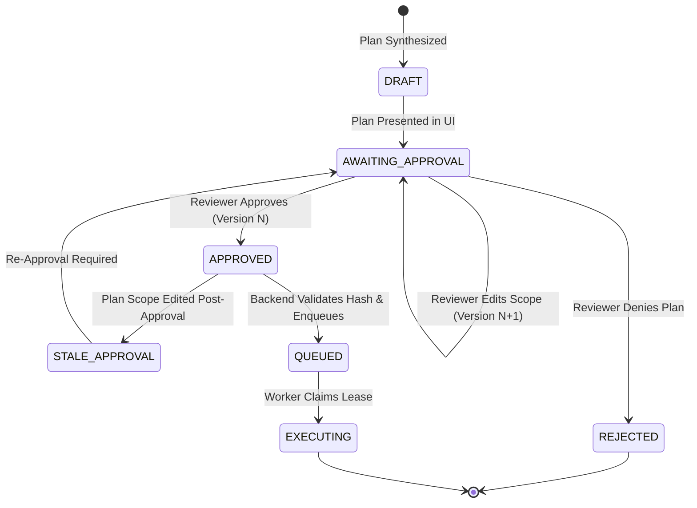

### 8.1 Invalidation Rules
1. **Hash Invariance:** The approval token is cryptographically bound to `planHash`.
2. **Scope Mutation:** Any change to:
   - Target URL or environment
   - Test account username
   - Ordered step list or input text
   - Affected data fixture IDs
   - Expected behavior or failure signature predicates
   ...**immediately revokes approval**, increments `plan.version` ($N \to N+1$), transitions state to `STALE_APPROVAL`, and requires a new human click.
3. **Queue Cancellation on Revocation:** If approval is revoked while the job is waiting in `pg-boss`, the controller deletes the queue job before a worker can claim it.

---

## 9. Agent Observe-Ground-Validate Control Loop

The Browser Investigation Agent executes strictly inside a deterministic wrapper:

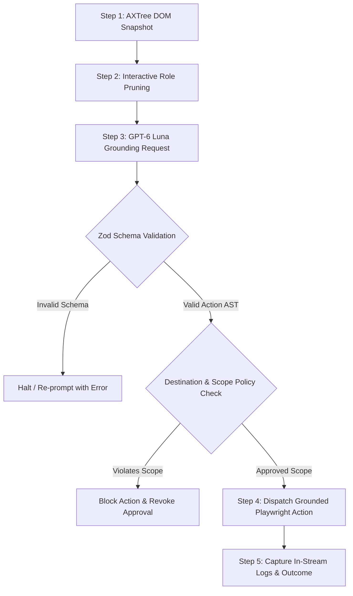

- **Bounding:** The agent receives only interactive elements (`button`, `textbox`, `combobox`, `link`) and max 50 lines of recent logs.
- **Enforcement:** If Luna proposes navigating to `http://attacker.com` or deleting `account_root`, the policy check hard-aborts execution before Playwright receives the command.

---

## 10. Action Execution Lifecycle and Uncertain Mutation Handling

An individual browser interaction transitions through five discrete states:

```
[ PROPOSED ] ──► [ VALIDATED ] ──► [ DISPATCHED ] ──► [ COMPLETED ]
                                           │
                                    (Timeout / Crash)
                                           ▼
                                  [ OUTCOME_UNCERTAIN ]
                                           │
                                  (Target DB Probe)
                                           ▼
                                 [ RECONCILED / HALT ]
```

### 10.1 Handling Uncertain Deletions (TC3)
If a `CLICK(button[name='Delete'])` times out or the worker crashes mid-request:
1. The action transitions to `OUTCOME_UNCERTAIN`.
2. The worker **prohibits automated re-click** (to prevent deleting unintended secondary items).
3. The worker issues a readback probe to the target API: `GET /api/tasks/task-uuid-002`.
   - If Task B is already gone: Mutation succeeded; record outcome and proceed.
   - If Task B still exists: Mutation failed before execution; record timeout error and halt.
   - If target unreachable: Halt with `EXECUTION_ERROR`.

---

## 11. Dual-Attempt Execution and Backend Reset Workflow

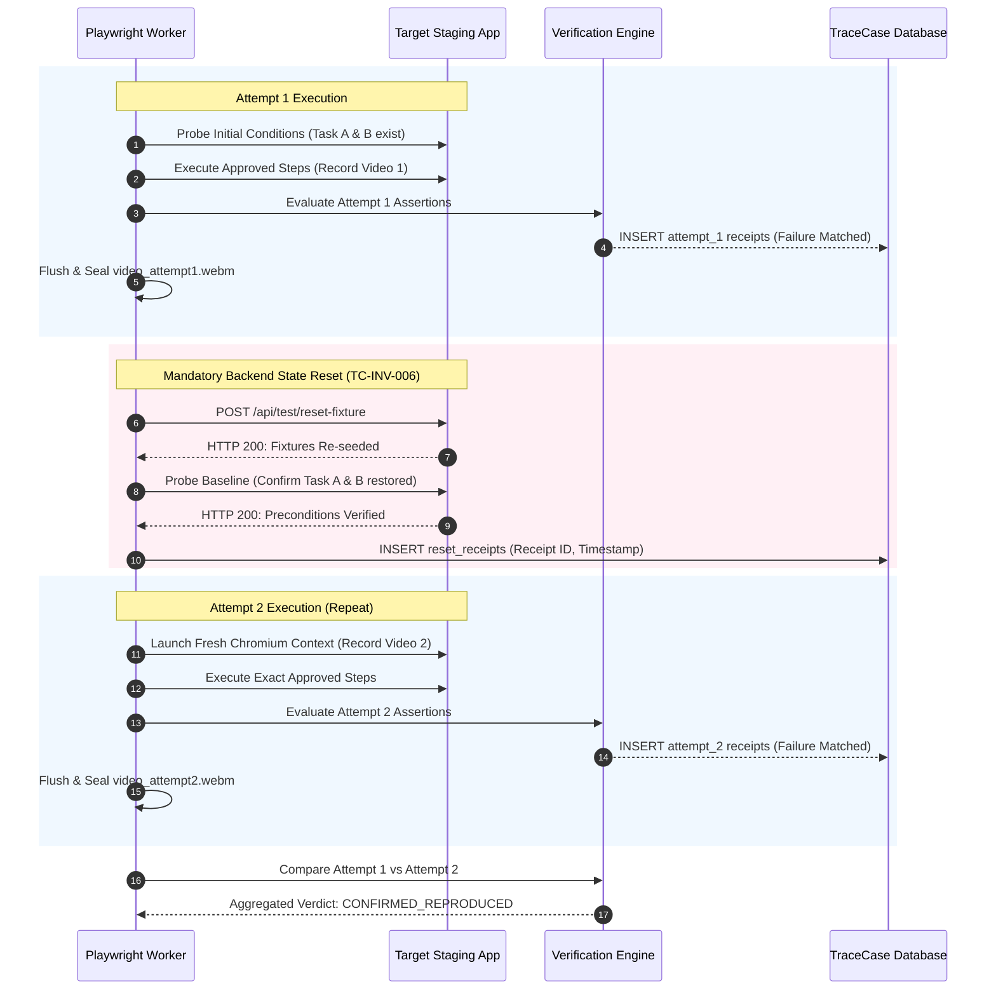

---

## 12. Deterministic Verification and Outcome Aggregation

The Verification Engine aggregates Attempt 1 and Attempt 2 using pure Boolean logic:

```typescript
export function computeFinalVerdict(
  attempt1: AttemptResult,
  attempt2: AttemptResult,
  resetReceipt: ResetReceipt | null
): ReproductionVerdict {
  if (!resetReceipt || !resetReceipt.verified) {
    return 'INCONCLUSIVE'; // Reset failed; Attempt 2 dirty
  }
  
  if (attempt1.failureSignatureMatched && attempt2.failureSignatureMatched) {
    return 'CONFIRMED_REPRODUCED'; // Official TC1
  }
  
  if (attempt1.healthyBehaviorMatched && attempt2.healthyBehaviorMatched) {
    return 'NOT_REPRODUCED'; // Official TC2
  }
  
  if (attempt1.failureSignatureMatched !== attempt2.failureSignatureMatched) {
    return 'INCONSISTENT_OBSERVATIONS'; // Flaky bug
  }
  
  return 'INCONCLUSIVE';
}
```

---

## 13. Multi-Stage In-Stream Redaction and Publication Pipeline

Redaction operates at three distinct checkpoints:
1. **Checkpoint 1 (Browser Ingestion Tap):** Playwright CDP network interceptor removes `Authorization`, `Cookie`, and `Set-Cookie` headers from the in-memory buffer.
2. **Checkpoint 2 (Console In-Stream Scrubber):** Console stdout strings are filtered via regex before writing to `console.log`.
3. **Checkpoint 3 (Pre-Publication Scan):** Prior to sealing `bundle.zip`, an automated scan verifies $0$ occurrences of active session tokens.

---

## 14. Background Queue and Worker Lease Lifecycle

- **Lease Duration:** 300 seconds (5 minutes).
- **Heartbeat:** Worker sends heartbeat to `pg-boss` every 10 seconds.
- **Crash Detection:** If 3 consecutive heartbeats are missed (30s), `pg-boss` marks the job `STALLED`. Standby worker claims the lease and executes the uncertain mutation probe (`TC-INV-013`).

---

## 15. Cancellation, Pause, Resume, Retry, and Restart Policies

| Operation | Triggered By | Eligible States | Execution Effect | Target DB Effect | Resumable? |
|---|---|---|---|---|---|
| **Cancellation** | User | `QUEUED`, `EXECUTING_*`, `PREPARING` | Closes Chromium context; preserves partial logs; sets status `CANCELLED`. | No automated rollback; target remains in current state. | No (Terminal). |
| **Retry (Step)** | Worker | `EXECUTING_*` (Safe reads only) | Re-attempts element query up to 3 times (5s timeout). | None (Read-only). | Yes (Internal). |
| **Retry (Mutation)** | Prohibited | N/A | **Hard-blocked**; uncertain mutations never auto-replayed. | Prohibited. | N/A. |
| **Restart (Run)** | User | `COMPLETED`, `EXECUTION_ERROR`, `BLOCKED` | Creates new `Investigation` instance; preserves historic run. | Invokes reset adapter before fresh run. | Yes (New run). |

---

## 16. Manual Handoffs and External Blockers

When an un-automatable barrier occurs:
1. **CAPTCHA / OTP:** System transitions to `BLOCKED: MANUAL_AUTH_REQUIRED`. Worker pauses for max **180 seconds**. User completes challenge in a designated browser window. Worker resumes upon user confirmation click.
2. **Missing Sample File:** System transitions to `BLOCKED: MISSING_ATTACHMENT`. UI prompts user to upload the required file.

---

## 17. Resource Caps, Quotas, and Stopping Conditions

- **Max Total Run Time:** 10 minutes (600 seconds) per investigation.
- **Max Steps per Plan:** 20 semantic actions.
- **Max DOM Nodes per Prompt:** 150 interactive elements.
- **Token Cap per Run:** 25,000 total tokens (Prompt + Completion).
- **Budget Hard Stop:** $90\%$ of reported credit balance ($\approx\text{US}\$18.00$).

---

## 18. Error Taxonomy and Workflow Responses

| Error Code | Category | Stage | State Effect | Evidence Handled | Next Allowed Action |
|---|---|---|---|---|---|
| `WF-ERR-001` | Stale Approval | Queue Claim | Transitions to `AWAITING_APPROVAL` | None | Re-approve plan vN+1. |
| `WF-ERR-002` | Sandbox Rejection | Pre-Flight | Transitions to `BLOCKED` | Audit log saved | Re-configure target as sandbox. |
| `WF-ERR-003` | Reset Adapter 500 | Between Runs | Transitions to `BLOCKED` | Attempt 1 preserved | Inspect target reset webhook. |
| `WF-ERR-004` | Browser Crash / OOM | Execution | Transitions to `EXECUTION_ERROR` | Partial video/logs saved | Restart investigation. |
| `WF-ERR-005` | Secret Unresolvable | Finalizing | `evidence_status = 'RESTRICTED'` | Artifact quarantined | Manual redaction review. |
| `WF-ERR-006` | Budget Cap Exceeded | Planning | Transitions to `BLOCKED` | Usage audit saved | Add OpenAI API credits. |

---

## 19. Frontend SSE Projection and Event Replay Cursor

The Next.js frontend connects to `/api/investigations/:id/live?cursor=N`:
- **Authoritative Source:** PostgreSQL `investigation_events` table.
- **Cursor Replay:** On reconnection, the server streams all events with `event_seq > cursor` before broadcasting live worker events.
- **Zero Duplicate Trigger:** Browser refresh never restarts an active investigation or launches new browser processes.

---

## 20. Detailed Scenario Walkthroughs

### 20.1 Official Test Case Walkthroughs (TC1–TC4)
- **TC1 (Bug Reproduced Twice):** User submits vague report $\to$ Luna extracts claim $\to$ Reviewer approves $\to$ Attempt 1 observes bug $\to$ Reset webhook restores DB $\to$ Attempt 2 observes bug $\to$ Final Report: `CONFIRMED_REPRODUCED`. Attached: `video_1.webm`, `video_2.webm`, `console.log`, `network.json`.
- **TC2 (Cannot Reproduce):** Plan executes CSV export $\to$ Target returns `200 OK` $\to$ Reset $\to$ Repeat returns `200 OK` $\to$ Final Report: `NOT_REPRODUCED`. Attached: Steps tried, target build stamp, healthy network log.
- **TC3 (Sandbox Data Deletion):** Deletion plan generated $\to$ Approval modal warns of destructive mutation $\to$ Reviewer approves $\to$ Worker verifies `is_sandbox: true` $\to$ Deletion executed in sandbox $\to$ DB diff receipt confirms only disposable tasks deleted.
- **TC4 (Auth Token Redaction):** App prints JWT bearer token to console $\to$ In-stream scrubber replaces token with `[REDACTED_AUTH_TOKEN]` $\to$ Post-execution grep scan confirms 0 raw token bytes $\to$ Export bundle safe to share.

### 20.2 Edge Scenarios Walkthrough Matrix (23 Canonical Failure & Interruption Cases)

| Scenario ID | Edge Scenario Title | Triggering Condition | State Machine Path & Invariant | Final State & User-Visible Result | Evidence & Safety Handling |
|---|---|---|---|---|---|
| **WF-SCN-001** | Report missing essential info | Report lacks expected behavior or target route. | `RECEIVED` $\to$ `INTERPRETING` $\to$ `NEEDS_CLARIFICATION`. | `BLOCKED: WAITING_INPUT`. UI presents 3 targeted multiple-choice questions. | No browser actions dispatched; raw report preserved. |
| **WF-SCN-002** | Plan rejected by reviewer | Reviewer clicks "Reject Plan" in modal. | `AWAITING_APPROVAL` $\to$ `REJECTED`. | `REJECTED` (Terminal). Reason displayed: *"Plan denied by reviewer"*. | Zero browser actions enqueued; audit event logged. |
| **WF-SCN-003** | Plan changed after approval | Reviewer approves v1, then edits Step 2 text. | `APPROVED` $\to$ `STALE_APPROVAL` $\to$ `AWAITING_APPROVAL`. | UI re-renders Plan v2; prompts for new approval click. | Approval v1 revoked; plan hash updated; queue blocked. |
| **WF-SCN-004** | Duplicate Run request | User double-clicks "Approve & Run" button. | Idempotency token matches active investigation. | Returns existing job status. Exactly 1 job enqueued. | Database constraint prevents duplicate active jobs. |
| **WF-SCN-005** | Approval revoked while queued | Plan edited or cancelled while job in `pg-boss`. | Controller issues job cancellation in `pgboss`. | Job deleted from queue before worker claim. Status: `AWAITING_APPROVAL`. | Worker never starts; zero target mutations. |
| **WF-SCN-006** | Approval revoked during in-flight action | User clicks Cancel while click is dispatched. | Worker checks cancellation flag at step boundary. | Halts execution immediately; status transitions to `CANCELLED`. | Partial video and console logs flushed and preserved. |
| **WF-SCN-007** | Late Luna response after cancellation | Luna API call finishes after user clicked Cancel. | Worker checks cancellation flag on response arrival. | Discards model response; transitions to `CANCELLED`. | Zero subsequent Playwright actions dispatched. |
| **WF-SCN-008** | Missing or ambiguous DOM element | Primary role selector fails after 5s timeout. | Bounded self-healing queries AXTree; if ambiguous, halts. | Transitions to `EXECUTION_ERROR`. Reason: `LOCATOR_AMBIGUITY`. | Captures decisive failure screenshot; preserves logs. |
| **WF-SCN-009** | Mutation outcome uncertain | Network drop during `CLICK(Delete)`. | `action_state = 'OUTCOME_UNCERTAIN'`. Worker probes target DB. | If deleted: proceed. If intact: halt with `EXECUTION_ERROR`. | **Hard-block on auto-retry** (`TC-INV-013`). |
| **WF-SCN-010** | Reset adapter failure | Target reset webhook returns HTTP 500. | `RESETTING_TARGET` $\to$ `BLOCKED: RESET_FAILED`. | Halted before Attempt 2. Reason: `TARGET_RESET_FAILED`. | Attempt 1 logs preserved; Attempt 2 prohibited (`TC-INV-006`). |
| **WF-SCN-011** | One matching and one nonmatching attempt | Flaky bug (Fails Attempt 1, passes Attempt 2). | Verifier compares runs: $1 \neq 0$. | Verdict: `INCONSISTENT_OBSERVATIONS`. Lifecycle: `COMPLETED`. | Dual videos attached; bug **not confirmed** (`TC-INV-005`). |
| **WF-SCN-012** | Different bug observed | App throws unrelated 500 error on navigation. | Assertion checks failure signature; returns `FALSE`. | Verdict: `INCONCLUSIVE`. Lifecycle: `EXECUTION_ERROR`. | Unrelated error log attached; original bug unconfirmed. |
| **WF-SCN-013** | Second attempt blocked by budget | Attempt 1 finishes; estimated spend $\ge \$18.00$. | Luna client triggers `WF-EV-026 (BUDGET_EXHAUSTED)`. | Transitions to `BLOCKED: BUDGET_EXHAUSTED`. | Attempt 1 preserved; zero silent model fallback (`TC-INV-001`). |
| **WF-SCN-014** | Worker loss before mutation | Worker OOMs before dispatching action intent. | `pg-boss` lease expires (30s); standby claims job. | Standby checks intent un-dispatched; restarts attempt. | Resumes cleanly from clean baseline. |
| **WF-SCN-015** | Worker loss after possible mutation | Worker dies while delete click in-flight. | Standby claims job; inspects target postcondition. | If mutation occurred: halt with `EXECUTION_ERROR`. | Never blindly replays uncertain mutation. |
| **WF-SCN-016** | Video finalization failure | Video context fails to encode `.webm` stream. | Worker detects missing video file on disk. | Verdict confirmed, but `evidence_status = 'INCOMPLETE'`. | Honest evidence reporting; no fake video attached. |
| **WF-SCN-017** | Sanitized logs but restricted video | Unresolvable test password visible in video frame. | Redaction pipeline quarantines video artifact. | Verdict confirmed, but `evidence_status = 'REDACTION_RESTRICTED'`. | Video hidden from public export; logs shared safely. |
| **WF-SCN-018** | UI reconnect during execution | User refreshes browser during Attempt 1. | Frontend reconnects to `/api/live?cursor=N`. | Streams missed events from PostgreSQL `investigation_events`. | Replay cursor reconciles UI; zero duplicate browser run. |
| **WF-SCN-019** | Evidence upload retry | S3 upload returns HTTP 503 Service Unavailable. | Worker retries upload up to 3 times with exponential backoff. | If retry succeeds: `COMPLETED`. If fails: `EVIDENCE_INCOMPLETE`. | Local scratchpad holds files until upload confirmed. |
| **WF-SCN-020** | Authentication / manual handoff | Target throws unexpected CAPTCHA challenge. | Worker pauses and emits `MANUAL_AUTH_REQUIRED`. | UI shows 180s countdown for manual user solve. | **Zero automated CAPTCHA bypass** (`TC-INV-010`). |
| **WF-SCN-021** | Target build changes mid-run | Pre-flight probe detects target commit hash drift. | Worker detects mismatch against approved plan. | Transitions to `BLOCKED: TARGET_BUILD_CHANGED`. | Halts safely; prompts user to re-plan against new build. |
| **WF-SCN-022** | Unsupported assertion check | Plan contains visual layout or pixel diff claim. | Verifier marks assertion `UNSUPPORTED`. | Verdict: `INCONCLUSIVE`. Reason: `UNSUPPORTED_ORACLE`. | Escalates to human reviewer; no false automated pass. |
| **WF-SCN-023** | Result regeneration post-redaction | Reviewer manually scrubs quarantined video. | Admin triggers `POST /api/artifacts/:id/re-evaluate`. | Manifest updates to `evidence_status = 'COMPLETE'`. | Re-seals `bundle.zip` without re-running browser steps. |

---

## 21. Architectural & State Machine Diagrams

#### Diagram 1: Overall Report-to-Result Workflow Flowchart
*This diagram illustrates the macro-level lifecycle from report intake to final sealed evidence delivery.*

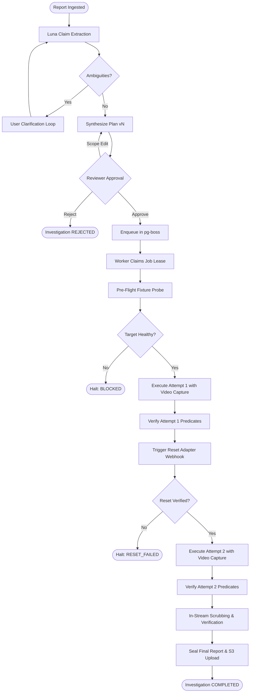

---

#### Diagram 2: Plan and Approval Lifecycle State Machine
*This diagram captures version transitions, scope edits, and approval revocations.*

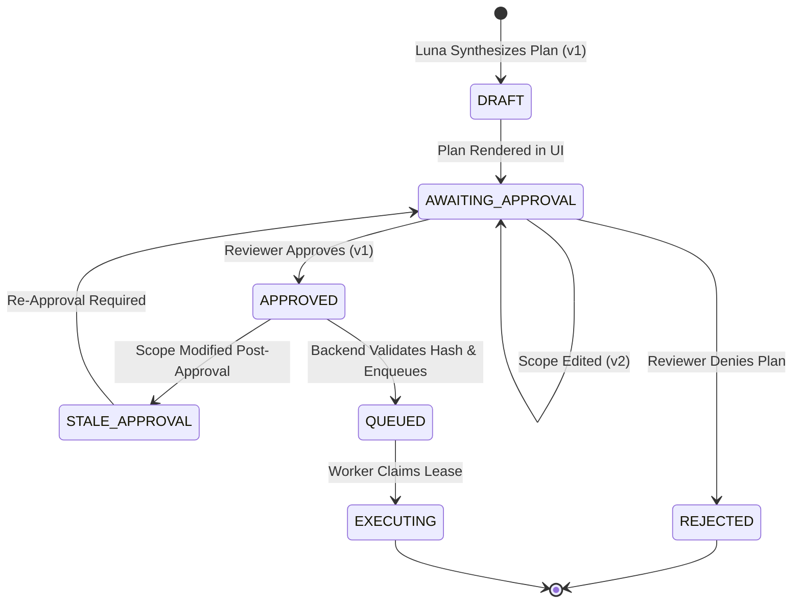

---

#### Diagram 3: Investigation Master Lifecycle State Machine
*This diagram represents the authoritative states governed by PostgreSQL ACID transactions.*

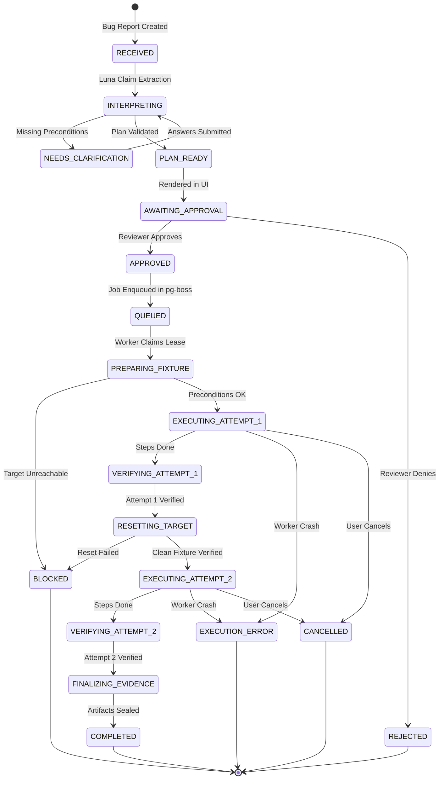

---

#### Diagram 4: Attempt Execution and Verification Lifecycle
*This diagram tracks the lifecycle of an individual physical browser execution.*

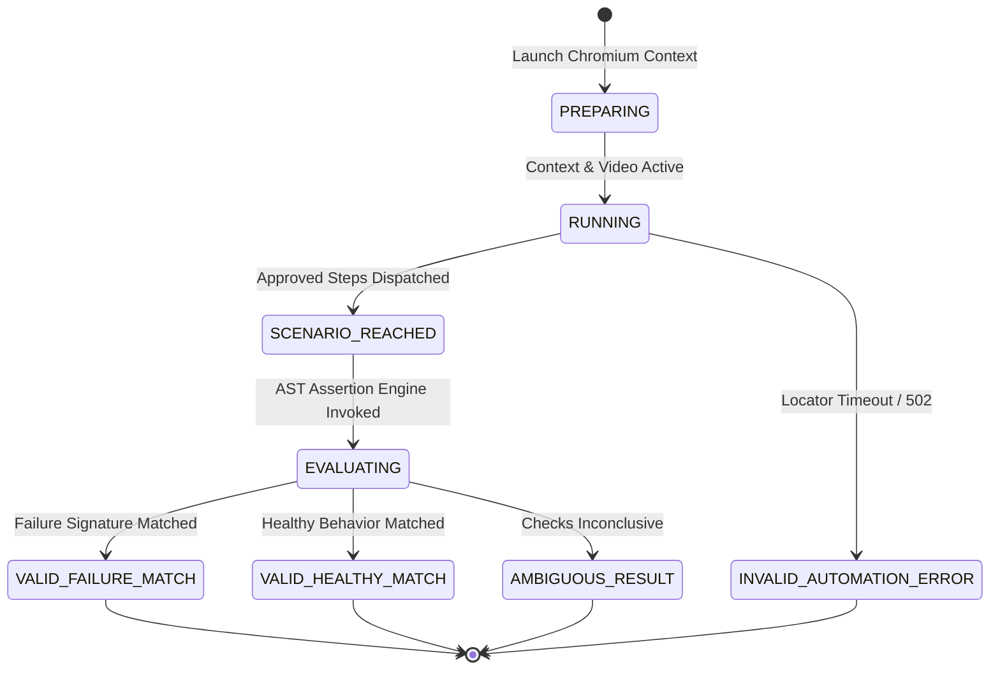

---

#### Diagram 5: Artifact Sanitization and Publication Lifecycle (TC4 Protection)
*This diagram maps how raw streams become sealed, redaction-verified evidence artifacts.*

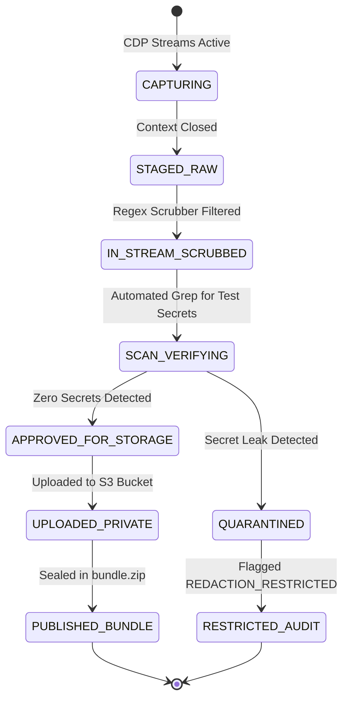

---

#### Diagram 6: Happy-Path Sequence with Two Attempts and Reset
*This sequence diagram shows the chronological lifecycle of a successful dual-run bug reproduction (TC1), detailing component interactions, approval gating, and state resets.*

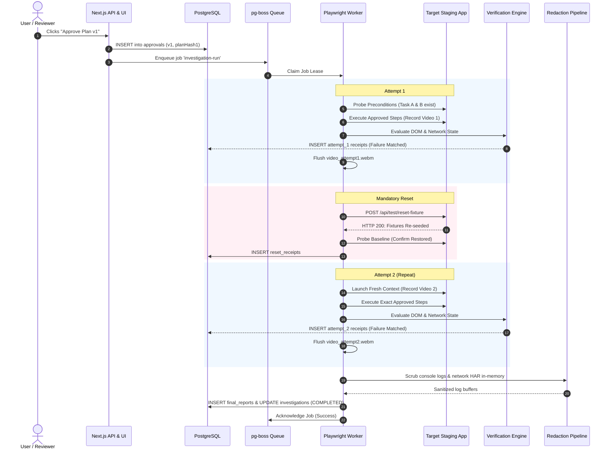

---

#### Diagram 7: Scope-Change and Re-Approval Sequence
*This sequence diagram shows how an in-flight plan modification invalidates existing approvals.*

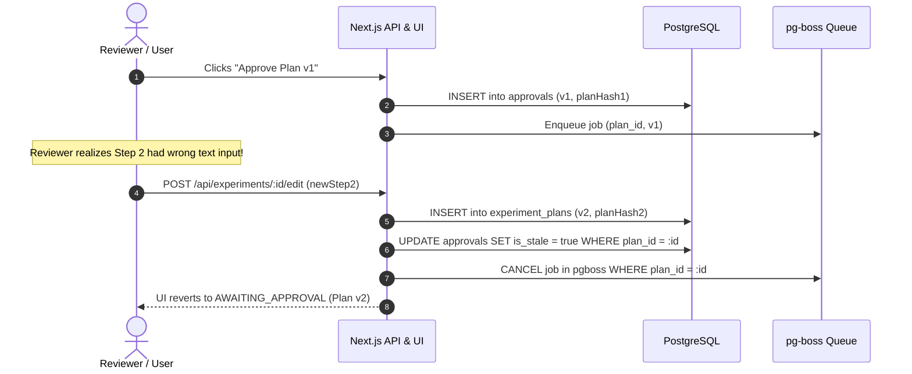

---

#### Diagram 8: Worker-Loss and Uncertain-Mutation Recovery Sequence
*This sequence diagram documents the recovery path when a worker crashes mid-investigation during an uncertain mutation, enforcing postcondition inspection without blind retries.*

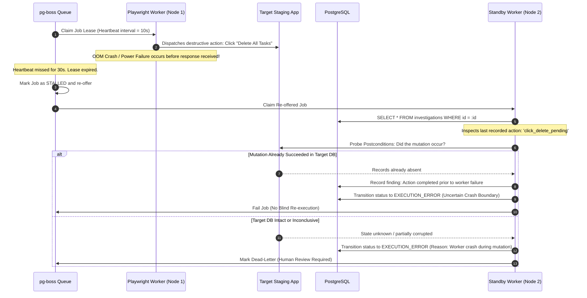

---

#### Diagram 9: Cancellation and Budget-Exhaustion Flow
*This diagram documents immediate resource reclamation upon user cancellation or quota exhaustion.*

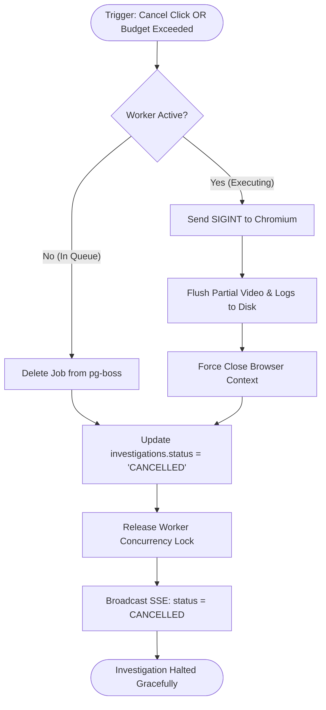

---

#### Diagram 10: Outcome and Evidence Decision Tree
*This flowchart illustrates the multi-dimensional mapping from dual runs to official verdicts.*

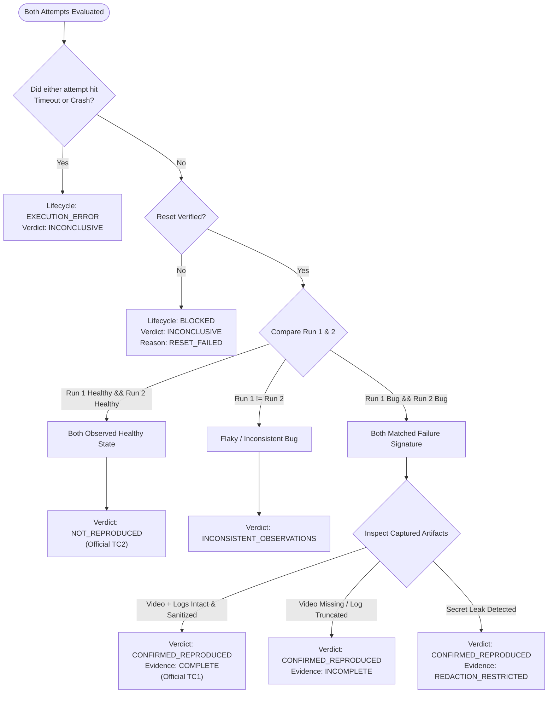

---

## 22. Specification Verification Strategy & Test Cases

The state machine will be verified via executable integration test suites (`VER-WFM-###`):

- **Scenario 1 (Stale Approval Invalidation):**
  - *Given* an approved investigation v1 enqueued in `pg-boss`,
  - *When* the user edits the plan to v2 before the worker claims the job,
  - *Then* the worker must reject execution with `WF-ERR-001 (STALE_APPROVAL)` and transition status to `AWAITING_APPROVAL`.
- **Scenario 2 (Uncertain Deletion Recovery):**
  - *Given* a worker process killed via `kill -9` while executing a destructive click,
  - *When* the standby worker claims the stalled job lease,
  - *Then* it must probe the target database and halt with `EXECUTION_ERROR` rather than blindly replaying the delete click.
- **Scenario 3 (Flaky Run Rejection):**
  - *Given* Attempt 1 matches the failure signature and Attempt 2 observes healthy behavior,
  - *When* verification aggregation executes,
  - *Then* the verdict must be `INCONSISTENT_OBSERVATIONS` and must **never** output `CONFIRMED_REPRODUCED`.

---

## 23. Open Decisions, Change Control, and Handoffs

### 23.1 Open Decisions Register (`WF-OQ-###`)
- **WF-OQ-001 (Target Demo Repository):** Specific repo for the task CRUD demo target. *(Blocks Phase 3: Fixtures).*
- **WF-OQ-002 (Worker Sizing):** Container memory allocation for Chromium under Linux. Proposed: 2GB RAM. *(Blocks Phase 2: Foundation).*

### 23.2 Change Control Rules
1. Changing any state enum or transition guard requires a version bump of this document (`TC-WFM-001`) and a corresponding update to `docs/trd.md`.
2. Existing completed investigation records in PostgreSQL must maintain historical state values; migrations must not retroactively rewrite historic audit logs.

---

*End of Workflow and State-Machine Specification — TraceCase (TC-WFM-001)*
