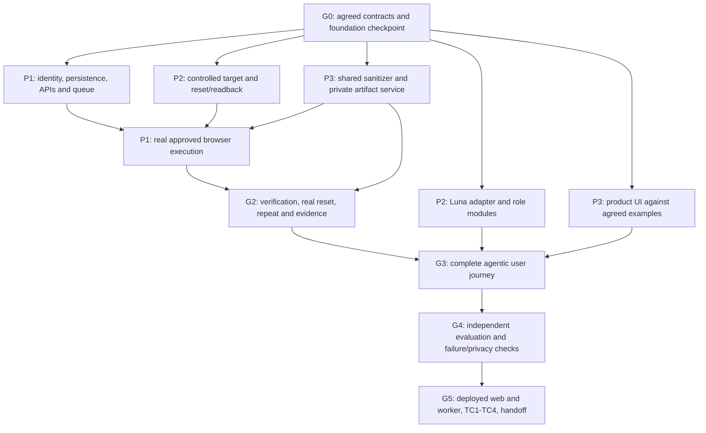

# TraceCase — Three-Person Implementation Plan

## Folder structure — start here

Each person has their own folder and a uniquely named file containing the complete plan:

```text
implementation-stages/
├── README.md                              Shared guide and navigation
├── person-1/
│   ├── README.md                          Person 1 entry page
│   └── person-1-implementation-plan.md     Full plan — 9 stages
├── person-2/
│   ├── README.md                          Person 2 entry page
│   └── person-2-implementation-plan.md     Full plan — 8 stages
└── person-3/
    ├── README.md                          Person 3 entry page
    └── person-3-implementation-plan.md     Full plan — 8 stages
```

- [Open Person 1 implementation plan](./person-1/person-1-implementation-plan.md)
- [Open Person 2 implementation plan](./person-2/person-2-implementation-plan.md)
- [Open Person 3 implementation plan](./person-3/person-3-implementation-plan.md)

These are real Markdown files inside the repository. Open the named `.md` file rather than a folder path.

**Status:** Proposed delivery plan for review; not a record of completed implementation.  
**Inspection date:** 20 October 2026 (Asia/Calcutta).  
**Team assumption:** Three contributors total; Person 1 is the user/lead. Names, availability, and final submission deadline are not established.

## 1. Read these plans together

| Contributor | Plan | Main responsibility | Stages |
|---|---|---|---|
| Person 1 — Lead / execution engineer | [Person 1](person-1/person-1-implementation-plan.md) | Trusted backend, database, approval, controller, queue, browser execution, verification, deployment | P1-01 through P1-09 |
| Person 2 — AI / target / evaluation engineer | [Person 2](person-2/person-2-implementation-plan.md) | Luna roles, controlled demo target, fixture reset implementation, independent evaluation | P2-01 through P2-08 |
| Person 3 — Product / evidence engineer | [Person 3](person-3/person-3-implementation-plan.md) | User interface, shared sanitization, private artifact processing/delivery, evidence experience | P3-01 through P3-08 |

Stage numbers are local to each person's plan. P2-03 does not depend on all of Person 1's first three stages. Follow the named dependency/handoff, rather than matching numbers. A stage is complete only when its exit evidence exists.

## 2. Current foundation: what is actually known

The repository has a Stage 0 implementation. Preserve and extend it rather than regenerating it. Inspected files include the package manifest, shared contracts, six-table Drizzle schema and generated migration, policy helpers, authentication scaffold, worker, API route scaffolds, UI routes, fixtures, event reducer, CI, and foundation documents.

Independently executed during this planning task:

| Check | Observed result | What it establishes |
|---|---|---|
| `pnpm typecheck` | Passed, exit 0 | Current code type-checks |
| `pnpm test` | 15 tests passed across 3 files, exit 0 | The existing test cases pass; not comprehensive product correctness |
| `pnpm lint` | No ESLint warnings/errors, exit 0 | Current configured lint rules pass |

Not independently executed here: web/worker build, browser UI review, PostgreSQL migration application, container startup, auth-provider integration, paid model access, real target reproduction, artifact upload, deployment, or TC1–TC4. Existing foundation documents report additional checks; treat those as reported records until their evidence is inspected or the checks are repeated where needed. An offline migration notice is not a successful migration.

At inspection, foundation files were uncommitted/untracked and README was modified. Do not discard them. Before branching for team delivery, complete the common readiness checkpoint, review the changes, and deliberately select one foundation commit. This document does not authorize committing or pushing.

The implemented baseline includes Next.js 15.1.7, React 19, TypeScript, Tailwind, Zod, Drizzle/PostgreSQL tooling, and a standalone worker scaffold. These are observed versions, not a claim that they are the latest or suitable forever. Playwright execution, pg-boss consumption, AI calls, and S3 processing are deferred interfaces. Production dependency compatibility/security must be reviewed before deployment.

## 3. Source register and authority

Read the actual files, not earlier prompts asking for them to be created:

| Source | Use |
|---|---|
| [PRD](../docs/prd.md) | Scope, inputs, report-driven user journey, functional requirements, outcomes |
| [TRD](../docs/trd.md) | Component boundaries, technical requirements, runtime and integration direction |
| [PS traceability](../docs/ps-requirements-traceability-matrix.md) | Official obligations and TC1–TC4 mapping |
| [Workflow](../docs/workflow-and-state-machine-specification.md) | Approval, transitions, attempt/reset sequence, uncertainty |
| [Database/ERD](../docs/database-design-and-erd.md) | Entities, ownership, transactions, artifact/audit relationships |
| [Architecture](../docs/system-architecture.md) | Web/worker separation, trust boundaries, interfaces, milestones |
| [UI/UX](../docs/ui-ux-specification.md) | Visual reference, screen behavior, component/state presentation |
| [Agent/tool contracts](../docs/agent-and-tool-contracts.md) | Three Luna roles, typed proposals, dispatch, permissions, stopping |
| [API/events](../docs/api-and-event-contracts.md) | Commands, snapshots, progress, safe errors, artifact access |
| [Verification/evidence/safety](../docs/verification-evidence-and-safety-specification.md) | Oracles, two-attempt validity, privacy, publication, safety |
| [Evaluation/operations/execution](../docs/test-evaluation-operations-and-execution-plan.md) | Case records, metrics, operational procedures, release readiness |
| [Foundation decisions](../docs/foundation-decisions.md), [status](../docs/foundation-status.md), [boundaries](../docs/contribution-boundaries.md), [setup](../docs/development-setup.md) | Starting implementation choices and commands; verify claims against actual code |

The supplied official brief/screenshots in the conversation establish the assignment. Repository summaries are secondary representations. Explicit user choices govern the name TraceCase and Luna-only model restriction. Do not treat a document's self-written “Approved” status as evidence of separate human approval. Existing source files establish current implementation, not proof that their behavior is correct. These plans propose delivery details and do not convert optional implementation choices into organizer requirements.

Do not wholesale rewrite prior specifications. Record necessary conflict resolutions, update affected contracts and source references together, and preserve unrelated work. Earlier plans assigning a redactor to Person 2 are superseded for this proposed split: Person 3 owns the single shared implementation; Persons 1 and 2 consume it.

## 4. Product and safety rules everyone preserves

TraceCase investigates a supplied web bug report against an authorized demo/staging application. It does not autonomously search arbitrary sites for bugs or automatically fix code. The user can start with incomplete information; correct behavior and a testable failure signature must be clarified before an executable plan is approved.

All three logical AI roles use GPT-6 Luna through OpenAI only. They are modules, not three required microservices. API model identifier, account access, pricing, and current capabilities must be verified before live use. Approximately $20 is user-reported credit, not a verified balance or guaranteed run count. No training, local model, GPU, or silent fallback is required.

Trusted code owns identity, target trust, approval, state, budgets, tools, validity, verification, and publication. The planner proposes; the browser role proposes scoped actions; the evidence reviewer explains sanitized locked facts. None can approve a plan or overwrite findings.

Two valid matching attempts must concern the same candidate/failure meaning and equivalent relevant starting conditions. Verify fixture restoration by readback; neither a new context nor HTTP 200 proves it. Preserve contradictory and invalid attempts. Two observed failures and missing evidence must remain visible as findings with incomplete evidence, not an apparently complete package. A worker crash is not nonreproduction. Reset and cleanup mutations require authorized scope too.

Both restricted and sanitized artifact stores remain private. `PUBLIC_SAFE` is an internal suitability classification, not permission for anonymous internet access. Minimize capture; sanitize before model input, progress, UI, or export exposure. Text scrubbing does not sanitize recording pixels. An unsafe artifact is withheld, not declared safe because a regex found nothing.

Approval is concrete/version-bound and rechecked at dispatch. Cancellation stops subsequent actions but cannot undo in-flight effects. A timed-out mutation is uncertain; reconcile before any replay. Queue deduplication and fencing do not promise exactly-once target effects. No OTP/CAPTCHA bypass, production deletion, arbitrary shell/SQL/JavaScript tools, or real-secret evaluation fixtures.

## 5. Common readiness checkpoint — do before live integration

This is a targeted foundation follow-up, not a demand to rebuild Stage 0. Person 1 integrates shared changes; Persons 2 and 3 review their consumed contracts and may begin independent work immediately.

| ID | Observed gap or risk | Required decision/change | Owner / review |
|---|---|---|---|
| F-01 | `services/ports.ts` has one planner port, a browser `defectDetected` boolean, and a combined publish call | Define three role ports, observed action/attempt receipts, separate verifier results, and evidence processing/access boundaries | P1 integrates; P2/P3 review |
| F-02 | `planning.ts` uses free-text verification criteria; plans carry identity/hash fields | Add a limited typed assertion vocabulary and model-proposal versus server-owned plan separation; freeze oracle before approval | P1 verifier owner + P2 planner |
| F-03 | `targets.ts` includes a reset-auth secret in a generally shared target profile | Split safe target projection from server credential references; no secret-bearing profile to UI/AI | P1, P2/P3 review |
| F-04 | Preview defaults on; production currently warns rather than forbids it; configuration errors can fall back to preview | Explicit dev/test-only preview, fail closed for live operation, no production fixture fallback | P1 config/API; P3 client composition |
| F-05 | Live approval route uses `SYNTHETIC_PLAN_V1` and does not persist approval; list scaffold can return empty “live” data | Use owned stored records, persist authorization, and keep unimplemented operations explicit until real | P1 |
| F-06 | Approval helper checks version/hash but not full persisted resource/actor/revocation scope | Bind plan/investigation/target/account/fixture/version, authorized actor, revocation, limits, and material changes | P1 |
| F-07 | Six tables do not yet provide frozen plan revisions, attempts, observations, evidence registries, or durable execution enforcement | Incremental reviewed migrations and repositories; do not call generated SQL applied; no mass ERD copying | P1, consumers request changes |
| F-08 | Progress payload is arbitrary; reducer casts status strings and may apply stale events | Discriminated safe events, bounded projection, sequence-gap recovery, snapshot/reconnect contract | P1 server; P3 reducer |
| F-09 | Evidence metadata permits generic URLs; storage port treats triad as buffers and one publish operation | Stable artifact IDs, scoped capture references, finalize/review/authorize access; avoid whole-video memory coupling | P3 proposes; P1 integrates |
| F-10 | Incomplete/observed-once/blocked semantics need comparison with current enums; readiness claims exceed implemented controls | Select explicit truthful mappings or coordinated enum extensions; update consumers and tests | P1 + P3 |
| F-11 | Migration runner catches errors as offline notices; worker logs concurrency as enforced though queue is idle | Distinguish real migration failure; truthful readiness; implement platform-wide admission before real processing | P1 |

Do not log credential values when documenting these issues. This inspection is not an exhaustive security audit. Passing 15 tests does not resolve these gaps.

## 6. Exclusive ownership and shared changes

| Area | Primary owner | Boundary |
|---|---|---|
| `src/app/api/**`, `src/server/auth`, `db`, `policy`, configuration, controller, queue, browser, verification, target client; `worker/**`; migrations and infrastructure | P1 | Public endpoints and authoritative state/policy |
| `src/server/ai/**`, prompts, AI evaluation; proposed `demo-target/**` and `evaluation/**` | P2 | Typed proposals and controlled target internals, not approvals/verdicts |
| `src/app/**` except API, `src/components/**`, client feature modules, preview composition; proposed `src/server/evidence/**` | P3 | UI and private evidence pipeline; not workflow/verdict authority |
| `src/contracts/**`, `src/server/services/ports.ts`, manifests/lockfile, shared status vocabulary | P1 coordinates | Consumers propose changes; land one agreed change and update impacted consumers |
| Shared persistence for evidence and model usage | P1 owns migrations/repositories; P3/P2 specify needs | No independent schema forks; evidence service may write artifact processing facts through agreed repository interfaces |

P3 owns storage/sanitization business logic. P1 owns public artifact HTTP handlers and authentication middleware; P3 supplies service operations. P1 captures actual browser events/media and invokes P3's sanitization boundary before exposure. P2's pruning is not a second sanitizer. P2 reports provider usage; P1 enforces admission/limits and durable accounting. P1 owns safe target client behavior; P2 owns the target's scoped fixture endpoints. Every owner writes tests for their module.

## 7. Handoff register

| ID | Producer → consumer | Deliverable | Acceptance |
|---|---|---|---|
| H-01 | P1 + consumers → all | Versioned shared schemas/ports/examples and chosen foundation commit | Compiles; proposed and authoritative fields separated; no secret in safe projections |
| H-02 | P2 → P1 | Demo target, scoped setup/reset/readback, build/fixture IDs | Real repeated reset restores relevant records; hidden labels excluded from agent input |
| H-03 | P3 → P1/P2 | Shared text/structured-data sanitizer and safe-observation projection contract | Synthetic secret tests cover agreed surfaces; media limitations explicit |
| H-04 | P2 → P1 | Planner/clarifier proposal adapter | Valid discriminated output; missing facts ask questions; no forged IDs/hash/approval |
| H-05 | P1 → P2 | Fresh scoped observation envelope + locked verification facts | Attempt/session/freshness fields, bounded safe data; no credentials |
| H-06 | P2 → P1 | Next-action/stop/manual-help proposal | Approved intent preserved; no arbitrary eval or final verdict |
| H-07 | P1 → P3 | Finalized capture references and coverage/error receipts | Attempt correlation; video context closed; empty log vs capture failure separated |
| H-08 | P3 → P1 | Artifact processing manifest/readiness + authorized access service | Missing/unsafe files remain incomplete/restricted; both stores private |
| H-09 | P1 → P3 | Persisted API snapshots, safe events, auth/error behavior | Resource ownership enforced; replay/reconnect does not start execution |
| H-10 | P2 → P1/P3 | Explanation of locked facts with evidence references | Observation/hypothesis separated; cannot overwrite verification |
| H-11 | All → P2 coordinator | Module results + actual official-run records | Ground truth independent; case/build/environment/attempt/evidence IDs present |
| H-12 | All → P1 release lead | Deployment, scenario, privacy and limitations package | All official requirements evidenced or explicitly blocked; no fabricated success |

## 8. Parallel execution and gates

| Gate | P1 lane | P2 lane | P3 lane | Gate evidence |
|---|---|---|---|---|
| G0: common contracts | P1-01, start P1-02 | P2-01, start P2-02 | P3-01, start P3-02 | H-01 agreed; preview cannot authorize live work |
| G1: isolated modules | P1-02–05 | P2-02–04 | P3-02–04 | Target/reset, capture, sanitizer, AI proposals and UI independently checked |
| G2: deterministic vertical slice | P1-06 | P2 supplies target/labels, not AI ground truth | P3 supplies real artifact processing and display | Human-approved fixed procedure, two valid attempts, real reset/readback, required evidence; internal plumbing milestone |
| G3: agentic user journey | P1-07 | P2-05–06 | P3-05–06 | Vague report → clarification → approved plan → bounded AI-guided actions → verified evidence/result |
| G4: hardening | P1-08 local recovery | P2-07 | P3-07 | Critical negatives, scoped secret tests, independent evaluation, no misleading statuses |
| G5: deployed evaluation | P1-08–09 | P2-08 | P3-08 | Deployed web+worker checks and actual TC1–TC4 records |

P1-05 may first use a safe controlled read operation and P3's sanitizer; destructive execution waits for the target/approval/reset controls. P3 may use labelled fixture captures while waiting for P1. P2 may use injected provider doubles while waiting for budgeted access. These are temporary boundaries, not evidence of a working complete product. No gate depends on an optional enhancement.

## 9. Official acceptance and theme alignment

| Official scenario | Required actual demonstration | P1 | P2 | P3 |
|---|---|---|---|---|
| TC1: reproduced twice | Two valid matching attempts with recording, console and network logs | Execute, restore, verify | Known defect, real AI assistance, independent labels | Safe real evidence processing and display |
| TC2: cannot reproduce | Meaningful bounded attempt, steps tried, environment/build and qualified result | Separate nonmatch from invalid execution | Correct/fixed comparison and nonrepro case | Honest result and limitations |
| TC3: deletion | Reproduce only in controlled sandbox | Trusted sandbox/action/approval gate | Disposable target fixtures and readback | Clear review scope and sandbox warning; no checkbox authority |
| TC4: token in logs | Synthetic known token redacted before sharing | Sanitize all integration/exposure paths | Controlled injection + independent scoped scan | Shared scrubber, private derivatives, previews/downloads/exports checked |

The Developer & Enterprise AI theme is served by useful report-driven agent decisions, real browser tools, trustworthy verification, and developer evidence. A static test script alone does not demonstrate the complete agentic behavior. Three AI processes are not necessary. Suggested tools, arbitrary coverage percentages, “100% redaction,” fixed run costs, and a 48-hour schedule are not adopted as organizer obligations. Submission needs the working deployed agent, source evidence, presentation, and test cases identified in supplied materials; final form/deadline remains unverified.

## 10. Contribution, completion, and change rules

Before parallel work, agree whether the existing proposed `develop` integration branch will be used. If retained, short feature branches target it, with a reviewed release moving to `main`. Do not assume remote protections already exist. No force pushes or shared working-tree resets. Each contributor uses their own clone/worktree when developing simultaneously, not three agents editing the same checkout.

For shared changes, describe old/new schema, reason, affected consumers, fixture update, and compatibility/test evidence before implementation diverges. P1 serializes migrations and lockfile changes. P3 maintains global UI tokens after the foundation handoff. All changes require proportional relevant checks; do not repeat unrelated suites without reason.

A stage completion record contains stage ID, source revision, files, implemented behavior, actual commands/results, synthetic/real boundary, handoff IDs, limitations, and reviewer. Planned, implemented, executed, verified, and deployed are different statuses. Do not fabricate results to fill a table. Keep secrets, raw recordings, auth state, logs, and private artifacts out of Git.

Optional after G5: evidence timeline polish, validated regression-test export asserting intended correct behavior (fail buggy/pass fixed), controlled buggy/fixed comparison, or evidence-supported repair advice. No automatic patching or external publishing. Training, paid tooling, external access, and schedule commitments are not prerequisites invented by this plan.

## 11. Validation of this documentation task

This task created delivery documents only; it did not implement the stages, run a browser, invoke a model, migrate a database, deploy, or publish. Static link/stage/handoff/coverage checks and the three foundation checks above must be reported separately. Relative document links resolved and stage counts were checked as P1=9, P2=8 and P3=8; Markdown fence checks passed. These are documentation checks, not execution of the planned acceptance tests. Reinspect the changing working tree before beginning implementation. Read the person document for the stage's exact entry conditions, work, references, behavior, tests, and exit evidence.

## 12. Cross-person dependency view

This is a proposed delivery dependency diagram, not a runtime architecture or completed-work chart. Arrows show required handoffs; independent work may proceed before unrelated upstream stages finish. Mermaid syntax is statically reviewed; rendering was not performed in this documentation task.


