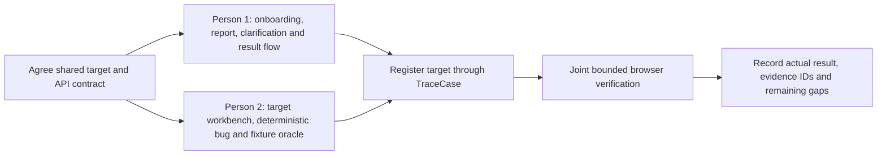

# TraceCase implementation stages

**Purpose:** Give each contributor one clear, source-aware implementation plan and protect the working prototype's ownership and safety boundaries. These documents describe planned work; they are not evidence that a stage is implemented or tested.

## Phase 2 plans requested for this sprint

| Owner | Plan | Owns | Does not own |
|---|---|---|---|
| Person 1 | [Phase 2 — TraceCase onboarding, report flow, and reliability](person-1/phase-2-implementation-plan.md) | Main TraceCase product UI, report and clarification journey, workflow/persistence fixes, onboarding guide, integrated product verification. | The target site's application code and fixture implementation. |
| Person 2 | [Phase 2 — Realistic, controlled browser-verification target](person-2/phase-2-implementation-plan.md) | Separate repo-managed target app, synthetic workbench UI, one deterministic defect, target-local reset/readback and handoff. | TraceCase UI, API/workflow, database, approval, worker or verdict logic. |

The existing [Person 1 corrective sprint plan](person-1/person-1-implementation-plan.md) and [Person 2 target plan](person-2/person-2-implementation-plan.md) remain useful baseline and scope references. Check actual code and progress before treating any planned work as done. Detailed P1-01–P1-09 review/handoff records remain in Person 1's folder for historical traceability.

## Shared sequence and handoffs

1. Both contributors inspect the current revision, all staged/unstaged changes and repository instructions. Person 1 owns the TraceCase workflow contract; Person 2 owns target behavior and target fixture contract.
2. Person 1 and Person 2 agree on target name, URL/builds, origin allowlist, fixture IDs, defect trigger, expected state, reset/readback contract and which files are shared before changing shared contracts or package scripts.
3. Person 1 can improve the main product flow and first-use guide while Person 2 builds the target in isolated target-owned files. A registered target profile is reused for reports; users do not register the same site for every report.
4. Person 2 hands off a runnable target with a verified baseline, exact buggy/fixed behavior and protected reset/readback. Person 1 registers it through the normal target-management UI; no target is hardcoded into TraceCase.
5. Together, verify the real path: register/reuse target → submit report → answer planner clarifications if returned → review persisted plan → approve → start → verify two valid runs with reset/readback → inspect actual artifacts and result.



## Confirmed baseline and screenshot interpretation

- The main TraceCase Next.js application runs separately from the repo-managed Node target. Registering a target stores its URL and safety/test metadata in TraceCase; that registration does not host the target.
- `demo-target` is an actual HTTP app with an in-memory task store and reset/readback/cleanup endpoints; the user-facing experience is currently one small task list. Its default port is 3005; repository documentation describes a fixed build on 3006. Preserve them as regression targets.
- The report page fetches registered targets, creates a report and requests planning. Its current form can preselect the first returned target; the new plan requires visible reuse/selection so multiple environments are not confused.
- The clarification repository uses a unique `(investigation_id, question_index)` index and currently accepts planner-supplied local indices. A later round can collide; inspect persisted history and confirm the exact runtime case before migrations or data changes. The clarification UI currently maps question fetch failure to an empty state, labels itself “Preview Mode,” and has a non-proposal path that can route to approval. A screenshot shows an actual unique-index error followed by no plan revision.
- Screenshots show multiple profiles for the same `localhost:3005` origin, an attachment notice that says selected files will not persist, and result cards where video/logs are unavailable or empty. Do not infer duplicate records are disposable, promise unsupported uploads, or fabricate evidence.
- The UI design reference remains white and pale lavender surfaces with cobalt actions, deep navy/purple text, rounded cards and fine outline icons. Simplify and clarify; do not redesign as an unrelated product.

These observations are source-based except where explicitly described as a screenshot symptom. A screenshot cannot establish the exact database row, cause, browser request, artifact bytes, or whether an environment is currently running.

## Product and safety invariants

TraceCase reproduces a reported bug; it does not auto-fix code or crawl arbitrary sites to discover defects. Test only owned or explicitly authorized applications, normally the controlled local sandbox. Preserve human plan approval, server-side authorization, bounded browser actions, verified reset/readback before a second attempt, two matching valid runs before confirmed reproduction, and truthful attempt/evidence states. GPT-6 Luna remains the planned model; no model training, local fallback or provider change is part of these plans. Do not bypass OTP/CAPTCHA, reveal reset credentials, use real customer data, or claim mock output as browser evidence.

## Product specifications

Before implementation, check the current versions of the [PRD](../docs/prd.md), [TRD](../docs/trd.md), [problem-statement traceability matrix](../docs/ps-requirements-traceability-matrix.md), [UI/UX specification](../docs/ui-ux-specification.md), [workflow specification](../docs/workflow-and-state-machine-specification.md), [database design](../docs/database-design-and-erd.md), [system architecture](../docs/system-architecture.md), [agent/tool contracts](../docs/agent-and-tool-contracts.md), [API/event contracts](../docs/api-and-event-contracts.md), and [verification/evidence/safety specification](../docs/verification-evidence-and-safety-specification.md). Draft specifications describe intent; source and current runtime evidence determine what exists.

## Integration and browser verification reports

- [User Journey, Reporting, and Second-Site Verification Report](integration/user-journey-reporting-and-second-site-verification.md)
- [Visible Browser Acceptance & Usability Verification Report](integration/visible-browser-verification-report.md)
- [Phase 2 Reliability, AI Integration, and Browser Verification Report](integration/phase-2-reliability-ai-and-browser-verification.md)
- [Phase 2 Browser Acceptance Report](integration/phase-2-browser-acceptance-report.md)

## Repository layout

```text
implementation-stages/
├── README.md
├── person-1/
│   ├── README.md
│   ├── phase-2-implementation-plan.md
│   └── historical P1 review and handoff records
├── person-2/
│   ├── README.md
│   ├── person-2-implementation-plan.md
│   └── phase-2-implementation-plan.md
└── person-3/
    └── existing person-3 plan and records
```

## Documentation scope and push boundary

This update adds and indexes planning documents only; it does not implement product changes, run browser tests, alter database records, or change target fixtures. The user requested pushing the documentation update. If committing/pushing this work, include only reviewed `implementation-stages` documentation paths, preserve unrelated changes, and use the current authorized branch without force-pushing or merging application code.
