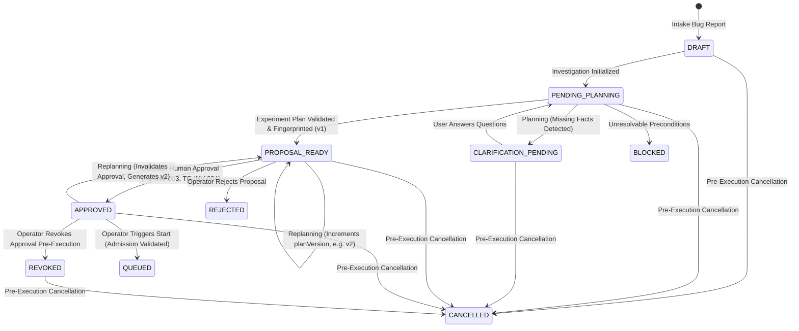
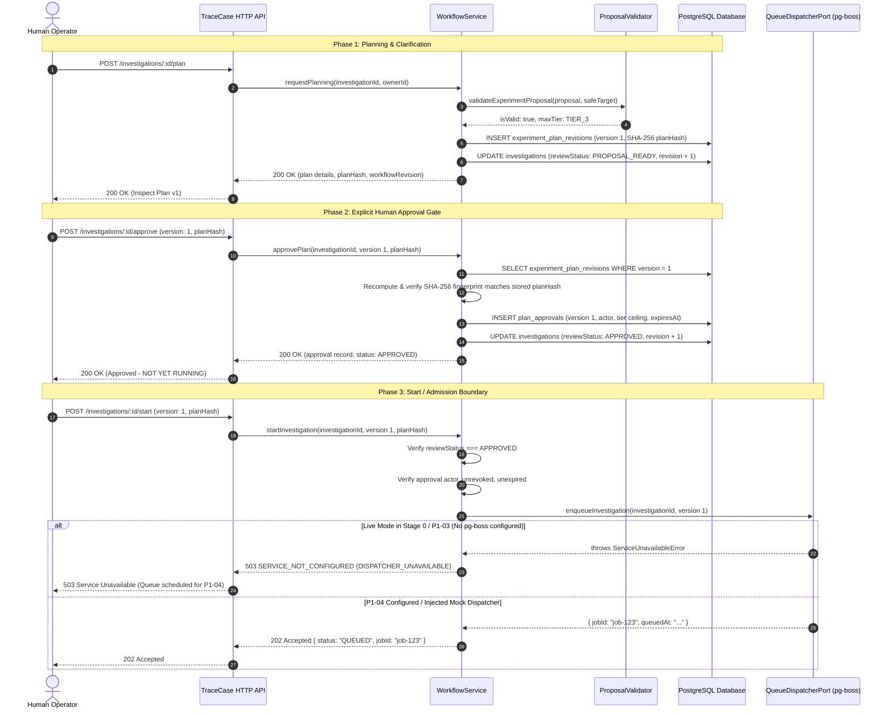

# TraceCase — Person 1: Phase P1-03 Workflow, Clarification, Versioned Plans, and Persisted Human Approval Review

**Phase:** P1-03 — Investigation Workflow, Clarification, Versioned Plans, and Persisted Human Approval  
**Status:** Completed Locally / Ready for Review  
**Date:** 20 October 2026 (Asia/Calcutta)  
**Author:** Person 1 (Core Platform, Browser Execution, and Verification Lead)  
**Baseline Commit:** `af56f5a`  
**Test Suite State:** 19 test files, 108 passed tests (0 failures), typecheck clean (`tsc --noEmit`), lint clean (`next lint`), production build clean (`next build` & `tsup worker`)  

---

## 1. Executive Summary and Intent

Phase **P1-03** delivers the trusted, multi-tenant backend workflow engine for TraceCase. It transitions an authenticated user's submitted bug report through iterative clarification, AI experiment proposal validation, immutable plan publication, and explicit cryptographic human approval.

### Primary Objectives Delivered:
1. **Inherited Identity & Persistence Hardening:**
   - Enforced required `AUTH_AUDIENCE`, non-empty `sub`/`iss`, and valid numeric expiration (`exp`) in JWT claims validation.
   - Masked raw tokens, JWKS URLs, and connection traces from all error envelopes.
   - Removed test tokens from production code, introducing a test-only resolver injection hook (`setCustomPrincipalResolverForTesting`).
   - Implemented conflict-safe atomic upsert (`onConflictDoUpdate`) on `(external_issuer, external_subject)` in `PrincipalsRepository`.
   - Hardened database migration runner to exit non-zero on failure and sanitize credential logging.
2. **Relational Schema Extension & Migration (`0002_fair_bloodaxe.sql`):**
   - Added `clarification_questions` table with `(investigation_id, question_index)` unique index.
   - Extended `investigations` table with `workflow_revision`, `review_status`, and explicit audit fields (`rejection_reason`, `rejected_at`, `rejected_by`, `cancelled_at`, `cancelled_by`, `cancellation_reason`).
   - Added durable `idempotency_keys` table with primary key `(principal_id, key)`.
   - Added unique index on `(investigation_id, sequence_index)` for append-only `investigation_events`.
3. **Deterministic Proposal Policy Validator (`proposal-validator.ts`):**
   - Validates model-proposed experiment plans prior to publication.
   - Tool allowlist: permits safe interaction tools (`navigate`, `click_button`, `click_link`, `fill_input`, `select_option`, `set_checkbox`, `press_key`, `hover_element`, `scroll_page`, `inspect_dom`, `get_text`, `screenshot`); rejects `delete_element` (clarifying DOM deletion != backend mutation) and `clear_storage`.
   - Step sequence: enforces strictly sequential 0-based step indices and timeout bounds (1,000ms to 60,000ms).
   - Assertion compatibility matrix (`ASSERTION_COMPATIBILITY_TABLE`): validates allowed `(kind, source, operator, expectedValue)` combinations; explicitly rejects `MATCHES_REGEX` (preventing catastrophic backtracking / ReDoS) and hazardous script execution prefixes (`javascript:`, `eval`, `data:`, `file:`).
   - Dual assertion check: mandates at least one `EXPECTED_CORRECT_BEHAVIOR` assertion and at least one `REPORTED_FAILURE_SIGNATURE` assertion.
   - Sandbox authority check (TC-INV-008): strictly blocks any `TIER_4_DESTRUCTIVE` steps if `target.isSandboxVerified !== true`.
4. **Trusted Workflow Service (`investigation-workflow.service.ts`):**
   - Implements `requestPlanning`, `answerClarifications`, `approvePlan`, `rejectPlan`, `revokeApproval`, `cancelInvestigation`, and `getInvestigationSnapshot`.
   - Enforces optimistic concurrency control using `workflowRevision` (integer).
   - Manages immutable plan versioning (`planVersion`) and canonical SHA-256 fingerprinting (`planHash`).
   - Re-planning cleanly invalidates prior approvals by allocating new plan revisions.
   - Emits structured audit events (`CLARIFICATION_REQUESTED`, `CLARIFICATION_ANSWERED`, `PLAN_PUBLISHED`, `PLAN_APPROVED`, `PLAN_REJECTED`, `APPROVAL_REVOKED`, `INVESTIGATION_CANCELLED`) with monotonically increasing sequence indices.
5. **Durable Command Deduplication (`idempotency.repository.ts`, `workflow-http.ts`):**
   - Supports `X-Idempotency-Key` HTTP header and payload `idempotencyKey`.
   - Prevents duplicate execution, replays cached responses on identical payloads, rejects key reuse with mismatched payloads (409 Conflict), blocks concurrent requests in progress (409 Conflict), and guarantees strict tenant isolation.
6. **Truthful Start / Admission Boundary (`POST /api/v1/investigations/[id]/start`):**
   - Enforces the two-step invariant (TC-INV-003): human approval persists consent but does NOT enqueue or launch execution.
   - Validates all preconditions (active `reviewStatus === 'APPROVED'`, matching plan version, matching plan hash, valid actor, unrevoked, unexpired).
   - In live mode without external dispatcher, truthfully returns HTTP 503 `SERVICE_NOT_CONFIGURED` (`DISPATCHER_UNAVAILABLE`), stating that pg-boss queue scheduling belongs to Phase P1-04.
7. **Complete API Route Surfaces:**
   - Wired live endpoints under `/api/v1/investigations/[id]/` for `plan`, `clarifications`, `clarifications/answer`, `approve`, `reject`, `revoke`, `cancel`, and `start`.

---

## 2. State Machine Architecture and Lifecycle Flow



### Detailed Sequence: Human Approval Gate & Admission Boundary



---

## 3. Relational Schema Extensions & Migrations

### 3.1. Generated Migration: `drizzle/migrations/0002_fair_bloodaxe.sql`

```sql
CREATE TABLE "clarification_questions" (
	"id" uuid PRIMARY KEY DEFAULT gen_random_uuid() NOT NULL,
	"investigation_id" uuid NOT NULL,
	"question_index" integer DEFAULT 0 NOT NULL,
	"question_text" text NOT NULL,
	"explanation" text,
	"suggested_options" jsonb,
	"is_answered" boolean DEFAULT false NOT NULL,
	"answer_text" text,
	"answered_by" text,
	"answered_at" timestamp with time zone,
	"created_at" timestamp with time zone DEFAULT now() NOT NULL
);

CREATE TABLE "idempotency_keys" (
	"principal_id" uuid NOT NULL,
	"key" varchar(255) NOT NULL,
	"resource_id" text NOT NULL,
	"command_name" varchar(100) NOT NULL,
	"command_fingerprint" varchar(64) NOT NULL,
	"status" varchar(20) DEFAULT 'IN_PROGRESS' NOT NULL,
	"response_status" integer,
	"response_body" jsonb,
	"created_at" timestamp with time zone DEFAULT now() NOT NULL,
	"expires_at" timestamp with time zone NOT NULL,
	CONSTRAINT "idempotency_keys_principal_id_key_pk" PRIMARY KEY("principal_id","key")
);

ALTER TABLE "investigations" ADD COLUMN "workflow_revision" integer DEFAULT 1 NOT NULL;
ALTER TABLE "investigations" ADD COLUMN "review_status" varchar(30) DEFAULT 'NONE' NOT NULL;
ALTER TABLE "investigations" ADD COLUMN "rejection_reason" text;
ALTER TABLE "investigations" ADD COLUMN "rejected_at" timestamp with time zone;
ALTER TABLE "investigations" ADD COLUMN "rejected_by" text;
ALTER TABLE "investigations" ADD COLUMN "cancelled_at" timestamp with time zone;
ALTER TABLE "investigations" ADD COLUMN "cancelled_by" text;
ALTER TABLE "investigations" ADD COLUMN "cancellation_reason" text;

CREATE UNIQUE INDEX "clarification_questions_inv_idx_idx" ON "clarification_questions" USING btree ("investigation_id","question_index");
CREATE INDEX "idempotency_keys_expires_at_idx" ON "idempotency_keys" USING btree ("expires_at");
CREATE UNIQUE INDEX "investigation_events_inv_seq_idx" ON "investigation_events" USING btree ("investigation_id","sequence_index");
```

---

## 4. Proposal Policy Validator (`src/server/policy/proposal-validator.ts`)

| Validation Rule | Invariant / Policy Reference | Enforcement Mechanism |
| :--- | :--- | :--- |
| **Tool Allowlist** | Deterministic browser execution | Rejects `delete_element` (DOM manipulation is not backend mutation) and `clear_storage`. Allows only 12 approved interactive tools. |
| **Tool Parameters** | Executable action safety | Enforces non-empty `selector` for clicks/fills/hovers, and non-empty `value` for navigate and input fills. |
| **Step Indexing** | Sequential reproducibility | Strict check: `step.stepIndex === i` (sequential 0-based). Rejects gaps, reordered steps, or duplicate indices. |
| **Timeout Bounds** | Execution resource bounds | `1000 <= step.timeoutMs <= 60000`. Rejects zero, sub-second, or indefinite timeouts. |
| **Assertion Compatibility Matrix** | Deterministic verification | Enforces strict `(kind, source, operator, expectedValue)` combinations from `ASSERTION_COMPATIBILITY_TABLE`. |
| **ReDoS / RegEx Ban** | Catastrophic backtracking prevention | Explicitly rejects `MATCHES_REGEX` operator to eliminate ReDoS vulnerabilities and unbounded regex evaluation complexity. |
| **Injection Safety** | Code execution vector mitigation | Rejects `javascript:`, `eval`, `data:`, and `file:` prefixes in assertion `subjectRef` and `expectedValue`. |
| **Dual Assertion Rule** | Reproduction confirmation | Requires at least one `EXPECTED_CORRECT_BEHAVIOR` assertion and at least one `REPORTED_FAILURE_SIGNATURE` assertion. |
| **Sandbox Tier Boundary** | TC-INV-008, TC-INV-004 | Rejects any plan step containing `TIER_4_DESTRUCTIVE` unless `target.isSandboxVerified === true`. |

---

## 5. Durable Command Idempotency (`src/server/db/repositories/idempotency.repository.ts`)

Command requests support `X-Idempotency-Key` headers (or payload `idempotencyKey`):
1. **Fingerprint Calculation:** Deterministically hashes the canonical JSON representation of the request payload using recursive key sorting (`canonicalJsonStringify`).
2. **Atomic Claiming:** Atomically inserts or updates `idempotency_keys` under `(principal_id, key)`.
3. **Replay Detection:** If status is `COMPLETED` and the payload fingerprint matches, returns the cached response status and body without re-executing.
4. **Conflict Detection:** If the key is reused with a different payload fingerprint, fails immediately with HTTP 409 `IDEMPOTENCY_KEY_REUSED`.
5. **In-Flight Locking:** If an identical request is currently `IN_PROGRESS`, returns HTTP 409 `IDEMPOTENCY_REQUEST_IN_PROGRESS`.
6. **Failure Recovery:** If the command handler throws an error, the key status is set to `FAILED`, permitting the client to retry.
7. **Tenant Isolation:** Primary key includes `principal_id`, guaranteeing Tenant A cannot block or collide with Tenant B.

---

## 6. HTTP API Surface (`src/app/api/v1/investigations/`)

| Route | Method | Idempotent | Auth Required | Description |
| :--- | :---: | :---: | :---: | :--- |
| `/api/v1/investigations/[id]` | `GET` | Yes | Yes | Authoritative `InvestigationSnapshot` read model with approval status and audit reasons. |
| `/api/v1/investigations/[id]/plan` | `POST` | Yes | Yes | Request experiment planning or replanning via `ReportClarificationAgentPort`. |
| `/api/v1/investigations/[id]/plan` | `GET` | Yes | Yes | Retrieve active authoritative experiment plan revision for this investigation. |
| `/api/v1/investigations/[id]/clarifications` | `GET` | Yes | Yes | List ordered clarification questions for an investigation. |
| `/api/v1/investigations/[id]/clarifications/answer` | `POST` | Yes | Yes | Batch-submit user answers to clarification questions. |
| `/api/v1/investigations/[id]/approve` | `POST` | Yes | Yes | Human operator approval gate. Persists signed approval record with SHA-256 verification. |
| `/api/v1/investigations/[id]/reject` | `POST` | Yes | Yes | Human operator rejection with persisted reason. |
| `/api/v1/investigations/[id]/revoke` | `POST` | Yes | Yes | Operator revocation of a previously granted plan approval before execution starts. |
| `/api/v1/investigations/[id]/cancel` | `POST` | Yes | Yes | Pre-execution cancellation of an investigation. |
| `/api/v1/investigations/[id]/start` | `POST` | Yes | Yes | Admission boundary. Validates approval; returns 503 `DISPATCHER_UNAVAILABLE` in live Stage 0 mode. |

---

## 7. Verification Results

### 7.1. Full Test Suite (`pnpm test`)
```
 RUN  v3.2.7 C:/SHARAN PROJECTS/TraceCase

 ✓ tests/person-1/phase-1/fingerprint-and-approval.test.ts (5 tests)
 ✓ tests/person-1/phase-1/events-and-ports.test.ts (6 tests)
 ✓ tests/person-1/phase-1/safe-projections.test.ts (4 tests)
 ✓ tests/contracts.test.ts (6 tests)
 ✓ tests/person-1/phase-2/repositories.test.ts (6 tests)
 ✓ tests/person-1/phase-3/jwt-hardening.test.ts (4 tests)
 ✓ tests/person-1/phase-2/jwt-auth.test.ts (10 tests)
 ✓ tests/person-1/phase-3/start-boundary.test.ts (4 tests)
 ✓ tests/person-1/phase-3/idempotency.test.ts (6 tests)
 ✓ tests/person-1/phase-2/live-api-persistence.test.ts (3 tests)
 ✓ tests/person-1/phase-3/workflow-state-machine.test.ts (10 tests)
 ✓ tests/person-1/phase-3/end-to-end-workflow.test.ts (1 test)
 ✓ tests/person-1/phase-1/api-boundaries.test.ts (7 tests)
 ✓ tests/person-1/phase-1/intake-and-proposals.test.ts (5 tests)
 ✓ tests/person-1/phase-3/proposal-validator.test.ts (13 tests)
 ✓ tests/person-1/phase-1/config-and-readiness.test.ts (4 tests)
 ✓ tests/person-1/phase-2/policy-regressions.test.ts (5 tests)
 ✓ tests/domain.test.ts (5 tests)
 ✓ tests/boundaries.test.ts (4 tests)

 Test Files  19 passed (19)
      Tests  108 passed (108)
```

### 7.2. Typecheck (`pnpm typecheck`)
```
> tsc --noEmit
Exit code: 0 (Zero errors)
```

### 7.3. Linting (`pnpm lint`)
```
> next lint
✔ No ESLint warnings or errors
Exit code: 0
```

### 7.4. Production Build (`pnpm build`)
```
> next build
✓ Compiled successfully
✓ Generating static pages (12/12)
✓ Finalizing page optimization

> tsup worker/index.ts --format esm --out-dir dist/worker
ESM dist\worker\index.mjs 3.13 KB
ESM Build success in 32ms
Exit code: 0
```
