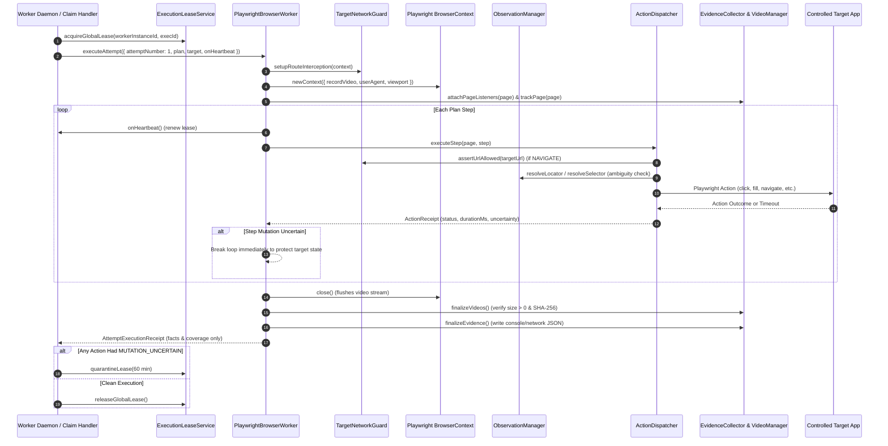
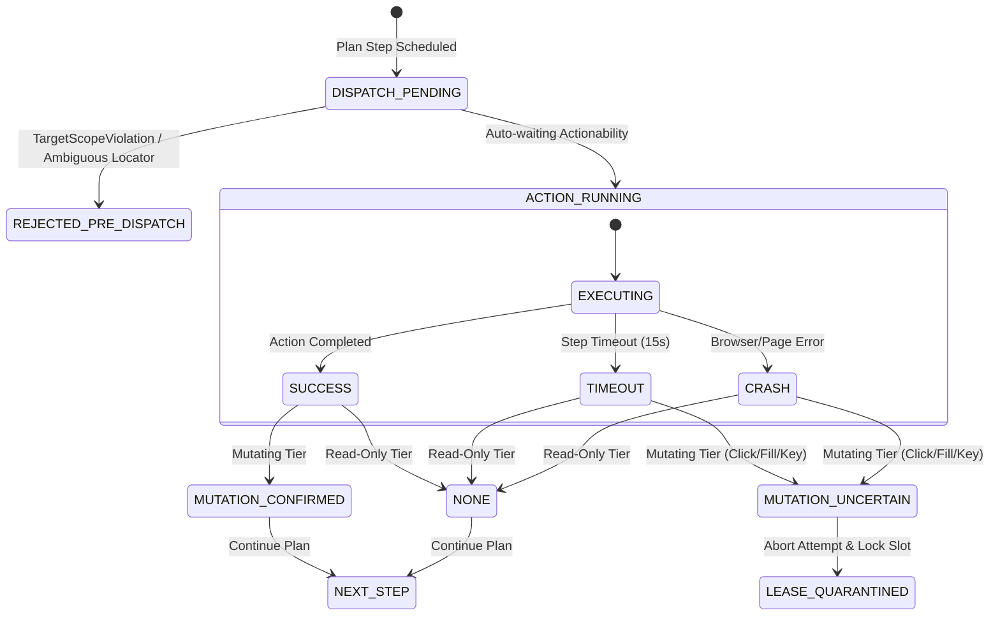

# Person 1, Phase P1-05: Bounded Playwright Browser Execution, Fresh Observations, Action Receipts, and Evidence Capture — Review

## Executive Summary

Phase P1-05 establishes the bounded, sandboxed browser execution engine and evidence capture pipeline for **TraceCase**. Prior to this phase, background execution was limited to internal diagnostic jobs, and live browser automation was deferred. Phase P1-05 introduces real headless Chromium automation using Playwright (`playwright@1.49.1`), isolated browser contexts per execution attempt, strict target network egress enforcement, fresh structured observations with staleness and ambiguity guards, typed action dispatching with mutation uncertainty tracking, context video recording with on-disk verification, and pre-navigation console/network evidence collection.

Critically, this phase adheres strictly to architectural invariant **TC-INV-007**: the browser execution subsystem emits **execution facts, action receipts, and coverage receipts only**. It does **not** decide whether a bug is reproduced or assign reproduction verdicts; verdict assessment is strictly deferred to Phase P1-06.

---

## Architecture and Execution Lifecycle

---

## Detailed Components Implemented

### 1. Headless Chromium Lifecycle & Context Isolation
- **Engine**: Playwright Chromium automation (`playwright@1.49.1`) verified with Node >= 18 and Node 20 CI.
- **Context Isolation**: Every scientific reproduction attempt executes within a freshly initialized `BrowserContext`. No cookies, local storage, cache, or active sessions leak between attempts.
- **Viewport & Configuration**: Standardized 1280x720 viewport, desktop Chrome user-agent, sandboxed process flags (`--no-sandbox`, `--disable-setuid-sandbox`, `--disable-dev-shm-usage`).

### 2. Target Network Egress Guard (`TargetNetworkGuard`)
- **Origin Whitelist**: Disallows any navigation or subresource outside the explicit list of `target.allowedOrigins` and `target.baseUrl`.
- **Cloud Metadata Protection**: Strictly blocks requests to AWS, GCP, Azure, and OpenStack metadata IPs (`169.254.169.254`, `metadata.google.internal`, `169.254.169.253`, `100.100.100.200`).
- **Loopback Protection**: Disallows `localhost`, `127.0.0.1`, `[::1]`, and `0.0.0.0` unless the target profile explicitly declares a local/development environment.
- **Protocol Enforcement**: Blocks `file:`, `ftp:`, `javascript:`, and embedded credentials (`user:pass@host`).
- **Route Interception**: Attaches `context.route('**/*', ...)` at the browser level to abort unauthorized egress before socket establishment (`blockedbyclient`).

### 3. Fresh Observations and Staleness Detection (`ObservationManager`)
- **Opaque References**: Interactive candidate elements are assigned opaque tokens (`ref-0`, `ref-1`) tied to a specific `documentGeneration`.
- **Staleness Guard**: Whenever page navigation occurs, `documentGeneration` increments. Attempting to resolve an older reference fails with `STALE_REFERENCE`.
- **Anti-Ambiguity Guard**: When resolving a selector or element reference, `locator.count()` is checked. If more than 1 matching element is found, execution immediately rejects with `AMBIGUOUS_LOCATOR`. Blind `first()` or `nth()` fallbacks are strictly prohibited to prevent misdirected mutations.

### 4. Typed Action Dispatcher & Uncertainty Tracking (`ActionDispatcher`)
- **Supported Vocabulary**: Dispatches typed plan steps: `navigate`, `click_button`, `click_link`, `fill_input`, `select_option`, `set_checkbox`, `press_key`, `hover_element`, `scroll_page`, `inspect_dom`, `get_text`, `screenshot`, `clear_storage`, and `delete_element`.
- **Auto-Waiting**: Leverages Playwright's locator actionability (visible, stable, enabled, editable) with bounded step timeouts (default 15,000ms).
- **Duration Tracking**: Monotonic elapsed milliseconds recorded per action receipt.
- **Mutation Uncertainty**:
  - Read-only actions (`TIER_1_READ_ONLY`, `TIER_2_SAFE_INTERACTION`) produce `uncertainty: 'NONE'`.
  - Mutating actions that succeed cleanly produce `uncertainty: 'MUTATION_CONFIRMED'`.
  - Mutating actions that time out or crash produce `uncertainty: 'MUTATION_UNCERTAIN'`.

### 5. Evidence Collection & Context Video (`EvidenceCollector` & `VideoManager`)
- **Pre-Navigation Listeners**: Console listeners (`console`, `pageerror`) and network listeners (`request`, `response`, `requestfailed`) are registered before navigation starts.
- **Secret Sanitization**: Redacts `Bearer <token>`, `Basic <token>`, and query secrets (`password=`, `token=`, `api_key=`) in memory before writing to disk.
- **Truthful Status Distinction**: Distinguishes successfully captured empty logs (`CAPTURED_EMPTY`) from listener or file failures (`CAPTURE_FAILED` / `UNAVAILABLE`).
- **Context Video Stream Finalization**: Videos are recorded to disk staging. Upon context closure, file existence and `size > 0` are verified on disk, generating SHA-256 hashes and setting `videoStatus: 'FINALIZED'`.

### 6. Queue Claim Handler & Lease Quarantine Integration
- **Heartbeat Renewal**: `InvestigationClaimHandler` passes `onHeartbeat` to `executeAttempt`, renewing the worker lease every step.
- **Quarantine Boundary**: If any executed action in an attempt produces `MUTATION_UNCERTAIN`, the claim handler sets execution status to `FAILED`, marks the investigation `FAILED`, and calls `quarantineLease` with a 1-hour quarantine window, blocking automated re-runs without operator reset.
- **Separation of Concerns**: When Attempt 1 succeeds cleanly, the claim handler records status `ATTEMPT_1_EXECUTED` with investigation state `RUNNING_ATTEMPT_1`. It does not mark the entire investigation complete or generate reproduction verdicts.

---

## Action and Mutation Uncertainty State Machine

---

## Failure & Quarantine Matrix

| Scenario | Tier | Outcome Status | Uncertainty | Lease Disposition | Investigation Lifecycle |
| :--- | :--- | :--- | :--- | :--- | :--- |
| Selector matches 3 buttons | Mutating | `FAILED` (`AMBIGUOUS_LOCATOR`) | `NONE` (pre-dispatch) | Normal release | `FAILED` |
| Navigation to `169.254.169.254` | Safe | `FAILED` (`TargetScopeViolation`) | `NONE` (pre-dispatch) | Normal release | `FAILED` |
| Navigation to authorized target | Safe | `SUCCESS` | `NONE` | Held via heartbeat | `RUNNING_ATTEMPT_1` |
| Text read-back times out | Read-only | `TIMED_OUT` | `NONE` | Normal release | `FAILED` |
| Mutating button click times out | Mutating | `TIMED_OUT` | `MUTATION_UNCERTAIN` | **QUARANTINED (1 hr)** | `FAILED` |
| Target server crashes during submit | Mutating | `FAILED` | `MUTATION_UNCERTAIN` | **QUARANTINED (1 hr)** | `FAILED` |
| All steps complete successfully | Mixed | `SUCCESS` | `MUTATION_CONFIRMED` | Normal release | `RUNNING_ATTEMPT_1` (Awaiting Attempt 2) |

---

## Verification Results

- **Unit and Integration Test Suite**: 30 test files, **149 tests passing** across `vitest run`.
  - Phase 5 specific tests: 18 tests passing in `tests/person-1/phase-5/`.
  - Real headless Chromium execution test passing with video, console, and network capture.
- **TypeScript**: `pnpm typecheck` passed with 0 errors.
- **ESLint**: `pnpm lint` passed with 0 warnings and 0 errors.
- **Local Review Status**: All changes uncommitted in working directory. Zero GitHub push, zero emojis.
