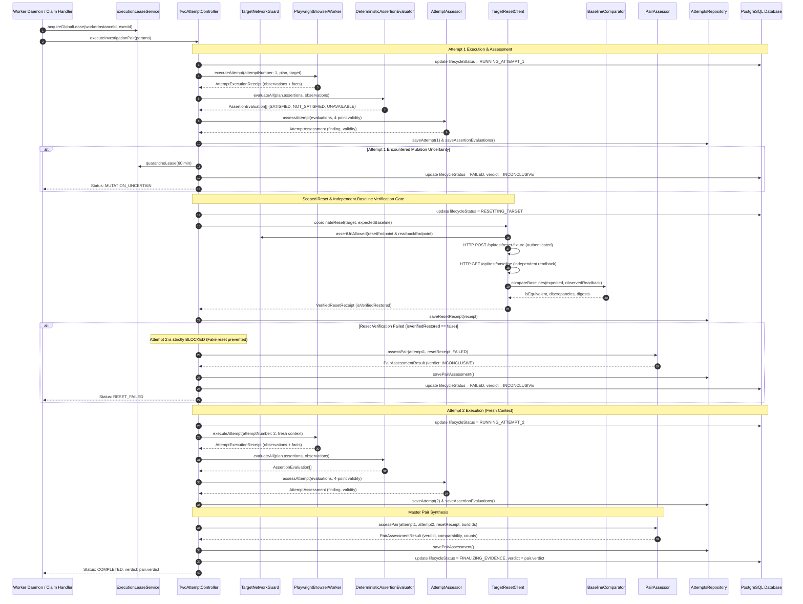
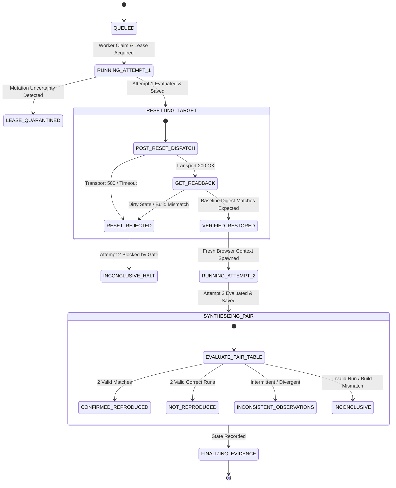

# Person 1, Phase P1-06: Deterministic Assertions, Attempt Validity, Verified Fixture Restoration, and Two-Attempt Assessment — Review

## Executive Summary

Phase P1-06 establishes the trusted verification layer, independent baseline comparator, scoped reset client, and bounded two-attempt orchestrator for **TraceCase**. Prior to this phase, execution facts and media captures were gathered from isolated browser attempts, but there was no deterministic mechanism to evaluate assertions, verify target fixture restoration, or synthesize authoritative reproduction conclusions across multiple runs.

Under project invariants **TC-INV-002** (two-attempt confirmation requirement) and **TC-INV-007** (strict three-dimensional separation of Lifecycle State, Reproduction Finding, and Evidence Readiness), this phase enforces that AI models have zero authority over verification verdicts or defect classifications. Verdicts are computed purely through deterministic code over frozen predicates and attested target baselines. A defect is marked `CONFIRMED_REPRODUCED` strictly when two independent valid runs observe the reported failure signature under verified equivalent baseline conditions.

All changes are local and uncommitted in accordance with repository instructions. Zero emojis are used across all code, tests, documentation, and logs.

---

## Architecture and Two-Attempt Orchestration



---

## State Diagram: Attempt Gates & Reset Verification



---

## Inherited Safety Corrections

1. **Destructive Tool Bypasses Removed from Dispatcher**:
   - `ActionDispatcher` previously contained executable implementations of `clear_storage` and `delete_element`. Although proposal validation disallowed them, dispatcher-level bypasses were eliminated to prevent execution-time compromise.
2. **Tool Execution Uncertainty Corrected**:
   - A successful Playwright click or fill was previously labeled `MUTATION_CONFIRMED`. Successful tool dispatch only establishes that the browser interaction completed without error; it does not prove that backend target state mutated. Clean tool executions now return `uncertainty: 'NONE'`. Mutation verification is strictly delegated to independent assertion oracles and target readback.
3. **Network Evidence Keyed by Request Identity**:
   - `EvidenceCollector` keyed network transactions by URL strings, causing concurrent or repeated requests to overwrite previous observations. Network telemetry is now correlated by Playwright `Request` reference, separating HTTP 4xx/5xx responses from transport dropouts.
   - Separate accessors `findNetworkEntry`, `getAllNetworkEntries`, and `getAllConsoleEntries` provide bounded lookups without truncating authoritative observations.
4. **Isolated Attempt Capture Namespaces**:
   - `VideoManager` initialized attempt video tracking by purging stale directory fallback state and strictly tracking pages belonging to the active attempt. This eliminates evidence leakage across distinct attempts.
5. **Persistent DB-Level Lease Quarantine**:
   - `globalExecutionLeasesTable` was upgraded with persistent quarantine fields (`isQuarantined`, `quarantineReason`, `quarantinedAt`, `quarantinedByWorker`, `quarantineClearedAt`, `quarantineClearedBy`). An uncertain mutating action can no longer re-enter execution merely because an in-memory TTL or lease expiry elapsed.
6. **Observation Acquisition Boundary Before Teardown**:
   - `ObservationCollector` acquires DOM, network, and console facts while the browser context and page frames remain alive, preventing post-teardown reconstruction errors from closed pages.
7. **Strict Abort on Lease Heartbeat Failure**:
   - `PlaywrightBrowserWorker` asserts fencing authority and aborts subsequent step executions if lease renewal fails or throws.

---

## Pure Deterministic Assertion Evaluator

`DeterministicAssertionEvaluator` (`src/server/verification/evaluator.ts`) evaluates frozen assertion predicates against structured observations without network I/O, external process calls, or LLM inferences.

### Supported Predicate Vocabulary

| Assertion Kind | Supported Operators | Valid Sources | Outcome Semantics |
| :--- | :--- | :--- | :--- |
| `ENTITY_PRESENCE` | `EXISTS`, `NOT_EXISTS` | `DOM_ELEMENT` | Compares element count. `NOT_EXISTS` requires verified acquisition with count 0; acquisition failure returns `OBSERVATION_UNAVAILABLE`. |
| `VALUE_COMPARISON` | `EQUALS`, `NOT_EQUALS`, `CONTAINS`, `NOT_CONTAINS`, `GREATER_THAN`, `LESS_THAN`, `MATCHES_REGEX` | `DOM_TEXT`, `DOM_ATTRIBUTE` | Strict string comparisons preserving casing and punctuation. Numeric comparisons strictly reject `NaN`, `Infinity`, and empty string coercion. Regex matching runs in try/catch boundary. |
| `READBACK_STATE` | `EQUALS`, `NOT_EQUALS`, `CONTAINS`, `NOT_CONTAINS`, `GREATER_THAN`, `LESS_THAN`, `EXISTS`, `NOT_EXISTS` | `TARGET_READBACK_API` | Resolves dot-delimited object paths (e.g., `invoice.balance`). Missing keys evaluate to `undefined` without throwing. |
| `NETWORK_OBSERVATION` | `EQUALS`, `NOT_EQUALS`, `EXISTS`, `NOT_EXISTS` | `NETWORK_RESPONSE` | Evaluates HTTP status code, request method, and endpoint matching against intercepted network receipts. |
| `CONSOLE_LOG_OBSERVATION` | `EXISTS`, `NOT_EXISTS`, `CONTAINS`, `NOT_CONTAINS` | `CONSOLE_LOG` | Evaluates message presence or text patterns in structured browser logs. Absence requires verified complete collection coverage. |

### Evaluation Outcome States

- `SATISFIED`: The observation strictly satisfies the operator and expected value.
- `NOT_SATISFIED`: The observation was successfully acquired but does not satisfy the predicate.
- `OBSERVATION_UNAVAILABLE`: Frame detached, locator timed out, network response missing, or readback unavailable.
- `UNSUPPORTED`: Combination of kind and operator is unsupported.
- `INVALID_EVALUATION`: Non-numeric string supplied to numeric operator or malformed regular expression.

---

## 4-Point Attempt Validity Guard

`AttemptAssessor` (`src/server/verification/attempt-assessor.ts`) decouples **experiment validity** from **findings**:

1. **Preconditions Met**: Initial baseline was verified equivalent, and all `PRECONDITION` assertions evaluated as `SATISFIED`.
2. **Scope Adherence**: Browser navigation and outbound network calls remained within `target.allowedOrigins`.
3. **Procedure Completion**: Browser actions executed completely without runner crash, locator timeout, or step failure.
4. **Required Observations Available**: All oracle observations were successfully acquired (zero `OBSERVATION_UNAVAILABLE` or `INVALID_EVALUATION`).

### Attempt Findings

- `REPORTED_FAILURE`: Expected condition is `false`, Reported failure condition is `true`.
- `EXPECTED_BEHAVIOR`: Expected condition is `true`, Reported failure condition is `false`.
- `CONTRADICTORY`: Both expected and reported failure conditions evaluated to `true` simultaneously (marked `INVALID`).
- `UNEXPECTED_OUTCOME`: Both expected and reported failure conditions evaluated to `false`.
- `UNRESOLVED`: One or more required observations was unavailable.

---

## Scoped Target Reset and Baseline Equivalence

`BaselineComparator` (`src/server/verification/baseline-comparator.ts`) and `TargetResetClient` (`src/server/verification/target-reset-client.ts`) enforce verifiable fixture restoration:

- **Canonical State Hashing**: State objects are sorted by key recursively and pruned of volatile timestamps (`timestamp`, `createdAt`, `updatedAt`, `lastModified`, `sessionId`, `etag`, `_ts`). A SHA-256 digest is generated from the canonical representation.
- **Deep Semantic Comparison**: Key presence, array ordering, logical entity IDs, and target build identity must match.
- **Fake Reset Proof**: An HTTP 200 response from `/api/test/reset-fixture` does **not** prove restoration. The client independently executes a GET request to `/api/test/baseline` and compares the resulting state against the expected baseline. If readback is dirty or missing, `isVerifiedRestored` is `false`, and Attempt 2 is strictly blocked.
- **Outbound Guard**: Egress destinations are validated against `TargetNetworkGuard` before dispatch; cloud metadata services (`169.254.169.254`) and unauthorized origins are aborted.

---

## Master Pair Assessment Decision Table

`PairAssessor` (`src/server/verification/pair-assessor.ts`) implements the exhaustive 16-scenario decision matrix:

| Scenario | Attempt 1 Finding | Attempt 1 Validity | Reset Gate | Attempt 2 Finding | Attempt 2 Validity | Final Verdict | Justification & Rules |
| :---: | :---: | :---: | :---: | :---: | :---: | :---: | :--- |
| **1** | `REPORTED_FAILURE` | `VALID` | `RESTORED` | `REPORTED_FAILURE` | `VALID` | **`CONFIRMED_REPRODUCED`** | Defect observed in two independent valid runs under equivalent baseline conditions (TC-INV-002, PS-REQ-001). |
| **2** | `EXPECTED_BEHAVIOR` | `VALID` | `RESTORED` | `EXPECTED_BEHAVIOR` | `VALID` | **`NOT_REPRODUCED`** | Clean negative reproduction: intended behavior confirmed in two valid runs (PS-REQ-002). |
| **3** | `REPORTED_FAILURE` | `VALID` | `RESTORED` | `EXPECTED_BEHAVIOR` | `VALID` | **`INCONSISTENT_OBSERVATIONS`** | Intermittent defect: failure observed in Run 1, correct behavior in Run 2. Observed once preserved. |
| **4** | `EXPECTED_BEHAVIOR` | `VALID` | `RESTORED` | `REPORTED_FAILURE` | `VALID` | **`INCONSISTENT_OBSERVATIONS`** | Intermittent defect: correct in Run 1, failure in Run 2. Order independent. |
| **5** | `UNEXPECTED_OUTCOME` | `VALID` | `RESTORED` | `UNEXPECTED_OUTCOME` | `VALID` | **`INCONSISTENT_OBSERVATIONS`** | Unrelated application errors observed; neither confirmation nor clean nonreproduction. |
| **6** | `REPORTED_FAILURE` | `VALID` | `FAILED` | N/A (Blocked) | N/A | **`INCONCLUSIVE`** | Reset failed; Attempt 2 blocked to prevent polluted state. Preserves observed-once fact in limitations. |
| **7** | `EXPECTED_BEHAVIOR` | `VALID` | `FAILED` | N/A (Blocked) | N/A | **`INCONCLUSIVE`** | Reset failed; cannot establish clean nonreproduction across pair. |
| **8** | `REPORTED_FAILURE` | `VALID` | `RESTORED` | `UNRESOLVED` | `INVALID` | **`INCONCLUSIVE`** | Run 2 observations unavailable. Defect observed once. |
| **9** | `REPORTED_FAILURE` | `VALID` | `RESTORED` | `REPORTED_FAILURE` | `INVALID` | **`INCONCLUSIVE`** | Run 2 procedure crashed or had timeout; cannot confirm invalid run. |
| **10** | `INVALID` | `INVALID` | Any | Any | Any | **`INCONCLUSIVE`** | Run 1 invalid (e.g. runner crash, scope breach, precondition failure). |
| **11** | `CONTRADICTORY` | `INVALID` | Any | Any | Any | **`INCONCLUSIVE`** | Contradictory oracle evaluation (both expected and failure satisfied). |
| **12** | Any | `VALID` | `RESTORED` | `CONTRADICTORY` | `INVALID` | **`INCONCLUSIVE`** | Oracle contradiction in Attempt 2. |
| **13** | `REPORTED_FAILURE` | `VALID` | `RESTORED` | `REPORTED_FAILURE` | `VALID` (Diff Build) | **`INCONCLUSIVE`** | Build version changed between attempts; runs are not comparable. |
| **14** | `MUTATION_UNCERTAIN`| `INVALID` | N/A | N/A | N/A | **`INCONCLUSIVE`** | Mutating action timed out. Slot quarantined. Execution halted. |
| **15** | Any | Any | Any | Any | Any | **`INCONCLUSIVE`** | Operator cancelled investigation prior to pair completion. |
| **16** | `UNRESOLVED` | `INVALID` | Any | Any | Any | **`INCONCLUSIVE`** | Required oracle observations missing from intake or runner. |

---

## Database Persistence Schema

Migration `0004_parched_bucky.sql` adds the relational verification tables:

1. **`global_execution_leases`**:
   - Added `is_quarantined` (boolean), `quarantine_reason` (text), `quarantined_at` (timestamptz), `quarantined_by_worker` (varchar), `quarantine_cleared_at`, `quarantine_cleared_by`.
2. **`investigation_attempts`**:
   - `id`, `investigation_id`, `attempt_number` (1 or 2), `status`, `validity`, `finding`, `invalidity_reason`, `total_duration_ms`, `completed_cleanly`, `summary`, `created_at`.
   - Unique constraint: `(investigation_id, attempt_number)`.
3. **`assertion_evaluations`**:
   - `id`, `investigation_id`, `attempt_id`, `attempt_number`, `assertion_id`, `kind`, `purpose`, `result`, `expected_value`, `observed_value`, `details`, `evaluated_at`.
4. **`reset_receipts`**:
   - `id`, `investigation_id`, `target_id`, `attempt_number` (2), `transport_success`, `baseline_equivalent`, `is_verified_restored`, `expected_state_hash`, `observed_state_hash`, `discrepancies`, `verified_at`.
5. **`pair_assessments`**:
   - `id`, `investigation_id`, `verdict`, `valid_attempt_count`, `matching_attempt_count`, `is_comparable`, `summary`, `limitations`, `assessed_at`.

---

## Verification and Test Coverage

All test suites pass cleanly:

1. **Unit & Integration Suite**:
   ```bash
   pnpm test
   ```
   **36 test files passed, 195 tests passed** (0 failures).
   - `tests/person-1/phase-6/evaluator.test.ts`: 13 table-driven tests for all assertion kinds and operators.
   - `tests/person-1/phase-6/baseline-comparator.test.ts`: 6 tests for canonical hashing, volatile field pruning, and build mismatches.
   - `tests/person-1/phase-6/target-reset.test.ts`: 7 tests for HTTP reset coordination, network guard blocking, timeout, and fake reset detection.
   - `tests/person-1/phase-6/attempt-assessor.test.ts`: 9 tests for 5 findings and 4-point validity.
   - `tests/person-1/phase-6/pair-assessor.test.ts`: 8 tests for master decision table branches.
   - `tests/person-1/phase-6/two-attempt-controller.test.ts`: 3 tests for two-attempt orchestration with local HTTP test fixture.
2. **Type Checking**:
   ```bash
   pnpm typecheck
   ```
   **0 errors**.
3. **Linting**:
   ```bash
   pnpm lint
   ```
   **0 warnings, 0 errors**.
4. **Production Build**:
   ```bash
   pnpm build
   ```
   Next.js web application and tsup worker daemon compiled with **0 errors**.

---

## Unmet Integration Gates & Truthful Readiness

1. **Person 2 Controlled Target Adapter**:
   - The reset and readback clients interact via HTTP endpoints (`/api/test/reset-fixture`, `/api/test/baseline`). When Person 2 provides the real controlled target application and attested build identifiers, the live endpoints will plug directly into `TargetResetClient`.
2. **Person 3 Evidence Sanitizer & Storage**:
   - Evidence capture files are staged locally on disk in isolated attempt directories (`staging/captures/<inv-id>/attempt-<n>/`). Final public sharing eligibility (`PUBLIC_SAFE_READY`) requires Person 3's shared sanitizer and artifact access grant pipeline (Phase P1-07).
3. **AI Integration**:
   - Verdicts are 100% deterministic code. AI roles (GPT-6 Luna) have zero authority over verification findings.
