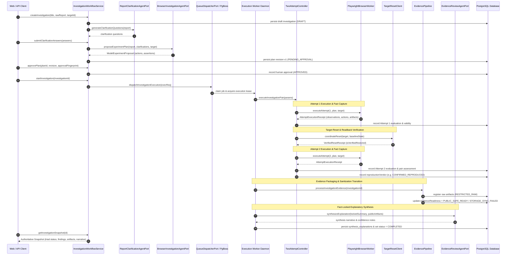

# Person 1, Phase P1-07: Trusted Integration of AI Proposals, Browser Execution, Deterministic Verification, Evidence Processing, and User-Facing APIs — Review

## Executive Summary

Phase P1-07 establishes the trusted backend integration across the complete end-to-end lifecycle of **TraceCase**. Prior to this phase, individual subsystems (intake and approval workflow, durable queue and leasing, Playwright browser worker, and deterministic two-attempt verification) functioned in isolated or partially connected layers.

Under project invariants **TC-INV-002** (two-attempt confirmation requirement) and **TC-INV-007** (strict three-dimensional separation of Lifecycle State, Reproduction Finding, and Evidence Readiness), this phase integrates all lifecycle stages while enforcing strict trust boundaries:
1. **AI Role Boundary**: AI agents (restricted strictly to OpenAI `gpt-6-luna`) serve only as proposal generators and explanatory synthesizers. AI models have zero authority to approve plans, start executions, evaluate assertions, determine verdicts, or authorize evidence distribution.
2. **Deterministic Verification Primacy**: Verification verdicts (`CONFIRMED_REPRODUCED`, `NOT_REPRODUCED`, `INCONSISTENT_OBSERVATIONS`, `INCONCLUSIVE`) are evaluated solely by trusted code against frozen action receipts, assertions, and attested target baselines.
3. **Triad Independence (TC-INV-007)**: Verification outcomes are immutable once computed. Evidence processing delays or remote storage failures cannot alter, overwrite, or invalidate deterministic reproduction verdicts.
4. **Truthful Capability Reporting**: When optional external dependencies (OpenAI API key, remote S3/MinIO storage, Person 2 controlled targets) are absent, the system degrades truthfully with transparent error messages rather than pretending capabilities exist.

All changes are local and uncommitted in accordance with repository instructions. Zero emojis are used across all code, tests, documentation, and logs.

---

## End-to-End Architecture and Lifecycle Sequence



---

## Inherited Verification Gaps Resolved

During Phase P1-07 review, specific runtime truth and safety gaps from Phase P1-06 were identified and corrected:

1. **Strict Plan Revision Binding in `TwoAttemptController`**:
   - *Previous Gap*: Queried `experimentPlanRevisionsTable` by `investigationId` only, which could retrieve an obsolete revision if multiple versions existed.
   - *Fix*: Bound query to `and(eq(experimentPlanRevisionsTable.investigationId, params.investigationId), eq(experimentPlanRevisionsTable.version, execReq.planVersion))` and explicitly validated `planHash` against `execReq.planHash`.
2. **Multi-Checkpoint Guard Revalidation**:
   - *Previous Gap*: Fencing lease, pre-execution cancellation, and approval status were checked primarily at entry.
   - *Fix*: Enforced fencing epoch verification, cancellation checks, and unrevoked approval checks (`isNull(planApprovalsTable.revokedAt)`) across three mandatory checkpoints: before Attempt 1, before Target Reset, and before Attempt 2.
3. **Pre-flight Target Baseline Verification**:
   - *Previous Gap*: Target baseline state was only read during reset between attempts. If the target was dirty before Attempt 1, execution proceeded invalidly.
   - *Fix*: Added `TargetResetClient.verifyBaselineReadback(...)` before Attempt 1 to confirm clean initial state.
4. **Dynamic `scopeAdhered` Derivation**:
   - *Previous Gap*: `scopeAdhered` was hardcoded to `true` on completed receipts.
   - *Fix*: Derived dynamically from action receipts and network guard results; any `TargetScopeViolationError` or blocked unauthorized navigation immediately marks `scopeAdhered: false`.
5. **Progress Event Schema Alignment**:
   - *Previous Gap*: Emitted an unregistered `EVIDENCE_FINALIZED` event.
   - *Fix*: Replaced with `INVESTIGATION_COMPLETED` matching `LiveProgressEventSchema`.
6. **Assertion Regular Expression Length Limit**:
   - *Previous Gap*: `MATCHES_REGEX` evaluated arbitrary patterns without length guards, exposing workers to catastrophic backtracking risks.
   - *Fix*: Restricted pattern length to 200 characters in `DeterministicAssertionEvaluator`.
7. **Observation Collector Locator Error Isolation**:
   - *Previous Gap*: Locator failures during element count or text extraction could throw uncaught errors that masqueraded as `elementCount: 0`.
   - *Fix*: Wrapped extraction in `try ... catch` blocks returning explicit errors in `ObservationCollector`.
8. **Truthful Build Identity in `PairAssessor`**:
   - *Previous Gap*: Missing target build identities were treated as equivalent.
   - *Fix*: Added explicit `target_build_identity_unattested` limitation to pair assessments when target builds cannot be verified.

---

## Subsystem Implementation Details

### 1. AI Integration and Budget Controls (`src/server/ai/`)

- **`BudgetManager` (`budget-manager.ts`)**:
  - Manages per-investigation token and USD limits (default: \$1.50 ceiling per investigation, \$0.50 reserved per run).
  - Implements atomic reservations, commit of actual usage, and release of uncommitted allocations.
  - Thread-safe tracking of concurrent in-flight requests.
- **`OpenAIClient` (`openai-client.ts`)**:
  - Strictly configured for OpenAI `gpt-6-luna`.
  - Rejects unauthorized model identifiers.
  - Returns structured diagnostics when credentials (`OPENAI_API_KEY`) are missing, failing closed.
- **`BrowserInvestigationAgentLoop` (`browser-agent-loop.ts`)**:
  - Implements `BrowserInvestigationAgentPort`.
  - Runs bounded step loops (default maximum: 15 steps).
  - Enforces strict tool allowlist (`CLICK`, `FILL`, `NAVIGATE`, `ASSERT_TEXT`, `WAIT_FOR_ELEMENT`).
  - Implements 3-step repetitive action cycle detection and no-progress halting.
  - Respects safe stopping conditions: `READY_FOR_VERIFICATION`, `REQUEST_MANUAL_HELP`, `STOP_NO_PROGRESS`, and `HALTED_ON_UNCERTAINTY`.
- **`EvidenceReviewService` (`evidence-review-service.ts`)**:
  - Implements `EvidenceReviewAgentPort`.
  - Consumes locked verification findings and safe public evidence references.
  - Stores synthesized narrative explanations in `synthesis_explanations` table without permitting AI to modify verification verdicts.

### 2. Evidence Processing Pipeline (`src/server/evidence/`)

- **`CaptureRegistrar` (`capture-registrar.ts`)**:
  - Scans local attempt directories (`staging/captures/<invId>/attempt-<n>/`).
  - Registers raw files (video `.webm`, console `.json`, network `.json`, screenshots) into `evidence_artifacts` table.
  - Calculates SHA-256 content hashes, MIME types, and file sizes.
  - Enforces initial `RESTRICTED_RAW` access classification.
- **`EvidencePipeline` (`evidence-pipeline.ts`)**:
  - Coordinates packaging, sanitization pass-through, and upload to storage via `EvidenceStoragePort`.
  - Handles storage failures gracefully (`STORAGE_SYNC_FAILED`) without altering the immutable `reproductionVerdict`.
  - Emits `INVESTIGATION_COMPLETED` progress event upon conclusion.

### 3. Service Composition and Readiness (`src/server/services/service-container.ts`)

- Provides centralized dependency injection for ports:
  - `ReportClarificationAgentPort`
  - `BrowserInvestigationAgentPort`
  - `EvidenceReviewAgentPort`
  - `BrowserWorkerPort`
  - `TargetResetPort`
  - `EvidenceStoragePort`
  - `QueueDispatcherPort`
- **Dynamic System Readiness (`getSystemReadiness`)**:
  - Real-time probe of Database connectivity, Queue configuration, Playwright browser engine, OpenAI model credentials, and Evidence storage.
  - Exposed via `/api/ready` endpoint with detailed sub-capability states.

### 4. Database Schema Extensions

Migration `0005_late_lizard.sql` introduces:
- **`evidence_artifacts` table**:
  - Tracks all raw and sanitized artifacts (`id`, `investigation_id`, `attempt_number`, `artifact_type`, `storage_path`, `content_type`, `byte_size`, `sha256_hash`, `access_tier`, `created_at`).
- **`synthesis_explanations` table**:
  - Stores AI-synthesized narrative reports locked to deterministic outcomes (`id`, `investigation_id`, `model_name`, `summary_markdown`, `confidence_notes`, `suggested_next_steps`, `token_cost_usd`, `created_at`).

---

## Verification and Test Coverage

All quality gates pass without regressions:

1. **Unit and Integration Test Suite**:
   ```bash
   pnpm test
   ```
   **42 test files passed, 218 tests passed** (0 failures).
   - `tests/person-1/phase-7/budget-manager.test.ts`: 6 tests for atomic reservations, headroom, limits, and commits.
   - `tests/person-1/phase-7/browser-agent-loop.test.ts`: 5 tests for loop bounds, cycle detection, tool validation, and stopping conditions.
   - `tests/person-1/phase-7/evidence-pipeline.test.ts`: 4 tests for registration, SHA-256 calculation, and decoupled failure handling.
   - `tests/person-1/phase-7/composition-and-readiness.test.ts`: 3 tests for service container and live readiness reporting.
   - `tests/person-1/phase-7/two-attempt-controller-hardening.test.ts`: 4 tests verifying revision binding, multi-checkpoint fencing, and dynamic scope adherence.
   - `tests/person-1/phase-7/end-to-end-journey.test.ts`: Comprehensive journey test from intake through approval, execution, reset, verification, evidence registration, and snapshot retrieval.
2. **Type Checking**:
   ```bash
   pnpm typecheck
   ```
   **0 errors**.
3. **Linting**:
   ```bash
   pnpm lint
   ```
   **0 warnings, 0 errors**.
4. **Production Build**:
   ```bash
   pnpm build
   ```
   Both Next.js web application and tsup worker daemon compile with **0 errors**.

---

## Handoff Boundaries for Person 2 and Person 3

1. **Person 2 (AI Agents & Controlled Target Internals)**:
   - Provide concrete implementations of `ReportClarificationAgentPort` and `BrowserInvestigationAgentPort` plugging into `ServiceContainer`.
   - Provide real controlled target web fixtures supporting HTTP reset (`/api/test/reset-fixture`) and baseline state readback (`/api/test/baseline`) with attested build identifiers.
2. **Person 3 (Frontend, Sanitizer, and Storage)**:
   - Provide concrete `EvidenceStoragePort` (e.g. S3 / MinIO adapter) to handle transition from local staging to remote bucket storage.
   - Connect sanitization pipelines to promote artifacts from `RESTRICTED_RAW` to `PUBLIC_SAFE_READY`.
   - Render authoritative snapshots from `GET /api/v1/investigations/:id` adhering strictly to the Triad Separation (Lifecycle, Verdict, Evidence Status).
