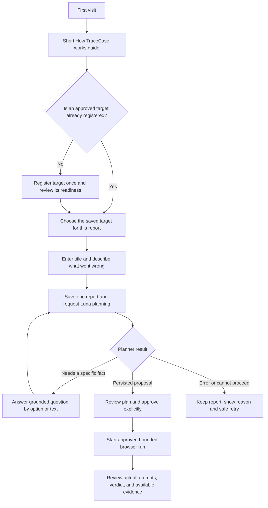

# Person 1 — Phase 2: TraceCase onboarding, report flow, and reliability

**Owner:** Person 1 (TraceCase application and integration lead).
**Status:** Proposed implementation plan; no stage is represented as complete.
**Primary outcome:** A first-time user can understand TraceCase, register a permitted target once, submit a report against that saved target, answer only useful clarifications, reach a real persisted plan, approve it, run it, and understand the actual result without seeing misleading or fabricated states.

This is a Phase 2 refinement of the existing working prototype. It does not replace the product: TraceCase remains a controlled bug-reproduction application. It does not discover arbitrary bugs, fix target source code, or execute unapproved actions. Keep the existing white/pale-lavender/cobalt/deep-navy UI direction from [`docs/ui-ux-specification.md`](../../docs/ui-ux-specification.md).

## Repository facts to carry into implementation

Use current source as the implementation authority and re-check it at the start of each stage. The dashboard is `src/app/page.tsx`; target registration is `src/app/targets/page.tsx`; report intake is `src/app/investigations/new/page.tsx`; clarification, approval, live execution and results have investigation routes under `src/app/investigations/[id]/`. The related API routes are under `src/app/api/v1/`, and browser UI calls use `src/features/investigations/api-client.ts`.

The report form loads registered target profiles and currently selects the first returned target when no target has been selected. It then saves the report and asks the backend to plan; when planning fails it keeps the saved investigation ID to support a planning retry. The target screen creates a saved target profile containing a base URL, allowed origins, environment and optional test/reset metadata. A target profile is authorization/configuration metadata: it does not host the target application. The `demo-target` Node server is a separate process; its existing task app defaults to port 3005, and the documented fixed build uses 3006. Do not confuse target registration with deploying or starting that app.

The screenshot of the clarification submission shows a unique-index error on `(investigation_id, question_index)`. Current source confirms that the workflow forwards a model-provided question index (or the current array index) and the repository can persist it unchanged even when earlier clarification rounds already used that index. The answer UI does provide suggested-option buttons when the planner returns options, as well as free text, but it currently treats a failed question fetch like an empty question list, labels the page “Preview Mode,” and can route a non-proposal planning result to plan approval. These are actionable code-level findings; inspect database rows and request history before claiming which exact production/local record produced a screenshot.

The source form and screenshots also expose technical setup details to ordinary users and show an attachment picker whose notice says selected files will not be persisted. Do not claim an upload succeeded unless an existing, verified upload/storage path persists and retrieves it. The screenshots show five saved profiles sharing `localhost:3005`; do not assume these are safe to delete or merge. Existing 3005/3006 behavior, fixture scopes, reset/readback and synthetic TC4 scenario must remain available unless a reviewed compatibility change says otherwise.

## User journey Phase 2 must deliver

Clarification is a **planning-time** user interaction. The browser executor does not spontaneously present multiple-choice questions during a run in the current product contract. If execution encounters an ambiguity or unsafe/unavailable precondition, it must stop or report the existing blocked/inconclusive state; do not silently invent a runtime chat capability. Luna is the planned model; do not add model training, a local-model fallback, or another provider as part of this phase.

## Stage P1-2.0 — Re-baseline, reproduce, and freeze boundaries

Before editing, read repository guidance, `PROJECT_MEMORY.md` if present, the linked product/technical/workflow/API/agent/evidence specifications, and the current branch, commit, staged changes and working tree. Do not assume earlier phase work was applied just because an earlier plan said it should be. Reproduce the visible issues only with a disposable local record and the configured test environment. Capture the exact request, response, workflow revision, question rows, persisted plan revision and safe server log reference. Avoid extra paid Luna calls when the unique-index behavior can be established deterministically.

Create a short baseline record in the implementation handoff: what happens today when a user visits the app, registers a target, creates a report, requests a plan, answers a clarification and opens plan review. List each screenshot symptom as **confirmed in source**, **reproduced in runtime**, or **still unverified**. Inspect why a saved profile shares an origin before recommending cleanup. Agree file ownership with Person 2: Person 1 owns TraceCase UI, TraceCase APIs/workflow, database migrations if needed, and the first-use guide; Person 2 owns the separate target application and its target-local fixtures/APIs.

**Exit evidence:** recorded baseline revision and worktree; reproducible or explicitly unverified symptoms; a target/report/API contract with Person 2; no user records deleted or reset to make the baseline look clean.

## Stage P1-2.1 — Make target setup a one-time, understandable task

Redesign the target-management journey around the user's mental model: “Add a test site once, then choose it whenever you file a report.” Explain that the target application runs at its own URL and TraceCase stores its registration, trust boundary and test configuration. In the primary form, ask for the application's display name, base URL and environment. Parse and validate the URL and show the normalized origin before save. Move allowed extra origins, reset/readback integration and test-account reference into a clearly labeled advanced section with plain-language help. Never ask for a password or store credentials in the target profile.

Represent the actual server-returned safety/readiness facts distinctly: for example, sandbox requested is not the same as sandbox verified, and a URL reachable check is not proof that a reset/readback fixture is valid. Any reachability check must use the existing server-side allowlist and SSRF protections, be read-only, bounded by a timeout, and display what it actually checked. Do not introduce a browser visit or mutating probe merely to make the card look “ready.”

For an already registered normalized origin, show a non-destructive notice and let the user open/reuse the existing profile. Allow multiple profiles only when the user intentionally distinguishes environment/build/scope and confirms it. Do not auto-merge or delete the screenshot's existing five records. After successful registration, offer “Create a report for this target,” carrying the returned target ID into the report route. Returning users should still see the existing saved-target list and can select one without re-registering it.

**Files likely in scope:** `src/app/targets/page.tsx`, target contracts and API client, `src/app/api/v1/targets/route.ts`, target repository/policy only if source review finds the contract incomplete, shared target cards/help text, and narrowly scoped tests. Inspect before editing; do not expand the authorization surface.

**Acceptance:** registering a target once returns a persisted ID; refresh shows the same saved profile; “Create a report for this target” selects that exact ID; duplicate origins warn without changing records; malformed/unsafe origins are rejected server-side; no secret is exposed to browser state or logs.

## Stage P1-2.2 — Turn report creation into a short, reliable flow

Make the default intake feel small and plain: select a saved target, enter a short title, and describe what happened. Tell the user that uncertainty is okay. Keep expected behavior, observed behavior, reproduction steps, browser/build details and diagnostic text optional and progressively disclosed. Use the selected target's actual environment/build metadata only where contracts support it; do not imply that reporter-supplied values were observed by the worker. Preserve content if validation or a network request fails.

Do not create a second registration form inside report intake. If there are no saved targets, present one clear action to register a target and then return to report creation. When the user arrives from a target card, use that explicit target ID. For a general “New Report” entry, present a required visible choice; do not silently choose the first of multiple profiles. If there is exactly one suitable target, it can be preselected only with its name, environment and origin visible and an easy change control.

Treat report save and AI planning as two distinct operations. Once the backend confirms report persistence, keep its investigation ID and show a durable “Report saved; preparing a plan” state. A planning failure must not cause a duplicate report on retry. Retry the same investigation's plan request, with idempotency/revision rules from the existing API. Render typed safe errors as actionable messages (sign-in, target unavailable, service temporarily unavailable, clarification needed, or cannot proceed) without exposing stack traces, database errors, raw provider response or secrets. Do not represent a failed request as an empty success or stay on a permanently disabled spinner.

Attachment selection is not an upload. Until a real supported upload-and-retrieval path is present and verified end to end, remove/disable the misleading file picker and offer a paste-diagnostics field or explain that attachments are not supported yet. Do not add new object storage as an implied quick fix.

**Acceptance:** a report is created once; planning retries reuse the saved investigation; the user can tell which target was selected; optional fields remain optional; form values survive recoverable errors; no “output” is fabricated when planning fails.

## Stage P1-2.3 — Make Luna clarification and plan generation deterministic to the user

Repair persistence before polishing question cards. `src/server/db/repositories/clarifications.repository.ts` currently queries existing questions, derives a next index, and accepts an explicit incoming question index; concurrent requests can also race if allocation is not protected. `src/server/workflow/investigation-workflow.service.ts` currently passes planner indices. Design an append-only per-investigation ordering strategy that does not trust Luna's local question index as a database-wide unique index. Preserve answered questions, unanswered questions and any useful association to a planning round. Use a database transaction/locking or an equivalent concurrency-safe mechanism that matches the current database; retain/replace the uniqueness guarantee deliberately. Do not delete history, truncate tables, reindex old records destructively, or simply remove the unique index.

Make answer persistence and replanning a recoverable state transition. Validate that submitted IDs belong to the investigation, preserve already accepted answers, reject stale workflow revisions consistently, and make retries idempotent. If Luna returns another grounded clarification round, append it and show it without losing earlier answers. If Luna returns a proposal, navigate to plan review only after the authoritative API confirms a persisted current plan revision. If it returns unable-to-proceed, a safe error, timeout or unexpected status, stay on an honest status page and allow a valid retry where policy permits. Never route “anything else” to approval.

Use this decision sequence rather than treating any model response as a question or plan: (1) assemble a fact ledger from the saved report, target metadata and prior persisted answers; (2) identify only the unresolved facts needed to form a safe, testable plan; (3) request a structured planner result through the existing Luna integration; (4) validate its status, question fields/options and proposal against the existing runtime schemas; (5) persist newly returned questions with server-assigned per-investigation ordering and idempotency; (6) return those persisted question IDs/options to the UI; (7) after answers save, rebuild the fact ledger and plan again; and (8) create/return a plan revision only when a valid proposal is stored. Keep user-supplied statements, model interpretations, target metadata and browser observations as distinct provenance. Never let a model-suggested option silently become an observed fact.

Question cards should render the actual server-saved suggested options as selectable buttons only when present, plus a text response path for free-form answers. If no options were returned, use a text answer; do not invent options in the UI. Distinguish answer-required from optional only when the API says so. Ground questions in specific missing/ambiguous facts from the report or target; avoid repeating a question whose answer is already persisted. Apply a bounded clarification count/round policy from the authoritative product contract/configuration; do not introduce an arbitrary new cap without reconciling the PRD and workflow specs. Label the interaction as “Clarify report details” rather than “Luna Role 1”; make clear these questions are about planning, not a quiz or live browser chat.

Add separate loading, fetch-failed, no-pending-questions, submitting, planning, proposal-ready and cannot-proceed states. A fetch error must never render a success checkmark or empty state. The “Go to plan review” action must verify a current proposal exists; otherwise provide a route back to the investigation with the appropriate retry/answer action.

**Acceptance:** a second clarification round cannot collide with an earlier question index; retry/concurrent behavior is safe; prior answers remain; option and text answers both work; no random UI options are invented; only a persisted proposal reaches approval; errors remain actionable and preserve the report.

## Stage P1-2.4 — Add a first-use guide that explains the real application

Add a compact “How TraceCase works” first-use panel or page linked from the dashboard, with a permanent “How to use TraceCase” entry in the help/navigation area. Use a short numbered walkthrough: register a permitted test/staging site once; file a report against that saved target; answer any specific planning questions; review the proposed steps and approve; start the bounded browser investigation; inspect two-run outcome and actual video/console/network evidence. Explain in plain words that TraceCase attempts reproduction and packages evidence; it does not patch the site.

Make the distinction between the TraceCase server and the target site explicit. The local `demo-target` server is a separate application at its own configured port; registering its URL tells TraceCase which application to test. It does not deploy or host that app. Include a small status legend for “completed,” “reproduced/not reproduced/inconclusive,” and “evidence available/empty/processing/restricted,” explaining that these dimensions do not mean the same thing.

If a static example is shown, mark every example record, status and screenshot as “Walkthrough example — not a live investigation.” Prefer an interactive guide that highlights actual controls without issuing APIs, triggering Luna, starting a browser, mutating a target or consuming credits. Provide skip/close and reopen behavior. Do not create synthetic dashboard rows to make onboarding look populated.

**Acceptance:** a new user can explain the six main steps and target-versus-TraceCase boundary; onboarding never starts paid or destructive work; all sample content is unmistakably illustrative; keyboard and mobile use remain supported.

## Stage P1-2.5 — Make dashboard, plan and result states consistent

Align dashboard and detail labels with the actual contracts. Keep lifecycle, reproduction verdict and evidence readiness separate. Explain the next permitted user action for a draft, clarification-needed, plan-ready, running, completed/inconclusive and evidence-processing case. Do not equate “Completed” with “Confirmed.” On plan review, show the current plan revision, target, approved steps, expected observations, data mutation warning and approval state from authoritative persisted data. Approval and start must remain separate actions and existing server guards remain in force.

On results, show both actual attempts, reset/readback outcome, assertion observations, environment/build and available evidence by attempt. Empty console, unavailable video, processing evidence, restricted artifact and failed retrieval are distinct states. Render only fields returned by authorized APIs. Keep AI narrative/hypotheses visibly separate from measured browser observations and deterministic verdict. Never fabricate a recording, log line, network request, HTTP status, test success or plan revision. Follow the evidence-access policy and do not make raw restricted recordings public or place them in exports/model input.

**Acceptance:** the same persisted state yields consistent labels on dashboard, plan and detail; missing evidence is explained honestly; no unauthorized artifact access is added; status is understandable without reading internal enum names.

## Stage P1-2.6 — Integrated verification and handoff

After Person 2 provides the new target contract, register it through the normal target manager and conduct a bounded end-to-end check on an explicitly owned local sandbox. Verify: target registration and reuse; target-specific report selection; valid report save; planning proposal; a clarification case with choices; a text-only clarification case; a follow-up round if the planner contract supports it; one controlled planning failure and retry against the same report; plan review and human approval; separate start; actual browser run; two attempts with verified reset/readback; actual evidence/result display; and blocked destructive action outside verified sandbox. Use synthetic data and synthetic TC4 token fixtures only. Do not test a third-party site or a real user/customer account.

Record the tested app revision/build, target URL/build, fixture IDs, investigation ID, plan revision/hash, attempt IDs, reset/readback receipts, artifact IDs and observed results. Mark an item “blocked” if infrastructure, API credentials or target setup prevent a real test; never report a mocked check as a browser verification. Run the repo's relevant existing type/lint/test/build checks after implementation as the code owner; do not widen into a provider-costly campaign unless necessary and authorized.

**Definition of done:** the first-time path is learnable; one target can be reused for multiple reports; report/clarification/planning produces either a persisted proposal or a clear recoverable state; review and approval gates remain real; actual run outputs are understandable and evidence-backed; all differences and known limits are handed off.

## Person 1 agent instructions and non-negotiable boundaries

Work from the current branch and preserve all pre-existing staged/unstaged work. Do not switch branches, reset, clean, rebase, merge, commit or push unless the human explicitly assigns that operation for the implementation task. Make one coherent stage-sized change at a time. Read actual types, schemas, API envelopes and authorization guards before editing; reuse shared contracts and components rather than adding a parallel workflow. Keep UI changes within the existing visual system. Update migrations only when a verified data-model gap requires them; include a forward-compatible migration and preserve current records. Never place API keys, reset secrets, auth tokens, private target URLs or raw restricted artifacts in source, screenshots, logs, browser state or Git.

Do not alter Person 2's `demo-target` application implementation or its deterministic bug. Coordinate target contract changes before modifying shared types, `package.json`, the lockfile or environment examples. Do not add fake data, guessed diagnosis, automatic source fixes, uncontrolled crawling, OTP/CAPTCHA bypass, or an execution-time multiple-choice feature that the API/workflow does not support. Report what is implemented, what was actually verified, and what remains blocked separately.

## References

[`docs/prd.md`](../../docs/prd.md) · [`docs/trd.md`](../../docs/trd.md) · [`docs/ps-requirements-traceability-matrix.md`](../../docs/ps-requirements-traceability-matrix.md) · [`docs/ui-ux-specification.md`](../../docs/ui-ux-specification.md) · [`docs/workflow-and-state-machine-specification.md`](../../docs/workflow-and-state-machine-specification.md) · [`docs/database-design-and-erd.md`](../../docs/database-design-and-erd.md) · [`docs/system-architecture.md`](../../docs/system-architecture.md) · [`docs/agent-and-tool-contracts.md`](../../docs/agent-and-tool-contracts.md) · [`docs/api-and-event-contracts.md`](../../docs/api-and-event-contracts.md) · [`docs/verification-evidence-and-safety-specification.md`](../../docs/verification-evidence-and-safety-specification.md) · [`implementation-stages/person-1/person-1-implementation-plan.md`](./person-1-implementation-plan.md)
